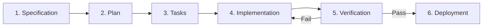
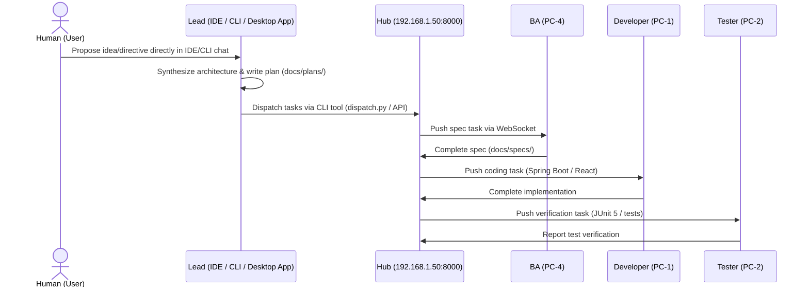

# MASTER.md — Workflow Orchestration

> **How work flows through the multi-agent system.** See [CONSTITUTION.md](CONSTITUTION.md) for rules.

## Development Workflow



| Phase | Owner | Input | Output |
|-------|-------|-------|--------|
| Specification | BA | Requirements / epic | Spec doc ([template](docs/ai/templates/SPEC.md)) |
| Plan | Lead | Approved spec | Plan doc ([template](docs/ai/templates/PLAN.md)) |
| Tasks | Lead | Plan | Task entries ([template](docs/ai/templates/TASKS.md)) |
| Implementation | Developer | Assigned task | Code + tests on feature branch |
| Verification | Tester | PR + spec | Test results, approval or defect report |
| Deployment | Lead | Approved PR | Merge to main, deploy |

## Task Flow Between Agents



### Lead Initiation via IDE / CLI (No Dashboard Required)

The Human User can initiate and steer any feature or project directly from the IDE/CLI on any machine designated as Lead (e.g. PC-3):
1. **Interactive Chat in IDE**: Discuss architecture and requirements with the Lead AI assistant.
2. **Plan Generation**: Lead writes the breakdown into `docs/plans/` using the [PLAN template](docs/ai/templates/PLAN.md).
3. **Instant CLI Dispatch**:
   ```bash
   # Dispatch a single task to BA, Dev, or Tester
   python agentforge/agent/dispatch.py --role ba --title "Viết spec..." --desc "..."

   # Or parse and dispatch all tasks in a Markdown plan file
   python agentforge/agent/dispatch.py --plan docs/plans/PLAN-002.md

   # Check cluster status
   python agentforge/agent/dispatch.py --status
   ```
4. **Autonomous Team Execution**: Connected daemons on PC-1, PC-2, PC-4 immediately receive tasks over WebSocket and execute concurrently.

## Task State Machine

```
pending → assigned → in_progress → review → done
                         ↓            ↓
                      blocked       failed → in_progress (rework)
```

| State | Meaning | Who transitions |
|-------|---------|----------------|
| `pending` | Created, not yet assigned | Lead creates |
| `assigned` | Assigned to agent, not started | Lead assigns |
| `in_progress` | Agent actively working | Assignee starts |
| `blocked` | Cannot proceed, dependency or question | Assignee flags |
| `review` | Implementation done, awaiting verification | Assignee submits |
| `done` | Verified and merged | Lead after Tester approval |
| `failed` | Verification failed, needs rework | Tester rejects |

## Handling Blockers & Rework

- **Blocked**: Agent sets status to `blocked` with reason. Lead must unblock or reassign.
- **Failed**: Tester logs specific failures. Task returns to `in_progress` with defect details.
- **Rework limit**: If a task fails 3 times, escalate to Lead for redesign.

## Communication via Hub

All agents connect to the Hub via **WebSocket** (see [DECISIONS.md — D001](docs/ai/DECISIONS.md)).

```json
{
  "jsonrpc": "2.0",
  "method": "task.update",
  "params": {
    "task_id": "T001",
    "status": "in_progress",
    "agent_role": "developer",
    "message": "Starting implementation of auth module"
  },
  "id": 1
}
```

- Hub broadcasts state changes to all connected agents
- Hub persists all messages to PostgreSQL for audit
- Agents poll [CURRENT_STATE.md](docs/ai/CURRENT_STATE.md) when Hub is offline

## Sprint Structure

- **Sprint length**: 1 week
- **Sprint planning**: Lead creates plan from backlog, assigns tasks
- **Daily sync**: Agents report status via Hub (or SESSION.md if async)
- **Sprint review**: Lead summarizes completed work, updates CURRENT_STATE.md
- **Backlog**: Maintained in TASKS.md files per epic

## New Project Initiation Workflow

When a human user initiates a brand-new project idea via the Web Dashboard:
1. **Reset Context**: Lead executes the Reset Protocol in [CONSTITUTION.md](CONSTITUTION.md) (archives previous project files, refreshes `PROJECT.md` & `CURRENT_STATE.md`).
2. **Context Ingestion**: Lead reads user directives and `docs/ai/PROJECT.md` to establish architectural boundaries.
3. **Decompose & Plan**: Lead generates initial Sprint 1 tasks using [PLAN template](docs/ai/templates/PLAN.md).
4. **Delegate to BA**: Lead creates the first task on the Hub assigning the BA Agent to formulate detailed functional specifications ([SPEC template](docs/ai/templates/SPEC.md)).
5. **Execution Loop**: The development squad proceeds through the standard lifecycle (Spec → Plan → Code → Test → Deploy).
