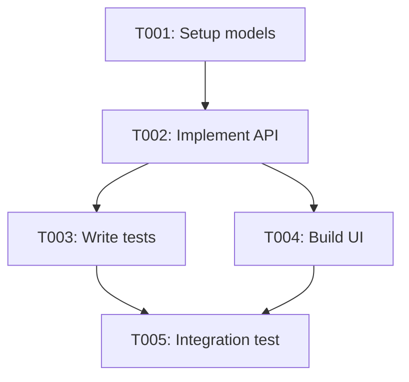

# PLAN.md — Implementation Plan Template (Lead Agent)

> **Instructions**: Create one plan per epic/feature. Link to the approved spec. Decompose into tasks.

## Plan: [Epic/Feature Name]

| Field | Value |
|-------|-------|
| Plan ID | PLAN-XXX |
| Spec | [SPEC-XXX](../specs/SPEC-XXX.md) |
| Author | Lead Agent |
| Date | YYYY-MM-DD |
| Sprint | Sprint N |
| Status | Draft / Active / Completed |

## Overview

_Brief description of what this plan delivers and why._

## Task Breakdown

| Task ID | Title | Role | Priority | Effort | Depends On | Status |
|---------|-------|------|----------|--------|------------|--------|
| T001 | [Task title] | Developer | High | 2h | — | pending |
| T002 | [Task title] | Developer | High | 3h | T001 | pending |
| T003 | [Task title] | Tester | Medium | 1h | T002 | pending |

## Dependency Graph

## Role Assignments

| Role | Tasks | Focus |
|------|-------|-------|
| BA | Pre-work | Spec review, clarify edge cases |
| Developer | T001, T002, T004 | Backend + frontend implementation |
| Tester | T003, T005 | Unit + integration testing |
| Lead | Oversight | Review PRs, unblock, merge |

## Sprint Allocation

| Sprint | Tasks | Milestone |
|--------|-------|-----------|
| Sprint N | T001, T002 | Backend complete |
| Sprint N+1 | T003, T004, T005 | Feature complete |

## Risk Mitigation

| Risk | Plan |
|------|------|
| [Risk from spec] | [Concrete mitigation step] |
| Dependency delay | Assign parallel tasks where possible |

## Notes

_Any additional context, constraints, or decisions specific to this plan._
