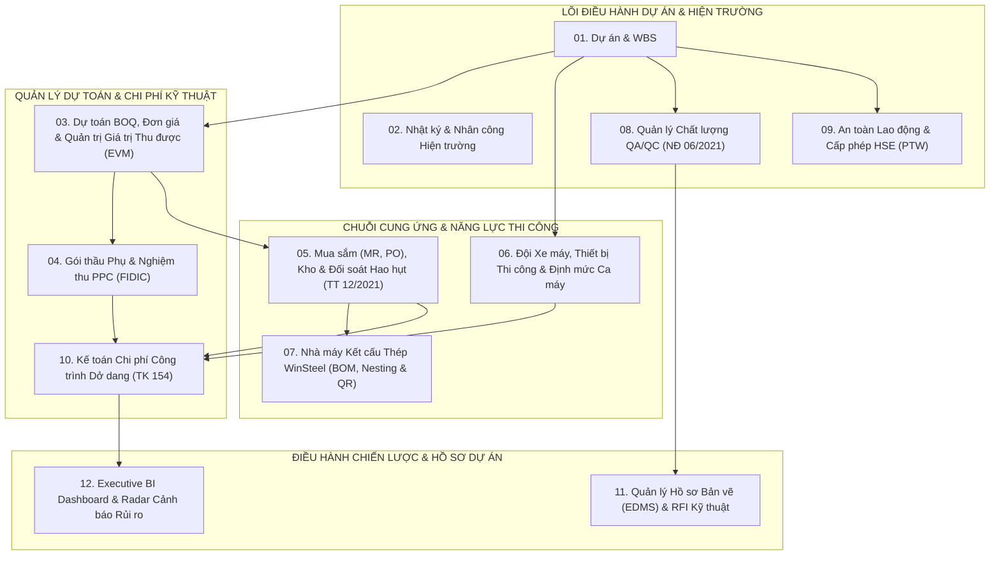

# LỘ TRÌNH KIẾN TRÚC TOÀN DIỆN HỆ THỐNG ERP ÁNH DƯƠNG BUILDING (ADB ERP 12-MODULE SUITE)

> **Lead Architect**: Lead Agent (PC-3)  
> **Áp dụng cho**: Toàn bộ Đội ngũ Kỹ thuật Tự chủ (Lead, BA, Developer, Tester, DevOps)  
> **Phiên bản**: v2.0 - Định hướng Doanh nghiệp Tổng thầu Thiết kế & Thi công (D&B EPC General Contractor)  
> **Mục tiêu**: Xây dựng nền tảng ERP chuyên biệt hóa cho ngành xây dựng công nghiệp Việt Nam, đáp ứng tiêu chuẩn FIDIC, Nghị định 06/2021/NĐ-CP, Thông tư 12/2021/TT-BXD và Thông tư 200/2014/TT-BTC.

---

## 1. Bản đồ Tổng thể 12 Phân hệ Nghiệp vụ (ERP Functional Architecture)

---

## 2. Chi tiết 12 Phân hệ & Ma trận Dữ liệu Liên thông

### Phân hệ 01: Quản lý Dự án & Cây Phân rã Công việc (WBS)
- **Mục tiêu**: Quản trị cấu trúc cây WBS 4 cấp (Dự án $\to$ Hạng mục $\to$ Gói thầu $\to$ Công tác).
- **Luồng dữ liệu**: Là trục xương sống liên kết toàn bộ dự toán BOQ, nhật ký hiện trường, và phiếu xuất kho.
- **Trạng thái**: Đã hoàn thiện Core Entity, DDL V1 và REST API.

### Phân hệ 02: Nhật ký Thi công Điện tử & Chấm công Công trường
- **Mục tiêu**: Ghi nhận thời tiết, quân số công nhân (nhân công cơ hữu vs thầu phụ), khối lượng công việc hoàn thành trong ngày, và hình ảnh hiện trường có gắn Geolocation.
- **Trạng thái**: Đã hoàn thiện Core Entity, DDL V1 và REST API.

### Phân hệ 03: Dự toán BOQ, Đơn giá Chi tiết & Phân tích EVM
- **Mục tiêu**: Bóc tách khối lượng BOQ (Bill of Quantities) theo mã hiệu định mức xây dựng Việt Nam.
- **Thuật toán EVM**:
  - $PV = \% \text{Kế hoạch} \times BAC$ (Planned Value)
  - $EV = \% \text{Nghiệm thu thực tế} \times BAC$ (Earned Value)
  - $AC = \text{Chi phí thực tế phát sinh ghi nhận từ Kho, Thầu phụ, Nhân công}$ (Actual Cost)
  - $CV = EV - AC$ (Cost Variance), $SV = EV - PV$ (Schedule Variance)
  - $CPI = \frac{EV}{AC}$, $SPI = \frac{EV}{PV}$ (Hiệu suất Chi phí & Tiến độ)
- **Trạng thái**: Đã hoàn thiện Backend JPA Entity, Service EVM, Controller và Bộ Test Suite `JobCostingEVMTest.java`.

### Phân hệ 04: Quản lý Thầu phụ, Hợp đồng Giao khoán & Nghiệm thu PPC (FIDIC)
- **Mục tiêu**: Quản lý các nhà thầu phụ (cọc, đào đất, hoàn thiện, MEP, PCCC). Áp dụng mẫu chứng chỉ thanh toán tạm tính (Payment Certificate - PPC) theo thông lệ FIDIC Red/Yellow Book:
  - Tạm ứng hợp đồng (Advance Payment) và khấu trừ hoàn trả dần theo từng đợt thanh toán (Advance Recovery).
  - Giữ lại 5% tiền bảo hành công trình (Retention Money) đến khi hết thời hạn bảo hành.
  - Khấu trừ các chi phí phạt vi phạm an toàn, chi phí mượn thiết bị máy thi công (Backcharges).
  - Áp thuế VAT 8% theo quy định hiện hành.
- **Trạng thái**: Đã hoàn thiện Flyway DDL V2, Entity, Service, Controller và Bộ Test Suite `SubcontractorServiceTest.java`.

### Phân hệ 05: Quản lý Cung ứng Vật tư, Mua sắm (PO) & Kho Công trường
- **Mục tiêu**: Quản lý vòng đời vật tư từ công trường đến nhà cung cấp:
  1. Phiếu đề nghị cấp vật tư (Material Requisition - MR) căn cứ theo tiến độ WBS.
  2. Đơn đặt hàng mua sắm (Purchase Order - PO) kiểm soát giá chào cạnh tranh và phê duyệt hạn mức.
  3. Phiếu nhập kho (Goods Receipt Note - GRN) kèm biên bản kiểm tra chất lượng vật tư đầu vào (CO/CQ).
  4. Phiếu xuất kho (Goods Issue Note - GIN) ra các tổ đội thi công.
  5. Đối soát tỷ lệ hao hụt định mức theo **Thông tư 12/2021/TT-BXD**:
     - Sắt thép xây dựng: Hao hụt thi công $\le 2.5\%$.
     - Bê tông thương phẩm: Hao hụt đổ tại chỗ $\le 1.5\%$.
     - Cát, đá, vật liệu rời: Hao hụt vận chuyển và thi công $\le 3.0\%$.
- **Trạng thái**: Đã hoàn thành SPEC-05, đang tiến hành DDL V3, Backend JPA & Test Suites.

### Phân hệ 06: Đội Xe máy, Thiết bị Thi công & Định mức Ca máy
- **Mục tiêu**: Quản lý hàng trăm đầu thiết bị chuyên dụng của Ánh Dương Building (cần cẩu tháp, máy đào, lu rung, máy san gạt, cọc ép robot, xe bồn bê tông):
  1. Quản lý hồ sơ kỹ thuật, số khung/số máy, niên hạn sử dụng và hạn kiểm định kỹ thuật an toàn.
  2. Lệnh điều động thiết bị (Mobilization / Demobilization) luân chuyển giữa các công trường.
  3. Nhật trình ca máy điện tử: Ghi nhận giờ nổ máy (engine hours), người lái máy, khối lượng ca máy phục vụ.
  4. Định mức tiêu hao dầu Diesel theo ca máy quy định tại Thông tư 12/2021/TT-BXD, tự động phát hiện gian lận hoặc hao phí nhiên liệu bất thường.
  5. Lịch bảo dưỡng định kỳ (thay dầu, lọc gió, kiểm tra thủy lực) sau mỗi 250 giờ / 500 giờ chạy máy.
- **Trạng thái**: Task TASK-014 đang được BA Agent (`ba-hant_lap`) đặc tả chi tiết trong `SPEC-06-EQUIPMENT-FLEET.md`.

### Phân hệ 07: Nhà máy Kết cấu Thép WinSteel (BOM, Nesting & QR Code)
- **Mục tiêu**: Quản lý toàn diện quy trình sản xuất cấu kiện thép tiền chế (PEB) tại nhà máy WinSteel (Bình Dương):
  1. Bóc tách danh mục cấu kiện thép (BOM - Bill of Materials: Cột H, Kèo thép, Giằng, Xà gồ mạ kẽm Z/C, Bản mã Gusset plate, Bu lông cường độ cao 8.8 / 10.9).
  2. Thuật toán tối ưu hóa cắt phôi thép tấm (1D/2D Nesting Algorithm) giảm thiểu tỷ lệ thép vụn phế liệu dưới $3.0\%$.
  3. Quản lý 5 công đoạn sản xuất tại xưởng:
     - Công đoạn 1: Cắt phôi CNC Oxy-Gas / Plasma / Laser.
     - Công đoạn 2: Gá đính tổ hợp cấu kiện.
     - Công đoạn 3: Hàn tự động dưới lớp thuốc (SAW) và hàn CO2.
     - Công đoạn 4: Bắn bi làm sạch bề mặt đạt tiêu chuẩn Thụy Điển Sa 2.5.
     - Công đoạn 5: Sơn phủ chống rỉ Epoxy và sơn chống cháy đạt tiêu chuẩn PCCC QCVN 06:2022/BXD.
  4. Gắn tem mã QR Code định danh duy nhất cho từng cấu kiện. Quét mã QR khi xuất xưởng và khi cẩu lắp dựng vào đúng vị trí tọa độ trục cột tại công trường.
- **Trạng thái**: Task TASK-017 đã lên lịch hàng đợi cho BA Agent.

### Phân hệ 08: Quản lý Chất lượng Công trình QA/QC & Hồ sơ Nghiệm thu (Nghị định 06/2021/NĐ-CP)
- **Mục tiêu**: Số hóa 100% quy trình kiểm soát chất lượng công trình:
  1. Biên bản nghiệm thu công việc xây dựng (BBNT) theo quy chuẩn Nghị định 06/2021/NĐ-CP (Nghiệm thu cốt thép móng, cốp pha dầm sàn, trắc đạc tim trục).
  2. Nhật ký lấy mẫu thí nghiệm hiện trường: Nén mẫu bê tông (R7, R14, R28), kéo nén cốt thép, siêu âm đường hàn kết cấu thép NDT (Non-Destructive Testing).
  3. Báo cáo sự không phù hợp (Non-Conformance Report - NCR) kèm ảnh hiện trường, nguyên nhân, biện pháp khắc phục và thời hạn đóng NCR.
  4. Danh sách lỗi tồn đọng trước bàn giao (Punch List) để bàn giao công trình cho Chủ đầu tư.

### Phân hệ 09: An toàn Lao động Hiện trường (HSE) & Giấy phép Làm việc Nguy cơ Cao (PTW)
- **Mục tiêu**: Đảm bảo mục tiêu "Zero Harm" trên mọi công trường của Ánh Dương Building:
  1. Hệ thống cấp phép làm việc nguy cơ cao điện tử (Permit To Work - PTW):
     - PTW Làm việc trên cao (> 2m).
     - PTW Làm việc trong không gian kín (Confined Space: hố ga, bể ngầm).
     - PTW Hàn cắt phát sinh tia lửa điện (Hot Work).
     - PTW Đào đất sâu nguy cơ sạt lở (> 1.5m).
  2. Quản lý chứng chỉ huấn luyện An toàn vệ sinh lao động (Nhóm 1, 2, 3, 4 theo Nghị định 44/2016/NĐ-CP).
  3. Biên bản ghi nhận vi phạm an toàn hiện trường (Safety Violation Ticket) kèm chế tài phạt trừ trực tiếp vào PPC thầu phụ.
  4. Báo cáo điều tra sự cố / Near-miss (sự cố suýt gây chấn thương).

### Phân hệ 10: Kế toán Chi phí Công trình Dở dang (TK 154) & Dòng tiền Dự án
- **Mục tiêu**: Chuẩn hóa hạch toán kế toán xây lắp theo Thông tư 200/2014/TT-BTC và chuẩn mực VAS 15 / IFRS 15:
  1. Tài khoản 154 (Chi phí sản xuất kinh doanh dở dang) chi tiết theo 4 yếu tố chi phí:
     - 1541: Chi phí nguyên vật liệu trực tiếp (từ Phân hệ Kho 05).
     - 1542: Chi phí nhân công trực tiếp (từ Chấm công 02).
     - 1543: Chi phí sử dụng máy thi công (từ Phân hệ Xe máy 06).
     - 1547: Chi phí sản xuất chung / Chi phí thuê ngoài (từ Thầu phụ 04).
  2. Quản lý dòng tiền thanh toán với Chủ đầu tư (Chủ đầu tư tạm ứng $\to$ Nghiệm thu đợt Milestone $\to$ Xuất hóa đơn GTGT điện tử $\to$ Quyết toán bàn giao).
  3. Báo cáo P&L (Lãi/Lỗ) theo từng công trình thời gian thực.

### Phân hệ 11: Quản lý Hồ sơ Bản vẽ Thi công (EDMS) & RFI Kỹ thuật
- **Mục tiêu**: Quản lý vòng đời hồ sơ kỹ thuật của mô hình Design & Build:
  1. Kho lưu trữ bản vẽ thiết kế kỹ thuật, bản vẽ thi công (Shopdrawing) có kiểm soát phiên bản (Revision Rev.01, Rev.02...).
  2. Quy trình gửi và phê duyệt Yêu cầu Thông tin Kỹ thuật (Request For Information - RFI) giữa Tư vấn Giám sát (TVGS), Chủ đầu tư và Ban Chỉ huy Công trường.
  3. Đệ trình phê duyệt vật liệu (Material Approval Submittal - MAS) trước khi đặt hàng PO.
  4. Bản vẽ hoàn công (As-built Drawing).

### Phân hệ 12: Executive BI Dashboard & Radar Cảnh báo Rủi ro
- **Mục tiêu**: Cung cấp bức tranh tổng thể cho Ban Giám đốc và Giám đốc Khối Dự án:
  1. Chỉ số sức khỏe dự án: Thẻ điểm tổng hợp EVM (CPI, SPI), tiến độ tài chính so với tiến độ vật lý.
  2. Radar cảnh báo sớm rủi ro (Risk Radar):
     - Rủi ro vượt ngân sách vật tư (Actual vs Norm).
     - Rủi ro nợ đọng thầu phụ / trễ tiến độ thanh toán của Chủ đầu tư.
     - Cảnh báo thiết bị quá hạn kiểm định an toàn hoặc chưa bảo dưỡng.
     - Dự báo thời tiết cực đoan (mưa bão khu vực Bình Dương, Long An) gây gián đoạn thi công.

---

## 3. Lịch trình Phân công Dây chuyền Song song Tự chủ (Concurrent Squad Schedule)

| Đợt Triển khai | Phân hệ Trọng tâm | Vai trò BA Agent | Vai trò Developer Agent | Vai trò Tester Agent |
|---|---|---|---|---|
| **Đợt 3 (Hiện tại)** | **Module 05 & 06** | Soạn thảo `SPEC-06-EQUIPMENT-FLEET.md` | Lập trình Backend Spring Boot & DDL V3 cho `Module 05: Inventory & PO` | Viết bộ JUnit 5 `MaterialNormReconciliationTest` |
| **Đợt 4 (Tiếp theo)** | **Module 06 & 07** | Soạn thảo `SPEC-07-WINSTEEL-FACTORY.md` | Lập trình Backend Spring Boot cho `Module 06: Equipment Fleet & Diesel` | Viết bộ JUnit 5 kiểm thử định mức ca máy & nhiên liệu dầu |
| **Đợt 5** | **Module 07 & 08** | Soạn thảo `SPEC-08-QAQC-INSPECTION.md` | Lập trình Backend cho `Module 07: WinSteel BOM & Nesting` | Viết bộ Unit Test kiểm tra thuật toán Nesting phế liệu < 3% |
| **Đợt 6** | **Module 08 & 09** | Soạn thảo `SPEC-09-HSE-SAFETY-PTW.md` | Lập trình Backend cho `Module 08: QA/QC BBNT & NDT Lab` | Viết bộ Integration Test luồng nghiệm thu BBNT theo NĐ 06 |

---
*Tài liệu được khởi tạo và cập nhật bởi Lead Architect theo nguyên tắc tự chủ liên tục của AgentForge.*
