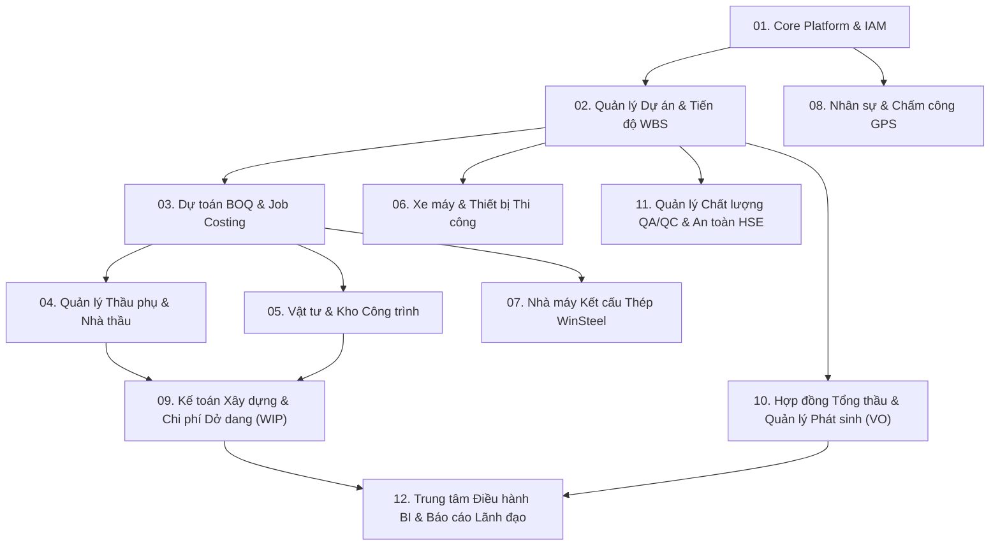

# MASTER_ROADMAP.md — Lộ trình Phát triển Tự chủ Toàn diện ERP Ánh Dương Building

> **Tài liệu Định hướng Cốt lõi cho Toàn bộ Đội ngũ AI Multi-Agent (Lead, BA, Dev, Tester)**  
> **Chế độ Vận hành**: Vòng lặp Tiến hóa Tự chủ (Continuous Autonomous Evolution Loop)  
> **Công nghệ**: Backend Java 21 + Spring Boot 3.x, Frontend React 18 + TypeScript, Database PostgreSQL (Server `192.168.1.50:5432`)  
> **Repository Sản phẩm**: `https://github.com/HanHuuTrung22130302/Erp-ADB-Building.git`  
> **Repository Nền tảng Điều phối**: `https://github.com/HanHuuTrung22130302/Agent-chat-team-4-local.git`

---

## 1. Tầm nhìn & Tiêu chuẩn Nghiệp vụ

Ánh Dương Building (ADB) là Tổng thầu Thiết kế & Thi công (Design & Build - D&B) có chứng chỉ năng lực hoạt động xây dựng Hạng I, chuyên sâu nhà xưởng công nghiệp, trung tâm logistics và nhà máy kết cấu thép (WinSteel).

Hệ thống ERP của Ánh Dương Building không phải là một ứng dụng CRUD đơn thuần, mà là giải pháp chuyển đổi số toàn diện quy trình xây lắp, tuân thủ nghiêm ngặt các quy định pháp luật và thông lệ quốc tế:
1. **Nghị định 10/2021/NĐ-CP** và **Thông tư 12/2021/TT-BXD** về quản lý chi phí đầu tư xây dựng và định mức dự toán xây dựng.
2. **Nghị định 06/2021/NĐ-CP** về quản lý chất lượng, thi công xây dựng và bảo trì công trình xây dựng.
3. **Tiêu chuẩn hợp đồng FIDIC** (Red Book, Yellow Book, Silver Book) áp dụng cho Hợp đồng Tổng thầu và Hợp đồng Thầu phụ.
4. **Chuẩn mực Kế toán Xây dựng** (Thông tư 200/2014/TT-BTC, VAS 15 / IFRS 15 về ghi nhận doanh thu và chi phí dở dang TK 154 theo tiến độ).
5. **Công nghệ Giám sát Hiện trường**: Chấm công GPS công trường, Nhật ký thi công điện tử, Quản lý hao hụt vật tư thực tế so với định mức WBS.

---

## 2. Bản đồ 12 Phân hệ Nghiệp vụ (Autonomous Module Matrix)

---

## 3. Chi tiết Phân hệ & Kế hoạch Thực thi Tuần tự

### Phân hệ 01: Core IAM & Multi-Project Tenancy
- **Mục tiêu**: Quản trị tài khoản, phân quyền RBAC đa cấp (Ban Giám đốc, Chỉ huy trưởng, Kỹ sư QS, Kế toán trưởng, Thầu phụ, Tư vấn giám sát).
- **Entities**: `User`, `Role`, `Permission`, `ProjectAssignment`, `AuditLog`.
- **APIs**: `/api/v1/auth/login`, `/api/v1/auth/refresh`, `/api/v1/users`, `/api/v1/roles`, `/api/v1/audit-logs`.
- **UI Components**: Login screen, User Management, Role & Permission Matrix, Session Monitor.

### Phân hệ 02: Quản lý Dự án, Tiến độ WBS & Nhật ký Công trường
- **Mục tiêu**: Quản lý vòng đời dự án, phân rã công việc WBS 4 cấp độ, sơ đồ Gantt tiến độ thời gian thực (Critical Path Method), nhật ký công trường điện tử đính kèm ảnh và thời tiết.
- **Entities**: `Project`, `WBSItem`, `ProjectMilestone`, `DailySiteDiary`, `SiteInspectionRecord`.
- **APIs**: `/api/v1/projects`, `/api/v1/projects/{id}/wbs`, `/api/v1/projects/{id}/gantt`, `/api/v1/site-diaries`.
- **UI Components**: Project Portfolio Dashboard, Interactive Gantt Chart, Daily Diary Editor with Weather & Photo Upload.

### Phân hệ 03: Dự toán BOQ, Đơn giá Định mức & Kiểm soát Chi phí (Job Costing)
- **Mục tiêu**: Bóc tách khối lượng BOQ (Bill of Quantities), tra cứu đơn giá định mức Thông tư 12/2021/TT-BXD, quản lý chi phí mục tiêu (Target Cost) vs Chi phí cam kết (Committed Cost) vs Chi phí thực tế (Actual Cost), phân tích EVM (CPI, SPI).
- **Entities**: `BOQHeader`, `BOQItem`, `CostNorm`, `UnitRate`, `JobCostSummary`, `CostVarianceAnalysis`.
- **APIs**: `/api/v1/boq`, `/api/v1/boq/import-excel`, `/api/v1/cost-norms`, `/api/v1/job-costing/{projectId}`.
- **UI Components**: BOQ Spreadsheet Grid, Excel Importer/Exporter, Real-time EVM Variance Charts.

### Phân hệ 04: Quản lý Thầu phụ, Hợp đồng Giao khoán & Nghiệm thu Thanh toán (PPC)
- **Mục tiêu**: Hồ sơ năng lực thầu phụ, đấu thầu nội bộ chọn thầu phụ, quản lý hợp đồng giao khoán, lập chứng chỉ thanh toán khối lượng hoàn thành (Progress Payment Certificate - PPC), quản lý tạm ứng, bảo hành và khấu trừ (Backcharges).
- **Entities**: `Subcontractor`, `Subcontract`, `SubcontractWorkOrder`, `PaymentCertificate`, `Backcharge`.
- **APIs**: `/api/v1/subcontractors`, `/api/v1/subcontracts`, `/api/v1/payment-certificates`.
- **UI Components**: Subcontractor Directory, Contract Milestone Tracker, Digital PPC Approval Workflow.

### Phân hệ 05: Quản lý Cung ứng Vật tư, Mua sắm & Tồn kho Công trường
- **Mục tiêu**: Phiếu đề nghị cấp vật tư theo tiến độ WBS (Material Requisition), đơn đặt hàng PO (Purchase Order), phiếu nhập kho công trình (GRN), phiếu xuất vật tư ra công trường (GIN), đối soát định mức tiêu hao vật tư tránh thất thoát cát, đá, xi măng, sắt thép.
- **Entities**: `Material`, `MaterialRequisition`, `PurchaseOrder`, `GoodsReceiptNote`, `GoodsIssueNote`, `StockBalance`.
- **APIs**: `/api/v1/materials`, `/api/v1/requisitions`, `/api/v1/purchase-orders`, `/api/v1/inventory/warehouse-stock`.
- **UI Components**: Material Catalog, Purchase Order Processing, Site Warehouse Stock Grid.

### Phân hệ 06: Quản lý Xe máy, Thiết bị Thi công & Bảo dưỡng
- **Mục tiêu**: Hồ sơ danh mục thiết bị (Cần cẩu tháp, máy xúc, giàn giáo, cốp pha), lệnh điều động thiết bị ra vào công trường, nhật trình ca máy (giờ chạy, tiêu thụ dầu diesel), lịch bảo dưỡng định kỳ và trích khấu hao.
- **Entities**: `Equipment`, `EquipmentMobilization`, `DailyMachineLog`, `MaintenanceRecord`.
- **APIs**: `/api/v1/equipment`, `/api/v1/equipment/mobilize`, `/api/v1/equipment/machinery-logs`.
- **UI Components**: Fleet Tracker Map, Machinery Logbook Entry, Preventive Maintenance Calendar.

### Phân hệ 07: Nhà máy Kết cấu Thép WinSteel (Sản xuất & Lắp dựng)
- **Mục tiêu**: Bóc tách chi tiết cấu kiện thép (BOM), tối ưu hóa cắt phôi (Nesting), lệnh sản xuất gia công qua các khâu (Pha cắt, gá đính, hàn tự động, bắn cát, sơn), dán mã QR/Barcode cấu kiện, theo dõi vận chuyển và lắp dựng tại công trường.
- **Entities**: `SteelProject`, `SteelComponent`, `ProductionOrder`, `NestingPlan`, `ErectionLog`.
- **APIs**: `/api/v1/winsteel/components`, `/api/v1/winsteel/production-orders`, `/api/v1/winsteel/erection-status`.
- **UI Components**: Steel Member 3D/2D Visualizer, Factory Production Line Kanban, QR Scanner Module.

### Phân hệ 08: Nhân sự, Chấm công Định vị GPS & Tính lương Công trường
- **Mục tiêu**: Quản lý lao động trực tiếp và lao động thầu phụ, điểm danh công nhân qua GPS trên thiết bị di động tại tọa độ công trường, quản lý chứng chỉ ATLĐ, hợp đồng mùa vụ, tính lương công nhân và kỹ sư theo Luật Lao động Việt Nam.
- **Entities**: `Employee`, `WorkerProfile`, `GPSAttendanceRecord`, `SafetyCard`, `PayrollPeriod`, `Payslip`.
- **APIs**: `/api/v1/employees`, `/api/v1/attendance/gps-checkin`, `/api/v1/payroll/calculate`.
- **UI Components**: Geofence Setup Screen, Daily Attendance Timeline, Automated Payroll Table.

### Phân hệ 09: Kế toán Xây dựng & Chi phí Dở dang (WIP - TK 154)
- **Mục tiêu**: Hệ thống tài khoản Thông tư 200/2014/TT-BTC, tập hợp chi phí 621 (NVL trực tiếp), 622 (Nhân công trực tiếp), 623 (Máy thi công), 627 (Chi phí chung) vào TK 154 theo từng công trình; kết chuyển giá vốn 632 và ghi nhận doanh thu theo chuẩn mực VAS 15 / IFRS 15.
- **Entities**: `GeneralLedgerAccount`, `JournalEntry`, `WIPCostCenter`, `ProjectFinancialSummary`, `InvoiceARAP`.
- **APIs**: `/api/v1/accounting/chart-of-accounts`, `/api/v1/accounting/journal-entries`, `/api/v1/accounting/wip-summary`.
- **UI Components**: General Ledger View, Project WIP Cost Breakdown Dashboard, Balance Sheet & P&L.

### Phân hệ 10: Hợp đồng Chủ đầu tư, Quản lý Phát sinh (VO) & Bảo lãnh Ngân hàng
- **Mục tiêu**: Hợp đồng chính với Chủ đầu tư (FIDIC D&B Contract), hồ sơ phát sinh khối lượng và đơn giá (Variation Order - VO), quản lý bảo lãnh ngân hàng (Tạm ứng, Bảo lãnh thực hiện hợp đồng, Bảo lãnh bảo hành).
- **Entities**: `MainContract`, `VariationOrder`, `BankGuarantee`, `MilestoneClaim`.
- **APIs**: `/api/v1/contracts/main-contract`, `/api/v1/contracts/variation-orders`, `/api/v1/contracts/guarantees`.
- **UI Components**: Main Contract Executive View, Variation Order Approval Board, Bank Guarantee Expiry Monitor.

### Phân hệ 11: Quản lý Chất lượng QA/QC, Nghiệm thu & An toàn HSE
- **Mục tiêu**: Phiếu kiểm tra an toàn đầu ngày (Tool Box Meeting), báo cáo sự cố an toàn lao động và biện pháp khắc phục (CAPA), biên bản kiểm tra thí nghiệm mẫu vật liệu (nén bê tông, kéo thép), phiếu không phù hợp (NCR).
- **Entities**: `SafetyChecklist`, `IncidentReport`, `MaterialTestReport`, `NonConformanceReport`.
- **APIs**: `/api/v1/safety/checklists`, `/api/v1/safety/incidents`, `/api/v1/qaqc/material-tests`, `/api/v1/qaqc/ncr`.
- **UI Components**: HSE Incident Heatmap, QA/QC Compliance Inspection Form, Test Certificate Archive.

### Phân hệ 12: Trung tâm Báo cáo Điều hành (Executive BI Cockpit)
- **Mục tiêu**: Bảng điều khiển tài chính và tiến độ tổng thể dành cho Tổng Giám đốc và Hội đồng Quản trị. Dự báo dòng tiền (Cash flow forecasting), tỷ suất lợi nhuận gộp từng công trình, cảnh báo rủi ro trễ hạn hoặc vượt dự toán.
- **Entities**: `ExecutiveKPI`, `CashFlowForecast`, `ProjectHealthScorecard`.
- **APIs**: `/api/v1/bi/executive-summary`, `/api/v1/bi/cash-flow-forecast`, `/api/v1/bi/cross-project-risks`.
- **UI Components**: Real-time KPI Widgets, Multi-project Cashflow Trajectory, Interactive Risk Heatmap.

---

## 4. Cơ chế Vòng lặp Tiến hóa Tự chủ (Continuous Autonomous Loop)

Đội ngũ AI đa tác nhân hoạt động tuần hoàn liên tục theo chu trình:
1. **Lead Agent**: Đọc Roadmap, rà soát mức độ hoàn thiện của từng phân hệ, tạo Task đặc tả chi tiết và giao cho BA.
2. **BA Agent**: Viết đặc tả nghiệp vụ chi tiết, bảng cơ sở dữ liệu (PostgreSQL) và bộ API REST (OpenAPI Schema) lưu vào `docs/specs/SPEC-<module>.md`.
3. **Developer Agent**: Viết mã nguồn Spring Boot 3 (Entity, Repository, Service, Controller, DTO, Security) và React 18 (Components, Pages, API Client, State) vào repo `Erp-ADB-Building.git`.
4. **Tester Agent**: Viết bộ kiểm thử tự động JUnit 5 cho Backend và kiểm thử tích hợp giao diện, ghi nhận kết quả và báo cáo xác minh.
5. **Lead Agent Review & Tiến hóa tiếp**: Tự động nghiệm thu, merge code, cập nhật trạng thái và chuyển sang phân hệ/tính năng tiếp theo cho đến khi toàn bộ 12 phân hệ đạt độ hoàn thiện thực tế cấp doanh nghiệp Hạng I.
