# PLAN-002: Kế hoạch Mở rộng Toàn diện Hệ sinh thái ERP Ánh Dương Building (Phân hệ 05 → 12)

> **Lead Architect**: Lead Agent (PC-3)  
> **Áp dụng cho**: Toàn bộ Đội ngũ Kỹ thuật Tự chủ (BA, Dev, Tester, DevOps)  
> **Mục tiêu**: Vận hành dây chuyền sản xuất phần mềm liên tục (Continuous Software Pipeline), không để bất kỳ Agent nào nhàn rỗi. Lead định hướng kiến trúc, BA đặc tả quy chuẩn pháp lý và kỹ thuật, Developer lập trình module, Tester tự động hóa kiểm thử hồi quy.

---

## 1. Bản đồ Phân công Dây chuyền Song song (Concurrent Pipeline Matrix)

```mermaid
flowchart TD
    subgraph S1["Nhánh 1: Cung ứng & Quản lý Kho Công trường"]
        T11["SPEC-05: Vật tư & Kho (BA) ✅"] --> T14["Backend Inventory & DDL V3 (Dev)"]
        T14 --> T15["JUnit 5 Đối soát Định mức TT12 (Tester)"]
    end

    subgraph S2["Nhánh 2: Xe máy & Thiết bị Thi công"]
        T16["SPEC-06: Đội Xe máy & Nhật trình Ca máy (BA)"] --> T17["Backend Equipment Fleet (Dev)"]
        T17 --> T18["Test Ca máy & Định mức Dầu (Tester)"]
    end

    subgraph S3["Nhánh 3: Nhà máy Kết cấu Thép WinSteel"]
        T19["SPEC-07: BOM, Nesting & QR Code (BA)"] --> T20["Backend WinSteel Manufacturing (Dev)"]
        T20 --> T21["Test Tối ưu Cắt Phôi & QR Lắp dựng (Tester)"]
    end

    subgraph S4["Nhánh 4: Nhân sự, Chấm công GPS & Lương Công trường"]
        T22["SPEC-08: Geofence GPS & Thẻ An toàn (BA)"] --> T23["Backend GPS Attendance & Payroll (Dev)"]
        T23 --> T24["Test Tính lương 3P & Chấm công (Tester)"]
    end

    subgraph S5["Nhánh 5: Kế toán Chi phí Dở dang Công trình (TK 154)"]
        T25["SPEC-09: TT 200/2014 & VAS 15 / IFRS 15 (BA)"] --> T26["Backend WIP Accounting (Dev)"]
        T26 --> T27["Test Kết chuyển Giá vốn 632 (Tester)"]
    end
```

---

## 2. Chi tiết Nghiệp vụ & Phương hướng Mở rộng cho BA Agent

### Module 06: Xe máy, Thiết bị Thi công & Bảo dưỡng Kỹ thuật
- **Thực tế hiện trường**: ADB sở hữu và thuê ngoài hàng trăm đầu máy: Cần cẩu tháp, máy đào, lu rung, máy ủi, cọc ép thủy lực, trạm biến áp tạm, giàn giáo nhôm định hình.
- **Yêu cầu BA đặc tả (`SPEC-06-EQUIPMENT-FLEET.md`)**:
  1. Hồ sơ kỹ thuật máy thi công, chứng chỉ kiểm định an toàn còn hạn.
  2. Lệnh điều động thiết bị ra/vào công trình (Mobilization / Demobilization Order).
  3. Nhật trình ca máy điện tử: Số giờ chạy (engine hours), thợ vận hành, nhiên liệu dầu diesel tiêu hao thực tế so với định mức ca máy theo **Thông tư 12/2021/TT-BXD**.
  4. Lịch bảo dưỡng định kỳ và nhật ký sửa chữa hỏng hóc.

### Module 07: Nhà máy Kết cấu Thép WinSteel (Sản xuất & Lắp dựng D&B)
- **Thực tế hiện trường**: Nhà máy WinSteel tại Bình Dương gia công cấu kiện thép tiền chế (Pre-Engineered Building - PEB) cho các nhà xưởng 50.000m2 - 100.000m2.
- **Yêu cầu BA đặc tả (`SPEC-07-WINSTEEL-FACTORY.md`)**:
  1. Bóc tách chi tiết danh mục cấu kiện thép (BOM - Bill of Materials: Cột, kèo, giằng, xà gồ Z/C, bản mã, bu lông neo).
  2. Kế hoạch tối ưu hóa cắt phôi thép tấm (Nesting Plan) giảm tỷ lệ đầu mẩu phế liệu dưới 3%.
  3. Lệnh sản xuất 5 công đoạn: Pha cắt CNC $\to$ Gá đính $\to$ Hàn tự động SAW $\to$ Bắn bi cát làm sạch bề mặt đạt Sa 2.5 $\to$ Sơn epoxy chống rỉ.
  4. Dán mã QR Code lên từng thanh cấu kiện; Quét QR khi xuất xưởng và quét QR khi cẩu lắp dựng thành công tại công trường.

### Module 08: Nhân sự, Chấm công GPS & An toàn Lao động (HSE)
- **Thực tế hiện trường**: Mỗi công trình có hàng trăm công nhân cơ hữu và thầu phụ ra vào hàng ngày. Cần điểm danh chính xác tại tọa độ GPS công trường, tránh tình trạng điểm danh hộ.
- **Yêu cầu BA đặc tả (`SPEC-08-WORKFORCE-GPS.md`)**:
  1. Thiết lập bán kính hàng rào địa lý (Geofencing, bán kính 100m-300m quanh tim công trình).
  2. Điểm danh công nhân bằng GPS trên ứng dụng di động; Nhận diện khuôn mặt hoặc thẻ công nhân.
  3. Quản lý hồ sơ thẻ an toàn lao động nhóm 3 (thợ hàn, thợ điện, làm việc trên cao).
  4. Bảng chấm công tự động và tính lương công nhân theo ngày công / khoán khối lượng.

---

## 3. Phân rã Đợt Nhiệm vụ (Immediate Concurrent Batch)

| Task ID | Vai trò | Tên Nhiệm vụ | Trọng tâm Triển khai |
|---|---|---|---|
| **TASK-014** | **BA** | Đặc tả Module 06: Xe máy, Thiết bị Thi công & Định mức Ca máy | File `docs/specs/SPEC-06-EQUIPMENT-FLEET.md` |
| **TASK-015** | **Developer** | Hiện thực hóa DDL V3 & Backend REST API cho Phân hệ Quản lý Vật tư & Kho Công trường | Package `com.anhduongbuilding.erp.inventory`, Migration `V3__inventory_and_procurement.sql` |
| **TASK-016** | **Tester** | Xây dựng Bộ Kiểm thử Tự động JUnit 5 cho Định mức Hao hụt Vật tư TT 12/2021 | Class `MaterialNormReconciliationTest.java` |
| **TASK-017** | **BA** | Đặc tả Module 07: Nhà máy Kết cấu Thép WinSteel (BOM, Nesting & QR Lắp dựng) | File `docs/specs/SPEC-07-WINSTEEL-FACTORY.md` |
