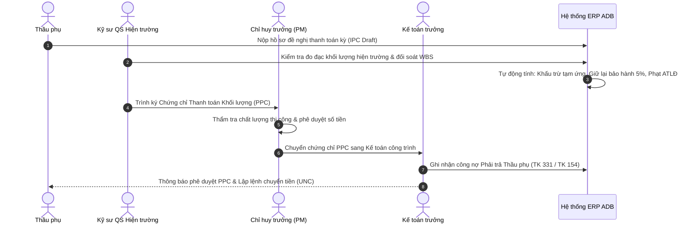

# SPEC-04: Phân hệ Quản lý Thầu phụ, Hợp đồng Giao khoán & Nghiệm thu Thanh toán (PPC) theo FIDIC

> **Phiên bản**: 1.0.0  
> **Tác giả**: BA Agent / Lead Architect  
> **Áp dụng cho**: Developer Agent, Tester Agent  
> **Chuẩn mực tham chiếu**: Chuẩn Hợp đồng FIDIC Subcontract (Điều kiện Hợp đồng Giao khoán), Thông tư 02/2023/TT-BXD về quản lý hợp đồng xây dựng, Thông tư 12/2021/TT-BXD.

---

## 1. Tổng quan Nghiệp vụ

Trong mô hình Tổng thầu Thiết kế & Thi công (Design & Build - D&B) của **Ánh Dương Building (ADB)**, thầu phụ (Subcontractor) thực hiện từ 50% đến 70% khối lượng thi công chuyên biệt (cọc móng, kết cấu thép, cơ điện M&E, sơn bả, nhôm kính).

Hệ thống quản lý thầu phụ giải quyết 4 bài toán sống còn:
1. **Minh bạch hóa lựa chọn thầu phụ**: Đánh giá năng lực tài chính, máy móc, an toàn lao động (ATLĐ) và xếp hạng tín nhiệm nội bộ (Grade A/B/C).
2. **Hợp đồng giao khoán chuẩn FIDIC**: Quy định rõ phạm vi công việc gắn với mã WBS, đơn giá cố định/điều chỉnh, điều khoản bảo lãnh thực hiện hợp đồng (Performance Security 10%), tạm ứng và hoàn tạm ứng.
3. **Chứng chỉ Thanh toán Khối lượng Hoàn thành (Progress Payment Certificate - PPC)**:
   - Nghiệm thu khối lượng thực tế tại hiện trường theo chu kỳ hàng tháng hoặc mốc WBS.
   - Công thức tính toán nghiêm ngặt:
     $$\text{Net Payable} = \text{Gross Value} - \text{Advance Deduction} - \text{Retention (5\%)} - \text{Backcharges}$$
4. **Kiểm soát thất thoát (Backcharge Control)**: Tự động cấn trừ các chi phí do ADB cấp bù cho thầu phụ (điện nước công trường, sửa chữa hỏng hóc, phạt vi phạm an toàn lao động HSE).

---

## 2. Luồng Quy trình Nghiệp vụ (Business Process Flow)

---

## 3. Mô hình Thực thể Dữ liệu (PostgreSQL Schema: `subcontractor_mgmt`)

### 3.1. Bảng `subcontractors` (Hồ sơ Nhà thầu phụ)
- `id` (UUID, PK)
- `code` (VARCHAR(30), UNIQUE) — Mã thầu phụ (ví dụ: `SUB-STEEL-001`)
- `name` (VARCHAR(255), NOT NULL) — Tên công ty thầu phụ
- `tax_code` (VARCHAR(30), NOT NULL, UNIQUE) — Mã số thuế
- `representative` (VARCHAR(100)) — Người đại diện pháp luật
- `phone` (VARCHAR(30))
- `email` (VARCHAR(100))
- `specialty` (VARCHAR(100)) — Chuyên môn (Kết cấu thép, M&E, Cọc khoan nhồi, Xây tô)
- `rating_grade` (VARCHAR(5)) — Hạng tín nhiệm: `A`, `B`, `C`, `BLACKLISTED`
- `status` (VARCHAR(20)) — `ACTIVE`, `INACTIVE`, `SUSPENDED`
- `created_at` (TIMESTAMP), `updated_at` (TIMESTAMP)

### 3.2. Bảng `subcontracts` (Hợp đồng Giao khoán)
- `id` (UUID, PK)
- `contract_number` (VARCHAR(50), UNIQUE) — Số hợp đồng (ví dụ: `HĐGK-ADB-2026/04-ST`)
- `project_id` (UUID, NOT NULL) — FK liên kết bảng `projects`
- `subcontractor_id` (UUID, NOT NULL) — FK liên kết bảng `subcontractors`
- `title` (VARCHAR(255), NOT NULL) — Tên gói thầu giao khoán
- `contract_type` (VARCHAR(30)) — `LUMP_SUM` (Trọn gói), `UNIT_PRICE` (Đơn giá cố định), `COST_PLUS`
- `total_value` (NUMERIC(18, 2), NOT NULL) — Giá trị hợp đồng (VND)
- `advance_payment_rate` (NUMERIC(5, 2)) — Tỷ lệ tạm ứng hợp đồng (ví dụ: 15.00%)
- `advance_payment_amount` (NUMERIC(18, 2)) — Số tiền đã tạm ứng
- `retention_rate` (NUMERIC(5, 2)) — Tỷ lệ giữ lại bảo hành (Mặc định: 5.00%)
- `retention_amount_accumulated` (NUMERIC(18, 2)) — Tổng tiền bảo hành lũy kế đang giữ
- `start_date` (DATE), `end_date` (DATE)
- `status` (VARCHAR(30)) — `DRAFT`, `APPROVED`, `EXECUTING`, `COMPLETED`, `TERMINATED`
- `created_at` (TIMESTAMP)

### 3.3. Bảng `subcontract_items` (Hạng mục Công việc BOQ Giao khoán)
- `id` (UUID, PK)
- `subcontract_id` (UUID, NOT NULL) — FK liên kết bảng `subcontracts`
- `wbs_item_id` (UUID) — FK liên kết `wbs_items`
- `item_code` (VARCHAR(50)) — Mã hạng mục
- `description` (TEXT, NOT NULL) — Diễn giải công việc
- `unit` (VARCHAR(20), NOT NULL) — Đơn vị tính (m3, m2, tấn, md)
- `contract_quantity` (NUMERIC(14, 3), NOT NULL) — Khối lượng theo hợp đồng
- `unit_price` (NUMERIC(18, 2), NOT NULL) — Đơn giá giao khoán (VND)
- `total_amount` (NUMERIC(18, 2), NOT NULL) — Thành tiền

### 3.4. Bảng `payment_certificates` (Chứng chỉ Thanh toán Khối lượng PPC)
- `id` (UUID, PK)
- `certificate_number` (VARCHAR(50), UNIQUE) — Số chứng chỉ (ví dụ: `PPC-2026-001/ADB`)
- `subcontract_id` (UUID, NOT NULL) — FK liên kết bảng `subcontracts`
- `period_number` (INT, NOT NULL) — Kỳ thanh toán thứ n (Kỳ 01, Kỳ 02...)
- `billing_start_date` (DATE, NOT NULL)
- `billing_end_date` (DATE, NOT NULL)
- `gross_amount` (NUMERIC(18, 2), NOT NULL) — Tổng giá trị nghiệm thu kỳ này
- `cumulative_gross_amount` (NUMERIC(18, 2), NOT NULL) — Giá trị nghiệm thu lũy kế đến kỳ này
- `advance_deduction` (NUMERIC(18, 2), NOT NULL) — Khấu trừ hoàn trả tạm ứng kỳ này
- `retention_deduction` (NUMERIC(18, 2), NOT NULL) — Giữ lại bảo hành kỳ này (5% gross)
- `backcharges_deduction` (NUMERIC(18, 2), DEFAULT 0) — Khấu trừ vi phạm / cấp bù vật tư
- `tax_amount` (NUMERIC(18, 2), DEFAULT 0) — Thuế VAT (8% hoặc 10%)
- `net_payable_amount` (NUMERIC(18, 2), NOT NULL) — Số tiền thực chi thanh toán cho thầu phụ
- `qs_engineer_id` (UUID) — Kỹ sư QS lập hồ sơ
- `site_manager_id` (UUID) — Chỉ huy trưởng ký duyệt
- `status` (VARCHAR(30)) — `DRAFT`, `SUBMITTED`, `VERIFIED_QS`, `APPROVED_PM`, `PAID`
- `approved_at` (TIMESTAMP)

### 3.5. Bảng `ppc_details` (Chi tiết Nghiệm thu Từng Hạng mục)
- `id` (UUID, PK)
- `payment_certificate_id` (UUID, NOT NULL) — FK `payment_certificates`
- `subcontract_item_id` (UUID, NOT NULL) — FK `subcontract_items`
- `previous_quantity` (NUMERIC(14, 3), DEFAULT 0) — Khối lượng lũy kế kỳ trước
- `current_quantity` (NUMERIC(14, 3), NOT NULL) — Khối lượng nghiệm thu kỳ này
- `cumulative_quantity` (NUMERIC(14, 3), NOT NULL) — Khối lượng lũy kế đến hết kỳ này
- `current_amount` (NUMERIC(18, 2), NOT NULL) — Thành tiền kỳ này
- `completion_percentage` (NUMERIC(5, 2)) — % hoàn thành so với hợp đồng

---

## 4. Đặc tả Giao diện Lập trình REST API

| Method | Endpoint | Quyền hạn (Role) | Mô tả Chức năng |
|---|---|---|---|
| `GET` | `/api/v1/subcontractors` | ALL_STAFF | Tra cứu danh sách và hồ sơ năng lực thầu phụ |
| `POST` | `/api/v1/subcontractors` | QS_MANAGER, DIRECTORS | Tạo mới hồ sơ nhà thầu phụ |
| `GET` | `/api/v1/subcontracts/project/{projectId}` | SITE_QS, PM | Danh sách hợp đồng giao khoán thuộc dự án |
| `POST` | `/api/v1/subcontracts` | QS_MANAGER | Ký hợp đồng giao khoán mới gắn với WBS |
| `GET` | `/api/v1/payment-certificates/subcontract/{contractId}` | SITE_QS, PM, ACCOUNTANT | Lịch sử các kỳ thanh toán PPC của hợp đồng |
| `POST` | `/api/v1/payment-certificates` | SITE_QS | Tạo hồ sơ nghiệm thu thanh toán kỳ mới (tính tự động) |
| `PUT` | `/api/v1/payment-certificates/{id}/approve` | SITE_MANAGER, DIRECTORS | Chỉ huy trưởng phê duyệt chứng chỉ PPC |
| `GET` | `/api/v1/payment-certificates/{id}/export-pdf` | ALL_STAFF | Xuất mẫu chứng chỉ thanh toán theo chuẩn FIDIC Subcontract |

---

## 5. Quy tắc Tính toán Nghiệm thu Thanh toán (PPC Engine Rules)

1. **Quy tắc Kiểm soát Vượt khối lượng**:
   - Nếu `cumulative_quantity > contract_quantity`, hệ thống đưa ra cảnh báo: *"Khối lượng nghiệm thu vượt hợp đồng. Cần lập Phụ lục Hợp đồng phát sinh (Variation Order - VO)"*.
2. **Quy tắc Khấu trừ Tạm ứng (Advance Recovery Rule)**:
   - Tỷ lệ khấu trừ hoàn trả tạm ứng áp dụng lũy kế theo % hoàn thành công việc:
     $$\text{Advance Deduction} = \text{Gross Amount} \times \text{Advance Deduction Rate}$$
   - Đảm bảo hoàn ứng 100% khi khối lượng đạt 80% giá trị hợp đồng.
3. **Quy tắc Giữ lại Bảo hành (Retention Rule)**:
   - Giữ lại đúng 5.00% trên `Gross Amount` mỗi kỳ cho đến khi bàn giao công trình và hết thời hạn bảo hành 12-24 tháng.
