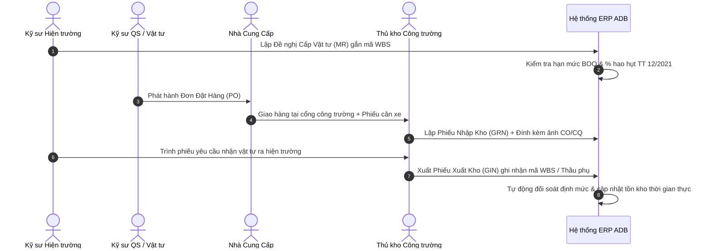

# SPEC-05: Phân hệ Quản lý Cung ứng Vật tư, Mua sắm (PO) & Kho Công trường theo Định mức Thông tư 12/2021/TT-BXD

> **Phiên bản**: 1.0.0  
> **Tác giả**: BA Agent / Lead Architect  
> **Áp dụng cho**: Developer Agent, Tester Agent, Quản lý Cung ứng & Thủ kho Hiện trường  
> **Chuẩn mực tham chiếu**: Thông tư 12/2021/TT-BXD về định mức hao hụt vật tư xây dựng, Nghị định 10/2021/NĐ-CP, Quy chuẩn kiểm định chất lượng CO/CQ.

---

## 1. Tổng quan Nghiệp vụ

Trong tổng giá trị hợp đồng D&B của **Ánh Dương Building (ADB)**, chi phí vật tư (thép hình, thép cây, cát, đá, xi măng, bê tông thương phẩm, tấm lợp panel) chiếm từ **55% đến 65%** tổng mức đầu tư. 

Việc thất thoát hoặc vượt định mức vật tư là nguyên nhân hàng đầu gây thâm hụt lợi nhuận công trình. Phân hệ Quản lý Cung ứng & Kho Công trường giải quyết 5 bài toán cốt lõi:
1. **Yêu cầu Cấp Vật tư gắn chặt với Tiến độ WBS (Material Requisition - MR)**: Kỹ sư hiện trường chỉ được đề nghị cấp vật tư đúng chủng loại và nằm trong trần định mức BOQ của gói công việc WBS tương ứng.
2. **Đơn đặt hàng Mua sắm (Purchase Order - PO)**: Đấu thầu chọn nhà cung ứng tối ưu về đơn giá và cự ly vận chuyển, theo dõi tiến độ giao hàng và điều khoản thanh toán.
3. **Phiếu Nhập kho Hiện trường (Goods Receipt Note - GRN)**:
   - Kiểm tra khối lượng thực tế (phiếu cân xe tải, đo thể tích bồn bê tông tươi).
   - Kiểm tra chứng chỉ xuất xưởng (CO/CQ), phiếu kiểm định thí nghiệm nén mẫu R28.
4. **Phiếu Xuất kho Thi công (Goods Issue Note - GIN)**: Cấp phát vật tư cho đội thi công trực tiếp hoặc cấp bù vật tư cho thầu phụ (tự động link sang phân hệ Backcharges của `SPEC-04`).
5. **Đối soát Hao hụt Tự động (Material Norm Reconciliation)**:
   - Đo lường độ lệch giữa:
     $$\text{Hao hụt Thực tế} = \frac{\text{Tổng Xuất GIN} - \text{Khối lượng Hoàn thành theo WBS}}{\text{Khối lượng Hoàn thành theo WBS}} \times 100\%$$
   - So sánh với tỷ lệ hao hụt cho phép theo **Thông tư 12/2021/TT-BXD**:
     - Thép kết cấu / thép xây dựng: $\le 2.5\%$
     - Bê tông thương phẩm: $\le 1.5\%$
     - Cát, đá xây dựng: $\le 3.0\%$
     - Xi măng bao: $\le 1.0\%$
   - Tự động kích hoạt cảnh báo đỏ khi vượt định mức để Ban Giám đốc và Chỉ huy trưởng đình chỉ xuất kho bất thường.

---

## 2. Quy trình Cung ứng & Xuất Nhập Tồn Công trường

---

## 3. Mô hình Dữ liệu PostgreSQL (Schema: `inventory_mgmt`)

### 3.1. Bảng `materials` (Danh mục Vật tư & Tiêu chuẩn Kỹ thuật)
- `id` (BIGSERIAL, PK)
- `code` (VARCHAR(50), UNIQUE) — Ví dụ: `MAT-STEEL-H300`, `MAT-CONC-M300`
- `name` (VARCHAR(255), NOT NULL) — Tên vật tư (Thép hình H300x300, Bê tông tươi M300 R28)
- `category` (VARCHAR(50)) — `STEEL`, `CONCRETE`, `CEMENT`, `AGGREGATES`, `FINISHING`, `MEP`
- `unit` (VARCHAR(30), NOT NULL) — Đơn vị tính (`TẤN`, `M3`, `BAO`, `M2`, `KG`)
- `standard_norm_rate` (NUMERIC(5, 2)) — Tỷ lệ hao hụt định mức cho phép theo TT 12/2021 (%)
- `specs` (TEXT) — Quy cách kỹ thuật (ASTM A36, TCVN 1651, PCB40)
- `created_at` (TIMESTAMP)

### 3.2. Bảng `material_requisitions` (Phiếu Đề nghị Cấp Vật tư MR)
- `id` (BIGSERIAL, PK)
- `mr_number` (VARCHAR(50), UNIQUE) — Ví dụ: `MR-DA01-2026-004`
- `project_id` (BIGINT, FK `project_mgmt.projects`)
- `wbs_item_id` (BIGINT, FK `project_mgmt.wbs_items`)
- `required_date` (DATE, NOT NULL) — Ngày cần có tại hiện trường
- `priority` (VARCHAR(20)) — `NORMAL`, `URGENT`, `CRITICAL`
- `status` (VARCHAR(30)) — `DRAFT`, `SUBMITTED`, `APPROVED_PM`, `ORDERED`, `FULFILLED`
- `requested_by` (BIGINT, FK `core_iam.users`)
- `approved_by` (BIGINT, FK `core_iam.users`)
- `created_at` (TIMESTAMP)

### 3.3. Bảng `purchase_orders` (Đơn Đặt Hàng Nhà Cung Cấp PO)
- `id` (BIGSERIAL, PK)
- `po_number` (VARCHAR(50), UNIQUE) — Ví dụ: `PO-ADB-2026-015`
- `supplier_name` (VARCHAR(255), NOT NULL)
- `supplier_tax_code` (VARCHAR(30))
- `project_id` (BIGINT, FK `project_mgmt.projects`)
- `total_amount` (NUMERIC(18, 2), NOT NULL)
- `delivery_deadline` (DATE)
- `payment_terms` (TEXT) — Điều khoản thanh toán (Tạm ứng 20%, nghiệm thu thanh toán 80%)
- `status` (VARCHAR(30)) — `ISSUED`, `PARTIALLY_DELIVERED`, `COMPLETED`, `CANCELLED`
- `created_at` (TIMESTAMP)

### 3.4. Bảng `goods_receipt_notes` (Phiếu Nhập Kho Hiện trường GRN)
- `id` (BIGSERIAL, PK)
- `grn_number` (VARCHAR(50), UNIQUE) — Ví dụ: `GRN-2026-042`
- `po_id` (BIGINT, FK `purchase_orders`)
- `project_id` (BIGINT, FK `project_mgmt.projects`)
- `delivery_truck_plate` (VARCHAR(30)) — Biển số xe tải giao hàng
- `weighing_slip_number` (VARCHAR(50)) — Số phiếu cân trạm
- `has_co_cq` (BOOLEAN DEFAULT TRUE) — Có chứng chỉ xuất xưởng
- `inspector_notes` (TEXT)
- `received_by` (BIGINT, FK `core_iam.users`)
- `receipt_date` (DATE NOT NULL)
- `created_at` (TIMESTAMP)

### 3.5. Bảng `goods_issue_notes` (Phiếu Xuất Kho Thi công GIN)
- `id` (BIGSERIAL, PK)
- `gin_number` (VARCHAR(50), UNIQUE) — Ví dụ: `GIN-2026-078`
- `project_id` (BIGINT, FK `project_mgmt.projects`)
- `wbs_item_id` (BIGINT, FK `project_mgmt.wbs_items`)
- `subcontractor_id` (BIGINT, FK `subcontractor_mgmt.subcontractors`, NULLABLE)
- `recipient_name` (VARCHAR(150) NOT NULL) — Đội trưởng thi công / Kỹ sư nhận vật tư
- `purpose` (TEXT NOT NULL) — Mục đích sử dụng (Đổ bê tông sàn tầng 2 trục A-D)
- `issue_date` (DATE NOT NULL)
- `created_at` (TIMESTAMP)

### 3.6. Bảng `stock_balances` (Sổ Kho Tồn Thực tế)
- `id` (BIGSERIAL, PK)
- `project_id` (BIGINT, FK `project_mgmt.projects`)
- `material_id` (BIGINT, FK `materials`)
- `current_quantity` (NUMERIC(14, 3) NOT NULL DEFAULT 0.000)
- `minimum_threshold` (NUMERIC(14, 3) DEFAULT 0.000) — Mức tồn kho tối thiểu cảnh báo
- `last_updated` (TIMESTAMP)

---

## 4. Đặc tả REST API

| Method | Endpoint | Quyền hạn (Role) | Mô tả |
|---|---|---|---|
| `GET` | `/api/v1/materials` | ALL_STAFF | Tra cứu danh mục định mức vật tư tiêu chuẩn |
| `GET` | `/api/v1/inventory/stock/{projectId}` | SITE_STAFF, QS | Xem tồn kho thời gian thực tại công trường |
| `POST` | `/api/v1/inventory/requisitions` | SITE_ENGINEER | Lập phiếu đề nghị cấp vật tư MR |
| `POST` | `/api/v1/inventory/purchase-orders` | PROCUREMENT_OFFICER | Phát hành đơn đặt hàng PO |
| `POST` | `/api/v1/inventory/grn` | WAREHOUSE_KEEPER | Nhập kho vật tư có đối chiếu phiếu cân xe |
| `POST` | `/api/v1/inventory/gin` | WAREHOUSE_KEEPER | Xuất kho thi công ghi nhận WBS/Thầu phụ |
| `GET` | `/api/v1/inventory/reconciliation/{projectId}` | QS_ENGINEER, PM | Báo cáo đối soát hao hụt so với định mức TT 12/2021 |
