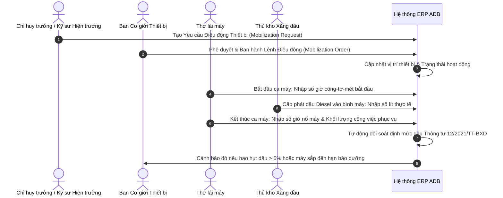

# SPEC-06: Phân hệ Quản lý Đội Xe máy, Thiết bị Thi công & Định mức Ca máy

> **Phiên bản**: 1.0.0  
> **Tác giả**: BA Agent / Lead Architect  
> **Áp dụng cho**: Developer Agent, Tester Agent, Ban Cơ giới & Quản lý Thiết bị Hiện trường  
> **Chuẩn mực tham chiếu**: Thông tư 12/2021/TT-BXD về định mức hao phí ca máy và thiết bị thi công, Nghị định 06/2021/NĐ-CP về an toàn máy xây dựng, Tiêu chuẩn an toàn thiết bị nâng TCVN 4244:2005.

---

## 1. Tổng quan Nghiệp vụ

Trong các dự án thi công nhà xưởng công nghiệp quy mô lớn (50.000m2 - 100.000m2) của **Ánh Dương Building (ADB)**, đội xe máy và thiết bị cơ giới thi công là lực lượng sản xuất trực tiếp then chốt:
- Cần trục tháp (Tower Crane), cẩu lốp/cẩu xích (Crawler/Mobile Crane 25T - 150T) phục vụ lắp dựng kết cấu thép.
- Máy xúc đào bánh xích, máy ủi bánh xích, máy lu rung 14T phục vụ công tác san lấp và hạ tầng ngầm.
- Robot ép cọc thủy lực (Static Hydraulic Piling Rig 600T - 1000T) phục vụ xử lý móng sâu.
- Trạm biến áp tạm, máy phát điện dự phòng 500kVA, máy nén khí, giàn giáo nhôm định hình.

Phân hệ Quản lý Xe máy & Thiết bị Thi công giải quyết 4 bài toán lớn:
1. **Quản lý Hồ sơ Kỹ thuật & Kiểm định Kỹ thuật An toàn**: Cảnh báo trước 30 ngày khi cẩu tháp, cẩu lốp, bình chịu áp lực sắp hết hạn kiểm định của Trung tâm Kiểm định Kỹ thuật An toàn (Bộ Lao động - TB&XH). Thiết bị quá hạn kiểm định bị cấm hoạt động tuyệt đối trên công trường.
2. **Lệnh Điều động & Luân chuyển Thiết bị (Mobilization / Demobilization Order)**: Quản lý vị trí hiện tại của thiết bị (đang ở Kho tổng Thuận An hay đang ở Công trường VSIP III, Becamex Bàu Bàng, Long Thành).
3. **Nhật trình Ca máy Điện tử & Tiêu hao Nhiên liệu (Digital Engine Hour & Fuel Log)**:
   - Ghi nhận chỉ số đồng hồ giờ máy chạy (Hour Meter / Engine Hours) lúc bắt đầu và kết thúc ca làm việc.
   - Ghi nhận lượng dầu Diesel (lít) cấp phát thực tế từ bồn téc hiện trường.
   - So sánh tiêu hao nhiên liệu thực tế với **Định mức Ca máy Thông tư 12/2021/TT-BXD**:
     $$\text{Độ lệch Nhiên liệu} = \frac{\text{Lít dầu thực tế} - (\text{Số giờ nổ máy} \times \text{Định mức lít/giờ})}{\text{Số giờ nổ máy} \times \text{Định mức lít/giờ}} \times 100\%$$
   - Cảnh báo bất thường khi độ lệch vượt quá $+5.0\%$ (dấu hiệu rò rỉ hoặc thất thoát dầu Diesel).
4. **Bảo dưỡng Định kỳ (Preventive Maintenance)**: Tự động nhắc lịch thay dầu động cơ, dầu thủy lực, lọc dầu, lọc gió sau mỗi chu kỳ 250 giờ / 500 giờ / 1000 giờ hoạt động.

---

## 2. Quy trình Quản trị Thiết bị Hiện trường



---

## 3. Mô hình Dữ liệu PostgreSQL (Schema: `equipment_mgmt`)

```sql
CREATE SCHEMA IF NOT EXISTS equipment_mgmt;

-- 1. DANH MỤC THIẾT BỊ & HỒ SƠ KỸ THUẬT
CREATE TABLE IF NOT EXISTS equipment_mgmt.equipments (
    id BIGSERIAL PRIMARY KEY,
    code VARCHAR(50) UNIQUE NOT NULL, -- Ví dụ: EQ-CRANE-50T-01, EQ-EXC-02
    name VARCHAR(255) NOT NULL, -- Cần cẩu bánh xích Hitachi KH180-3 50T
    category VARCHAR(50) NOT NULL, -- CRANE, EXCAVATOR, ROLLER, PILING_RIG, GENERATOR, TRUCK
    brand VARCHAR(100), -- Komatsu, Hitachi, Kobelco, Tadano
    model VARCHAR(100),
    manufacture_year INT,
    serial_number VARCHAR(100),
    plate_number VARCHAR(50),
    owner_type VARCHAR(30) DEFAULT 'INTERNAL', -- INTERNAL (Ánh Dương sở hữu), RENTED (Thuê ngoài)
    current_project_id BIGINT REFERENCES project_mgmt.projects(id),
    status VARCHAR(30) DEFAULT 'OPERATIONAL', -- OPERATIONAL, STANDBY, MAINTENANCE, BREAKDOWN, DEMOBILIZED
    standard_fuel_norm NUMERIC(6, 2) NOT NULL DEFAULT 0.00, -- Định mức tiêu hao dầu Diesel (lít/giờ) theo TT 12/2021
    total_engine_hours NUMERIC(10, 2) DEFAULT 0.00, -- Tổng số giờ hoạt động tích lũy
    safety_inspection_expiry DATE NOT NULL, -- Hạn kiểm định an toàn kỹ thuật
    insurance_expiry DATE, -- Hạn bảo hiểm thiết bị
    created_at TIMESTAMP WITH TIME ZONE DEFAULT CURRENT_TIMESTAMP,
    updated_at TIMESTAMP WITH TIME ZONE DEFAULT CURRENT_TIMESTAMP
);

-- 2. LỆNH ĐIỀU ĐỘNG THIẾT BỊ (MOBILIZATION)
CREATE TABLE IF NOT EXISTS equipment_mgmt.mobilization_orders (
    id BIGSERIAL PRIMARY KEY,
    order_number VARCHAR(50) UNIQUE NOT NULL, -- MO-2026-008
    equipment_id BIGINT REFERENCES equipment_mgmt.equipments(id) ON DELETE RESTRICT,
    from_project_id BIGINT REFERENCES project_mgmt.projects(id),
    to_project_id BIGINT REFERENCES project_mgmt.projects(id) NOT NULL,
    dispatch_date DATE NOT NULL,
    arrival_date DATE,
    transport_company VARCHAR(255),
    transport_cost NUMERIC(18, 2) DEFAULT 0.00,
    status VARCHAR(30) DEFAULT 'IN_TRANSIT', -- IN_TRANSIT, MOBILIZED, REJECTED
    notes TEXT,
    created_at TIMESTAMP WITH TIME ZONE DEFAULT CURRENT_TIMESTAMP
);

-- 3. NHẬT TRÌNH CA MÁY & ĐỐI SOÁT NHIÊN LIỆU ĐIỆN TỬ
CREATE TABLE IF NOT EXISTS equipment_mgmt.equipment_logs (
    id BIGSERIAL PRIMARY KEY,
    log_number VARCHAR(50) UNIQUE NOT NULL, -- EL-2026-0142
    equipment_id BIGINT REFERENCES equipment_mgmt.equipments(id) ON DELETE RESTRICT,
    project_id BIGINT REFERENCES project_mgmt.projects(id) NOT NULL,
    wbs_item_id BIGINT REFERENCES project_mgmt.wbs_items(id),
    log_date DATE NOT NULL DEFAULT CURRENT_DATE,
    operator_name VARCHAR(150) NOT NULL, -- Tên thợ lái máy
    start_engine_hour NUMERIC(10, 2) NOT NULL,
    end_engine_hour NUMERIC(10, 2) NOT NULL,
    worked_hours NUMERIC(6, 2) NOT NULL, -- end_engine_hour - start_engine_hour
    fuel_issued_liters NUMERIC(8, 2) NOT NULL DEFAULT 0.00, -- Số lít dầu thực tế cấp phát
    expected_fuel_liters NUMERIC(8, 2) NOT NULL, -- worked_hours * standard_fuel_norm
    fuel_variance_rate NUMERIC(5, 2) NOT NULL, -- % chênh lệch nhiên liệu so với TT 12/2021
    work_description TEXT NOT NULL, -- Cẩu lắp kèo thép trục 10-15 Nhà xưởng A
    alert_flag VARCHAR(30) DEFAULT 'NORMAL', -- NORMAL, OVER_CONSUMPTION, CRITICAL
    created_at TIMESTAMP WITH TIME ZONE DEFAULT CURRENT_TIMESTAMP
);

-- 4. NHẬT KÝ BẢO DƯỠNG & SỬA CHỮA
CREATE TABLE IF NOT EXISTS equipment_mgmt.maintenance_records (
    id BIGSERIAL PRIMARY KEY,
    equipment_id BIGINT REFERENCES equipment_mgmt.equipments(id) ON DELETE CASCADE,
    maintenance_type VARCHAR(50) NOT NULL, -- 250H_PERIODIC, 500H_PERIODIC, EMERGENCY_REPAIR, HYDRAULIC_FIX
    engine_hours_at_maintenance NUMERIC(10, 2) NOT NULL,
    maintenance_date DATE NOT NULL,
    performed_by VARCHAR(255) NOT NULL, -- Đội cơ điện Ánh Dương / Hãng Komatsu
    parts_replaced TEXT, -- Thay 25L nhớt 15W40, lọc nhớt, phớt xilanh nâng hạ
    total_cost NUMERIC(18, 2) DEFAULT 0.00,
    next_maintenance_engine_hours NUMERIC(10, 2) NOT NULL, -- +250 giờ hoặc +500 giờ
    notes TEXT,
    created_at TIMESTAMP WITH TIME ZONE DEFAULT CURRENT_TIMESTAMP
);
```

---

## 4. Đặc tả REST API Phân hệ Xe máy

| Method | Endpoint | Quyền hạn (Role) | Mô tả |
|---|---|---|---|
| `GET` | `/api/v1/equipments` | ALL_STAFF | Tra cứu danh mục thiết bị cơ giới & tình trạng hoạt động |
| `GET` | `/api/v1/equipments/inspections/due` | EQUIPMENT_MNGR, PM | Danh sách thiết bị sắp hết hạn kiểm định trong 30 ngày |
| `POST` | `/api/v1/equipments/mobilize` | EQUIPMENT_MNGR | Ban hành lệnh điều động thiết bị đến công trình |
| `POST` | `/api/v1/equipments/logs` | SITE_OPERATOR, QS | Ghi nhật trình ca máy, tính đối soát nhiên liệu TT 12/2021 |
| `GET` | `/api/v1/equipments/{id}/fuel-analysis` | EQUIPMENT_MNGR, C_LEVEL | Biểu đồ tiêu hao nhiên liệu lũy kế so với định mức |
| `POST` | `/api/v1/equipments/maintenance` | MECHANIC_LEAD | Lập biên bản bảo dưỡng định kỳ & cập nhật mốc bảo dưỡng kế tiếp |

---

## 5. Quy tắc Kiểm định An toàn & Cảnh báo Sớm (Business Invariants)

1. **Quy tắc Kiểm định An toàn**:
   - Mọi thiết bị nâng (cần cẩu tháp, cẩu bánh xích, cẩu lốp) bắt buộc phải có Giấy chứng nhận kiểm định an toàn còn hiệu lực.
   - Nếu `safety_inspection_expiry <= CURRENT_DATE`, hệ thống tự động khóa trạng thái thiết bị sang `STANDBY_EXPIRED` và ngăn chặn tạo nhật trình ca máy.
2. **Quy tắc Định mức Nhiên liệu TT 12/2021/TT-BXD**:
   - Nếu $\text{fuel\_variance\_rate} > 5.0\%$, hệ thống ghi nhận cờ `OVER_CONSUMPTION` và gửi thông báo trực tiếp đến Chỉ huy trưởng công trình.
   - Nếu $\text{fuel\_variance\_rate} > 15.0\%$, hệ thống kích hoạt cờ `CRITICAL` để Ban Thanh tra Nội bộ ADB tiến hành kiểm tra hiện trường.
3. **Quy tắc Mốc Bảo dưỡng 250H/500H**:
   - Khi `total_engine_hours` đạt ngưỡng cách mốc bảo dưỡng dưới 20 giờ, hệ thống kích hoạt cảnh báo vàng trên màn hình của Đội trưởng Cơ điện.
