# SPEC-07: Phân hệ Nhà máy Kết cấu Thép WinSteel (BOM, Nesting Cắt Thép & QR Lắp dựng)

> **Phiên bản**: 1.0.0  
> **Tác giả**: BA Agent / Lead Architect  
> **Áp dụng cho**: Developer Agent, Tester Agent, Giám đốc Nhà máy WinSteel, Kỹ sư Lắp dựng Công trường  
> **Chuẩn mực tham chiếu**: Tiêu chuẩn thiết kế kết cấu thép TCVN 5575:2012, Tiêu chuẩn chế tạo & nghiệm thu kết cấu thép TCVN 170:2007, Tiêu chuẩn độ sạch bề mặt Thụy Điển ISO 8501-1 (Sa 2.5), Quy chuẩn PCCC QCVN 06:2022/BXD.

---

## 1. Tổng quan Nhà máy Kết cấu Thép WinSteel

Nhà máy WinSteel (trực thuộc Ánh Dương Building, đặt tại KCN Nam Tân Uyên, Bình Dương) có công suất 1.500 tấn kết cấu thép/tháng, chuyên gia công cấu kiện thép tiền chế (Pre-Engineered Building - PEB) phục vụ các dự án nhà xưởng công nghiệp quy mô lớn từ 30.000m2 đến 100.000m2.

Phân hệ Nhà máy WinSteel giải quyết 4 bài toán then chốt:
1. **Bóc tách BOM Cấu kiện Chi tiết (Bill of Materials)**:
   - Nhập khẩu mô hình 3D từ Tekla Structures / Autodesk Advance Steel.
   - Quản lý danh mục cấu kiện: Cột thép tổ hợp chữ H (Built-up H-columns), Kèo thép chữ H thay đổi tiết diện (Tapered Rafters), Hệ giằng mái/cột (Bracing system), Xà gồ mạ kẽm Z/C (Purlins), Bản mã liên kết (Gusset plates), Bu lông neo móng (Anchor bolts), Bu lông liên kết cường độ cao cấp bền 8.8 / 10.9 (High-strength structural bolts).
2. **Thuật toán Tối ưu Cắt Phôi Thép Tấm (Nesting Plan Optimization)**:
   - Xếp các hình học bản mã và bụng/cánh cột kèo lên các khổ thép tấm tiêu chuẩn ($1.5m \times 6m$, $2.0m \times 12m$).
   - Thuật toán Nesting 2D giảm tỷ lệ đầu mẩu thép phế liệu xuống dưới **$3.0\%$** (tiết kiệm hàng tỷ đồng trên mỗi dự án).
3. **Quy trình 5 Công đoạn Sản xuất Khép kín**:
   - **Công đoạn 1 (Cutting)**: Cắt phôi thép tự động bằng máy cắt Plasma CNC / Laser / Oxy-Gas đa mỏ.
   - **Công đoạn 2 (Assembly/Fitting)**: Gá đính tổ hợp bụng và cánh dầm trên máy gá thủy lực tự động.
   - **Công đoạn 3 (Welding)**: Hàn tự động dưới lớp thuốc bảo vệ (Submerged Arc Welding - SAW) và hàn CO2 bán tự động; Kiểm tra đường hàn bằng phương pháp siêu âm không phá hủy NDT (Ultrasonic Testing - UT) theo TCVN 170:2007.
   - **Công đoạn 4 (Shot Blasting)**: Bắn bi thép tự động làm sạch gỉ sét bề mặt đạt tiêu chuẩn Sa 2.5 theo tiêu chuẩn quốc tế ISO 8501-1.
   - **Công đoạn 5 (Painting)**: Phun sơn phủ chống rỉ gốc Epoxy 2 thành phần (độ dày màng sơn khô DFT $\ge 80\mu m$) và sơn chống cháy đạt tiêu chuẩn chịu lửa R60 / R90 / R120 theo QCVN 06:2022/BXD.
4. **Hệ thống Mã QR Code Định danh & Cẩu Lắp dựng Công trường**:
   - Mỗi cấu kiện sau khi nghiệm thu sơn đạt chuẩn được dán 01 tem QR kim loại chống rỉ ghi rõ: Mã cấu kiện, Tên dự án, Trục cột vị trí thiết kế, Khối lượng bản thân (kg), Chiều dài (mm).
   - Thủ kho quét QR khi cấu kiện rời xưởng lên rơ-moóc chuyên dụng.
   - Chỉ huy trưởng và Kỹ sư lắp dựng tại công trường quét mã QR khi cẩu lắp vào đúng tim trục, tự động cập nhật tiến độ lắp dựng vật lý lên ERP thời gian thực.

---

## 2. Quy trình Sản xuất & Lắp dựng Cấu kiện Thép

```mermaid
flowchart LR
    A["Bóc tách BOM từ Tekla"] --> B["Nesting Cắt Phôi (Vụn < 3%)"]
    B --> C1["1. Cắt Phôi CNC"]
    C1 --> C2["2. Gá Đính Cấu Kiện"]
    C2 --> C3["3. Hàn Tự Động SAW & Siêu Âm NDT"]
    C3 --> C4["4. Bắn Bi Sa 2.5"]
    C4 --> C5["5. Sơn Epoxy & Chống Cháy"]
    C5 --> D["In & Gán Tem Mã QR"]
    D --> E["Xuất Xưởng Vận Chuyển"]
    E --> F["Quét QR Cẩu Lắp Dựng Hiện Trường"]
```



---

## 3. Mô hình Dữ liệu PostgreSQL (Schema: `winsteel_mgmt`)

```sql
CREATE SCHEMA IF NOT EXISTS winsteel_mgmt;

-- 1. BẢNG DỰ ÁN KẾT CẤU THÉP & TIẾN ĐỘ XƯỞNG
CREATE TABLE IF NOT EXISTS winsteel_mgmt.steel_orders (
    id BIGSERIAL PRIMARY KEY,
    order_number VARCHAR(50) UNIQUE NOT NULL, -- WS-2026-004
    project_id BIGINT REFERENCES project_mgmt.projects(id) ON DELETE RESTRICT,
    total_tonnage NUMERIC(10, 3) NOT NULL, -- Tổng khối lượng thép (tấn)
    drawing_approval_date DATE,
    target_delivery_date DATE NOT NULL,
    status VARCHAR(30) DEFAULT 'IN_PRODUCTION', -- BOM_IMPORTING, NESTING, IN_PRODUCTION, ERECTING, COMPLETED
    created_at TIMESTAMP WITH TIME ZONE DEFAULT CURRENT_TIMESTAMP
);

-- 2. BẢNG BÓC TÁCH CẤU KIỆN THÉP CHI TIẾT (BOM)
CREATE TABLE IF NOT EXISTS winsteel_mgmt.steel_components (
    id BIGSERIAL PRIMARY KEY,
    steel_order_id BIGINT REFERENCES winsteel_mgmt.steel_orders(id) ON DELETE CASCADE,
    component_mark VARCHAR(50) NOT NULL, -- Ví dụ: C1-1, C1-2, R1-1 (Kèo), B1 (Giằng)
    component_type VARCHAR(50) NOT NULL, -- COLUMN, RAFTER, PURLIN, BRACING, GUSSET_PLATE
    profile_specs VARCHAR(100) NOT NULL, -- H500x250x8x12, Z200x65x20x2.0
    steel_grade VARCHAR(30) DEFAULT 'SS400', -- SS400, Q345B, A572-Gr50
    length_mm INT NOT NULL,
    weight_kg NUMERIC(10, 2) NOT NULL,
    grid_location VARCHAR(50), -- Trục 1-A, Trục 5-B
    qr_code_uid VARCHAR(100) UNIQUE NOT NULL, -- Mã QR duy nhất: ADB-WS-P01-C1-001
    
    -- 5 CÔNG ĐOẠN SẢN XUẤT XƯỞNG
    cut_status VARCHAR(20) DEFAULT 'PENDING',       -- PENDING, COMPLETED
    fit_status VARCHAR(20) DEFAULT 'PENDING',       -- PENDING, COMPLETED
    weld_status VARCHAR(20) DEFAULT 'PENDING',      -- PENDING, COMPLETED, NDT_PASSED, NDT_REJECTED
    blast_status VARCHAR(20) DEFAULT 'PENDING',     -- PENDING, COMPLETED (Sa 2.5)
    paint_status VARCHAR(20) DEFAULT 'PENDING',     -- PENDING, COMPLETED (DFT >= 80um)
    
    -- TIẾN ĐỘ CÔNG TRƯỜNG
    shipping_status VARCHAR(20) DEFAULT 'IN_SHOP',  -- IN_SHOP, SHIPPED, ON_SITE
    erection_status VARCHAR(20) DEFAULT 'PENDING',  -- PENDING, ERECTED, INSPECTED_OK
    erected_at TIMESTAMP WITH TIME ZONE,
    erected_by VARCHAR(150),
    created_at TIMESTAMP WITH TIME ZONE DEFAULT CURRENT_TIMESTAMP
);

-- 3. KẾ HOẠCH TỐI ƯU CẮT PHÔI THÉP TẤM (NESTING)
CREATE TABLE IF NOT EXISTS winsteel_mgmt.nesting_plans (
    id BIGSERIAL PRIMARY KEY,
    plan_code VARCHAR(50) UNIQUE NOT NULL, -- NP-2026-089
    steel_order_id BIGINT REFERENCES winsteel_mgmt.steel_orders(id) ON DELETE CASCADE,
    raw_plate_specs VARCHAR(100) NOT NULL, -- Thép tấm Posco SS400 Khổ 2000x12000x12mm
    raw_plate_weight_kg NUMERIC(10, 2) NOT NULL,
    utilized_weight_kg NUMERIC(10, 2) NOT NULL,
    scrap_weight_kg NUMERIC(10, 2) NOT NULL, -- Trọng lượng vụn sắt phế liệu
    scrap_rate NUMERIC(5, 2) NOT NULL,       -- scrap_weight / raw_weight * 100%
    is_approved BOOLEAN DEFAULT FALSE,       -- Duyệt khi scrap_rate <= 3.0%
    created_at TIMESTAMP WITH TIME ZONE DEFAULT CURRENT_TIMESTAMP
);
```

---

## 4. Đặc tả REST API Phân hệ Nhà máy WinSteel

| Method | Endpoint | Quyền hạn (Role) | Mô tả |
|---|---|---|---|
| `POST` | `/api/v1/winsteel/orders` | QS_LEAD, PM | Tạo lệnh gia công kết cấu thép mới cho dự án |
| `POST` | `/api/v1/winsteel/bom/import` | TEKLA_ENGINEER | Nhập khẩu file danh mục cấu kiện Tekla BOM |
| `POST` | `/api/v1/winsteel/nesting` | PRODUCTION_PLANNER | Lập kế hoạch Nesting cắt phôi & kiểm tra vụn < 3% |
| `PATCH` | `/api/v1/winsteel/components/{id}/stage` | SHOP_LEAD, QC | Cập nhật hoàn thành từng công đoạn (Cắt, Gá, Hàn, Bắn bi, Sơn) |
| `GET` | `/api/v1/winsteel/components/qr/{qrCode}` | SITE_ENGINEER | Tra cứu thông tin cấu kiện bằng mã QR trên mobile |
| `POST` | `/api/v1/winsteel/components/erect` | SITE_ENGINEER | Xác nhận cấu kiện đã cẩu lắp dựng thành công vào tim trục |

---

## 5. Quy chuẩn Đảm bảo Chất lượng Cấu kiện Thép

1. **Kiểm tra Đường hàn Siêu âm NDT**:
   - $100\%$ mối hàn nối cánh và bụng dầm cột chính phải được kiểm tra siêu âm NDT.
   - Chỉ khi kết quả NDT đạt cấp I/II theo TCVN 170:2007 thì hệ thống mới cho phép chuyển sang công đoạn bắn bi Sa 2.5.
2. **Quy tắc Kiểm soát Phế liệu Nesting $\le 3.0\%$**:
   - Nếu tỷ lệ phế liệu $\text{scrap\_rate} > 3.0\%$, kế hoạch cắt phôi bị khóa trạng thái `REJECTED_OVER_SCRAP` và yêu cầu Kỹ sư Nesting chạy lại thuật toán chia khổ phôi.
3. **Tính Duy nhất của Mã QR Code**:
   - Mỗi mã QR Code cấu kiện là duy nhất trên toàn hệ thống ADB ERP, mã hóa thông tin: `[Dự án]-[Mã cấu kiện]-[Vị trí trục]-[Khối lượng]`.
