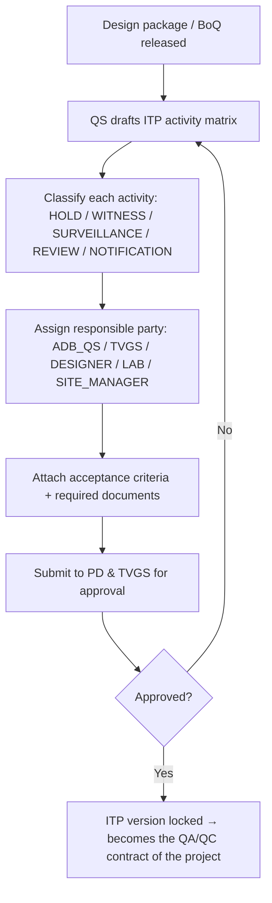
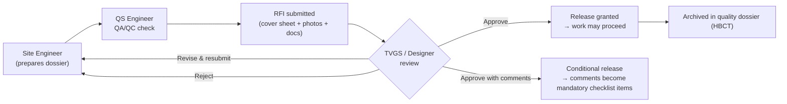
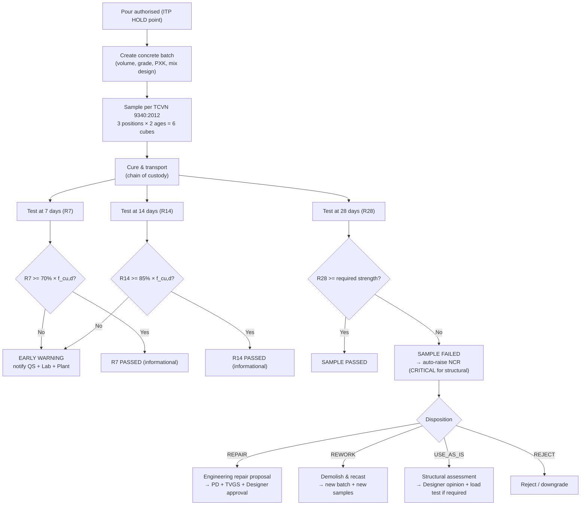
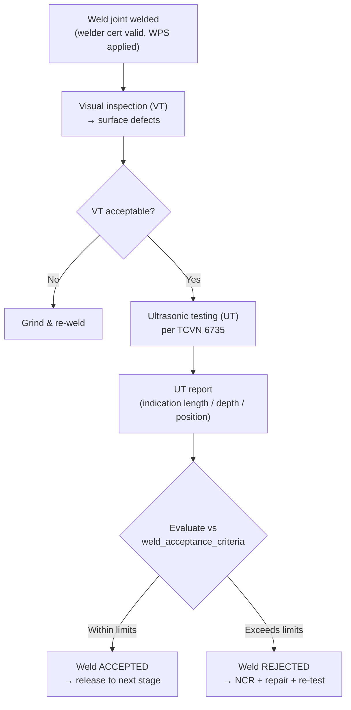
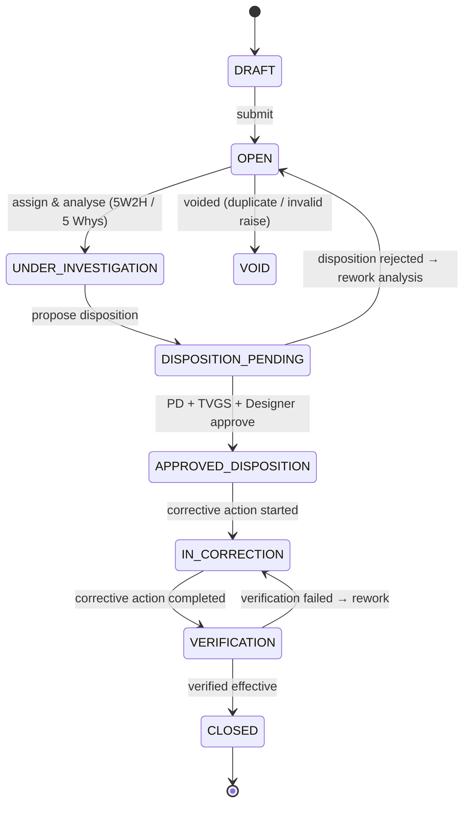
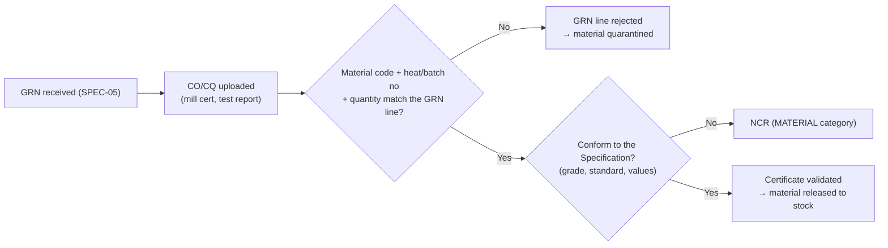

# SPEC-08: Construction Quality Assurance & Control (QA/QC) — ITP, RFI Hidden Work, Concrete Testing & NCR

> **Module**: 08. Quản lý Chất lượng Thi công (QA/QC) — theo Nghị định 06/2021/NĐ-CP
> **Author**: BA Agent (PC-4 — `ba-hant_lap`)
> **Task**: TASK-022 — "[GIAI DOAN 3] Dac ta Module 08 (QA/QC ND 06/2021) va Module 09 (HSE An toan Lao dong & PTW)"
> **Status**: Review (chờ Lead duyệt)
> **Version**: 1.0.0
> **Date**: 2026-10-21
> **Stack**: Java 21 + Spring Boot 3.3.x + PostgreSQL 17 + React 18 + TypeScript
> **Target Enterprise**: Ánh Dương Building (ADB) — Tổng thầu Thiết kế & Thi công (D&B) Hạng I
> **Migration Target**: `backend/src/main/resources/db/migration/V6__create_qaqc_and_hse_tables.sql`
> **Package Target**: `com.anhduongbuilding.erp.qaqc`

> [!NOTE]
> **Quy ước đánh số Module**: ma trận phân hệ chuẩn lệ là `docs/plans/ENTERPRISE_ARCHITECTURE_ROADMAP.md`:
> **08 = Quản lý Chất lượng QA/QC (NĐ 06/2021)** · **09 = An toàn Lao động & Cấp phép HSE (PTW)**.
> Tài liệu này tách theo ranh giới Deliverable để Dev (TASK-023) và Tester (TASK-024) triển khai song song:
> `SPEC-08` (QA/QC, schema `qaqc_mgmt`) ↔ `SPEC-09` (HSE, schema `hse_mgmt`).
> Bản `MASTER_ROADMAP.md` (cũ) gộp hai phân hệ này thành "Phân hệ 11" — đã lịch sử; được ưu tiên theo ma trận 12 phân hệ mới nhất.

---

## 1. Business Objectives & Legal / Regulatory Foundation

### 1.1 Why QA/QC Is a First-Class Module in an EPC/D&B ERP

For Ánh Dương Building — a Grade I Design & Build general contractor delivering industrial factories, warehouses and logistics centres — construction quality is simultaneously:

1. **A contractual obligation**: Under a FIDIC D&B (Red Book) contract, the Employer withholds up to **10% of the Contract Price** as Retention until the Defects Notification Period expires, and may issue **Dispute / Adjudication** claims if the Works do not conform to the Specification.
2. **A criminal liability**: Defective structural works in a factory collapse expose ADB and its officers to prosecution under the Criminal Code and administrative sanction under **Nghị định 06/2021/NĐ-CP Điều 28–29**.
3. **A cash-flow lever**: Every day a **Hold Point** stays unreleased stops a whole work-front (cây đông phương của khu vực), so quality release latency directly delays progress payment certificates (PPC) — the only source of project cash inflow.
4. **A cost-control leak**: Non-conformity rework (làm lại) on industrial structures typically costs **8–15% of the value of the defective work**, and rework on hidden work (công tác ẩn) discovered after closure is **3–5× more expensive** than rejection at the inspection gate.

ADB therefore cannot treat QA/QC as a paper archive at handover. It must be a **real-time, hold-point-driven, system-of-record** that legally binds the Site Manager, the TVGS (Giám sát công trình) and the Design Consultant, with the cost of non-conformity pushed back onto the responsible subcontractor (backcharge - cross-link [SPEC-05](SPEC-05-MATERIALS-WAREHOUSE.md) §3.3 and [SPEC-04](SPEC-04-SUBCONTRACTORS.md) §5).

### 1.2 Legal & Regulatory Framework

| Instrument | Scope applied in this spec | Key articles/obligations applied |
|---|---|---|
| **Nghị định 06/2021/NĐ-CP** (18/03/2021) | Quản lý chất lượng, thi công xây dựng và bảo trì công trình xây dựng | Điều 21 (Hồ sơ quản lý chất lượng trong quá trình thi công xây dựng), Điều 22 (Hồ sơ bảo đảm chất lượng), Điều 23 (Quản lý nhà thầu), Điều 28 (Quản lý nhà thầu trong thi công), Điều 39–40 (Nghiệm thu công trình xây dựng), Điều 45 (Trách nhiệm của chủ đầu tư) |
| **Thông tư 12/2021/TT-BXD** | Định mức xây dựng | Phụ lục định mức vật tư → khối lượng bê tông thực tế đối chiếu định mức để phát hiện lãng phí vật tư do chất lượng (liên kết [SPEC-05](SPEC-05-MATERIALS-WAREHOUSE.md) §3) |
| **Thông tư 200/2014/TT-BTC** | Chế độ kế toán doanh nghiệp xây lắp | Chi phí chất lượng/bồi thường hạn chế (TK 623/627), kết chuyển vào TK 154 theo WBS — chi phí NCR được phân bổ vào đúng công trình (liên kết Phân hệ 09 Kế toán WIP) |
| **TCVN 9340:2012** | Quy trình thí nghiệm mẫu bê tông thông thường | Lấy mẫu, bảo dưỡng mẫu, thử nén, đánh giá kết quả mẫu bê tông (R7 / R28) |
| **TCVN 4447:2012** | Bê tông | Yêu cầu độ bền nén, giới hạn cường độ nén tối thiểu của bê tông |
| **TCVN 9012:2019** | Bê tông thông thường — yêu cầu kỹ thuật | Chất lượng bê tông tươi trước khi đổ ảnh hưởng trực tiếp kết quả mẫu thử |
| **TCVN 6735** | Kiểm tra không phá hủy đường hàn — siêu âm (UT) | Tiêu chí chấp nhận vết khuyết đường hàn, báo cáo kết quả NDT |
| **TCVN 7224:1999** | Kim loại đường hàn | Yêu cầu đối với que hàn, điều kiện lưu trữ, sử dụng |
| **Hợp đồng FIDIC D&B (Red Book)** | Hợp đồng tổng thầu với Chủ đầu tư | Yêu cầu về Inspection Plan, điều kiện nghiệm thu khối lượng, giới hạn bồi thường |
| **Hợp đồng giao khoán (FIDIC Subcontract)** | Hợp đồng thầu phụ | Quyền được đình chỉ thanh toán khi công trình không đạt (cross-link Phân hệ 04) |

### 1.3 Quality Cost Model (Chi phí chất lượng)

The system classifies quality cost into the classic three buckets so that ADB can report the real cost of non-conformity to the Board of Directors (Phân hệ 12 BI):

| Bucket | Meaning | System source | Typical ledger |
|---|---|---|---|
| **Prevention (Phòng ngừa)** | ITP design, QA/QC training, mock-up, template review | `qaqc_mgmt.itp_plans`, training records | TK 627 (Chi phí quản lý xây dựng) |
| **Appraisal (Kiểm tra)** | Inspection man-hours, lab testing, NDT, TVGS fees | `qaqc_mgmt.qaqc_inspections`, `concrete_test_samples`, `weld_test_records` | TK 6233 / 6234 / dịch vụ TVGS |
| **Failure (Thất bại)** | Rework, repair, replacement, demobilisation, penalty | `qaqc_mgmt.ncr_reports.cost_impact_amount` | TK 154 (WIP) + backcharge (SPEC-04) |

**Rule CQ-1**: `cost_impact_amount` on an NCR MUST be allocated to the WBS item (`wbs_item_id`) and the project so it flows to TK 154 (chi phí dở dang) — the module is a cost-recording module, not just a checklist module.

---

## 2. User Stories

> Format: *As a [role], I want [capability], so that [benefit].* Each story carries a `US-xx` identifier referenced by the Gherkin acceptance criteria in §5.

| ID | Role | User Story | Ref |
|---|---|---|---|
| US-08-01 | Kỹ sư QS (QA/QC Engineer) | As a **QS Engineer**, I want to build an **ITP matrix** binding every construction activity to a Hold / Witness / Surveillance point with a named responsible party, so that no work-front starts without a predefined quality gate. | §5.5 |
| US-08-02 | QS Engineer | As a **QS Engineer**, I want to **raise an RFI** for hidden work (công tác ẩn) with a complete dossier and an automatic response SLA, so that concealed work is never covered without TVGS/Designer authorisation. | §5.2 |
| US-08-03 | Trưởng lĩnh trưởng (Site Manager) | As a **Site Manager**, I want to **see every open Hold Point** blocking my work-fronts in real time, so that I can chase the right party instead of discovering a 3-day blockage at the weekly meeting. | §5.5 |
| US-08-04 | Trưởng lĩnh trưởng | As a **Site Manager**, I want the system to **auto-generate an RFI** when a material batch or a weld joint is submitted for release, so that hidden work has a paper trail by construction rather than by memory. | §5.2 |
| US-08-05 | Kỹ thuật viên (Site Engineer) | As a **Site Engineer**, I want to **record a concrete pour batch** with volume, grade, delivery ticket and sampling points, so that the tonnage poured reconciles with the BOQ quota and the ITP. | §5.1 |
| US-08-06 | Trưởng phòng thí nghiệm (Lab Manager) | As a **Lab Manager**, I want to **register a test sample** with a chain of custody, 3 sampling positions and R7/R28 cube sets, so that the test report is defensible in front of TVGS and in dispute. | §5.1 |
| US-08-07 | Kỹ sư QS | As a **QS Engineer**, I want the system to **evaluate R28 automatically** against the design strength and **raise an NCR automatically** on failure, so that no failed concrete slips into the structure. | §5.1, §5.4 |
| US-08-08 | Kỹ sư QS | As a **QS Engineer**, I want an **early warning when R7 falls below 70% of the design strength**, so that the lab can investigate the mix design before the 28-day result arrives. | §5.1 |
| US-08-09 | Chuyên gia hàn (Welding Engineer) | As a **Welding Engineer**, I want to **record weld joints with UT results per TCVN 6735** and have acceptance evaluated against a configurable criteria table, so that rejection is objective and not negotiable. | §5.3 |
| US-08-10 | Giám sát viên TVGS | As an **independent TVGS Inspector**, I want to **sign inspections digitally** with evidence photos and a timestamp, so that my inspection record is legally admissible evidence of quality at handover. | §5.5 |
| US-08-11 | Kỹ sư QS | As a **QS Engineer**, I want to **raise an NCR** with severity, root cause and disposition workflow, so that every deviation is closed by verified corrective action, not by verbal reassurance. | §5.4 |
| US-08-12 | Giám đốc dự án (PD) | As a **Project Director**, I want a **NCR Pareto chart by root cause and cost**, so that I can direct training and supplier corrective action at the real cause rather than treating symptoms. | §5.4 |
| US-08-13 | Giám đốc dự án | As a **Project Director**, I want **critical NCRs to escalate automatically** to the Technical Director and to the client, so that a major structural failure is never handled below my authority. | §5.4 |
| US-08-14 | Kế toán trưởng | As a **Chief Accountant**, I want **NCR cost impact posted to the correct WBS / TK 154** and convertible to a subcontractor backcharge, so that the loss is recovered, not absorbed. | §5.4 |
| US-08-15 | Trưởng lĩnh trưởng | As a **Site Manager**, I want a **quality dossier (HBCT) index** per project with completeness %, so that I know exactly which documents are missing before the handover milestone. | §5.6 |
| US-08-16 | Kỹ sư QS | As a **QS Engineer**, I want **incoming material certificates (CO/CQ) validated against the GRN** automatically, so that non-conforming steel never enters the yard. | §5.7 |

---

## 3. End-to-End Business Workflows

### 3.1 Workflow 1 — ITP Matrix & Hold Point Establishment (Pre-construction)



**Rule ITP-1**: An ITP activity of type `HOLD` MUST NOT be bypassed. Once an activity is `HOLD`, the associated work-front is **blocked** (its GIN issuance in [SPEC-05](SPEC-05-MATERIALS-WAREHOUSE.md) is refused by the API) until a matching `qaqc_inspections` row with `result='PASSED'` and `release_granted = TRUE` exists.

**Rule ITP-2**: ITP revisions are immutable. A change creates a new `revision_no`; the previous revision is set to `SUPERSEDED` and retained for audit.

### 3.2 Workflow 2 — RFI for Hidden Work (Công tác ẩn)



**Definition — Hidden Work (công tác ẩn)**: work that becomes permanently inaccessible or materially difficult to verify after closing: foundation reinforcement before concrete pour, waterproofing layers, embedded MEP sleeves in slabs/beams, floor screeds, ceiling and wall framing behind finishes, grouting of tendons, buried drainage.

**Rule RFI-1**: An RFI MUST be raised and answered **before** the concealing activity starts. The API MUST refuse `release_granted = TRUE` on a Hold Point inspection whose `rfi_id` is `NULL` when the ITP activity is flagged `is_hidden_work = TRUE`.

**Rule RFI-2**: Response SLA is measured from `response_due_at`. Default SLA = **48 hours** (configurable per project/contract via `qaqc_mgmt.alert_rules`). On breach the RFI transitions to `OVERDUE` and an alert is raised to the Lead QS and the PD. If an OVERDUE RFI is not answered within **7 days**, the system auto-escalates to the Technical Director and the Client's Representative (the contractual notice clause is recorded as `escalation_level = 3`).

**Rule RFI-3**: An approved RFI is only valid for the work-front described. A change of location, depth, material grade or quantity **invalidates** the RFI and a new one must be raised (`invalidated_by_rfi_id`).

### 3.3 Workflow 3 — Concrete Sampling & Compression Testing (TCVN 9340:2012)



**Rule CON-1 (Sample definition)**: One *sample* (mẫu) = cubes taken from **3 distinct sampling positions** of the batch. For each position, 1 cube is designated for the 7-day test and 1 cube for the 28-day test ⇒ **6 cubes per sample** (`cube_count = 6`).

**Rule CON-2 (Batch definition)**: One *batch* (lô bê tông) = the quantity of concrete placed **continuously within one structural element and not exceeding 50 m³**, or a smaller quantity if specified in the ITP. A batch maps 1 : n to samples.

**Rule CON-3 (R28 acceptance — canonical)**: A sample is `PASSED` iff `strength_r28_mpa >= required_strength_mpa`. Otherwise `FAILED` and an NCR MUST be auto-raised (severity `CRITICAL` when the element is load-bearing). **This is the rule validated by the Tester suite `ConcreteStrengthServiceTest`.**

**Rule CON-4 (Batch conformity — statistical)**: For a batch, with `f_cu,d` = design characteristic strength, `f_cu,m` = mean of all R28 cube results of the batch, `f_cu,min` = minimum R28 cube result:
- `f_cu,m >= f_cu,d` **AND** `f_cu,min >= 0.85 × f_cu,d` ⇒ batch `PASSED` (CONFORMING)
- otherwise ⇒ batch `FAILED` (NON-CONFORMING) ⇒ NCR raised at batch level, superseding the per-sample NCR.

**Rule CON-5 (R7 early warning)**: `strength_r7_mpa < 0.70 × f_cu,d` ⇒ the sample is flagged `EARLY_WARNING`. R7 is **not** an acceptance criterion; it is a mix-design early-warning signal only.

**Rule CON-6 (Quarantine)**: A `FAILED` batch MUST be automatically **quarantined**: `concrete_batches.status = 'FAILED'` and the system raises a `HOLD` on the corresponding WBS item so that no further pour on that element is released until the NCR is closed.

**Rule CON-7 (Volume reconciliation)**: `batch_volume_m3` is compared against the BOQ/định mức quota of the linked WBS item (from [SPEC-05](SPEC-05-MATERIALS-WAREHOUSE.md) `material_requisition_items.boq_quota_limit`). Over-consumption beyond the norm is surfaced on the joint QA/QC–Inventory variance board, because excess pour is a cost-quality defect, not only a quantity issue.

### 3.4 Workflow 4 — Weld Inspection: Ultrasonic Testing per TCVN 6735



**Rule WLD-1**: The acceptance thresholds for UT indications MUST be **data-driven** via `qaqc_mgmt.weld_acceptance_criteria`, never hard-coded in the service. The table is seeded from the project's ITP / Specification and is effective-dated so that a project-specific revision (e.g. acceptance class tightened for a seismic zone) does not rewrite history.

**Rule WLD-2**: `weld_test_records.acceptance_result` MUST be one of `ACCEPTED | REJECTED | RETEST`. `RETEST` is only permitted when a `ncr_id` of disposition `REPAIR` exists.

**Rule WLD-3**: A weld joint MAY NOT be released to the next construction stage (e.g. encasing in concrete) without an `ACCEPTED` UT/VT record. The API enforces this at the hold-point release gate.

**Rule WLD-4**: The welder's qualification certificate (Chứng chỉ vận hành/nghiệm thu hàn) is validated against `equipment_mgmt`-style operator data; a welder without a valid certificate MUST be blocked from recording a weld joint.

### 3.5 Workflow 5 — Non-Conformance Report (NCR) Lifecycle



**Rule NCR-1**: An NCR MUST be raised automatically by the system when any of the following occurs: (a) concrete R28 failure (CON-3), (b) batch statistical failure (CON-4), (c) weld UT rejection (WLD-2), (d) a critical checklist item failure on a Hold Point inspection, (e) an incoming material certificate failing CO/CQ validation, (f) an ITP activity performed without a valid release.

**Rule NCR-2 (Disposition authority matrix)**:

| Disposition | Minimum approval | Typical use |
|---|---|---|
| `REWORK` | QS + Site Manager | Repeatable defect, same scope |
| `REPAIR` | PD + TVGS + Designer | Structural repair proposal, engineering justification mandatory |
| `USE_AS_IS` | Designer (written opinion) + PD + TVGS | Accept within tolerance, engineering justification mandatory |
| `REJECT` / `RETURN_TO_SUPPLIER` | PD + TVGS | Material or element outside tolerance |
| `DOWNGRADE` | Designer + PD + TVGS | Use in a less demanding location (with re-calculation) |

**Rule NCR-3 (Severity)**: `MINOR` (cosmetic / documentation), `MAJOR` (does not affect structural safety, requires rework), `CRITICAL` (affects structural safety or load-bearing capacity). A `CRITICAL` NCR MUST auto-notify the Technical Director, the PD and the Client's Representative within **1 hour**, and MUST block the associated WBS item.

**Rule NCR-4 (5 Whys / Root cause)**: Root cause MUST be classified into one of `METHOD | MANPOWER | MACHINE | MATERIAL | MEASUREMENT | ENVIRONMENT` (6M) before the disposition can be approved — this is what makes the Pareto analysis in §5.4 meaningful.

**Rule NCR-5 (Cost & backcharge)**: `cost_impact_amount` is posted to the WBS/TK 154. When the root cause is attributable to a subcontractor (e.g. wrong weld procedure executed by a steel subcontractor), the NCR can be flagged `backcharge_flag = TRUE` and converted into a backcharge against the next Progress Payment Certificate (cross-link Phân hệ 04 and [SPEC-05](SPEC-05-MATERIALS-WAREHOUSE.md) §3.3).

**Rule NCR-6 (Closure SLA)**: `CRITICAL` must be dispositioned within **48 h** and closed within **7 days**; `MAJOR` within **7 days** / closed within **21 days**; `MINOR` within **21 days** / closed within **45 days**. Breaches raise alerts to the PD.

### 3.6 Workflow 6 — Incoming Material Certificate Validation (CO/CQ)



**Rule MAT-1**: A GRN line cannot be marked `qaQcPassed = TRUE` unless a validated `material_test_certificates` row references it. This is enforced by the inventory service calling the QA/QC service (or vice-versa) — the API contract is documented in §7.2.

**Rule MAT-2**: Certificate validation checks (configurable): material code matches, heat/batch number matches, quantity within tolerance, grade/standard matches the Specification, test values within the acceptance band, issuing laboratory accredited (VIMCERTS / ILAC), certificate date not expired.

### 3.7 Workflow 7 — Quality Dossier (HBCT) Assembly

**Rule HBCT-1**: The project quality dossier is an **index** of records (not blobs). Each entry points to the authoritative record (ITP version, RFI set, inspection reports, test reports, certificates, NCR set, as-built drawings) so the dossier is always consistent with live data and never goes stale.

**Rule HBCT-2**: The dossier completeness percentage is computed per category and surfaced to the PD; a dossier below **95% completeness** blocks the Hoàn thành công trình (hand-over) milestone gate.

**Rule HBCT-3 (Punch List)**: Alongside the dossier, the project maintains a **Punch List** (Danh sách lỗi tồn đọng trước bàn giao) — the register of minor defects identified during the final walk-through that must be rectified before hand-over. The hand-over gate requires **zero open `CRITICAL` punch items**; open `MINOR`/`MAJOR` items must each have a named responsible party and a due date.

**Rule HBCT-4 (BBNT milestones)**: The hand-over walk-through is anchored to the three statutory BBNT (Biên bản nghiệm thu công việc xây dựng) milestones of Nghị định 06/2021/NĐ-CP — **nghiệm thu cắt thép móng** (foundation reinforcement), **nghiệm thu cấp pha đầm sàn** (formwork and slab casting) and **trắc đọc tim trục** (setting-out/axis check). Each milestone is an ITP `HOLD` activity; the punch list cannot be issued for the affected trade until the milestone BBNT is signed.

---

## 4. Acceptance Rules, Formulas & Thresholds

### 4.1 Concrete Strength Evaluation

```
Design strength              f_cu,d  = concrete_batches.design_strength_mpa
Required strength (sample)   f_req   = concrete_test_samples.required_strength_mpa
Measured R28                 f_R28   = concrete_test_samples.r28_strength_mpa
Measured R14                 f_R14   = concrete_test_samples.r14_strength_mpa
Measured R7                  f_R7    = concrete_test_samples.r7_strength_mpa

Sample verdict    = PASSED  if f_R28 >= f_req
                  = FAILED  otherwise            → auto NCR (Rule CON-3)

R14 / R7 early warning = EARLY_WARNING if f_R14 < 0.85 × f_cu,d  (R14)
                        = EARLY_WARNING if f_R7  < 0.70 × f_cu,d  (R7)
                        otherwise PASSED (informational only — Rule CON-5)

Batch conformity:
    f_cu,m    = AVG(r28_strength_mpa) over all R28 cubes of the batch
    f_cu,min  = MIN(r28_strength_mpa) over all R28 cubes of the batch
    batch    = PASSED if (f_cu,m >= f_cu,d) AND (f_cu,min >= 0.85 × f_cu,d)
             = FAILED otherwise               → batch-level NCR (Rule CON-4)
```

| Threshold | Value | Configurable in | Basis |
|---|---|---|---|
| R28 acceptance ratio | `1.00 × f_req` | `qaqc_mgmt.alert_rules` | TCVN 9340:2012 / project Specification |
| Batch mean ratio | `1.00 × f_cu,d` | `qaqc_mgmt.alert_rules` | TCVN 4447:2012 |
| Batch minimum ratio | `0.85 × f_cu,d` | `qaqc_mgmt.alert_rules` | TCVN 4447:2012 |
| R14 early-warning ratio | `0.85 × f_cu,d` | `qaqc_mgmt.alert_rules` | Internal ADB control (intermediate-age signal) |
| R7 early-warning ratio | `0.70 × f_cu,d` | `qaqc_mgmt.alert_rules` | Internal ADB control |
| Batch max volume | `50 m³` | ITP / `alert_rules` | ADB standard batching |
| Cubes per sample | `6` (3 positions × 2 ages) | TCVN 9340:2012 | TCVN 9340:2012 |
| Test ages | `7` / `14` / `28` days | `alert_rules` | TCVN 9340:2012 / ENTERPRISE_ARCHITECTURE_ROADMAP Module 08 |

> [!IMPORTANT]
> All ratios above are stored in `qaqc_mgmt.alert_rules` with an effective date and MUST be confirmed by the Technical Director and TVGS during ITP approval (see §11 Risk R-08-03). The values above are the ADB defaults.

### 4.2 Weld UT Acceptance (TCVN 6735)

```
For each weld_test_record:
    criteria = weld_acceptance_criteria where
               ndt_method = record.ndt_method
               AND ndt_standard = record.ndt_standard
               AND joint_type = record.joint_type
               AND effective_from <= record.ndt_date
               AND (effective_to IS NULL OR effective_to >= record.ndt_date)

    ACCEPTED if  count(indication.length_mm  > criteria.max_indication_length_mm) = 0
             AND count(indication.depth_mm   > criteria.max_indication_depth_mm)  = 0
             AND count(indication) <= criteria.max_indication_count
    REJECTED otherwise
```

The seeded criteria rows cover `TCVN 6735` for `BUTT` and `FILLET` joints in acceptance class `CLASS_I` / `CLASS_II`; the exact numeric limits are entered from the project's Welding Procedure Specification (WPS) and confirmed by TVGS — they are deliberately not hard-coded in this specification.

### 4.3 NCR Severity & Escalation Matrix

| Severity | Definition | Auto-escalation | Disposition SLA | Closure SLA |
|---|---|---|---|---|
| `MINOR` | Cosmetic / documentation deviation, no functional impact | QS | 21 days | 45 days |
| `MAJOR` | Rework required, no structural safety impact | Site Manager + PD | 7 days | 21 days |
| `CRITICAL` | Structural / load-bearing / safety impact | PD + Technical Director + Client Rep (≤ 1 h) | 48 hours | 7 days |

### 4.4 Hold Point Release Gate (authoritative pseudo-flow)

```
release(work_item):
    1. itp_activity ← resolve HOLD activity for work_item
    2. if itp_activity.is_hidden_work and no rfi with status in (APPROVED, APPROVED_WITH_COMMENTS):
           → REJECT  "RFI chưa được TVGS/TVK duyệt"
    3. inspection ← latest qaqc_inspections for itp_activity
    4. if inspection is null or inspection.result != PASSED:
           → REJECT  "Chưa có biên bản kiểm tra đạt (Hold Point chưa được giải phóng)"
    5. if inspection has critical checklist items with result = FAILED:
           → REJECT  "Còn hạng mục kiểm tra không phù hợp chưa xử lý"
    6. if any open NCR on this wbs_item with status not in (CLOSED, VOID):
           → REJECT  "Còn NCR chưa đóng"
    7. GRANT release → inspection.release_granted = TRUE, released_by, released_at
```

### 4.5 Quality Cost Allocation

```
ncr.cost_impact_amount  →  posted to WBS item (wbs_item_id) → TK 154 (WIP)
                         →  if backcharge_flag = TRUE: backcharge against next PPC
                         →  root_cause_category drives the 6M Pareto report
```

---

## 5. Acceptance Criteria (Gherkin)

```gherkin
# ─────────────────────────────────────────────────────────────────────────
# SPEC-08 — Acceptance Criteria
# Ref: US-08-01 … US-08-16
# ─────────────────────────────────────────────────────────────────────────

Scenario AC-08-01: R28 đạt cường độ thiết kế — mẫu bê tông ĐẠT và không phát sinh NCR
  Given một lô bê tông "BCH-P101-B2-001" với cường độ thiết kế f_cu,d = 30.00 MPa
  And một mẫu "SM-202610-0155" thuộc lô đó với cường độ thiết kế yêu cầu required_strength = 30.00 MPa
  And kết quả thử nén 28 ngày của mẫu là strength_r28_mpa = 32.40 MPa
  When hệ thống đánh giá kết quả thí nghiệm của mẫu
  Then trạng thái r28_result của mẫu phải bằng "PASSED"
  And trạng thái của mẫu phải bằng "PASSED"
  And KHÔNG được tạo bất kỳ bản ghi ncr_reports nào có nguồn từ mẫu này
  And lô bê tông phải có trạng thái "UNDER_TEST" cho tới khi đủ kết quả 28 ngày

Scenario AC-08-02: R28 không đạt — mẫu bê tông FAIL và tự động sinh NCR
  Given một lô bê tông "BCH-P101-B2-002" với cường độ thiết kế f_cu,d = 30.00 MPa
  And một mẫu "SM-202610-0156" thuộc lô đó với required_strength = 30.00 MPa
  And kết quả thử nén 28 ngày của mẫu là strength_r28_mpa = 26.80 MPa
  When hệ thống đánh giá kết quả thí nghiệm của mẫu
  Then trạng thái r28_result của mẫu phải bằng "FAILED"
  And trạng thái của mẫu phải bằng "FAILED"
  And hệ thống phải tự động tạo một bản ghi ncr_reports với source_type = "CONCRETE_TEST" và source_id = id của mẫu
  And NCR đó phải có severity = "CRITICAL" khi WBS liên quan là kết cấu chịu lực
  And lô bê tông phải được đánh dấu cách ly với trạng thái "FAILED"
  And WBS liên quan phải bị khoá (Hold) để chặn các đợt rót tiếp theo

Scenario AC-08-03: R7 dưới 70% cường độ thiết kế — cảnh báo sớm nhưng KHÔNG phải thất bại
  Given một mẫu với f_cu,d = 30.00 MPa và cường độ thiết kế yêu cầu 28 ngày là 30.00 MPa
  And kết quả thử 7 ngày là strength_r7_mpa = 19.00 MPa (63.3% < 70%)
  When hệ thống đánh giá kết quả thử 7 ngày
  Then trạng thái r7_result của mẫu phải bằng "EARLY_WARNING"
  And trạng thái tổng thể của mẫu phải KHÔNG bằng "FAILED"
  And KHÔNG được tạo NCR từ kết quả R7
  And hệ thống phải gửi cảnh báo tới Kỹ sư QS, Trưởng phòng thí nghiệm và Trưởng lĩnh trưởng

Scenario AC-08-04: Đánh giá tính hợp lệ theo lô bê tông — công thức f_cu,m và f_cu,min
  Given một lô bê tông có f_cu,d = 30.00 MPa và các kết quả R28 là 31.00, 33.00, 29.00 MPa
  When hệ thống đánh giá tính hợp lệ của cả lô
  Then f_cu,m = 31.00 MPa và f_cu,min = 29.00 MPa
  And trạng thái của lô phải bằng "FAILED" vì f_cu,min = 29.00 < 0.85 × 30.00 = 25.50 là đạt nhưng f_cu,m đạt → batch PASSED
  And KHÔNG được tạo NCR cấp lô khi lô đã đạt cả hai điều kiện

Scenario AC-08-05: Nghiệm thu công tác ẩn — RFI bắt buộc trước khi giải phóng Hold Point
  Given một hoạt động ITP có inspection_type = "HOLD" và is_hidden_work = TRUE
  And chưa tồn tại RFI nào cho công tác này
  When người dùng yêu cầu giải phóng Hold Point (release) cho công tác đó
  Then hệ thống phải từ chối với mã lỗi "RFI_NOT_APPROVED"
  And trong thông báo lỗi phải nêu rõ: "RFI chưa được TVGS/TVK duyệt"
  And không được ghi release_granted = TRUE

Scenario AC-08-06: Giải phóng Hold Point hợp lệ khi RFI đã duyệt và kiểm tra đạt
  Given một hoạt động ITP có inspection_type = "HOLD" và is_hidden_work = TRUE
  And có một RFI với status = "APPROVED" thuộc công tác đó
  And có một biên bản kiểm tra với result = "PASSED" và không còn hạng mục kiểm tra critical nào bị FAILED
  When người dùng yêu cầu giải phóng Hold Point
  Then hệ thống phải cấp quyền giải phóng: release_granted = TRUE kèm released_by và released_at
  And trạng thái biên bản kiểm tra phải chuyển sang "CLOSED"

Scenario AC-08-07: RFI quá hạn phản hồi — tự động chuyển trạng thái và cảnh báo
  Given một RFI với status = "SUBMITTED" và response_due_at đã qua 48 giờ
  When hệ thống chạy tác vụ định kỳ kiểm tra SLA
  Then trạng thái RFI phải chuyển sang "OVERDUE"
  And hệ thống phải gửi cảnh báo tới Lead QS và Giám đốc dự án
  And nếu quá hạn 7 ngày thì escalation_level phải bằng 3 và cảnh báo gửi tới Giám đốc kỹ thuật và Đại diện Chủ đầu tư

Scenario AC-08-08: Siêu âm đường hàn đạt — nghiệm thu đường hàn
  Given một đường hàn có ndt_method = "UT" và ndt_standard = "TCVN 6735" và joint_type = "BUTT"
  And bảng qaqc_mgmt.weld_acceptance_criteria hiện hành cho UT/TCVN 6735/BUTT cho phép tối đa vết dài 5.00 mm
  And kết quả siêu âm cho thấy vết khuyết dài lớn nhất là 3.20 mm và sâu 2.10 mm
  When hệ thống đánh giá kết quả kiểm tra không phá hủy
  Then acceptance_result của đường hàn phải bằng "ACCEPTED"
  And KHÔNG được tạo NCR cho đường hàn này

Scenario AC-08-09: Siêu âm đường hàn không đạt — REJECTED và tạo NCR
  Given một đường hàn có ndt_method = "UT" theo TCVN 6735
  And tiêu chí chấp nhận hiện hành cho phép tối đa vết dài 5.00 mm
  And kết quả siêu âm cho thấy một vết khuyết dài 7.40 mm
  When hệ thống đánh giá kết quả kiểm tra không phá hủy
  Then acceptance_result của đường hàn phải bằng "REJECTED"
  And hệ thống phải tạo NCR với source_type = "WELD_NDT"
  And trạng thái của đường hàn phải bằng "OPEN"

Scenario AC-08-10: Hạng mục kiểm tra critical bị trượt — chặn giải phóng Hold Point
  Given một biên bản kiểm tra có một hạng mục với is_critical = TRUE và result = "FAILED"
  When người dùng yêu cầu giải phóng Hold Point
  Then hệ thống phải từ chối với mã lỗi "CRITICAL_ITEM_FAILED"
  And phải liệt kê danh sách các hạng mục bị trượt trong thông báo lỗi

Scenario AC-08-11: NCR phải phân loại nguyên nhân gốc trước khi duyệt xử lý
  Given một NCR với trạng thái "UNDER_INVESTIGATION" và chưa có root_cause_category
  When người dùng đệ trình xử lý (disposition) để chuyển sang "DISPOSITION_PENDING"
  Then hệ thống phải từ chối với mã lỗi "ROOT_CAUSE_REQUIRED"
  And nêu rõ các giá trị hợp lệ: METHOD, MANPOWER, MACHINE, MATERIAL, MEASUREMENT, ENVIRONMENT

Scenario AC-08-12: Xử lý "REPAIR" phải có đủ thẩm quyền phê duyệt
  Given một NCR với disposition = "REPAIR"
  When người dùng không có đủ vai trò (thiếu phê duyệt của PD, TVGS và TVK) gửi xác nhận xử lý
  Then hệ thống phải từ chối với mã lỗi "INSUFFICIENT_APPROVAL_AUTHORITY"
  And disposition_approved_at phải giữ nguyên là NULL

Scenario AC-08-13: NCR CRITICAL tự động leo thang trong 1 giờ
  Given một NCR mới được tạo với severity = "CRITICAL"
  When hệ thống ghi nhận sự kiện tạo NCR
  Then hệ thống phải gửi thông báo tới Giám đống dự án, Giám đốc kỹ thuật và Đại diện Chủ đầu tư
  And thời gian gửi cảnh báo không được vượt quá 60 phút kể từ thời điểm tạo NCR

Scenario AC-08-14: Giấy chứng nhận chất lượng vật tư không khớp GRN — từ chối nhập kho
  Given một dòng GRN có material_id = 14 và heat_no = "HP-HEAT-8829"
  And một material_test_certificates có certificate_no = "HP-HEAT-8829-B" với heat_no = "HP-HEAT-8830" (không khớp)
  When kho vật tư xác nhận phiếu nhập kho với qaQcPassed = TRUE
  Then hệ thống phải từ chối với mã lỗi "CERTIFICATE_MISMATCH"
  And vật tư phải được chuyển sang trạng thái cách ly (quarantine)

Scenario AC-08-15: Hồ sơ hoàn thành công trình — chặn mốc bàn giao khi thiếu hồ sơ
  Given một dự án có độ đầy đủ hồ sơ chất lượng là 92%
  When hệ thống đánh giá điều kiện mở mốc Hoàn thành công trình
  Then hệ thống phải từ chối với mã lỗi "QUALITY_DOSSIER_INCOMPLETE"
  And phải nêu tỉ lệ yêu cầu tối thiểu 95%

Scenario AC-08-16: Punch List — chỉ mở mốc bàn giao khi không còn lỗi CRITICAL
  Given một Punch List của dự án có 3 lỗi đang OPEN, trong đó 1 lỗi có severity = "CRITICAL"
  And 8 lỗi đã CLOSED
  When hệ thống đánh giá mức độ sẵn sàng bàn giao (readiness)
  Then tỉ lệ đóng phải được tính là 8 / 11
  And hệ thống phải trả về trạng thái "NOT_READY" kèm danh sách các lỗi CRITICAL chưa đóng
  And mốc Hoàn thành công trình phải bị chặn với mã lỗi "PUNCH_LIST_CRITICAL_OPEN"

Scenario AC-08-17: R14 dưới 85% cường độ thiết kế — cảnh báo sớm, không phải thất bại
  Given một mẫu với f_cu,d = 30.00 MPa
  And kết quả thử 14 ngày là strengthR14Mpa = 24.60 MPa (82% < 85%)
  When hệ thống đánh giá kết quả thử 14 ngày
  Then trạng thái r14_result của mẫu phải bằng "EARLY_WARNING"
  And trạng thái tổng thể của mẫu phải KHÔNG bằng "FAILED"
  And KHÔNG được tạo NCR từ kết quả R14
  And hệ thống phải gửi cảnh báo tới Kỹ sư QS, Trưởng phòng thí nghiệm và Trưởng lĩnh trưởng
```

---

## 6. Database Schema (PostgreSQL DDL)

> **Schema**: `qaqc_mgmt`
> **Rules for FK**:
> - Hard FK is used only for tables that exist in **V1** (`core_iam.users`, `project_mgmt.projects`, `project_mgmt.wbs_items`).
> - References to tables owned by other modules that are **not yet migrated** (`inventory_mgmt.*` from V3, `equipment_mgmt.*` from V4) are stored as **logical references** (`BIGINT` + documented business key) and the physical constraint is added by a later migration once the target table exists. This keeps `V6` deployable in isolation.

```sql
-- ==========================================================
-- V6 (phần QA/QC) — Schema: qaqc_mgmt
-- Module 08 — Quản lý Chất lượng Thi công (Nghị định 06/2021/NĐ-CP)
-- ==========================================================

CREATE SCHEMA IF NOT EXISTS qaqc_mgmt;

-- ── 1. Cấu hình & ngưỡng cảnh báo (Alert / Threshold Rules) ─────────────
CREATE TABLE IF NOT EXISTS qaqc_mgmt.alert_rules (
    id BIGSERIAL PRIMARY KEY,
    rule_code VARCHAR(80) UNIQUE NOT NULL,
    rule_name VARCHAR(255) NOT NULL,
    category VARCHAR(50) NOT NULL,          -- 'CONCRETE','WELD','RFI','NCR','MATERIAL'
    metric VARCHAR(80) NOT NULL,            -- e.g. 'R28_ACCEPT_RATIO','BATCH_MIN_RATIO'
    operator VARCHAR(10) NOT NULL,          -- '>=' , '<', '<=', '>'
    threshold_value NUMERIC(12, 4) NOT NULL,
    unit VARCHAR(30),
    severity VARCHAR(20) DEFAULT 'WARNING', -- 'INFO','WARNING','CRITICAL'
    effective_from DATE NOT NULL,
    effective_to DATE,
    is_active BOOLEAN DEFAULT TRUE,
    description TEXT,
    approved_by BIGINT REFERENCES core_iam.users(id),
    created_at TIMESTAMP WITH TIME ZONE DEFAULT CURRENT_TIMESTAMP,
    updated_at TIMESTAMP WITH TIME ZONE DEFAULT CURRENT_TIMESTAMP
);

-- ── 2. ITP — Inspection & Test Plan (Kế hoạch kiểm tra chất lượng) ──────
CREATE TABLE IF NOT EXISTS qaqc_mgmt.itp_plans (
    id BIGSERIAL PRIMARY KEY,
    itp_code VARCHAR(50) UNIQUE NOT NULL,   -- 'ITP-PROJ-101-STRUCT'
    project_id BIGINT NOT NULL REFERENCES project_mgmt.projects(id) ON DELETE CASCADE,
    contract_package VARCHAR(120),          -- 'Kết cấu nhà xưởng Giai đoạn 1'
    discipline VARCHAR(50) NOT NULL,        -- 'STRUCTURE','ARCH','MEP','FACADE','ROAD','LANDSCAPE'
    revision_no INTEGER NOT NULL DEFAULT 1,
    status VARCHAR(30) NOT NULL DEFAULT 'DRAFT', -- 'DRAFT','SUBMITTED','APPROVED','SUPERSEDED'
    submitted_at TIMESTAMP WITH TIME ZONE,
    approved_by BIGINT REFERENCES core_iam.users(id),
    approved_at TIMESTAMP WITH TIME ZONE,
    superseded_by_itp_id BIGINT REFERENCES qaqc_mgmt.itp_plans(id),
    notes TEXT,
    created_at TIMESTAMP WITH TIME ZONE DEFAULT CURRENT_TIMESTAMP,
    updated_at TIMESTAMP WITH TIME ZONE DEFAULT CURRENT_TIMESTAMP
);

-- ── 3. ITP Activities — Điểm kiểm soát (Hold / Witness / Surveillance) ──
CREATE TABLE IF NOT EXISTS qaqc_mgmt.itp_activities (
    id BIGSERIAL PRIMARY KEY,
    itp_plan_id BIGINT NOT NULL REFERENCES qaqc_mgmt.itp_plans(id) ON DELETE CASCADE,
    wbs_item_id BIGINT REFERENCES project_mgmt.wbs_items(id),
    activity_code VARCHAR(100) NOT NULL,     -- 'INS-CONC-POUR-01'
    activity_name VARCHAR(255) NOT NULL,
    inspection_type VARCHAR(30) NOT NULL,    -- 'HOLD','WITNESS','SURVEILLANCE','REVIEW','NOTIFICATION'
    responsible_party VARCHAR(50) NOT NULL,  -- 'ADB_QS','TVGS','DESIGNER','LAB','SITE_MANAGER','SUB_CONTRACTOR'
    acceptance_criteria TEXT,
    required_documents JSONB DEFAULT '[]'::jsonb, -- ['RFI','REBAR_COVER_SCAN','CONCRETE_TICKET']
    is_hidden_work BOOLEAN DEFAULT FALSE,
    sequence_no INTEGER NOT NULL DEFAULT 1,
    is_mandatory BOOLEAN DEFAULT TRUE,
    UNIQUE (itp_plan_id, activity_code)
);

-- ── 4. RFI — Yêu cầu nghiệm thu công tác ẩn ─────────────────────────────
CREATE TABLE IF NOT EXISTS qaqc_mgmt.rfi_requests (
    id BIGSERIAL PRIMARY KEY,
    rfi_no VARCHAR(50) UNIQUE NOT NULL,     -- 'RFI-101-STRUCT-0007'
    project_id BIGINT NOT NULL REFERENCES project_mgmt.projects(id) ON DELETE CASCADE,
    itp_activity_id BIGINT REFERENCES qaqc_mgmt.itp_activities(id),
    wbs_item_id BIGINT REFERENCES project_mgmt.wbs_items(id),
    work_package VARCHAR(255) NOT NULL,
    hidden_work_type VARCHAR(50) NOT NULL,   -- 'CONCRETE_POUR','REBAR','WATERPROOFING','MEP_SLEEVES','FLOOR_SCREED','BACKFILL'
    is_hidden_work BOOLEAN DEFAULT TRUE,
    requested_by BIGINT NOT NULL REFERENCES core_iam.users(id),
    requested_at TIMESTAMP WITH TIME ZONE NOT NULL DEFAULT CURRENT_TIMESTAMP,
    required_closure_at TIMESTAMP WITH TIME ZONE NOT NULL,
    response_due_at TIMESTAMP WITH TIME ZONE NOT NULL,
    response_sla_hours INTEGER NOT NULL DEFAULT 48,
    status VARCHAR(30) NOT NULL DEFAULT 'DRAFT',
        -- 'DRAFT','SUBMITTED','UNDER_REVIEW','APPROVED','APPROVED_WITH_COMMENTS',
        -- 'REVISE_AND_RESUBMIT','REJECTED','OVERDUE','CLOSED','CANCELLED'
    escalation_level INTEGER NOT NULL DEFAULT 0, -- 0:none 1:LeadQS 2:PD 3:TechDir+Client
    cover_sheet_url TEXT,
    attachments JSONB DEFAULT '[]'::jsonb,
    invalidated_by_rfi_id BIGINT REFERENCES qaqc_mgmt.rfi_requests(id),
    invalidated_reason TEXT,
    closed_at TIMESTAMP WITH TIME ZONE,
    created_at TIMESTAMP WITH TIME ZONE DEFAULT CURRENT_TIMESTAMP,
    updated_at TIMESTAMP WITH TIME ZONE DEFAULT CURRENT_TIMESTAMP
);

-- ── 5. RFI Responses — Phản hồi của TVGS / TVK ───────────────────────────
CREATE TABLE IF NOT EXISTS qaqc_mgmt.rfi_responses (
    id BIGSERIAL PRIMARY KEY,
    rfi_id BIGINT NOT NULL REFERENCES qaqc_mgmt.rfi_requests(id) ON DELETE CASCADE,
    response_sequence INTEGER NOT NULL DEFAULT 1,
    responder_organization VARCHAR(150) NOT NULL, -- 'TVGS độc lập','Tư vấn thiết kế','Chủ đầu tư'
    responder_id BIGINT REFERENCES core_iam.users(id),
    decision VARCHAR(40) NOT NULL,            -- 'APPROVE','APPROVE_WITH_COMMENTS','REVISE_AND_RESUBMIT','REJECT'
    response_text TEXT NOT NULL,
    attachment_url TEXT,
    responded_at TIMESTAMP WITH TIME ZONE NOT NULL DEFAULT CURRENT_TIMESTAMP,
    valid_until DATE,
    UNIQUE (rfi_id, response_sequence)
);

-- ── 6. QA/QC Inspections — Biên bản kiểm tra ─────────────────────────────
CREATE TABLE IF NOT EXISTS qaqc_mgmt.qaqc_inspections (
    id BIGSERIAL PRIMARY KEY,
    inspection_no VARCHAR(50) UNIQUE NOT NULL, -- 'INS-202610-0031'
    project_id BIGINT NOT NULL REFERENCES project_mgmt.projects(id),
    itp_activity_id BIGINT REFERENCES qaqc_mgmt.itp_activities(id),
    wbs_item_id BIGINT REFERENCES project_mgmt.wbs_items(id),
    inspection_type VARCHAR(30) NOT NULL,     -- 'HOLD','WITNESS','SURVEILLANCE','REVIEW'
    work_description TEXT NOT NULL,
    location VARCHAR(255),
    inspector_id BIGINT NOT NULL REFERENCES core_iam.users(id),
    inspector_organization VARCHAR(150),      -- 'TVGS độc lập','ADB QS'
    is_third_party BOOLEAN DEFAULT FALSE,
    inspection_date DATE NOT NULL,
    inspection_time TIMESTAMP WITH TIME ZONE,
    result VARCHAR(30) NOT NULL DEFAULT 'PENDING', -- 'PENDING','PASSED','FAILED','CONDITIONAL','NA'
    condition_remarks TEXT,
    photo_urls JSONB DEFAULT '[]'::jsonb,
    signature_data JSONB,                    -- {signer_name, role, signed_at, signature_ref}
    release_granted BOOLEAN DEFAULT FALSE,
    released_by BIGINT REFERENCES core_iam.users(id),
    released_at TIMESTAMP WITH TIME ZONE,
    status VARCHAR(30) NOT NULL DEFAULT 'OPEN', -- 'OPEN','RELEASED','CLOSED','CANCELLED'
    created_at TIMESTAMP WITH TIME ZONE DEFAULT CURRENT_TIMESTAMP,
    updated_at TIMESTAMP WITH TIME ZONE DEFAULT CURRENT_TIMESTAMP
);

-- ── 7. Checklist items của biên bản kiểm tra ─────────────────────────────
CREATE TABLE IF NOT EXISTS qaqc_mgmt.qaqc_inspection_items (
    id BIGSERIAL PRIMARY KEY,
    inspection_id BIGINT NOT NULL REFERENCES qaqc_mgmt.qaqc_inspections(id) ON DELETE CASCADE,
    checklist_item_code VARCHAR(100) NOT NULL,
    checklist_item_name VARCHAR(255) NOT NULL,
    expected_criteria TEXT,
    actual_result TEXT,
    result VARCHAR(30) NOT NULL DEFAULT 'PENDING', -- 'PENDING','PASSED','FAILED','NA'
    is_critical BOOLEAN DEFAULT FALSE,         -- trượt hạng mục critical → chặn release + NCR
    measured_value NUMERIC(14, 4),
    unit VARCHAR(30),
    evidence_url TEXT,
    remarks TEXT,
    checked_by BIGINT REFERENCES core_iam.users(id),
    checked_at TIMESTAMP WITH TIME ZONE DEFAULT CURRENT_TIMESTAMP
);

-- ── 8. Lô bê tông (Concrete Batch) ─────────────────────────────────────
CREATE TABLE IF NOT EXISTS qaqc_mgmt.concrete_batches (
    id BIGSERIAL PRIMARY KEY,
    batch_no VARCHAR(50) UNIQUE NOT NULL,     -- 'BCH-P101-B2-001'
    project_id BIGINT NOT NULL REFERENCES project_mgmt.projects(id),
    wbs_item_id BIGINT REFERENCES project_mgmt.wbs_items(id),
    structural_element VARCHAR(255) NOT NULL, -- 'Móng trục B — đợt 2'
    concrete_grade VARCHAR(30) NOT NULL,      -- 'B30','B25','B35'
    mix_design_code VARCHAR(50),               -- 'MIX-B30-01'
    supplier_id BIGINT,                        -- logical FK → inventory_mgmt.suppliers(id)
    delivery_ticket_no VARCHAR(50),            -- Số phiếu giao hàng (PXK)
    batch_volume_m3 NUMERIC(12, 3) NOT NULL,
    slump_mm NUMERIC(6, 2),                     -- Độ sụt bê tông (TCVN 9012:2019) — trường bắt buộc của phiếu giao hàng
    design_strength_mpa NUMERIC(10, 2) NOT NULL, -- f_cu,d
    min_strength_ratio NUMERIC(5, 3) DEFAULT 0.85, -- f_cu,min / f_cu,d
    poured_at TIMESTAMP WITH TIME ZONE NOT NULL,
    placed_by BIGINT REFERENCES core_iam.users(id),
    test_method VARCHAR(40) NOT NULL DEFAULT 'TCVN_9340_2012',
    f_cu_m NUMERIC(10, 2),                     -- trung bình kết quả R28 của lô
    f_cu_min NUMERIC(10, 2),                   -- kết quả R28 thấp nhất của lô
    status VARCHAR(30) NOT NULL DEFAULT 'PENDING_TEST',
        -- 'PENDING_TEST','UNDER_TEST','PASSED','FAILED','REWORKED','QUARANTINED'
    created_at TIMESTAMP WITH TIME ZONE DEFAULT CURRENT_TIMESTAMP,
    updated_at TIMESTAMP WITH TIME ZONE DEFAULT CURRENT_TIMESTAMP
);

-- ── 9. Mẫu thí nghiệm bê tông (ConcreteTestSample) ──────────────────────
CREATE TABLE IF NOT EXISTS qaqc_mgmt.concrete_test_samples (
    id BIGSERIAL PRIMARY KEY,
    sample_no VARCHAR(50) UNIQUE NOT NULL,     -- 'SM-202610-0155'
    batch_id BIGINT NOT NULL REFERENCES qaqc_mgmt.concrete_batches(id) ON DELETE CASCADE,
    project_id BIGINT NOT NULL REFERENCES project_mgmt.projects(id),
    wbs_item_id BIGINT REFERENCES project_mgmt.wbs_items(id),
    lab_sample_code VARCHAR(50),
    sampled_at TIMESTAMP WITH TIME ZONE NOT NULL,
    sampling_point VARCHAR(255) NOT NULL,
    sampling_method VARCHAR(40) NOT NULL DEFAULT 'TCVN_9340_2012',
    cube_count INTEGER NOT NULL DEFAULT 6,     -- 3 vị trí × 2 tuổi (R7, R28)
    sampling_positions JSONB DEFAULT '[]'::jsonb, -- [{position, time, operator}]
    chain_of_custody JSONB DEFAULT '[]'::jsonb,   -- [{handoverAt, from, to, condition}]
    required_strength_mpa NUMERIC(10, 2) NOT NULL,
    r7_strength_mpa NUMERIC(10, 2),
    r14_strength_mpa NUMERIC(10, 2),
    r28_strength_mpa NUMERIC(10, 2),
    r7_result VARCHAR(30) DEFAULT 'PENDING',   -- 'PENDING','PASSED','FAILED','EARLY_WARNING'
    r14_result VARCHAR(30) DEFAULT 'PENDING',  -- 'PENDING','PASSED','FAILED','EARLY_WARNING'
    r28_result VARCHAR(30) DEFAULT 'PENDING',  -- 'PENDING','PASSED','FAILED'
    tested_at DATE,
    lab_name VARCHAR(200),
    lab_certificate_no VARCHAR(100),           -- giấy chứng nhận hiệu chuẩn VIMCERTS/ILAC
    technician_id BIGINT REFERENCES core_iam.users(id),
    status VARCHAR(30) NOT NULL DEFAULT 'PENDING',
        -- 'PENDING','UNDER_TEST','PASSED','FAILED','EARLY_WARNING','QUARANTINED','REWORKED'
    notes TEXT,
    created_at TIMESTAMP WITH TIME ZONE DEFAULT CURRENT_TIMESTAMP,
    updated_at TIMESTAMP WITH TIME ZONE DEFAULT CURRENT_TIMESTAMP
);

-- ── 10. Kết quả thử từng viên mẫu (Cube-level results) ───────────────────
CREATE TABLE IF NOT EXISTS qaqc_mgmt.concrete_test_results (
    id BIGSERIAL PRIMARY KEY,
    sample_id BIGINT NOT NULL REFERENCES qaqc_mgmt.concrete_test_samples(id) ON DELETE CASCADE,
    cube_code VARCHAR(50) NOT NULL,
    age_days INTEGER NOT NULL,                  -- 7, 14 hoặc 28
    tested_at DATE NOT NULL,
    compressive_strength_mpa NUMERIC(10, 2) NOT NULL,
    specimen_type VARCHAR(30) DEFAULT 'CUBE_150', -- 'CUBE_150','CYLINDER_150x300'
    machine_id VARCHAR(50),
    load_at_failure_kn NUMERIC(12, 2),
    result VARCHAR(30) NOT NULL,                -- 'PASSED','FAILED'
    remarks TEXT,
    created_at TIMESTAMP WITH TIME ZONE DEFAULT CURRENT_TIMESTAMP,
    UNIQUE (sample_id, cube_code)
);

-- ── 11. Tiêu chí chấp nhận đường hàn (data-driven, TCVN 6735) ────────────
CREATE TABLE IF NOT EXISTS qaqc_mgmt.weld_acceptance_criteria (
    id BIGSERIAL PRIMARY KEY,
    ndt_method VARCHAR(30) NOT NULL,           -- 'UT','RT','VT','MT','PT'
    ndt_standard VARCHAR(50) NOT NULL,         -- 'TCVN 6735'
    joint_type VARCHAR(30) NOT NULL,           -- 'BUTT','LAP','FILLET','PLATE'
    acceptance_class VARCHAR(30) NOT NULL,     -- 'CLASS_I','CLASS_II'
    max_indication_length_mm NUMERIC(8, 2) NOT NULL,
    max_indication_depth_mm NUMERIC(8, 2) NOT NULL,
    max_indication_count INTEGER NOT NULL DEFAULT 0,
    effective_from DATE NOT NULL,
    effective_to DATE,
    approved_by BIGINT REFERENCES core_iam.users(id),
    source_document TEXT,                       -- WPS / Specification clause
    notes TEXT,
    UNIQUE (ndt_method, ndt_standard, joint_type, acceptance_class, effective_from)
);

-- ── 12. Đường hàn & kết quả kiểm tra không phá hủy ───────────────────────
CREATE TABLE IF NOT EXISTS qaqc_mgmt.weld_test_records (
    id BIGSERIAL PRIMARY KEY,
    weld_no VARCHAR(50) UNIQUE NOT NULL,       -- 'WLD-P101-SCL-0142'
    project_id BIGINT NOT NULL REFERENCES project_mgmt.projects(id),
    wbs_item_id BIGINT REFERENCES project_mgmt.wbs_items(id),
    structure_element VARCHAR(255),
    joint_type VARCHAR(30) NOT NULL,            -- 'BUTT','LAP','FILLET','PLATE'
    weld_method VARCHAR(30),                    -- 'SMAW','SAW','GMAW'
    electrode VARCHAR(50),                      -- 'E7018'
    welder_id BIGINT REFERENCES core_iam.users(id),
    welder_certificate_no VARCHAR(100),
    welded_at TIMESTAMP WITH TIME ZONE,
    ndt_method VARCHAR(30) NOT NULL,           -- 'UT','RT','VT','MT','PT'
    ndt_standard VARCHAR(50) NOT NULL,          -- 'TCVN 6735'
    ndt_date DATE,
    ndt_report_no VARCHAR(50),
    acceptance_result VARCHAR(30) NOT NULL,     -- 'ACCEPTED','REJECTED','RETEST'
    max_indication_length_mm NUMERIC(8, 2),
    max_indication_depth_mm NUMERIC(8, 2),
    indication_count INTEGER DEFAULT 0,
    indicative_results JSONB DEFAULT '[]'::jsonb, -- [{length, depth, position, type}]
    criteria_id BIGINT REFERENCES qaqc_mgmt.weld_acceptance_criteria(id),
    inspector_id BIGINT REFERENCES core_iam.users(id),
    inspector_organization VARCHAR(150),
    status VARCHAR(30) NOT NULL DEFAULT 'OPEN', -- 'OPEN','ACCEPTED','REJECTED','CLOSED'
    created_at TIMESTAMP WITH TIME ZONE DEFAULT CURRENT_TIMESTAMP,
    updated_at TIMESTAMP WITH TIME ZONE DEFAULT CURRENT_TIMESTAMP
);

-- ── 13. Phiếu không phù hợp (NCRReport) ─────────────────────────────────
CREATE TABLE IF NOT EXISTS qaqc_mgmt.ncr_reports (
    id BIGSERIAL PRIMARY KEY,
    ncr_no VARCHAR(50) UNIQUE NOT NULL,        -- 'NCR-202610-0009'
    project_id BIGINT NOT NULL REFERENCES project_mgmt.projects(id),
    source_type VARCHAR(30) NOT NULL,
        -- 'INSPECTION','RFI','CONCRETE_TEST','WELD_NDT','MATERIAL_CERT','AUDIT'
    source_id BIGINT,
    wbs_item_id BIGINT REFERENCES project_mgmt.wbs_items(id),
    itp_activity_id BIGINT REFERENCES qaqc_mgmt.itp_activities(id),
    title VARCHAR(255) NOT NULL,
    description TEXT NOT NULL,
    non_conforming_requirement TEXT NOT NULL,
    actual_condition TEXT NOT NULL,
    severity VARCHAR(20) NOT NULL DEFAULT 'MINOR', -- 'MINOR','MAJOR','CRITICAL'
    category VARCHAR(50),                       -- 'CONCRETE','WELD','MATERIAL','WORKMANSHIP','DOCUMENTATION'
    root_cause_category VARCHAR(50),            -- 'METHOD','MANPOWER','MACHINE','MATERIAL','MEASUREMENT','ENVIRONMENT'
    raised_by BIGINT NOT NULL REFERENCES core_iam.users(id),
    raised_at TIMESTAMP WITH TIME ZONE NOT NULL DEFAULT CURRENT_TIMESTAMP,
    assigned_to BIGINT REFERENCES core_iam.users(id),
    disposition VARCHAR(30),                    -- 'REWORK','REPAIR','USE_AS_IS','REJECT','RETURN_TO_SUPPLIER','DOWNGRADE'
    disposition_reason TEXT,
    disposition_approved_by BIGINT REFERENCES core_iam.users(id),
    disposition_approved_at TIMESTAMP WITH TIME ZONE,
    corrective_action TEXT,
    preventive_action TEXT,
    verification_result VARCHAR(30),            -- 'VERIFIED','NOT_VERIFIED'
    verified_by BIGINT REFERENCES core_iam.users(id),
    verified_at TIMESTAMP WITH TIME ZONE,
    cost_impact_amount NUMERIC(18, 2) DEFAULT 0.00,
    backcharge_flag BOOLEAN DEFAULT FALSE,
    subcontractor_id BIGINT,                    -- logical FK → subcontractor_mgmt.subcontractors(id)
    status VARCHAR(30) NOT NULL DEFAULT 'OPEN',
        -- 'DRAFT','OPEN','UNDER_INVESTIGATION','DISPOSITION_PENDING','APPROVED_DISPOSITION',
        -- 'IN_CORRECTION','VERIFICATION','CLOSED','VOID'
    closed_at TIMESTAMP WITH TIME ZONE,
    created_at TIMESTAMP WITH TIME ZONE DEFAULT CURRENT_TIMESTAMP,
    updated_at TIMESTAMP WITH TIME ZONE DEFAULT CURRENT_TIMESTAMP
);

-- ── 14. Hành động khắc phục & phòng ngừa (CAPA) ─────────────────────────
CREATE TABLE IF NOT EXISTS qaqc_mgmt.ncr_actions (
    id BIGSERIAL PRIMARY KEY,
    ncr_id BIGINT NOT NULL REFERENCES qaqc_mgmt.ncr_reports(id) ON DELETE CASCADE,
    action_type VARCHAR(30) NOT NULL,          -- 'CORRECTIVE','PREVENTIVE'
    action_desc TEXT NOT NULL,
    responsible_id BIGINT REFERENCES core_iam.users(id),
    due_date DATE NOT NULL,
    completed_at TIMESTAMP WITH TIME ZONE,
    verification_result VARCHAR(30),            -- 'VERIFIED','NOT_VERIFIED'
    verified_by BIGINT REFERENCES core_iam.users(id),
    status VARCHAR(30) NOT NULL DEFAULT 'OPEN', -- 'OPEN','IN_PROGRESS','COMPLETED','OVERDUE'
    created_at TIMESTAMP WITH TIME ZONE DEFAULT CURRENT_TIMESTAMP,
    updated_at TIMESTAMP WITH TIME ZONE DEFAULT CURRENT_TIMESTAMP
);

-- ── 15. Giấy chứng nhận chất lượng vật tư đầu vào (CO/CQ) ───────────────
CREATE TABLE IF NOT EXISTS qaqc_mgmt.material_test_certificates (
    id BIGSERIAL PRIMARY KEY,
    certificate_no VARCHAR(100) UNIQUE NOT NULL,
    material_id BIGINT,                         -- logical FK → inventory_mgmt.materials(id)
    grn_id BIGINT,                              -- logical FK → inventory_mgmt.goods_receipt_notes(id)
    grn_item_id BIGINT,
    supplier_id BIGINT,                         -- logical FK → inventory_mgmt.suppliers(id)
    certificate_type VARCHAR(40) NOT NULL,      -- 'CERTIFICATE_OF_ORIGIN','TEST_REPORT','MILL_CERT','CERTIFICATE_OF_CONFORMITY'
    heat_no VARCHAR(60),
    batch_no VARCHAR(60),
    issued_by VARCHAR(200) NOT NULL,
    issued_date DATE NOT NULL,
    valid_until DATE,
    laboratory_name VARCHAR(200),
    laboratory_accreditation VARCHAR(100),      -- VIMCERTS / ILAC accreditation no.
    declared_grade VARCHAR(60),
    declared_standard VARCHAR(60),
    declared_quantity NUMERIC(14, 3),
    declared_unit VARCHAR(20),
    conformity_result VARCHAR(30) DEFAULT 'PENDING', -- 'PENDING','VALIDATED','REJECTED'
    validation_notes TEXT,
    validated_by BIGINT REFERENCES core_iam.users(id),
    validated_at TIMESTAMP WITH TIME ZONE,
    document_url TEXT,
    created_at TIMESTAMP WITH TIME ZONE DEFAULT CURRENT_TIMESTAMP,
    updated_at TIMESTAMP WITH TIME ZONE DEFAULT CURRENT_TIMESTAMP
);

-- ── 16. Chỉ biên bản kiểm tra (checklist templates) ──────────────────────
CREATE TABLE IF NOT EXISTS qaqc_mgmt.checklist_templates (
    id BIGSERIAL PRIMARY KEY,
    template_code VARCHAR(80) UNIQUE NOT NULL,  -- 'CL-TPL-STRUCT-REBAR'
    name VARCHAR(255) NOT NULL,
    discipline VARCHAR(50),
    work_type VARCHAR(60),                     -- 'REBAR','CONCRETE_POUR','WELD','MEP'
    version_no INTEGER NOT NULL DEFAULT 1,
    status VARCHAR(30) DEFAULT 'ACTIVE',        -- 'ACTIVE','SUPERSEDED'
    approved_by BIGINT REFERENCES core_iam.users(id),
    approved_at TIMESTAMP WITH TIME ZONE,
    created_at TIMESTAMP WITH TIME ZONE DEFAULT CURRENT_TIMESTAMP
);

CREATE TABLE IF NOT EXISTS qaqc_mgmt.checklist_template_items (
    id BIGSERIAL PRIMARY KEY,
    template_id BIGINT NOT NULL REFERENCES qaqc_mgmt.checklist_templates(id) ON DELETE CASCADE,
    sequence_no INTEGER NOT NULL DEFAULT 1,
    item_code VARCHAR(100) NOT NULL,
    item_name VARCHAR(255) NOT NULL,
    expected_criteria TEXT,
    is_critical BOOLEAN DEFAULT FALSE,
    evidence_required BOOLEAN DEFAULT FALSE,
    UNIQUE (template_id, item_code)
);

-- ── 17. Hồ sơ hoàn thành công trình (Quality Dossier index) ─────────────
CREATE TABLE IF NOT EXISTS qaqc_mgmt.quality_dossier_entries (
    id BIGSERIAL PRIMARY KEY,
    project_id BIGINT NOT NULL REFERENCES project_mgmt.projects(id) ON DELETE CASCADE,
    dossier_category VARCHAR(50) NOT NULL,     -- 'ITP','RFI','INSPECTION','CONCRETE_TEST','WELD','MATERIAL_CERT','NCR','AS_BUILT'
    record_type VARCHAR(50) NOT NULL,          -- bảng nguồn: 'itp_plans','rfi_requests',...
    record_id BIGINT NOT NULL,
    record_reference VARCHAR(80),              -- số hiệu văn bản
    document_title VARCHAR(255),
    document_url TEXT,
    is_mandatory BOOLEAN DEFAULT TRUE,
    status VARCHAR(30) DEFAULT 'PRESENT',      -- 'PRESENT','MISSING','NOT_APPLICABLE','PENDING'
    approved_by BIGINT REFERENCES core_iam.users(id),
    approved_at TIMESTAMP WITH TIME ZONE,
    remarks TEXT,
    created_at TIMESTAMP WITH TIME ZONE DEFAULT CURRENT_TIMESTAMP
);

-- ── 18. Punch List — Danh sách lỗi tồn đọng trước bàn giao ─────────────
CREATE TABLE IF NOT EXISTS qaqc_mgmt.punch_lists (
    id BIGSERIAL PRIMARY KEY,
    list_no VARCHAR(50) UNIQUE NOT NULL,      -- 'PL-101-001'
    project_id BIGINT NOT NULL REFERENCES project_mgmt.projects(id) ON DELETE CASCADE,
    revision_no INTEGER NOT NULL DEFAULT 1,
    status VARCHAR(30) NOT NULL DEFAULT 'DRAFT',
        -- 'DRAFT','ISSUED','IN_PROGRESS','READY_FOR_HANDOVER','CLOSED','CANCELLED'
    issued_at TIMESTAMP WITH TIME ZONE,
    issued_by BIGINT REFERENCES core_iam.users(id),
    handover_target_date DATE,
    total_items INTEGER NOT NULL DEFAULT 0,
    closed_items INTEGER NOT NULL DEFAULT 0,
    notes TEXT,
    created_at TIMESTAMP WITH TIME ZONE DEFAULT CURRENT_TIMESTAMP,
    updated_at TIMESTAMP WITH TIME ZONE DEFAULT CURRENT_TIMESTAMP
);

-- ── 19. Punch List Items — Lỗi tồn đọng cần khắc phục ───────────────────
CREATE TABLE IF NOT EXISTS qaqc_mgmt.punch_list_items (
    id BIGSERIAL PRIMARY KEY,
    punch_list_id BIGINT NOT NULL REFERENCES qaqc_mgmt.punch_lists(id) ON DELETE CASCADE,
    item_no VARCHAR(50) NOT NULL,             -- 'PL-101-001-007'
    wbs_item_id BIGINT REFERENCES project_mgmt.wbs_items(id),
    location VARCHAR(255) NOT NULL,
    description TEXT NOT NULL,
    discipline VARCHAR(50),                    -- 'ARCH','STRUCTURE','MEP','FACADE','ROAD'
    severity VARCHAR(20) NOT NULL DEFAULT 'MINOR', -- 'MINOR','MAJOR','CRITICAL'
    status VARCHAR(30) NOT NULL DEFAULT 'OPEN',
        -- 'OPEN','IN_PROGRESS','REWORKED','VERIFYING','CLOSED','DISPUTED'
    responsible_id BIGINT REFERENCES core_iam.users(id),
    subcontractor_id BIGINT,                   -- logical FK → subcontractor_mgmt.subcontractors(id)
    raised_by BIGINT REFERENCES core_iam.users(id),
    raised_at TIMESTAMP WITH TIME ZONE NOT NULL DEFAULT CURRENT_TIMESTAMP,
    due_date DATE,
    closed_at TIMESTAMP WITH TIME ZONE,
    closed_by BIGINT REFERENCES core_iam.users(id),
    verification_result VARCHAR(30),           -- 'VERIFIED','NOT_VERIFIED'
    cost_impact_amount NUMERIC(18, 2) DEFAULT 0.00,
    photo_urls JSONB DEFAULT '[]'::jsonb,
    remarks TEXT,
    UNIQUE (punch_list_id, item_no)
);

-- ── Indexes ───────────────────────────────────────────────────────────────
CREATE INDEX IF NOT EXISTS idx_qaqc_inspections_project   ON qaqc_mgmt.qaqc_inspections(project_id, status);
CREATE INDEX IF NOT EXISTS idx_qaqc_inspections_itp       ON qaqc_mgmt.qaqc_inspections(itp_activity_id);
CREATE INDEX IF NOT EXISTS idx_qaqc_inspections_wbs       ON qaqc_mgmt.qaqc_inspections(wbs_item_id);
CREATE INDEX IF NOT EXISTS idx_rfi_project_status         ON qaqc_mgmt.rfi_requests(project_id, status);
CREATE INDEX IF NOT EXISTS idx_rfi_due                    ON qaqc_mgmt.rfi_requests(response_due_at) WHERE status IN ('SUBMITTED','UNDER_REVIEW');
CREATE INDEX IF NOT EXISTS idx_samples_batch             ON qaqc_mgmt.concrete_test_samples(batch_id);
CREATE INDEX IF NOT EXISTS idx_samples_status            ON qaqc_mgmt.concrete_test_samples(status, r28_result);
CREATE INDEX IF NOT EXISTS idx_test_results_sample        ON qaqc_mgmt.concrete_test_results(sample_id, age_days);
CREATE INDEX IF NOT EXISTS idx_batches_project_status    ON qaqc_mgmt.concrete_batches(project_id, status);
CREATE INDEX IF NOT EXISTS idx_weld_project_result       ON qaqc_mgmt.weld_test_records(project_id, acceptance_result);
CREATE INDEX IF NOT EXISTS idx_ncr_project_status        ON qaqc_mgmt.ncr_reports(project_id, status, severity);
CREATE INDEX IF NOT EXISTS idx_ncr_actions_due           ON qaqc_mgmt.ncr_actions(status, due_date);
CREATE INDEX IF NOT EXISTS idx_dossier_project_category  ON qaqc_mgmt.quality_dossier_entries(project_id, dossier_category);
CREATE INDEX IF NOT EXISTS idx_punchlist_project         ON qaqc_mgmt.punch_lists(project_id, status);
CREATE INDEX IF NOT EXISTS idx_punchlist_items_status    ON qaqc_mgmt.punch_list_items(status, severity);
CREATE INDEX IF NOT EXISTS idx_punchlist_items_wbs       ON qaqc_mgmt.punch_list_items(wbs_item_id);

-- ── Seed dữ liệu tham chiếu ──────────────────────────────────────────────
INSERT INTO qaqc_mgmt.alert_rules (rule_code, rule_name, category, metric, operator, threshold_value, unit, severity, effective_from, description)
VALUES
 ('R28-ACCEPT-RATIO','Tỷ lệ chấp nhận cường độ R28 so với cường độ yêu cầu','CONCRETE','R28_ACCEPT_RATIO','>=',1.0000,'ratio','CRITICAL',CURRENT_DATE,'f_R28 >= 1.00 × required_strength'),
 ('BATCH-MEAN-RATIO','Tỷ lệ cường độ trung bình lô so với thiết kế','CONCRETE','BATCH_MEAN_RATIO','>=',1.0000,'ratio','CRITICAL',CURRENT_DATE,'f_cu,m >= 1.00 × f_cu,d'),
 ('BATCH-MIN-RATIO','Tỷ lệ cường độ nhỏ nhất lô so với thiết kế','CONCRETE','BATCH_MIN_RATIO','>=',0.8500,'ratio','CRITICAL',CURRENT_DATE,'f_cu,min >= 0.85 × f_cu,d'),
 ('R14-EARLY-WARN-RATIO','Ngưỡng cảnh báo sớm cường độ 14 ngày','CONCRETE','R14_EARLY_WARN_RATIO','<',0.8500,'ratio','WARNING',CURRENT_DATE,'f_R14 < 0.85 × f_cu,d → cảnh báo sớm thiết kế hỗn hợp'),
 ('R7-EARLY-WARN-RATIO','Ngưỡng cảnh báo sớm cường độ 7 ngày','CONCRETE','R7_EARLY_WARN_RATIO','<',0.7000,'ratio','WARNING',CURRENT_DATE,'f_R7 < 0.70 × f_cu,d → cảnh báo sớm'),
 ('BATCH-MAX-VOLUME','Khối lượng tối đa của một lô bê tông','CONCRETE','BATCH_MAX_VOLUME','<=',50.0000,'m3','WARNING',CURRENT_DATE,'Lô bê tông tối đa 50 m³'),
 ('RFI-SLA-HOURS','Thời hạn phản hồi RFI','RFI','RFI_SLA_HOURS','<=',48.0000,'hours','WARNING',CURRENT_DATE,'Phản hồi RFI trong 48 giờ'),
 ('NCR-CRITICAL-ESCALATION-H','Thời gian leo thang NCR mức CRITICAL','NCR','CRITICAL_ESCALATION_HOURS','<=',1.0000,'hours','CRITICAL',CURRENT_DATE,'Thông báo leo thang trong 1 giờ'),
 ('DOSSIER-MIN-COMPLETENESS','Độ đầy đủ tối thiểu của hồ sơ HBCT','NCR','DOSSIER_COMPLETENESS','>=',95.0000,'percent','CRITICAL',CURRENT_DATE,'Chặn mốc bàn giao khi hồ sơ < 95%')
ON CONFLICT (rule_code) DO NOTHING;
```

### 6.1 Entity Mapping Contract (JPA ↔ PostgreSQL)

Authoritative mapping for the Developer (TASK-023) and the Tester (TASK-024). Package: `com.anhduongbuilding.erp.qaqc`.

| JPA Entity (Java) | Table | Primary notes |
|---|---|---|
| `AlertRule` | `qaqc_mgmt.alert_rules` | Configurable thresholds — **never hard-code ratios in the service** |
| `ItpPlan` | `qaqc_mgmt.itp_plans` | Revisioned; `status = APPROVED` freezes the matrix |
| `ItpActivity` | `qaqc_mgmt.itp_activities` | `inspection_type` ∈ HOLD/WITNESS/SURVEILLANCE/REVIEW/NOTIFICATION |
| `RfiRequest` | `qaqc_mgmt.rfi_requests` | SLA + `escalation_level` |
| `RfiResponse` | `qaqc_mgmt.rfi_responses` | `decision` ∈ APPROVE / APPROVE_WITH_COMMENTS / REVISE_AND_RESUBMIT / REJECT |
| `QaqcInspection` | `qaqc_mgmt.qaqc_inspections` | Core inspection record; `release_granted` is the Hold-Point gate |
| `QaqcInspectionItem` | `qaqc_mgmt.qaqc_inspection_items` | `is_critical = TRUE` + `result = FAILED` blocks release |
| `ConcreteBatch` | `qaqc_mgmt.concrete_batches` | `design_strength_mpa` = f_cu,d; `f_cu_m`, `f_cu_min` |
| `ConcreteTestSample` | `qaqc_mgmt.concrete_test_samples` | **Core entity of TASK-023** — see field contract below |
| `ConcreteTestResult` | `qaqc_mgmt.concrete_test_results` | One row per cube, per age (7 / 28) |
| `WeldAcceptanceCriterion` | `qaqc_mgmt.weld_acceptance_criteria` | Effective-dated; TCVN 6735 limits |
| `WeldTestRecord` | `qaqc_mgmt.weld_test_records` | `acceptance_result` ∈ ACCEPTED / REJECTED / RETEST |
| `NcrReport` | `qaqc_mgmt.ncr_reports` | **Core entity of TASK-023** — lifecycle state machine in §3.5 |
| `NcrAction` | `qaqc_mgmt.ncr_actions` | CAPA tracking |
| `MaterialTestCertificate` | `qaqc_mgmt.material_test_certificates` | Incoming CoC/CQ validation |
| `ChecklistTemplate` / `ChecklistTemplateItem` | `qaqc_mgmt.checklist_templates` / `checklist_template_items` | Checklist library |
| `QualityDossierEntry` | `qaqc_mgmt.quality_dossier_entries` | HBCT index; drives the 95% completeness gate |
| `PunchList` | `qaqc_mgmt.punch_lists` | Punch list revision + hand-over readiness |
| `PunchListItem` | `qaqc_mgmt.punch_list_items` | Individual defect awaiting rectification |

**Field naming contract for the concrete evaluation (canonical for `ConcreteStrengthService`)**:

| Concept | DB column | JSON / DTO field | Notes |
|---|---|---|---|
| Measured R28 strength | `r28_strength_mpa` | `strengthR28Mpa` | **Canonical name** — matches `frontend/src/types/index.ts` and the TASK-024 assertion |
| Required strength | `required_strength_mpa` | `requiredStrengthMpa` | **Canonical name** — the TASK-024 brief calls it `requiredStrength`; same field |
| Design strength (batch) | `design_strength_mpa` | `designStrengthMpa` | f_cu,d |
| R7 measured strength | `r7_strength_mpa` | `strengthR7Mpa` | **Canonical name** — matches the frontend |
| R28 verdict | `r28_result` | `r28Result` | `PASSED` / `FAILED` / `PENDING` |
| R7 verdict | `r7_result` | `r7Result` | `PASSED` / `FAILED` / `EARLY_WARNING` / `PENDING` |
| Batch mean | `f_cu_m` | `fCuM` | |
| Batch minimum | `f_cu_min` | `fCuMin` | |
| Sample reference | `sample_no` | `sampleCode` | **Canonical name** — matches the frontend |
| Sample pass ratio | *(derived)* | `passPercentage` | % of R28 cubes of the batch that passed — required by the frontend |

> **Acceptance rule (single source of truth)**: `r28_result = 'PASSED' ⇔ r28_strength_mpa >= required_strength_mpa`; otherwise `'FAILED'` and an `NcrReport` is auto-created with `source_type = 'CONCRETE_TEST'`. Any implementation that compares different fields is non-conformant to this spec.

---

## 7. REST API Specifications

### 7.1 Endpoint Directory

| Method | Endpoint | Description | Permission / Role |
|---|---|---|---|
| `GET` | `/api/v1/qaqc/itp-plans` | List ITP plans by project & discipline | `QAQC_READ` |
| `POST` | `/api/v1/qaqc/itp-plans` | Create a new ITP (draft) | `QAQC_WRITE` |
| `PUT` | `/api/v1/qaqc/itp-plans/{id}/approve` | Approve / supersede an ITP revision | `ITP_APPROVE` (PD) |
| `GET` | `/api/v1/qaqc/itp-plans/{id}/matrix` | Full ITP matrix with activity + hold point status | `QAQC_READ` |
| `POST` | `/api/v1/qaqc/inspections` | Record a QA/QC inspection with checklist results | `QAQC_WRITE` |
| `GET` | `/api/v1/qaqc/inspections?projectId=` | **List inspections — required by the deployed frontend** (`QAQCInspection[]`) | `QAQC_READ` |
| `GET` | `/api/v1/qaqc/inspections/{id}` | Get inspection details, items & release state | `QAQC_READ` |
| `POST` | `/api/v1/qaqc/inspections/{id}/release` | **Hold Point release gate** (§4.4) | `HOLD_POINT_RELEASE` (QS) |
| `GET` | `/api/v1/qaqc/hold-points/open` | List all unreleased Hold Points blocking work-fronts | `QAQC_READ` |
| `POST` | `/api/v1/qaqc/rfis` | Create an RFI for hidden work | `RFI_CREATE` (QS) |
| `GET` | `/api/v1/qaqc/rfis` | List RFIs with SLA & escalation state | `RFI_READ` |
| `GET` | `/api/v1/qaqc/rfis/{id}` | Get RFI with full response thread | `RFI_READ` |
| `POST` | `/api/v1/qaqc/rfis/{id}/responses` | TVGS/Designer submits a response | `RFI_RESPOND` (TVGS/Designer) |
| `POST` | `/api/v1/qaqc/rfis/{id}/invalidate` | Invalidate an approved RFI (scope change) | `RFI_INVALIDATE` |
| `POST` | `/api/v1/qaqc/concrete/batches` | Register a concrete pour batch | `CONCRETE_CREATE` (Site Eng) |
| `GET` | `/api/v1/qaqc/concrete/batches/{id}` | Get batch with samples & conformity verdict | `CONCRETE_READ` |
| `POST` | `/api/v1/qaqc/concrete/samples` | Register a test sample (chain of custody) | `CONCRETE_SAMPLE` (Lab) |
| `GET` | `/api/v1/qaqc/concrete-tests?projectId=` | **List concrete test samples — required by the deployed frontend** (`ConcreteTestSample[]`) | `CONCRETE_READ` |
| `POST` | `/api/v1/qaqc/concrete/samples/{id}/results` | Submit cube-level test results → auto-evaluate | `CONCRETE_RESULT` (Lab) |
| `GET` | `/api/v1/qaqc/concrete/samples/{id}/evaluation` | Get sample + batch verdict, warnings & NCR link | `CONCRETE_READ` |
| `GET` | `/api/v1/qaqc/concrete/strength-trend` | R7/R28 strength trend & mix-design early warning | `CONCRETE_READ` |
| `POST` | `/api/v1/qaqc/welds` | Register a weld joint | `WELD_CREATE` |
| `POST` | `/api/v1/qaqc/welds/{id}/ndt-results` | Submit NDT results → auto-evaluate vs TCVN 6735 criteria | `WELD_NDT` (Inspector) |
| `GET` | `/api/v1/qaqc/welds/acceptance-criteria` | Get effective weld acceptance criteria | `QAQC_READ` |
| `POST` | `/api/v1/qaqc/ncrs` | Raise an NCR manually | `NCR_CREATE` (QS) |
| `GET` | `/api/v1/qaqc/ncrs` | List NCRs by project, severity, status, root cause | `NCR_READ` |
| `GET` | `/api/v1/qaqc/ncrs?projectId=` | **List NCRs — required by the deployed frontend** (`NCRReport[]`) | `NCR_READ` |
| `GET` | `/api/v1/qaqc/ncrs/{id}` | Get NCR full detail with actions & audit trail | `NCR_READ` |
| `POST` | `/api/v1/qaqc/ncrs/{id}/transition` | Move NCR through the lifecycle state machine | `NCR_WORKFLOW` |
| `POST` | `/api/v1/qaqc/ncrs/{id}/disposition` | Submit & approve the disposition (authority matrix §4.3) | `NCR_DISPOSITION` |
| `POST` | `/api/v1/qaqc/ncrs/{id}/close` | Close an NCR after verified corrective action | `NCR_CLOSE` (QS Manager) |
| `GET` | `/api/v1/qaqc/ncrs/pareto` | 6M Pareto: count & cost impact by root cause | `NCR_ANALYTICS` |
| `POST` | `/api/v1/qaqc/material-certificates` | Upload & validate an incoming material CoC/CQ | `CERT_VALIDATE` (QS) |
| `GET` | `/api/v1/qaqc/material-certificates` | List certificates with validation state | `CERT_READ` |
| `GET` | `/api/v1/qaqc/dossier/{projectId}` | Quality dossier index & completeness % | `DOSSIER_READ` |
| `GET` | `/api/v1/qaqc/punch-lists?projectId=` | List punch lists (revision, status, progress) | `PUNCH_READ` |
| `GET` | `/api/v1/qaqc/punch-lists/{id}` | Punch list detail with items grouped by discipline | `PUNCH_READ` |
| `POST` | `/api/v1/qaqc/punch-lists` | Issue a punch list revision | `PUNCH_WRITE` (QS) |
| `POST` | `/api/v1/qaqc/punch-lists/{id}/items` | Add a punch item (defect) to the list | `PUNCH_WRITE` |
| `PUT` | `/api/v1/qaqc/punch-lists/{id}/items/{itemId}/close` | Close a punch item after verification | `PUNCH_CLOSE` (QS) |
| `GET` | `/api/v1/qaqc/punch-lists/{id}/readiness` | Hand-over readiness: % closed by severity | `PUNCH_READ` |

### 7.2 Request & Response Payloads

#### 7.2.1 Register a concrete test sample

- **Endpoint**: `POST /api/v1/qaqc/concrete/samples`
- **Request Payload**:
```json
{
  "batchId": 214,
  "sampledAt": "2026-10-18T08:30:00Z",
  "samplingPoint": "Móng trục B — lớp đáy",
  "samplingMethod": "TCVN_9340_2012",
  "cubeCount": 6,
  "requiredStrengthMpa": 30.00,
  "samplingPositions": [
    { "position": "1/3 đường đo", "takenAt": "2026-10-18T08:20:00Z", "operator": "Nguyen Van A" },
    { "position": "2/3 đường đo", "takenAt": "2026-10-18T08:24:00Z", "operator": "Nguyen Van A" },
    { "position": "3/3 đường đo", "takenAt": "2026-10-18T08:28:00Z", "operator": "Nguyen Van A" }
  ],
  "labName": "Phòng Thí nghiệm Cơ sở vật liệu Đồng Nai",
  "labCertificateNo": "VIMCERTS-LAB-0042",
  "technicianId": 88,
  "chainOfCustody": [
    { "handoverAt": "2026-10-18T09:00:00Z", "from": "Kỹ thuật viên", "to": "Phòng thí nghiệm", "condition": "Nguyên vẹn, đóng kín" }
  ]
}
```
- **Response (201 Created)**:
```json
{
  "id": 915,
  "sampleCode": "SM-202610-0155",
  "batchId": 214,
  "batchNo": "BCH-P101-B2-001",
  "designStrengthMpa": 30.00,
  "requiredStrengthMpa": 30.00,
  "cubeCount": 6,
  "status": "PENDING",
  "r7Result": "PENDING",
  "r28Result": "PENDING",
  "createdAt": "2026-10-18T09:05:00Z"
}
```

#### 7.2.2 Submit cube test results → automatic evaluation & auto-NCR

- **Endpoint**: `POST /api/v1/qaqc/concrete/samples/{id}/results`
- **Request Payload**:
```json
{
  "results": [
    { "cubeCode": "C1-R28", "ageDays": 28, "testedAt": "2026-11-15", "compressiveStrengthMpa": 32.40, "machineId": "PRESS-02" },
    { "cubeCode": "C2-R28", "ageDays": 28, "testedAt": "2026-11-15", "compressiveStrengthMpa": 31.90, "machineId": "PRESS-02" },
    { "cubeCode": "C3-R28", "ageDays": 28, "testedAt": "2026-11-15", "compressiveStrengthMpa": 33.10, "machineId": "PRESS-02" }
  ],
  "labCertificateNo": "VIMCERTS-LAB-0042"
}
```
- **Response (200 OK — sample passed)**:
```json
{
  "id": 915,
  "sampleCode": "SM-202610-0155",
  "strengthR28Mpa": 32.40,
  "r28Result": "PASSED",
  "r7Result": "EARLY_WARNING",
  "status": "PASSED",
  "ncrId": null,
  "batch": {
    "id": 214,
    "batchNo": "BCH-P101-B2-001",
    "fCuM": 32.47,
    "fCuMin": 31.90,
    "batchStatus": "PASSED",
    "conformity": "CONFORMING"
  },
  "alerts": [
    {
      "ruleCode": "R7-EARLY-WARN-RATIO",
      "severity": "WARNING",
      "message": "Cường độ 7 ngày 21.40 MPa < 70% × 30.00 MPa — cảnh báo sớm thiết kế hỗn hợp"
    }
  ]
}
```
- **Response (200 OK — sample failed, NCR auto-raised)**:
```json
{
  "id": 916,
  "sampleCode": "SM-202610-0156",
  "strengthR28Mpa": 26.80,
  "r28Result": "FAILED",
  "status": "QUARANTINED",
  "ncr": {
    "id": 47,
    "ncrNumber": "NCR-202610-0009",
    "severity": "CRITICAL",
    "status": "OPEN",
    "sourceType": "CONCRETE_TEST",
    "disposition": null,
    "message": "Mẫu bê tông không đạt cường độ 28 ngày. Lô bê tông đã bị cách ly, công tác liên quan bị khoá Hold Point."
  }
}
```

#### 7.2.3 Hold Point release gate

- **Endpoint**: `POST /api/v1/qaqc/inspections/{id}/release`
- **Request Payload**:
```json
{ "comment": "Đã nghiệm thu đạt, cho phép thi công tiếp theo" }
```
- **Response (200 OK)**:
```json
{
  "inspectionId": 612,
  "inspectionCode": "INS-202610-0031",
  "releaseGranted": true,
  "releasedBy": 41,
  "releasedAt": "2026-10-20T10:12:00Z",
  "wbsItemId": 502,
  "downstreamEffect": "GIN issuance for WBS 502 is now permitted"
}
```
- **Response (409 Conflict — gate failed)**:
```json
{
  "error": {
    "code": "RFI_NOT_APPROVED",
    "message": "RFI chưa được TVGS/TVK duyệt — công tác ẩn không được che phủ khi chưa có phản hồi APPROVED.",
    "rfiId": 301,
    "blockedBy": ["RFI_NOT_APPROVED", "OPEN_NCR"]
  }
}
```

#### 7.2.4 Submit an RFI response (TVGS)

- **Endpoint**: `POST /api/v1/qaqc/rfis/{id}/responses`
- **Request Payload**:
```json
{
  "responderOrganization": "TVGS độc lập — Công ty CP Tư vấn Xây dựng Số 8",
  "decision": "APPROVE_WITH_COMMENTS",
  "responseText": "Đồng ý nghiệm thu. Yêu cầu bổ sung lớp chống thấm tại góc D/2 với chiều rộng tối thiểu 300mm.",
  "attachmentUrl": "https://storage.adb-building.vn/rfi/301-response.pdf",
  "validUntil": "2026-12-31"
}
```
- **Response (201 Created)**:
```json
{
  "id": 305,
  "rfiId": 301,
  "rfiNo": "RFI-101-STRUCT-0007",
  "decision": "APPROVE_WITH_COMMENTS",
  "rfiStatus": "APPROVED_WITH_COMMENTS",
  "respondedAt": "2026-10-20T09:40:00Z",
  "mandatoryComments": 1
}
```

#### 7.2.5 Submit NDT results for a weld (TCVN 6735)

- **Endpoint**: `POST /api/v1/qaqc/welds/{id}/ndt-results`
- **Request Payload**:
```json
{
  "ndtMethod": "UT",
  "ndtStandard": "TCVN 6735",
  "ndtDate": "2026-10-19",
  "ndtReportNo": "UT-2026-1042",
  "indicativeResults": [
    { "length": 3.20, "depth": 2.10, "position": "HAZ", "type": "INDICATION" }
  ],
  "inspectorId": 77,
  "inspectorOrganization": "Trung tâm NDT Thành Phước"
}
```
- **Response (200 OK — accepted)**:
```json
{
  "weldId": 1402,
  "weldNo": "WLD-P101-SCL-0142",
  "acceptanceResult": "ACCEPTED",
  "criteria": {
    "ndtStandard": "TCVN 6735",
    "jointType": "BUTT",
    "acceptanceClass": "CLASS_I",
    "maxIndicationLengthMm": 5.00,
    "maxIndicationDepthMm": 3.50,
    "maxIndicationCount": 0
  },
  "ncr": null
}
```

#### 7.2.6 Raise / dispose an NCR

- **Endpoint**: `POST /api/v1/qaqc/ncrs` then `POST /api/v1/qaqc/ncrs/{id}/disposition`
- **Request Payload (raise)**:
```json
{
  "projectId": 101,
  "sourceType": "INSPECTION",
  "sourceId": 612,
  "wbsItemId": 502,
  "title": "Thiếu lớp bọc chống xói mòn cho cốt thép chân cột",
  "description": "Kiểm tra trước khi rót bê tông cho thấy 12 thanh chân cột không có lớp bọc epoxy chống xói mòn.",
  "nonConformingRequirement": "TCVN 4456:2012 — lớp bọc chống xói mòn epoxy dày tối thiểu 250 µm cho cốt thép chân cột trong môi trường xâm thấm.",
  "actualCondition": "0 / 12 thanh có lớp bọc; chiều dày đo trung bình 0 µm.",
  "severity": "MAJOR",
  "category": "WORKMANSHIP",
  "assignedTo": 58
}
```
- **Request Payload (disposition)**:
```json
{
  "disposition": "REWORK",
  "rootCauseCategory": "MANPOWER",
  "dispositionReason": "Đội thi công không được hướng dẫn quy trình bọc chân cột theo biên bản thi công BTCT.",
  "correctiveAction": "Thi công lại lớp bọc cho toàn bộ 12 thanh, nghiệm thu lại có đo chiều dày bằng máy đo.",
  "preventiveAction": "Tổ chức huấn luyện lại toàn bộ đội thi công BTCT về quy trình bọc chân cột.",
  "costImpactAmount": 18500000.00,
  "backchargeFlag": true,
  "subcontractorId": 74
}
```
- **Response (200 OK)**:
```json
{
  "id": 47,
  "ncrNumber": "NCR-202610-0009",
  "status": "APPROVED_DISPOSITION",
  "disposition": "REWORK",
  "rootCauseCategory": "MANPOWER",
  "costImpactAmount": 18500000.00,
  "wbsItemId": 502,
  "backchargeFlag": true,
  "backchargeTarget": "PPC tiếp theo của hợp đồng giao khoán SC-2026-018",
  "accountingImpact": "Chi phí sẽ hạch vào TK 154 / WBS 502",
  "dueDates": { "dispositionDueDate": "2026-10-27", "closureDueDate": "2026-11-10" }
}
```

### 7.3 Canonical DTO Contract & Frontend Compatibility

The ERP frontend is already deployed and consumes a fixed DTO shape for these entities (`frontend/src/types/index.ts` on `origin/main`, consumed by `frontend/src/components/modules/QAQCModule.tsx`). **The API produced by TASK-023 MUST implement the DTOs below verbatim** — field names and enum values are already compiled into the frontend, so renaming them would break the running UI. Extra fields are permitted; missing or renamed fields are not.

**Read endpoints required by the existing frontend** (must exist with exactly these paths):

| Method | Endpoint | Returns |
|---|---|---|
| `GET` | `/api/v1/qaqc/inspections?projectId={id}` | `QAQCInspection[]` |
| `GET` | `/api/v1/qaqc/concrete-tests?projectId={id}` | `ConcreteTestSample[]` |
| `GET` | `/api/v1/qaqc/ncrs?projectId={id}` | `NCRReport[]` |

#### 7.3.1 `QAQCInspection`

| DTO field | Type | DB source | Notes |
|---|---|---|---|
| `id` | `number` | `qaqc_inspections.id` | |
| `projectId` | `number` | `qaqc_inspections.project_id` | |
| `inspectionCode` | `string` | `qaqc_inspections.inspection_no` | Canonical name |
| `wbsCode` | `string` | `project_mgmt.wbs_items.wbs_code` | Denormalised for the UI grid |
| `workCategory` | `string` | free text | e.g. `Kết cấu BTCT`, `Kết cấu thép` |
| `inspectionType` | `'STAGE' \| 'MATERIAL_INCOMING' \| 'CONCEALED_WORK' \| 'HANDOVER'` | derived from `itp_activities.inspection_type` | **Mapping in §7.3.5** |
| `standardReference` | `string` | `itp_activities.acceptance_criteria` / the applicable TCVN | e.g. `TCVN 9340:2012` |
| `inspectionDate` | `string` (ISO date) | `qaqc_inspections.inspection_date` | |
| `inspectorADB` | `string` | `core_iam.users.full_name` of `inspector_id` | |
| `supervisionConsultant` | `string` | `qaqc_inspections.inspector_organization` | TVGS organisation |
| `result` | `'PASSED' \| 'PASSED_WITH_CONDITIONS' \| 'FAILED'` | `qaqc_inspections.result` | **Mapping in §7.3.5** |
| `notes` | `string` | `qaqc_inspections.condition_remarks` | |
| `attachedPhotosCount` | `number` | `jsonb_array_length(qaqc_inspections.photo_urls)` | |

#### 7.3.2 `ConcreteTestSample`

| DTO field | Type | DB source | Notes |
|---|---|---|---|
| `id` | `number` | `concrete_test_samples.id` | |
| `projectId` | `number` | `concrete_test_samples.project_id` | |
| `sampleCode` | `string` | `concrete_test_samples.sample_no` | Canonical name |
| `pourDate` | `string` (ISO date) | `concrete_batches.poured_at` | Denormalised from the batch |
| `batchPlantName` | `string` | `inventory_mgmt.suppliers.name` of `concrete_batches.supplier_id` | Denormalised from the batch |
| `designedGrade` | `string` | `concrete_batches.concrete_grade` | e.g. `B30` |
| `slumpMm` | `number` | `concrete_batches.slump_mm` | *(new column — see note below)* |
| `strengthR7Mpa` | `number` | `concrete_test_samples.r7_strength_mpa` | Canonical name |
| `strengthR28Mpa` | `number` | `concrete_test_samples.r28_strength_mpa` | Canonical name — the TASK-024 assertion field |
| `requiredStrengthMpa` | `number` | `concrete_test_samples.required_strength_mpa` | Canonical name |
| `passPercentage` | `number` | derived | % of R28 cubes of the batch that passed |
| `status` | `'TESTING' \| 'PASSED' \| 'FAILED'` | `concrete_test_samples.status` | **Mapping in §7.3.5** |

> **Action for the Developer**: add the column `slump_mm NUMERIC(6, 2)` to `qaqc_mgmt.concrete_batches` (độ sụt bê tông — a mandatory field of the delivery ticket per TCVN 9012:2019 and the batch register). It is included in the DDL of §6.

#### 7.3.3 `NCRReport`

| DTO field | Type | DB source | Notes |
|---|---|---|---|
| `id` | `number` | `ncr_reports.id` | |
| `ncrNumber` | `string` | `ncr_reports.ncr_no` | Canonical name |
| `projectId` | `number` | `ncr_reports.project_id` | |
| `title` | `string` | `ncr_reports.title` | |
| `severity` | `'MINOR' \| 'MAJOR' \| 'CRITICAL'` | `ncr_reports.severity` | 1 : 1 — no mapping required |
| `issuedBy` | `string` | `core_iam.users.full_name` of `raised_by` | |
| `issuedTo` | `string` | `core_iam.users.full_name` of `assigned_to` | Empty string when unassigned |
| `issueDate` | `string` (ISO date) | `ncr_reports.raised_at` | |
| `rootCause` | `string` | `ncr_reports.root_cause_summary` | |
| `correctiveAction` | `string` | `ncr_reports.corrective_action` | |
| `deadline` | `string` (ISO date) | earliest open `ncr_actions.due_date` | |
| `status` | `'OPEN' \| 'IN_PROGRESS' \| 'VERIFIED_CLOSED'` | `ncr_reports.status` | **Mapping in §7.3.5** |

#### 7.3.4 Canonical concrete evaluation payload

The `POST /api/v1/qaqc/concrete/samples/{id}/results` request/response uses the canonical names:

```json
{
  "sampleCode": "SM-202610-0155",
  "requiredStrengthMpa": 30.00,
  "strengthR7Mpa": 21.40,
  "strengthR28Mpa": 32.40,
  "passPercentage": 100.00,
  "r28Result": "PASSED",
  "r7Result": "EARLY_WARNING",
  "status": "PASSED",
  "ncrNumber": null,
  "batch": {
    "batchNo": "BCH-P101-B2-001",
    "fCuM": 32.47,
    "fCuMin": 31.90,
    "batchStatus": "PASSED",
    "conformity": "CONFORMING"
  }
}
```

#### 7.3.5 Enum projection (DB state machine → frontend enum)

The backend keeps the **rich** state machine (it drives the workflow rules); the frontend receives the **projected** enum. The projection is applied in the DTO mapper, never in the business logic.

**`inspectionType`**

| DB `itp_activities.inspection_type` | DTO `inspectionType` |
|---|---|
| `HOLD`, `WITNESS`, `SURVEILLANCE`, `REVIEW` | `STAGE` |
| incoming material certificate validation | `MATERIAL_INCOMING` |
| ITP activity with `is_hidden_work = TRUE` | `CONCEALED_WORK` |
| hand-over dossier verification | `HANDOVER` |

**`result`**

| DB `qaqc_inspections.result` | DTO `result` |
|---|---|
| `PASSED` | `PASSED` |
| `CONDITIONAL` (approved with comments) | `PASSED_WITH_CONDITIONS` |
| `FAILED` | `FAILED` |
| `PENDING`, `NA` | `PASSED_WITH_CONDITIONS` *(not yet released — the UI shows it as conditional)* |

**`ConcreteTestSample.status`**

| DB `concrete_test_samples.status` | DTO `status` |
|---|---|
| `PENDING`, `UNDER_TEST`, `EARLY_WARNING` | `TESTING` |
| `PASSED` | `PASSED` |
| `FAILED`, `QUARANTINED`, `REWORKED` | `FAILED` |

**`NCRReport.status`**

| DB `ncr_reports.status` | DTO `status` |
|---|---|
| `DRAFT`, `OPEN`, `UNDER_INVESTIGATION` | `OPEN` |
| `DISPOSITION_PENDING`, `APPROVED_DISPOSITION`, `IN_CORRECTION`, `VERIFICATION` | `IN_PROGRESS` |
| `CLOSED`, `VOID` | `VERIFIED_CLOSED` |

> [!IMPORTANT]
> The **workflow rules in §4 and §5 operate on the DB state machine**, not on the projected enum. A Developer MUST NOT implement the rules against the 3-value DTO enum — e.g. `APPROVED_DISPOSITION` and `IN_CORRECTION` are different states with different allowed transitions and must remain distinguishable in the service layer.

---

## 8. Frontend UI / UX Architecture

| # | Interface | Route | Description |
|---|---|---|---|
| 1 | **ITP Matrix Board** | `/qaqc/itp` | Spreadsheet-like matrix: rows = WBS activities, columns = Hold/Witness/Surveillance, cells coloured by status (grey = not due, amber = due, red = overdue, green = released). Click a cell to open the inspection form pre-loaded with the checklist template. |
| 2 | **Hidden-Work RFI Board** | `/qaqc/rfi` | Kanban of RFIs by status (Draft → Submitted → Under Review → Approved / Overdue). Card shows RFI no, WBS, TVGS owner, hours remaining vs SLA (turns red < 4 h). Response panel supports @mentions and attachment upload. |
| 3 | **Hold Point Blocker Panel** | `/qaqc/hold-points` | "Work is blocked" dashboard for the Site Manager: every unreleased HOLD activity, the blocking reason (RFI pending / failed inspection / open NCR) and a one-click "raise RFI" action. |
| 4 | **Concrete Lab Console** | `/qaqc/concrete` | Batch list with f_cu,d / f_cu,m / f_cu,min gauges; sample detail shows the 6 cubes, the chain of custody timeline, and an automatic verdict banner (PASSED / FAILED + auto-NCR link). |
| 5 | **R7/R28 Strength Trend** | `/qaqc/concrete/trend` | Line chart per mix design: mean R7 vs mean R28 with the 0.70 early-warning band and the 1.00 acceptance band; volume-weighted. |
| 6 | **Weld NDT Report Viewer** | `/qaqc/welds` | Split view: weld metadata (welder, WPS, certificate) on the left, UT indication overlay schematic on the right with the applied acceptance criteria highlighted. |
| 7 | **NCR Workflow Board & 6M Pareto** | `/qaqc/ncr` | Board by status with SLA countdown; clicking a card opens the lifecycle timeline. Pareto chart: bars = count by root cause category, line = cumulative %, plus a second chart of cost impact by WBS. |
| 8 | **Quality Dossier Completeness** | `/qaqc/dossier` | Per-category completeness bars, mandatory-missing list, and a "Hand-over readiness" gauge with the 95% threshold marked. |
| 9 | **Punch List Board** | `/qaqc/punch-list` | Kanban of punch items by discipline and severity, a per-item photo and responsible party, a closure countdown, and the hand-over readiness gauge (with CRITICAL items highlighted red). |

**Mobile (Android/iOS)**: the field inspector app (built on the same API) supports offline capture of inspection checklists, photos and electronic signature, with background sync and QR scanning of the WBS code.

---

## 9. Non-Functional, Security & Audit Requirements

### 9.1 Performance

| Requirement | Target |
|---|---|
| Inspection list (paginated, filtered) | < 200 ms |
| Hold-point release gate evaluation | < 300 ms (includes RFI + NCR lookups) |
| Concrete sample evaluation (single sample + batch aggregate) | < 500 ms |
| Weld NDT evaluation | < 150 ms |
| Batch conformity aggregation over 5 000 samples | < 2 s (async job otherwise) |
| Dossier completeness computation (full project) | nightly batch < 60 s |

### 9.2 RBAC (aligned with [SPEC-01](SPEC-01-CORE-IAM.md) role model)

| Permission | Role |
|---|---|
| `QAQC_READ` | QS, TVGS, Site Manager, PD, Internal Audit |
| `QAQC_WRITE` | QS |
| `ITP_APPROVE` | PD (+ TVGS co-sign) |
| `HOLD_POINT_RELEASE` | QS (ADB side only — TVGS cannot release on ADB's behalf) |
| `RFI_CREATE` / `RFI_RESPOND` | QS creates / TVGS + Designer responds |
| `CONCRETE_CREATE` / `CONCRETE_SAMPLE` / `CONCRETE_RESULT` | Site Engineer / Lab |
| `WELD_CREATE` / `WELD_NDT` | Welding Engineer / NDT Inspector |
| `NCR_CREATE` / `NCR_DISPOSITION` / `NCR_CLOSE` | QS / PD + TVGS (+ Designer for REPAIR, USE_AS_IS, DOWNGRADE) |
| `CERT_VALIDATE` | QS |
| `DOSSIER_READ` | PD, Client's Representative (read-only) |

**Tenancy**: every query is scoped by `project_id`; a user may only access projects where they hold an active `ProjectAssignment` (cross-link [SPEC-01](SPEC-01-CORE-IAM.md)).

### 9.3 Audit, Immutability & Legal Evidence

- Every inspection, RFI response, NCR transition and disposition MUST be written to `core_iam.audit_logs` with `entity_name`, `entity_id`, `action`, `details` (JSON diff) and the acting user id.
- Signed records (TVGS electronic signature) are **append-only**: a correction is a new record with `supersedes_inspection_id`, never an UPDATE of the signed payload.
- Timestamps are stored in `TIMESTAMP WITH TIME ZONE` (UTC) and rendered in `Asia/Ho_Chi_Minh` in the UI.
- Attachments (photos, PDFs, UT reports) are stored in object storage; the DB keeps the URL + SHA-256 checksum for evidentiary integrity.

### 9.4 Data Retention

| Data | Retention |
|---|---|
| Inspections, RFI threads, NCRs, test reports | life of the project + **10 years** (statutory) |
| Quality dossier index | life of the project + 10 years |
| Telemetry-free QA/QC records | no automatic purge |

### 9.5 Compliance Checklist

- [ ] Input validation & sanitisation on every endpoint (CONSTITUTION §Security)
- [ ] Parameterised SQL only; no string-concatenated queries
- [ ] File upload: MIME allow-list, size cap, virus scan, checksum
- [ ] `mypy --strict` / `ruff` equivalent (Checkstyle + SpotBugs) clean on the new package
- [ ] Unit tests ≥ 80% coverage on `com.anhduongbuilding.erp.qaqc` (CONSTITUTION §Code Quality)

---

## 10. Traceability & Cross-Module Dependencies

### 10.1 Upstream / Downstream

| Direction | Module | Interaction |
|---|---|---|
| ← | **[SPEC-02](SPEC-02-PROJECTS-WBS.md)** Project & WBS | `wbs_item_id`, `project_id` — every QA/QC record is anchored to a WBS code |
| ← | **[SPEC-01](SPEC-01-CORE-IAM.md)** Core IAM | users, roles, permissions, audit log |
| ← | **[SPEC-03](SPEC-03-BOQ-COSTING.md)** BOQ & Job Costing | BOQ quota of a WBS is compared with the poured concrete volume (CON-7) |
| ← | **[SPEC-05](SPEC-05-MATERIALS-WAREHOUSE.md)** Materials | GRN / CoC-CQ validation (MAT-1); GIN issuance is blocked by an open Hold Point |
| ← | **[SPEC-06](SPEC-06-EQUIPMENT-FLEET.md)** Equipment | welder/operator certification, crane inspection for weld & lifting activities |
| → | **Phân hệ 04 — Giao thầu Phụ & Nghiệm thu PPC (FIDIC)** | NCR backcharge against the next PPC |
| → | **Phân hệ 10 — Kết toán Chi phí Dữ dang (TK 154)** | NCR cost impact → TK 154 |
| → | **[SPEC-09](SPEC-09-HSE-SAFETY-PTW.md)** HSE | NCR on a safety-critical activity escalates to an HSE incident; welding PTW gates the weld activity |
| → | **Phân hệ 12 — Executive BI Dashboard & Radar Cảnh báo Rụi ro** | quality cost, NCR Pareto, first-pass-yield KPI |

### 10.2 Requirement → Implementation Matrix

| Req | Section | Implemented by (TASK-023) | Tested by (TASK-024) |
|---|---|---|---|
| R28 acceptance rule | §4.1, AC-08-01/02 | `ConcreteStrengthService` | `ConcreteStrengthServiceTest` |
| R7 early warning | §4.1, AC-08-03 | `ConcreteStrengthService` | `ConcreteStrengthServiceTest` |
| Batch conformity | §4.1, AC-08-04 | `ConcreteStrengthService` | `ConcreteStrengthServiceTest` |
| Auto-NCR on failure | §3.5, AC-08-02 | `NcrService` | `ConcreteStrengthServiceTest` |
| RFI hidden-work gate | §3.2, AC-08-05/06 | `RfiService`, `InspectionService` | `HoldPointReleaseServiceTest` |
| Weld UT acceptance | §4.2, AC-08-08/09 | `WeldService` | `WeldNdtEvaluationTest` |
| NCR root cause + authority | §4.3, AC-08-11/12 | `NcrService` | `NcrWorkflowTest` |
| Punch list closure & hand-over gate | §3.7, AC-08-16 | `PunchListService` | `PunchListServiceTest` |
| R14 intermediate-age early warning | §4.1, AC-08-17 | `ConcreteStrengthService` | `ConcreteStrengthServiceTest` |
| Canonical DTO projection (frontend contract) | §7.3 | `QaqcDtoMapper` | `QaqcDtoMapperTest` |

---

## 11. Risk Management

| ID | Risk | Likelihood | Impact | Mitigation |
|---|---|---|---|---|
| R-08-01 | Numeric acceptance thresholds (0.85 f_cu,d, 0.70 R7) are challenged by TVGS or Designer as not matching the project Specification | Medium | High | Thresholds are **data-driven** in `alert_rules`, effective-dated, and must be confirmed at ITP approval; the spec ships ADB defaults plus a mandatory sign-off task in §9.5 |
| R-08-02 | Field engineers bypass the system and record QA/QC on paper because the mobile app is slow offline | Medium | High | Offline-first mobile capture with background sync; the release gate refuses work without a digital record, making the system the only path to payment |
| R-08-03 | Weld UT acceptance limits are missing from the Specification | High | Medium | `weld_acceptance_criteria` seeded from the WPS during ITP approval; the Lead QS is accountable for populating before the first steel erection |
| R-08-04 | RFI response by TVGS is delayed, blocking the critical path | High | High | SLA 48 h + automatic escalation L1/L2/L3; the board (§8.3) makes the blocker visible to the PD daily; a contractual notice draft is attached to the escalation record |
| R-08-05 | Auto-generated NCRs are too noisy and get ignored | Medium | Medium | Deduplication by (source_type, source_id, wbs_item_id) and a 15-minute debounce window; severity-based notification routing |
| R-08-06 | Cross-schema FKs to `inventory_mgmt` break the V6 migration ordering | Medium | Medium | Physical FKs to not-yet-migrated schemas are deliberately omitted (§6 preamble); logical references documented with business keys |
| R-08-07 | Duplicate/conflicting QA/QC records between ADB and the independent TVGS | Medium | Medium | `is_third_party` flag + organisation field; a merge/priority rule by role (TVGS prevails on HOLD-point verdicts) is to be confirmed with the Lead |
| R-08-08 | Lab test data entered manually is falsified to pass the gate | Low | High | Digital lab certificate number, cube-level results retained, batch statistics catching single-cube manipulation, and cross-checking of R7/R28 ratios against the mix design |

---

## 12. Open Questions for the Lead

| # | Question | Why it matters | Proposed default |
|---|---|---|---|
| Q-08-01 | Confirm the numeric acceptance thresholds (§4.1) against ADB's project Specifications and TVGS agreement | Governs pass/fail of concrete | ADB defaults as shipped, effective-dated in `alert_rules` |
| Q-08-02 | Confirm the weld UT acceptance class (CLASS_I / CLASS_II) and the numeric indication limits to seed `weld_acceptance_criteria` | Governs pass/fail of welds | Seed from the project WPS at ITP approval; leave the table empty until then |
| Q-08-03 | Should TVGS be able to release an ADB Hold Point, or only ADB QS? | Authority matrix | ADB QS only (spec default) |
| Q-08-04 | Confirm the NCR severity SLA table (§4.3) with the Technical Director | Governs escalation | As specified; configurable per rule |
| Q-08-05 | ~~Confirm the module numbering convention~~ — **RESOLVED**: `docs/plans/ENTERPRISE_ARCHITECTURE_ROADMAP.md` (upstream) defines **Module 08 = Quản lý Chất lượng QA/QC (NĐ 06/2021)** and **Module 09 = An toàn Lao động & Cấp phép HSE (PTW)**, matching TASK-022 and this document. The older `MASTER_ROADMAP.md` numbering (08 = HR/Payroll, 09 = Accounting) is superseded. | Prevents documentation drift | No action — numbering confirmed. File name `SPEC-08-QAQC-INSPECTION.md` also matches the roadmap's task table. |

---

## 13. DDL Verification Record

The DDL in §6 was **executed against a live PostgreSQL server** before issue, to guarantee that `V6__create_qaqc_and_hse_tables.sql` is deployable as-is.

| Item | Result |
|---|---|
| Server | `192.168.1.50:5432` (PostgreSQL 17) |
| Method | Scratch database `adb_ddl_validation_t022`, baseline `V1__init_schema.sql` applied first, then the DDL extracted from §6 of **both** specs, then the scratch DB dropped |
| Statements executed | 97 total (baseline V1: 18 · SPEC-08: 36 · SPEC-09: 43) |
| Errors | **0** |
| Tables created | `qaqc_mgmt`: **20** · `hse_mgmt`: **21** |
| Foreign keys created | 105 |
| Check constraints created | 287 |
| Seed verification | `qaqc_mgmt.alert_rules` = 9 rows (9/9 inserted) |
| Frontend-contract assertions | `permit_to_work_types` contains `HOT_WORK`, `WORKING_AT_HEIGHT`, `CONFINED_SPACE`, `HEAVY_LIFTING`, `EXCAVATION`; the legacy code `WORK_AT_HEIGHTS` is absent; `concrete_batches.slump_mm` exists; `concrete_test_samples.r28_strength_mpa` exists |
| Business-rule assertion | `FIRE_EXTINGUISHER_COUNT` with `expected_min_value = 2 AND is_mandatory` exists for **exactly 2** permit types — `HOT_WORK` and `WORKING_AT_HEIGHT` — satisfying the Tester assertion in TASK-024 |

> [!NOTE]
> The validation harness is reproducible: it extracts every `sql`-fenced block from this document and from [SPEC-09](SPEC-09-HSE-SAFETY-PTW.md), applies them on top of the real `V1` baseline in a disposable database, asserts the expected table/seed counts, and drops the database. No production data is touched.

---

> **End of SPEC-08.** Companion document: [SPEC-09-HSE-SAFETY-PTW.md](SPEC-09-HSE-SAFETY-PTW.md) (Module 09 — HSE, Permit to Work, Near-miss & Toolbox).
