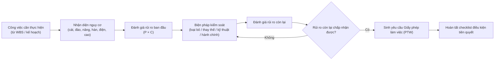
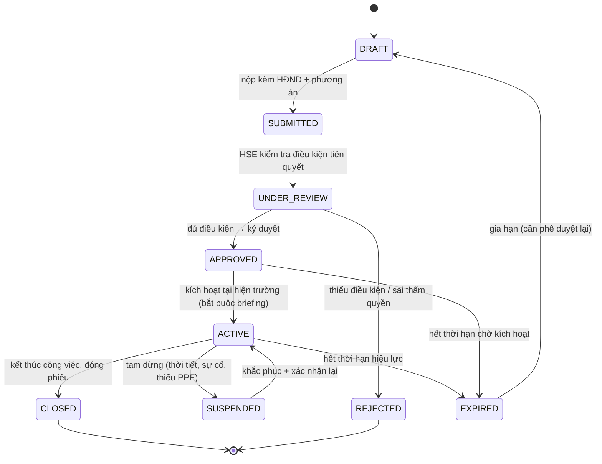
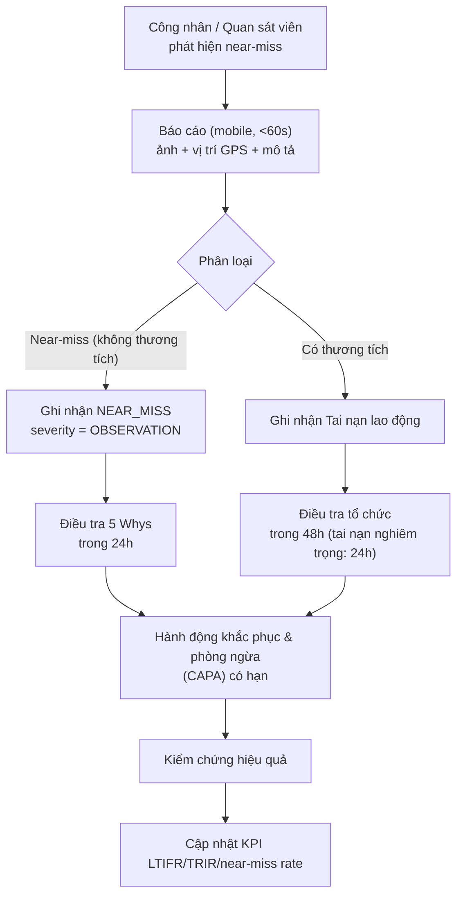
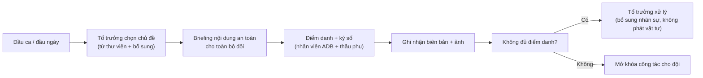
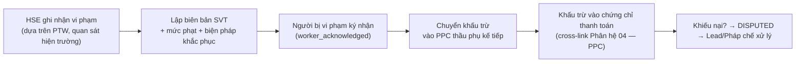

# SPEC-09: Occupational Safety & Health (HSE) — Permit to Work, Near-miss Control & Toolbox Meetings

> **Module**: 09. An toàn Lao động & An toàn Thi công (HSE) — theo Thông tư 10/2021/TT-BXD
> **Author**: BA Agent (PC-4 — `ba-hant_lap`)
> **Task**: TASK-022 — "[GIAI DOAN 3] Dac ta Module 08 (QA/QC ND 06/2021) va Module 09 (HSE An toan Lao dong & PTW)"
> **Status**: Review (chờ Lead duyệt)
> **Version**: 1.0.0
> **Date**: 2026-10-21
> **Stack**: Java 21 + Spring Boot 3.3.x + PostgreSQL 17 + React 18 + TypeScript
> **Target Enterprise**: Ánh Dương Building (ADB) — Tổng thầu Thiết kế & Thi công (D&B) Hạng I
> **Migration Target**: `backend/src/main/resources/db/migration/V6__create_qaqc_and_hse_tables.sql`
> **Package Target**: `com.anhduongbuilding.erp.hse`

> [!NOTE]
> **Quy ước đánh số Module**: ma trận phân hệ chuẩn lệ là `docs/plans/ENTERPRISE_ARCHITECTURE_ROADMAP.md`:
> **08 = Quản lý Chất lượng QA/QC (NĐ 06/2021)** · **09 = An toàn Lao động & Cấp phép HSE (PTW)**.
> Tài liệu này tách theo ranh giới Deliverable để Dev (TASK-023) và Tester (TASK-024) triển khai song song:
> `SPEC-08` (QA/QC, schema `qaqc_mgmt`) ↔ `SPEC-09` (HSE, schema `hse_mgmt`).
> Bản `MASTER_ROADMAP.md` (cũ) gộp hai phân hệ này thành "Phân hệ 11" — đã lịch sử; được ưu tiên theo ma trận 12 phân hệ mới nhất.

---

## 1. Business Objectives & Legal / Regulatory Foundation

### 1.1 Why HSE Is a System of Record, Not a Notice Board

ADB operates multi-shift industrial sites with thousands of workers (own labour + tier-1/tier-2 subcontractors) working simultaneously on cranes, steel structures, MEP and formwork. In that environment:

1. **Permit-to-Work is the single control point.** A large share of ADB's lost-time injuries originate from *uncontrolled high-energy work*: hot work (hàn cắt) near combustible formwork and fuel storage, work at height (làm việc trên cao) on structures without guardrails, and heavy lifting (nâng hạ) with uncertified cranes. A Permit to Work turns "work continues" into "work is *authorised* because N preconditions were objectively verified".
2. **Near-miss is the cheapest safety data.** The Heinrich/Bird triangle and modern safety science (DuPont, ICB) agree that near-misses outnumber injuries 50–100× and are the leading indicator. ADB therefore treats a **near-miss report as a positive act**, not a confession — a culture that punishes near-miss reporting eliminates the data needed to prevent the accident.
3. **Toolbox talk is the daily control that scales.** On a 2 000-person site, the only safety conversation that reaches every worker every day is the **họp an toàn đầu giờ (Toolbox Meeting)**. It is also the statutory mechanism for "Họp bảo đảm an toàn lao động đầu ca" and the delivery point for task-specific briefings, PTW briefings and emergency drills.
4. **Legal and financial exposure is personal.** Under **Nghị định 44/2016/NĐ-CP** and **Thông tư 10/2021/TT-BXD**, a serious accident triggers an immediate work-stoppage order from the Inspectorate of Construction (Thanh tra Bộ Xây dựng / Sở Xây dựng), criminal exposure for the officers in charge, mandatory compensation under the Labour Code, and — for a contractor — a **statutory suspension of the whole construction contract**. A single unpermitted hot-work fire on a factory slab can cost more than a year of margin on the affected project.

ADB therefore requires HSE to be a **hard-gate system**: work physically cannot be authorised without a valid permit, permits auto-expire, and every incident and near-miss is a permanent, auditable record feeding the executive risk dashboard (Phân hệ 12).

### 1.2 Legal & Regulatory Framework

| Instrument | Scope applied | Key obligations applied |
|---|---|---|
| **Thông tư 10/2021/TT-BXD** (22/12/2021) | Yêu cầu an toàn trong thi công xây dựng | Yêu cầu chung về an toàn lao động tại công trường; công tác nguy hiểm (hàn cắt, làm việc trên cao, nâng hạ); họp bảo đảm an toàn lao động đầu ca; hồ sơ an toàn lao động; điều tra tai nạn lao động |
| **Nghị định 44/2016/NĐ-CP** (06/12/2016) | An toàn, bảo hiểm lao động | Điều 7 (chủ đầu tư xây dựng thuộc trách nhiệm quản lý an toàn), Điều 21 (tài khoản thông tin tai nạn lao động), Điều 33 (khởi động lại sau tai nạn nghiêm trọng) |
| **Thông tư 36/2019/TT-BLĐTBXH** | Danh mục máy, thiết bị, vật tư yêu cầu kiểm định an toàn | Kiểm định cần cẩu tháp, cẩu tự hành, thiết bị nâng; điều kiện giấy phép sử dụng |
| **QCVN 18:2019/BXD** | Quy chuẩn kỹ thuật quốc gia về an toàn trong thi công xây dựng | An toàn thi công, an toàn điện, an toàn khoản không gian kín, phương án cứu hộ |
| **Luật An toàn lao động 2015** (Luật số 10/2015/QH13) | An toàn, bảo hiểm lao động | Quyền của người lao động được ngừng việc khi nguy cơ đe dọa tính mạng; nghĩa vụ phối hợp của người sử dụng lao động |
| **Luật Bảo hiểm xã hội 2014** (Luật số 58/2014/QH13) | Bảo hiểm xã hội | Nghĩa vụ khai báo tai nạn lao động, bệnh nghề nghiệp; thống kê tổng hợp để đối chiếu |
| **Thông tư 12/2021/TT-BXD** | Định mức xây dựng | Chi phí an toàn lao động (định mức nhân công, phương tiện, thiết bị an toàn) → chi phí 627 |
| **Thông tư 200/2014/TT-BTC** | Chế độ kế toán doanh ng lắp | Chi phí an toàn lao động và chi phí tổn thất tai nạn → TK 154 theo công trình |
| **Hợp đồng FIDIC D&B** | Hợp đồng tổng thầu | Nghĩa vụ của Nhà thầu về an toàn, quyền dừng thi công khi không đảm bảo an toàn |
| **Hợp đồng giao khoán** | Thầu phụ | Điều khoản an toàn, quyền thu hồi giấy phép, chuyển trách nhiệm khi vi phạm |

### 1.3 HSE Cost & KPI Model

| KPI | Definition | Target (ADB) |
|---|---|---|
| **LTIFR** | Lost Time Injury Frequency Rate = (số vụ tai nạn mất ngày làm việc × 200 000) / tổng giờ công | ≤ 1.0 |
| **TRIR** | Total Recordable Injury Rate = (số vụ tai nạn ghi nhận × 200 000) / tổng giờ công | ≤ 2.0 |
| **Near-miss reporting rate** | số near-miss / 1 000 giờ công | ≥ 5.0 (tín hiệu sức mạnh của hệ thống báo cáo) |
| **PTW compliance** | % phiếu PTW hợp lệ tại thời điểm kiểm tra hiện trường | 100% |
| **Toolbox participation** | % công nhân có mặt tại họp an toàn đầu giờ | ≥ 95% |
| **CAPA on-time closure** | % hành động khắc phục đóng đúng hạn | ≥ 90% |

The base of **200 000 hours** follows the standard internationally used normalisation factor for injury frequency rates.

---

## 2. User Stories

| ID | Role | User Story | Ref |
|---|---|---|---|
| US-09-01 | Chuyên viên HSE (HSE Officer) | As an **HSE Officer**, I want to **define a permit type with a mandatory precondition checklist**, so that authorisation is objective and identical for every site. | §5.1 |
| US-09-02 | Tổ trưởng (Foreman / Brigadier Leader) | As a **Foreman**, I want to **request a Permit to Work** for hot work, work at heights or heavy lifting with the location, scope and duration, so that work starts only after the hazard is controlled. | §5.2 |
| US-09-03 | HSE Officer | As an **HSE Officer**, I want to **verify each precondition with an objective value and evidence** (extinguisher count, gas cylinder, harness, crane certificate, wind speed), so that approval is based on facts, not on a verbal assurance. | §5.1 |
| US-09-04 | HSE Officer | As an **HSE Officer**, I want the system to **refuse to activate a permit whose preconditions are incomplete**, so that no permit is ever issued on a partially verified hazard control. | §5.1, §5.2 |
| US-09-05 | Giám đốc dự án (PD) | As a **Project Director**, I want to **approve high-risk permits personally** (heavy lifting, confined space, critical hot work), so that residual risk is owned at the right level. | §5.3 |
| US-09-06 | Tổ trưởng | As a **Foreman**, I want my **permit to auto-expire** at the end of its validity window and to be extendable only with re-approval, so that a permit never silently outlives the hazard assessment. | §5.4 |
| US-09-07 | HSE Officer | As an **HSE Officer**, I want to **suspend a permit immediately** when conditions change (weather, wind, fire, unauthorised work), so that work stops without a paperwork round-trip. | §5.5 |
| US-09-08 | Công nhân (Worker) | As a **Worker**, I want to **see which permits are active on my work-front** and what safety precautions apply, so that I can refuse unsafe work in good faith. | §5.6 |
| US-09-09 | Any worker | As a **Worker**, I want to **report a near-miss in under 60 seconds from my phone**, so that I can contribute to prevention without administrative effort. | §5.7 |
| US-09-10 | HSE Officer | As an **HSE Officer**, I want near-misses and incidents to be **investigated with 5-Whys and a tracked CAPA**, so that the root cause is removed rather than repeated. | §5.7, §5.8 |
| US-09-11 | Tổ trưởng | As a **Foreman**, I want to **hold a Toolbox Meeting** with a topic, an attendance list and worker signatures, so that every person on the shift has received the briefing. | §5.9 |
| US-09-12 | HSE Officer | As an **HSE Officer**, I want the system to **block material issue and hot work for a brigade with no Toolbox Meeting recorded that day**, so that the daily briefing is enforced, not merely recommended. | §5.9 |
| US-09-13 | Giám đốc dự án | As a **Project Director**, I want a **live HSE dashboard** (LTIFR, TRIR, near-miss rate, open permits, overdue CAPA), so that I can intervene before a statistic becomes an incident. | §5.10 |
| US-09-14 | Kế toán trưởng | As a **Chief Accountant**, I want **safety costs and incident costs posted to TK 154 / cost code 627** by project, so that the true cost of safety is visible in project profitability. | §5.10 |
| US-09-15 | HSE Officer | As an **HSE Officer**, I want **emergency contacts and evacuation plans per work-front** accessible offline, so that the first 5 minutes of an emergency are not spent looking for a phone number. | §5.11 |

---

## 3. End-to-End Business Workflows

### 3.1 Workflow 1 — Hazard & Risk Assessment (HĐND / JSA)



**Risk matrix**: Severity (1–5) × Likelihood (1–5) → Risk Level `LOW (1–4)`, `MEDIUM (5–9)`, `HIGH (10–15)`, `CRITICAL (16–25)`.

**Rule HRA-1**: No PTW may be created without an approved Risk Assessment linked to it, unless the permit type is configured as `requires_risk_assessment = FALSE` (e.g. simple lifting below 500 kg with an approved generic JSA).

**Rule HRA-2**: A `HIGH` or `CRITICAL` residual risk requires a **method statement** (phương án thi công / biện pháp thi công) to be attached before the permit can be approved.

### 3.2 Workflow 2 — Permit to Work Lifecycle



**Rule PTW-1 (Activation gate — canonical)**: A permit transitions `APPROVED → ACTIVE` **only if** every mandatory precondition of its type has `result = PASSED` and every required approval signature is present. For `HOT_WORK` and `WORKING_AT_HEIGHT` this explicitly includes **`FIRE_EXTINGUISHER_COUNT >= 2`**. Otherwise the API returns **HTTP 409** with code `PTW_PRECONDITION_FAILED` and, for the extinguisher rule specifically, `EXTINGUISHER_COUNT_INSUFFICIENT`. **This is the rule validated by the Tester suite `PermitToWorkServiceTest`.**

**Rule PTW-2 (Preconditions are data-driven)**: The precondition checklist for each permit type lives in `hse_mgmt.ptw_preconditions` and is seeded per permit type. Adding "dây an toàn 2 điểm" to `WORKING_AT_HEIGHT` or "bình chữa cháy ≥ 2" to `HOT_WORK` is a configuration change, not a code change.

**Rule PTW-3 (Validity window)**: A permit is valid from `valid_from` until `valid_until` (default: **the end of the current shift, max 12 hours**). At `valid_until` the system transitions the permit to `EXPIRED` automatically (scheduled job, every 5 minutes) and **blocks any dependent work** (GIN issuance in [SPEC-05](SPEC-05-MATERIALS-WAREHOUSE.md), QA/QC hold-point release in [SPEC-08](SPEC-08-QAQC-INSPECTION.md)).

**Rule PTW-4 (Extension)**: Extending an `ACTIVE` permit requires a new **re-validation of all preconditions** plus a fresh approval at the same authority level. A blind extension is rejected with `PTW_EXTENSION_REQUIRES_REVALIDATION`.

**Rule PTW-5 (Pre-activation briefing)**: `APPROVED → ACTIVE` requires a **pre-job briefing record** (name, time, attendees count, content summary) — the "Họp bảo đảm an toàn lao động đầu ca/đầu công việc" of Thông tư 10/2021/TT-BXD. A permit cannot be activated without it.

**Rule PTW-6 (One permit = one location, one scope)**: A permit covers exactly one `location` + one `scope_description`. Work outside it requires a separate permit (Rule RFI-3 analogue from SPEC-08).

**Rule PTW-7 (Immediate suspension)**: HSE, the PD or the Site Manager can suspend an `ACTIVE` permit instantly (`SUSPENDED`) — no reason code hierarchy, but the reason is mandatory and recorded in the audit log.

**Rule PTW-8 (Validity of linked certificates)**: A permit whose referenced equipment certificate (e.g. crane `kiểm định an toàn`) expires while the permit is active MUST auto-suspend the permit (`SUSPENDED`, reason `CERTIFICATE_EXPIRED`). This links HSE to [SPEC-06](SPEC-06-EQUIPMENT-FLEET.md).

### 3.3 Workflow 3 — Permit Type Profiles

| Permit type | Code | Mandatory preconditions (minimum set) | Approval chain | Validity |
|---|---|---|---|---|
| **Hàn cắt (Hot Work)** | `HOT_WORK` | `FIRE_EXTINGUISHER_COUNT ≥ 2`; `GAS_CYLINDER_CHECK`; `FIRE_WATCH_ASSIGNED`; `AREA_ISOLATION`; `COMBUSTIBLE_MATERIAL_CLEARED`; `PPE_COMPLETE`; `TRAINING_VERIFIED` | Tổ trưởng → HSE → Site Manager (PD nếu `HIGH` risk) | 8 h, theo ca |
| **Làm việc trên cao (Work at Heights)** | `WORKING_AT_HEIGHT` | `FIRE_EXTINGUISHER_COUNT ≥ 2`; `HARNESS_INSPECTED`; `GUARDRAIL_OR_SCAFFOLD_VERIFIED`; `RESCUE_PLAN`; `ANCHOR_POINT_VERIFIED`; `PPE_COMPLETE` | Tổ trưởng → HSE → Site Manager | 8 h |
| **Nâng hạ (Heavy Lifting)** | `HEAVY_LIFTING` | `LIFTING_PLAN_ATTACHED`; `CRANE_INSPECTION_VALID`; `WIND_SPEED_WITHIN_LIMIT`; `EXCLUSION_ZONE_SET`; `RIGGER_AND_SIGNALER_ASSIGNED`; `LIFT_PLAN_APPROVED` | Tổ trưởng → HSE → **PD (bắt buộc)** | 4 h |
| **Không gian kín (Confined Space)** | `CONFINED_SPACE` | `GAS_TESTING_PASSED`; `VENTILATION_VERIFIED`; `RESCUE_TEAM_STANDBY`; `ENTRY_PERSONNEL_REGISTERED`; `CONTINUOUS_MONITORING`; `COMMUNICATION_CHECKED` | Tổ trưởng → HSE → **PD + Kỹ thuật** | 4 h |
| **Đào đất / hố sâu (Excavation)** | `EXCAVATION` | `UTILITY_SURVEY_DONE`; `SHORING_OR_SLOP_INSTALLED`; `ACCESS_AND_EGRESS`; `WATER_PUMPING_PLAN`; `PPE_COMPLETE` | Tổ trưởng → HSE | 8 h |
| **Cách điện (Electrical Isolation)** | `ELECTRICAL_ISOLATION` | `LOTO_APPLIED`; `ZERO_ENERGY_VERIFIED`; `LOCKS_AND_TAGS_RECORDED`; `AUTHORISED_PERSON_PRESENT` | Tổ trưởng → HSE → Kỹ thuật | 8 h |
| **Phá dỡ (Demolition)** | `DEMOLITION` | `DEMOLITION_PLAN`; `UTILITY_DISCONNECTED`; `ASBESTOS_ASSESSMENT`; `EXCLUSION_ZONE`; `PPE_COMPLETE` | Tổ trưởng → HSE → **PD + Kỹ thuật** | 8 h |

> The 7 types above are the ADB baseline. `ptw_preconditions` is configuration, so a project may add types (e.g. `TEMPORARY_ELECTRICITY`, `WORK_IN_CONFINED_SHAFT`) without a schema change.

### 3.4 Workflow 4 — Near-miss Reporting & Investigation



**Rule HS-1**: **Near-miss reports MUST NOT be attributed to the reporting individual for performance management purposes.** The reporter field is recorded for follow-up, but the report is credited to the organisation, and the system forbids any performance-review linkage (enforced by RBAC: `HSE_MANAGER` cannot export reporter-level data for appraisal purposes).

**Rule HS-2 (SLA)**: `NEAR_MISS` must be triaged within **24 hours** and closed within **14 days**. `LOST_TIME` (mất ngày làm việc) must be triaged within **8 hours** and closed within **30 days**. `FATALITY` / `CRITICAL` requires an **immediate** (≤ 1 hour) notification to the PD, the General Director and the labour authority, and the site stops work until the investigation is complete (Nghị định 44/2016/NĐ-CP Điều 33).

**Rule HS-3 (Reporting channels)**: A report can come from a worker (mobile), an HSE officer, a QA/QC inspection (auto-raised from a failed checklist item in [SPEC-08](SPEC-08-QAQC-INSPECTION.md)), or an external party (TVGS, client representative) — the latter flagged `external_reporter = TRUE`.

**Rule HS-4 (5-Whys)**: Each incident MUST record a root-cause chain of at least **3 levels** with a final category from the 6M set (`METHOD, MANPOWER, MACHINE, MATERIAL, MEASUREMENT, ENVIRONMENT`) plus an HSE-specific extension (`PROCEDURE, TRAINING, DESIGN, SUPERVISION`).

**Rule HS-5 (CAPA tracking)**: Every CAPA has an owner, a due date and a verification step. Overdue CAPA raises a daily alert to the PD.

### 3.5 Workflow 5 — Toolbox Meeting (Họp an toàn đầu giờ)



**Rule TB-1**: A Toolbox Meeting is bound to a **project**, a **brigade/crew** (`brigade_code`), a **date**, a **shift** (`CA_1`, `CA_2`, `CA_3`, `CA_4` — ca 8h/ ca 16h/ ca đêm) and a **topic**.

**Rule TB-2 (Minimum attendance)**: The meeting is `VALID` only if attendance ≥ **90% of the brigade's headcount on shift** AND at least one representative of each subcontractor company present on site. Otherwise `status = 'INCOMPLETE'` and the brigade is **locked**: material issue (GIN) and hot-work permit creation for that brigade are refused.

**Rule TB-3 (Topic library)**: Topics come from `hse_mgmt.toolbox_topics`, covering at minimum: PTW briefing, working at height, hot work, lifting, PPE, housekeeping, emergency procedures, heat stress, and site-specific hazards. Each topic references the relevant regulatory basis.

**Rule TB-4 (Linkage to PTW)**: For work requiring a PTW, the toolbox meeting of that day may be attached to the permit as the pre-activation briefing (`ptw_id` on the meeting).

**Rule TB-5 (Signature)**: Attendance is captured by signature (drawn on the mobile canvas) or by QR scan of the worker's safety card; both are legally acceptable evidence of "đã được hướng dẫn".

### 3.6 Workflow 6 — HSE Emergency Response

**Rule EMG-1**: Every work-front has an emergency plan with: assembly points, evacuation routes, fire-fighting equipment locations, first-aid points, and the emergency contact list (`hse_mgmt.site_emergency_contacts`) — available **offline** on the mobile app (mandatory: the network is frequently down at the site perimeter).

**Rule EMG-2**: Every permit records, at activation, the **nearest fire extinguisher** and the **nearest first-aid station** for its location, so that the first responder does not need to search.

### 3.7 Workflow 7 — Safety Training Certificate (Chứng chỉ huấn luyện An toàn lao động)

Nghị định 44/2016/NĐ-CP divides safety training into **4 groups**; a worker may only perform tasks belonging to the groups for which they hold a valid certificate.

| Nhóm | Scope | Typical ADB roles |
|---|---|---|
| **Nhóm 1** | Huấn luyện bổ sung cho người lao động làm việc ở vị trí đã đào tạo (vận hành máy, điều khiển thiết bị) | Thợ vận hành, thợ hàn |
| **Nhóm 2** | Huấn luyện bổ sung cho người lao động làm việc ở vị trí đã đào tạo (điện, áp lực, nâng hạ) | Thợ điện, thợ cơ khí, người vận hành cần cẩu |
| **Nhóm 3** | Huấn luyện bổ sung cho người lao động làm việc ở vị trí đã đào tạo (an toàn vận hành thiết bị nâng, thiết bị áp lực, máy thi công) | Người vận hành cần cẩu tháp, người vận hành máy đào |
| **Nhóm 4** | Huấn luyện cho người lao động mới vào làm việc / chuyển công việc / nghỉ việc lâu > 6 tháng | Toàn bộ lao động mới, lao động thầu phụ mới |

**Rule TRN-1**: A worker without a valid certificate for the required group MUST NOT be recorded against a task that requires it. The check is enforced in two places: (a) the `HARNESS_INSPECTED` / `TRAINING_VERIFIED` / `CRANE_INSPECTION_VALID` preconditions of a PTW, and (b) the `CRANE_INSPECTION_VALID` / `RIGGER_AND_SIGNALER_ASSIGNED` preconditions referencing an operator certificate from [SPEC-06](SPEC-06-EQUIPMENT-FLEET.md).

**Rule TRN-2**: `expires_date` is optional — a certificate without an expiry date stays `VALID` until explicitly revoked. A certificate with an expiry date transitions `VALID → EXPIRING_SOON` (30 days) → `EXPIRED`, and an expired certificate is reported by the Compliance view.

**Rule TRN-3**: Certificates issued to subcontractor personnel are recorded in the same register with `company` and `subcontractor_id`, so the Site Manager can answer "is every person on this work-front qualified?" in one query.

### 3.8 Workflow 8 — Safety Violation Ticket (Biên bản vi phạm an toàn hiện trường)



**Rule SVT-1**: A safety violation detected during an active PTW **automatically suspends the permit** (reason `PERMIT_VIOLATION`) and raises an SVT referencing that permit.

**Rule SVT-2**: The penalty amount is deducted **directly from the next Progress Payment Certificate (PPC)** of the subcontractor. The SVT is the auditable source document for the deduction (cross-link Phân hệ 04 §5 — `subcontractor_mgmt.payment_certificates`).

**Rule SVT-3**: The worker must acknowledge the ticket (`worker_acknowledged`). An unacknowledged ticket cannot be closed and is escalated to the Site Manager after 48 hours. Acknowledgement acknowledges **receipt of the notice**, it is not an admission of liability.

**Rule SVT-4**: A `CRITICAL` SVT (e.g. working without a valid PTW, operating an uncertified crane, or bypassing an interlock) is escalated to the PD and the Technical Director within 1 hour, and the subcontractor may be **suspended from the site** — a contractual right under the FIDIC-style subcontract.

**Rule SVT-5**: `deduction_status` transitions `PENDING → SCHEDULED → DEDUCTED` (or `WAIVED` by the PD, or `DISPUTED` then `VOID`).

---

## 4. Business Rules, Formulas & Thresholds

### 4.1 PTW Activation Evaluation (authoritative)

```
activate(permit):
    1. permit.status must be APPROVED              → else PTW_NOT_APPROVED
    2. every approval row in ptw_approvals must exist for the permit's approval chain
                                                       → else PTW_APPROVAL_INCOMPLETE
    3. a pre-job briefing record must exist          → else PTW_BRIEFING_MISSING
    4. for each mandatory precondition p in ptw_preconditions
           where permit_type = permit.permit_type and p.is_mandatory = TRUE:
           r = ptw_precondition_results for (permit, p)
           if r is missing or r.result <> 'PASSED':
                if p.precondition_code = 'FIRE_EXTINGUISHER_COUNT' and r.actual_value < 2:
                     → 409 EXTINGUISHER_COUNT_INSUFFICIENT
                else → 409 PTW_PRECONDITION_FAILED (list every failing precondition)
    5. linked certificates (crane inspection, gas test, etc.) must be currently valid
                                                       → else 409 LINKED_CERTIFICATE_EXPIRED
    6. current time must be within [valid_from, valid_until] → else 409 PTW_EXPIRED
    7. GRANT → permit.status = 'ACTIVE', activated_at = now, activated_by = user
```

### 4.2 Permit validity & expiry

| Parameter | Default | Configurable in |
|---|---|---|
| Hot work validity | 8 h (end of shift) | `hse_mgmt.hse_alert_rules` / permit type |
| Work at heights validity | 8 h | " |
| Heavy lifting validity | 4 h | " |
| Confined space validity | 4 h | " |
| Pre-activation window (APPROVED → ACTIVE) | 24 h | `hse_mgmt.hse_alert_rules` |
| Expiry sweep job interval | 5 min | Scheduler config |
| Extension re-validation | ALL preconditions re-checked | Rule PTW-4 |
| Wind speed limit for lifting (per [SPEC-06](SPEC-06-EQUIPMENT-FLEET.md) §2.3) | ≤ 14 m/s | `hse_mgmt.hse_alert_rules` |

### 4.3 Incident severity & escalation

| Severity | Definition | Escalation | Triage SLA | Closure SLA |
|---|---|---|---|---|
| `OBSERVATION` | Near-miss / unsafe condition, no harm | HSE Officer | 24 h | 14 days |
| `FIRST_AID` | First aid treated, no lost time | HSE Officer + Site Manager | 24 h | 21 days |
| `LOST_TIME` | Lost time injury (≥ 1 day off work) | Site Manager + PD + **HR (báo cáo BHXH)** | 8 h | 30 days |
| `CRITICAL` | Serious injury (amputation, blindness, hospitalisation > 24 h) or fatality | PD + General Director + **cơ quan quản lý nhà nước** | ≤ 1 h | Until work-stop lifted |

### 4.4 KPI formulas

```
total_hours_worked = SUM(attendance.worked_hours) over the period   (cross-link module Nhân sự & Chấm công)

LTIFR = (count(incidents where severity = 'LOST_TIME') × 200000) / total_hours_worked
TRIR  = (count(incidents where severity in ('LOST_TIME','CRITICAL','FIRST_AID') and recordable = TRUE)
         × 200000) / total_hours_worked
near_miss_rate = (count(incidents where incident_type = 'NEAR_MISS') × 1000) / total_hours_worked
PTW compliance % = (count(permits with all preconditions PASSED at field audit) / count(permits issued)) × 100
CAPA on-time % = (count(actions completed on or before due_date) / count(actions due)) × 100
```

### 4.5 Toolbox coverage gate

```
brigade_is_covered(brigade_code, work_date, shift):
    meeting = latest toolbox_meetings where brigade_code = ? and work_date = ? and shift = ?
    if meeting is null                 → NOT COVERED   (block GIN, block HOT_WORK permit)
    if meeting.status <> 'VALID'       → NOT COVERED
    if meeting.attendance_count < 0.90 × brigade_headcount_on_shift → NOT COVERED
    else                               → COVERED
```

---

## 5. Acceptance Criteria (Gherkin)

```gherkin
# ─────────────────────────────────────────────────────────────────────────
# SPEC-09 — Acceptance Criteria
# Ref: US-09-01 … US-09-15
# ─────────────────────────────────────────────────────────────────────────

Scenario AC-09-01: Cấp PTW hợp lệ khi đủ điều kiện tiên quyết — trạng thái ACTIVE
  Given một loại giấy phép "HOT_WORK" có điều kiện tiên quyết bắt buộc gồm:
    | precondition_code          | expected_value | is_mandatory |
    | FIRE_EXTINGUISHER_COUNT    | 2              | TRUE         |
    | GAS_CYLINDER_CHECK         | PASSED         | TRUE         |
    | FIRE_WATCH_ASSIGNED        | PASSED         | TRUE         |
    | AREA_ISOLATION             | PASSED         | TRUE         |
  And một phiếu PTW ở trạng thái "APPROVED" đã có đủ các dòng phê duyệt theo chuỗi
  And đã có biên bản họp bảo đảm an toàn trước khi thi công (briefing)
  And kết quả kiểm tra các điều kiện tiên quyết đều là "PASSED", trong đó số bình chữa cháy là 2
  When người dùng kích hoạt phiếu PTW
  Then trạng thái phiếu phải chuyển sang "ACTIVE"
  And phải ghi nhận activated_at và activated_by
  And kết quả trả về phải có httpStatus 200

Scenario AC-09-02: Thiếu bình chữa cháy thứ hai — từ chối kích hoạt, giữ nguyên trạng thái APPROVED
  Given một phiếu PTW loại "HOT_WORK" ở trạng thái "APPROVED" đã đủ phê duyệt và briefing
  And kết quả kiểm tra FIRE_EXTINGUISHER_COUNT có actual_value = 1 (yêu cầu tối thiểu 2)
  And tất cả điều kiện tiên quyết khác đều "PASSED"
  When người dùng kích hoạt phiếu PTW
  Then hệ thống phải từ chối với httpStatus 409 và mã lỗi "EXTINGUISHER_COUNT_INSUFFICIENT"
  And trạng thái phiếu PTW phải giữ nguyên là "APPROVED"
  And KHÔNG được ghi activated_at
  And thông báo lỗi phải nêu rõ yêu cầu tối thiểu 2 bình chữa cháy

Scenario AC-09-03: PTW làm việc trên cao thiếu dây an toàn — từ chối kích hoạt
  Given một phiếu PTW loại "WORKING_AT_HEIGHT" ở trạng thái "APPROVED"
  And điều kiện tiên quyết FIRE_EXTINGUISHER_COUNT có actual_value = 2 (đạt)
  And điều kiện tiên quyết HARNESS_INSPECTED có actual_value = 0 (yêu cầu tối thiểu 1)
  When người dùng kích hoạt phiếu PTW
  Then hệ thống phải từ chối với httpStatus 409 và mã lỗi "PTW_PRECONDITION_FAILED"
  And danh sách blockedBy phải chứa "HARNESS_INSPECTED"
  And trạng thái phiếu PTW phải giữ nguyên là "APPROVED"

Scenario AC-09-04: PTW nâng hạ khi chứng nhận kiểm định cần cẩu đã hết hạn — từ chối
  Given một phiếu PTW loại "HEAVY_LIFTING" ở trạng thái "APPROVED"
  And điều kiện tiên quyết CRANE_INSPECTION_VALID có actual_value = 0 (yêu cầu tối thiểu 1)
  When người dùng kích hoạt phiếu PTW
  Then hệ thống phải từ chối với httpStatus 409 và mã lỗi "PTW_PRECONDITION_FAILED"
  And trong blockedBy phải chứa "CRANE_INSPECTION_VALID"

Scenario AC-09-05: PTW hết thời hạn — tự động chuyển EXPIRED và chặn công việc phụ thuộc
  Given một phiếu PTW ở trạng thái "ACTIVE" có valid_until đã qua
  When tác vụ định kỳ quét hạn hiệu lực chạy
  Then trạng thái phiếu phải chuyển sang "EXPIRED"
  And hệ thống phải gửi cảnh báo tới Tổ trưởng, HSE và Site Manager
  And các yêu cầu phát vật tư (GIN) và giải phóng Hold Point gắn với phiếu đó phải bị từ chối

Scenario AC-09-06: Gia hạn PTW mà không kiểm tra lại điều kiện tiên quyết — từ chối
  Given một phiếu PTW ở trạng thái "ACTIVE" đang được xin gia hạn
  And hệ thống phát hiện chưa có bản kiểm tra lại (re-validation) của các điều kiện tiên quyết
  When người dùng gửi yêu cầu gia hạn
  Then hệ thống phải từ chối với mã lỗi "PTW_EXTENSION_REQUIRES_REVALIDATION"
  And valid_until của phiếu phải giữ nguyên

Scenario AC-09-07: Tạm dừng PTW khi có điều kiện bất an — chặn công việc ngay
  Given một phiếu PTW ở trạng thái "ACTIVE"
  When HSE Officer gửi yêu cầu tạm dừng với lý do "Gió cấp 8, tạm dừng nâng hạ"
  Then trạng thái phiếu phải chuyển sang "SUSPENDED"
  And phải ghi nhận suspended_at, suspended_by và lý do
  And mọi yêu cầu phụ thuộc vào phiếu phải bị từ chối trong khi phiếu đang tạm dừng

Scenario AC-09-08: Báo cáo near-miss — ghi nhận đầy đủ, không tính là tai nạn
  Given một công nhân gửi báo cáo near-miss với mô tả, ảnh và toạ độ GPS
  When hệ thống tiếp nhận báo cáo
  Then incident_type phải bằng "NEAR_MISS"
  And severity phải bằng "OBSERVATION"
  And số người bị thương phải bằng 0
  And hệ thống phải tạo một nhiệm vụ điều tra với hạn 24 giờ
  And báo cáo KHÔNG được dùng làm căn cứ kỷ luật người báo cáo

Scenario AC-09-09: Tai nạn mất ngày làm việc (LOST_TIME) — leo thang trong 8 giờ và thông báo BHXH
  Given một tai nạn lao động với severity = "LOST_TIME" và số ngày nghỉ việc = 12
  When hệ thống ghi nhận tai nạn
  Then hệ thống phải gửi thông báo tới Site Manager, Giám đốc dự án và bộ phận Nhân sự
  And thời gian triage tối đa được ghi nhận là 8 giờ
  And phải tạo mẫu báo cáo tai nạn lao động cho cơ quan bảo hiểm

Scenario AC-09-10: Điều tra tai nạn bắt buộc có chuỗi 5 Whys tối thiểu 3 cấp
  Given một tai nạn ở trạng thái "UNDER_INVESTIGATION" chưa có nguyên nhân gốc
  When người dùng gửi yêu cầu phê duyệt xử lý
  Then hệ thống phải từ chối với mã lỗi "ROOT_CAUSE_CHAIN_INCOMPLETE"
  And nêu rõ yêu cầu tối thiểu 3 cấp nguyên nhân
  And phải liệt kê các danh mục nguyên nhân gốc hợp lệ: METHOD, MANPOWER, MACHINE, MATERIAL, MEASUREMENT, ENVIRONMENT, PROCEDURE, TRAINING, DESIGN, SUPERVISION

Scenario AC-09-11: Họp an toàn đầu giờ thiếu điểm danh — đội bị khoá, không phát vật tư
  Given một đội thi công có 20 người trong ca
  And hệ thống ghi nhận một phiếu họp an toàn với attendance_count = 12 (60% < 90%)
  When kho vật tư thử phát vật tư cho đội đó trong ngày
  Then hệ thống phải từ chối với mã lỗi "TOOLBOX_MEETING_NOT_COVERED"
  And trạng thái phiếu họp phải là "INCOMPLETE"
  And không được tạo phiếu xuất kho cho đội đó trong ca hiện tại

Scenario AC-09-12: Họp an toàn đầu giờ đủ điểm danh — đội được mở khóa
  Given một đội thi công có 20 người trong ca
  And có một phiếu họp an toàn hợp lệ với attendance_count = 19 (95% >= 90%)
  And có đại diện của các công ty thầu phụ có mặt tại công trường
  When kho vật tư phát vật tư cho đội đó trong ngày
  Then yêu cầu phải được chấp nhận
  And trạng thái phiếu họp phải là "VALID"

Scenario AC-09-13: Tính LTIFR và TRIR theo công thức chuẩn 200.000 giờ
  Given tổng số giờ công trong kỳ là 400000 giờ
  And có 2 tai nạn mất ngày làm việc và 4 tai nạn ghi nhận khác
  When hệ thống tính chỉ số
  Then LTIFR phải bằng (2 × 200000) / 400000 = 1.00
  And TRIR phải bằng (6 × 200000) / 400000 = 3.00
  And near_miss_rate phải bằng (số near-miss × 1000) / 400000

Scenario AC-09-14: PTW không kích hoạt được khi thiếu biên bản họp bảo đảm an toàn
  Given một phiếu PTW ở trạng thái "APPROVED" đã đủ điều kiện tiên quyết
  And chưa có biên bản họp bảo đảm an toàn trước khi thi công
  When người dùng kích hoạt phiếu PTW
  Then hệ thống phải từ chối với mã lỗi "PTW_BRIEFING_MISSING"

Scenario AC-09-15: Chứng nhận kiểm định thiết bị hết hạn trong khi phiếu đang hiệu lực — tự tạm dừng
  Given một phiếu PTW "HEAVY_LIFTING" đang ở trạng thái "ACTIVE"
  And chứng nhận kiểm định an toàn của cần cẩu tham chiếu đã hết hạn
  When tác vụ định kỳ kiểm tra chứng nhận liên kết chạy
  Then trạng thái phiếu phải chuyển sang "SUSPENDED"
  And lý do phải ghi nhận là "CERTIFICATE_EXPIRED"
  And phải gửi cảnh báo tới HSE và Giám đốc dự án

Scenario AC-09-16: Vi phạm an toàn trong phạm vi PTW — tự động tạm dừng phiếu và lập biên bản vi phạm
  Given một phiếu PTW "HOT_WORK" đang ở trạng thái "ACTIVE"
  When HSE Officer lập biên bản vi phạm an toàn với violation_type = "NO_PPE" và violated_party_type = "SUBCONTRACTOR"
  Then trạng thái phiếu PTW phải chuyển sang "SUSPENDED" với lý do "PERMIT_VIOLATION"
  And phải tạo một bản ghi safety_violation_tickets với permit_to_work_id trỏ tới phiếu đó
  And biên bản phải có penalty_amount và corrective_action
  And trạng thái biên bản phải là "OPEN" và worker_acknowledged phải là FALSE

Scenario AC-09-17: Biên bản vi phạm phải được người lao động ký nhận trước khi đóng
  Given một biên bản vi phạm an toàn đang ở trạng thái "OPEN" và chưa được người lao động ký nhận
  When người dùng thử đóng biên bản
  Then hệ thống phải từ chối với mã lỗi "SVT_NOT_ACKNOWLEDGED"
  And trạng thái biên bản phải giữ nguyên là "OPEN"

Scenario AC-09-18: Khấu trừ tiền phạt vào chứng chỉ thanh toán PPC kế tiếp
  Given một biên bản vi phạm an toàn đã được ký nhận với penalty_amount = 5.000.000 VND
  And deduction_status = "PENDING"
  And thầu phụ có một chứng chỉ thanh toán PPC đang chờ ký
  When Site Manager gửi yêu cầu lên lịch khấu trừ
  Then deduction_status phải chuyển sang "SCHEDULED"
  And phải ghi nhận ppc_deduction_id trỏ tới chứng chỉ thanh toán tương ứng
  And số tiền khấu trừ không được vượt quá giá trị còn lại của PPC — nếu vượt thì phải báo lỗi "DEDUCTION_EXCEEDS_PPC_VALUE"

Scenario AC-09-19: Chứng chỉ huấn luyện an toàn hết hạn — báo cáo vi phạm điều kiện nhân sự
  Given một chứng chỉ huấn luyện Nhóm 3 có expires_date đã qua
  And trạng thái của chứng chỉ là "EXPIRED"
  When hệ thống tạo báo cáo tuân thủ nhân sự công trường
  Then chứng chỉ đó phải xuất hiện trong danh sách vi phạm với lý do "CERTIFICATE_EXPIRED"
  And những chứng chỉ còn hiệu lực của cùng nhóm đó KHÔNG được đánh dấu vi phạm

Scenario AC-09-20: Người lao động chưa có chứng chỉ huấn luyện bắt buộc — chặn cấp giấy phép
  Given một phiếu PTW "HEAVY_LIFTING" đang ở trạng thái "APPROVED"
  And điều kiện tiên quyết RIGGER_AND_SIGNALER_ASSIGNED có actual_value = 0
  And người được phân công không có chứng chỉ huấn luyện Nhóm 3 còn hiệu lực
  When người dùng kích hoạt phiếu PTW
  Then hệ thống phải từ chối với mã lỗi "PTW_PRECONDITION_FAILED"
  And trong blockedBy phải chứa "RIGGER_AND_SIGNALER_ASSIGNED"
```

---

## 6. Database Schema (PostgreSQL DDL)

> **Schema**: `hse_mgmt`
> **FK rule**: hard FK only to `core_iam.users` / `project_mgmt.projects` / `project_mgmt.wbs_items` (V1). References to modules whose migration is not yet deployed (`inventory_mgmt` from V3, `equipment_mgmt` from V4, `qaqc_mgmt` from V6) are **logical references** (`BIGINT` + documented business key); the physical constraint is added by a later migration.

```sql
-- ==========================================================
-- V6 (phần HSE) — Schema: hse_mgmt
-- Module 09 — An toàn Lao động & An toàn Thi công (Thông tư 10/2021/TT-BXD)
-- ==========================================================

CREATE SCHEMA IF NOT EXISTS hse_mgmt;

-- ── 1. Danh mục nguy cơ ─────────────────────────────────────────────────
CREATE TABLE IF NOT EXISTS hse_mgmt.hazard_categories (
    id BIGSERIAL PRIMARY KEY,
    code VARCHAR(50) UNIQUE NOT NULL,          -- 'CUT','ELECTRO','LIFT','HEIGHT','HOTWORK','CONFINED','DUST','NOISE'
    name VARCHAR(150) NOT NULL,
    description TEXT,
    default_severity INTEGER DEFAULT 3,        -- 1..5
    is_active BOOLEAN DEFAULT TRUE,
    created_at TIMESTAMP WITH TIME ZONE DEFAULT CURRENT_TIMESTAMP
);

-- ── 2. HĐND / JSA — Phiếu đánh giá rủi ro ─────────────────────────────
CREATE TABLE IF NOT EXISTS hse_mgmt.risk_assessments (
    id BIGSERIAL PRIMARY KEY,
    ra_no VARCHAR(50) UNIQUE NOT NULL,         -- 'HĐND-101-0007'
    project_id BIGINT NOT NULL REFERENCES project_mgmt.projects(id) ON DELETE CASCADE,
    wbs_item_id BIGINT REFERENCES project_mgmt.wbs_items(id),
    activity_name VARCHAR(255) NOT NULL,
    location VARCHAR(255),
    performed_by BIGINT NOT NULL REFERENCES core_iam.users(id),
    performed_at TIMESTAMP WITH TIME ZONE NOT NULL DEFAULT CURRENT_TIMESTAMP,
    initial_risk_level VARCHAR(20),            -- 'LOW','MEDIUM','HIGH','CRITICAL'
    residual_risk_level VARCHAR(20),
    method_statement_url TEXT,
    status VARCHAR(30) NOT NULL DEFAULT 'DRAFT',
        -- 'DRAFT','SUBMITTED','APPROVED','REJECTED','SUPERSEDED'
    approved_by BIGINT REFERENCES core_iam.users(id),
    approved_at TIMESTAMP WITH TIME ZONE,
    created_at TIMESTAMP WITH TIME ZONE DEFAULT CURRENT_TIMESTAMP,
    updated_at TIMESTAMP WITH TIME ZONE DEFAULT CURRENT_TIMESTAMP
);

-- ── 3. Chi tiết nguy cơ & biện pháp kiểm soát trong HĐND ────────────────
CREATE TABLE IF NOT EXISTS hse_mgmt.risk_assessment_items (
    id BIGSERIAL PRIMARY KEY,
    risk_assessment_id BIGINT NOT NULL REFERENCES hse_mgmt.risk_assessments(id) ON DELETE CASCADE,
    sequence_no INTEGER NOT NULL DEFAULT 1,
    hazard_category_id BIGINT REFERENCES hse_mgmt.hazard_categories(id),
    hazard_description TEXT NOT NULL,
    who_at_risk VARCHAR(255),
    initial_severity INTEGER NOT NULL DEFAULT 1,   -- 1..5
    initial_likelihood INTEGER NOT NULL DEFAULT 1, -- 1..5
    initial_risk_score INTEGER GENERATED ALWAYS AS (initial_severity * initial_likelihood) STORED,
    control_measures TEXT,
    control_owner VARCHAR(255),
    residual_severity INTEGER,
    residual_likelihood INTEGER,
    residual_risk_score INTEGER GENERATED ALWAYS AS (residual_severity * residual_likelihood) STORED,
    is_satisfactory BOOLEAN DEFAULT FALSE
);

-- ── 4. Loại giấy phép làm việc (PTW type) ──────────────────────────────
CREATE TABLE IF NOT EXISTS hse_mgmt.permit_to_work_types (
    id BIGSERIAL PRIMARY KEY,
    code VARCHAR(50) UNIQUE NOT NULL,          -- 'HOT_WORK','WORKING_AT_HEIGHT','HEAVY_LIFTING','CONFINED_SPACE','EXCAVATION','ELECTRICAL_ISOLATION','DEMOLITION'
    name VARCHAR(150) NOT NULL,
    description TEXT,
    requires_risk_assessment BOOLEAN DEFAULT TRUE,
    requires_method_statement BOOLEAN DEFAULT TRUE,
    requires_pre_job_briefing BOOLEAN DEFAULT TRUE,
    default_validity_hours INTEGER NOT NULL DEFAULT 8,
    max_validity_hours INTEGER NOT NULL DEFAULT 12,
    requires_pd_approval BOOLEAN DEFAULT FALSE,
    approval_chain JSONB DEFAULT '[]'::jsonb,  -- ["FOREMAN","HSE_OFFICER","SITE_MANAGER","PROJECT_DIRECTOR"]
    is_active BOOLEAN DEFAULT TRUE,
    created_at TIMESTAMP WITH TIME ZONE DEFAULT CURRENT_TIMESTAMP
);

-- ── 5. Điều kiện tiên quyết theo loại giấy phép (data-driven) ───────────
CREATE TABLE IF NOT EXISTS hse_mgmt.ptw_preconditions (
    id BIGSERIAL PRIMARY KEY,
    permit_type_code VARCHAR(50) NOT NULL REFERENCES hse_mgmt.permit_to_work_types(code),
    precondition_code VARCHAR(80) NOT NULL,     -- 'FIRE_EXTINGUISHER_COUNT','HARNESS_INSPECTED',...
    precondition_name VARCHAR(255) NOT NULL,
    description TEXT,
    expected_type VARCHAR(30) NOT NULL DEFAULT 'BOOLEAN', -- 'BOOLEAN','COUNT','NUMERIC','TEXT'
    expected_min_value NUMERIC(12, 3),
    expected_max_value NUMERIC(12, 3),
    expected_unit VARCHAR(30),
    is_mandatory BOOLEAN DEFAULT TRUE,
    sequence_no INTEGER NOT NULL DEFAULT 1,
    evidence_required BOOLEAN DEFAULT FALSE,
    applies_to_scope VARCHAR(30) DEFAULT 'ALL',  -- 'ALL','HOT_WORK','WORKING_AT_HEIGHT',...
    UNIQUE (permit_type_code, precondition_code)
);

-- ── 6. Giấy phép làm việc (PermitToWork) ───────────────────────────────
CREATE TABLE IF NOT EXISTS hse_mgmt.permit_to_work (
    id BIGSERIAL PRIMARY KEY,
    permit_no VARCHAR(50) UNIQUE NOT NULL,     -- 'PTW-101-2026-0042'
    project_id BIGINT NOT NULL REFERENCES project_mgmt.projects(id) ON DELETE CASCADE,
    wbs_item_id BIGINT REFERENCES project_mgmt.wbs_items(id),
    permit_type_code VARCHAR(50) NOT NULL REFERENCES hse_mgmt.permit_to_work_types(code),
    risk_assessment_id BIGINT REFERENCES hse_mgmt.risk_assessments(id),
    title VARCHAR(255) NOT NULL,
    scope_description TEXT NOT NULL,
    location VARCHAR(255) NOT NULL,
    contractor_organization VARCHAR(150),      -- công ty thầu phụ / bộ phận ADB
    brigade_code VARCHAR(50),
    requested_by BIGINT NOT NULL REFERENCES core_iam.users(id),
    requested_at TIMESTAMP WITH TIME ZONE NOT NULL DEFAULT CURRENT_TIMESTAMP,
    required_start_at TIMESTAMP WITH TIME ZONE NOT NULL,
    valid_from TIMESTAMP WITH TIME ZONE,
    valid_until TIMESTAMP WITH TIME ZONE,
    status VARCHAR(30) NOT NULL DEFAULT 'DRAFT',
        -- 'DRAFT','SUBMITTED','UNDER_REVIEW','APPROVED','REJECTED','ACTIVE',
        -- 'SUSPENDED','EXPIRED','CLOSED','CANCELLED'
    activated_at TIMESTAMP WITH TIME ZONE,
    activated_by BIGINT REFERENCES core_iam.users(id),
    suspended_at TIMESTAMP WITH TIME ZONE,
    suspended_by BIGINT REFERENCES core_iam.users(id),
    suspension_reason TEXT,
    closed_at TIMESTAMP WITH TIME ZONE,
    closed_by BIGINT REFERENCES core_iam.users(id),
    closing_notes TEXT,
    nearest_extinguisher VARCHAR(150),
    nearest_first_aid_station VARCHAR(150),
    linked_equipment_id BIGINT,                -- logical FK → equipment_mgmt.equipment_assets(id)
    linked_certificate_id BIGINT,              -- logical FK → equipment_mgmt.safety_inspection_certificates(id)
    extension_count INTEGER NOT NULL DEFAULT 0,
    revalidation_required BOOLEAN DEFAULT FALSE,
    documents JSONB DEFAULT '[]'::jsonb,
    created_at TIMESTAMP WITH TIME ZONE DEFAULT CURRENT_TIMESTAMP,
    updated_at TIMESTAMP WITH TIME ZONE DEFAULT CURRENT_TIMESTAMP
);

-- ── 7. Kết quả kiểm tra điều kiện tiên quyết của một phiếu ────────────
CREATE TABLE IF NOT EXISTS hse_mgmt.ptw_precondition_results (
    id BIGSERIAL PRIMARY KEY,
    permit_to_work_id BIGINT NOT NULL REFERENCES hse_mgmt.permit_to_work(id) ON DELETE CASCADE,
    precondition_id BIGINT NOT NULL REFERENCES hse_mgmt.ptw_preconditions(id),
    result VARCHAR(30) NOT NULL DEFAULT 'PENDING', -- 'PENDING','PASSED','FAILED','NA'
    actual_value NUMERIC(14, 3),
    actual_text TEXT,
    evidence_url TEXT,
    verified_by BIGINT NOT NULL REFERENCES core_iam.users(id),
    verified_at TIMESTAMP WITH TIME ZONE NOT NULL DEFAULT CURRENT_TIMESTAMP,
    notes TEXT,
    UNIQUE (permit_to_work_id, precondition_id, verified_at)
);

-- ── 8. Chuỗi phê duyệt PTW ─────────────────────────────────────────────
CREATE TABLE IF NOT EXISTS hse_mgmt.ptw_approvals (
    id BIGSERIAL PRIMARY KEY,
    permit_to_work_id BIGINT NOT NULL REFERENCES hse_mgmt.permit_to_work(id) ON DELETE CASCADE,
    approval_sequence INTEGER NOT NULL DEFAULT 1,
    approver_role VARCHAR(50) NOT NULL,         -- 'FOREMAN','HSE_OFFICER','SITE_MANAGER','PROJECT_DIRECTOR','TECHNICAL_DIRECTOR'
    approver_id BIGINT REFERENCES core_iam.users(id),
    decision VARCHAR(20) NOT NULL,              -- 'APPROVED','REJECTED'
    comments TEXT,
    decided_at TIMESTAMP WITH TIME ZONE NOT NULL DEFAULT CURRENT_TIMESTAMP,
    UNIQUE (permit_to_work_id, approval_sequence)
);

-- ── 9. Biên bản họp bảo đảm an toàn trước khi thi công (briefing) ───────
CREATE TABLE IF NOT EXISTS hse_mgmt.ptw_briefings (
    id BIGSERIAL PRIMARY KEY,
    permit_to_work_id BIGINT REFERENCES hse_mgmt.permit_to_work(id) ON DELETE CASCADE,
    toolbox_meeting_id BIGINT,                  -- logical FK → hse_mgmt.toolbox_meetings(id)
    brief_title VARCHAR(255) NOT NULL,
    brief_content TEXT NOT NULL,
    briefed_at TIMESTAMP WITH TIME ZONE NOT NULL,
    attendee_count INTEGER NOT NULL DEFAULT 0,
    conducted_by BIGINT REFERENCES core_iam.users(id),
    evidence_url TEXT,
    created_at TIMESTAMP WITH TIME ZONE DEFAULT CURRENT_TIMESTAMP
);

-- ── 10. Tai nạn lao động & sự cố gần nhất (SafetyIncident) ──────────────
CREATE TABLE IF NOT EXISTS hse_mgmt.safety_incidents (
    id BIGSERIAL PRIMARY KEY,
    incident_no VARCHAR(50) UNIQUE NOT NULL,   -- 'HSE-202610-0031'
    project_id BIGINT NOT NULL REFERENCES project_mgmt.projects(id) ON DELETE CASCADE,
    wbs_item_id BIGINT REFERENCES project_mgmt.wbs_items(id),
    incident_type VARCHAR(30) NOT NULL,         -- 'NEAR_MISS','FIRST_AID','LOST_TIME','FATALITY','PROPERTY_DAMAGE','ENVIRONMENT'
    severity VARCHAR(20) NOT NULL DEFAULT 'OBSERVATION',
        -- 'OBSERVATION','FIRST_AID','LOST_TIME','CRITICAL'
    title VARCHAR(255) NOT NULL,
    description TEXT NOT NULL,
    occurred_at TIMESTAMP WITH TIME ZONE NOT NULL,
    location VARCHAR(255),
    latitude NUMERIC(10, 7),
    longitude NUMERIC(10, 7),
    injured_person_name VARCHAR(150),
    injured_person_company VARCHAR(150),
    injury_type VARCHAR(100),
    days_lost INTEGER DEFAULT 0,
    is_recordable BOOLEAN DEFAULT FALSE,
    immediate_action TEXT,
    reported_by BIGINT REFERENCES core_iam.users(id),
    reported_at TIMESTAMP WITH TIME ZONE NOT NULL DEFAULT CURRENT_TIMESTAMP,
    is_external_report BOOLEAN DEFAULT FALSE,
    external_reporter VARCHAR(150),
    permit_to_work_id BIGINT REFERENCES hse_mgmt.permit_to_work(id),
    root_cause_category VARCHAR(30),            -- 6M + HSE extension
    root_cause_summary TEXT,
    investigation_status VARCHAR(30) DEFAULT 'PENDING',
        -- 'PENDING','UNDER_INVESTIGATION','CAPA','CLOSED'
    triaged_at TIMESTAMP WITH TIME ZONE,
    due_date DATE,
    closed_at TIMESTAMP WITH TIME ZONE,
    authority_notified_at TIMESTAMP WITH TIME ZONE,  -- cơ quan quản lý nhà nước (LOST_TIME/CRITICAL)
    insurance_claim_no VARCHAR(50),
    cost_impact_amount NUMERIC(18, 2) DEFAULT 0.00,
    status VARCHAR(30) NOT NULL DEFAULT 'OPEN',
        -- 'OPEN','UNDER_INVESTIGATION','CAPA','VERIFICATION','CLOSED','VOID'
    photos JSONB DEFAULT '[]'::jsonb,
    created_at TIMESTAMP WITH TIME ZONE DEFAULT CURRENT_TIMESTAMP,
    updated_at TIMESTAMP WITH TIME ZONE DEFAULT CURRENT_TIMESTAMP
);

-- ── 11. Chuỗi nguyên nhân gốc (5 Whys) ─────────────────────────────────
CREATE TABLE IF NOT EXISTS hse_mgmt.incident_causes (
    id BIGSERIAL PRIMARY KEY,
    incident_id BIGINT NOT NULL REFERENCES hse_mgmt.safety_incidents(id) ON DELETE CASCADE,
    level_no INTEGER NOT NULL,                  -- 1..N (tối thiểu 3)
    question VARCHAR(255) NOT NULL,             -- 'Vì sao?'
    answer TEXT NOT NULL,
    category VARCHAR(30),                       -- 'METHOD','MANPOWER','MACHINE','MATERIAL','MEASUREMENT','ENVIRONMENT','PROCEDURE','TRAINING','DESIGN','SUPERVISION'
    evidence_url TEXT,
    created_at TIMESTAMP WITH TIME ZONE DEFAULT CURRENT_TIMESTAMP,
    UNIQUE (incident_id, level_no)
);

-- ── 12. Hành động khắc phục & phòng ngừa (CAPA) ───────────────────────
CREATE TABLE IF NOT EXISTS hse_mgmt.incident_actions (
    id BIGSERIAL PRIMARY KEY,
    incident_id BIGINT NOT NULL REFERENCES hse_mgmt.safety_incidents(id) ON DELETE CASCADE,
    action_type VARCHAR(30) NOT NULL,          -- 'CORRECTIVE','PREVENTIVE'
    action_desc TEXT NOT NULL,
    responsible_id BIGINT REFERENCES core_iam.users(id),
    due_date DATE NOT NULL,
    completed_at TIMESTAMP WITH TIME ZONE,
    verification_result VARCHAR(30),            -- 'VERIFIED','NOT_VERIFIED'
    verified_by BIGINT REFERENCES core_iam.users(id),
    verified_at TIMESTAMP WITH TIME ZONE,
    status VARCHAR(30) NOT NULL DEFAULT 'OPEN', -- 'OPEN','IN_PROGRESS','COMPLETED','OVERDUE'
    created_at TIMESTAMP WITH TIME ZONE DEFAULT CURRENT_TIMESTAMP,
    updated_at TIMESTAMP WITH TIME ZONE DEFAULT CURRENT_TIMESTAMP
);

-- ── 13. Quan sát an toàn (HIPO) — tiền thân của near-miss ──────────────
CREATE TABLE IF NOT EXISTS hse_mgmt.safety_observations (
    id BIGSERIAL PRIMARY KEY,
    observation_no VARCHAR(50) UNIQUE NOT NULL,
    project_id BIGINT NOT NULL REFERENCES project_mgmt.projects(id) ON DELETE CASCADE,
    observed_at TIMESTAMP WITH TIME ZONE NOT NULL DEFAULT CURRENT_TIMESTAMP,
    observer_id BIGINT REFERENCES core_iam.users(id),
    location VARCHAR(255),
    observation_type VARCHAR(30) DEFAULT 'UNSAFE_CONDITION', -- 'UNSAFE_CONDITION','UNSAFE_ACT','NEAR_MISS'
    description TEXT NOT NULL,
    suggested_action TEXT,
    hazard_category_id BIGINT REFERENCES hse_mgmt.hazard_categories(id),
    photo_urls JSONB DEFAULT '[]'::jsonb,
    status VARCHAR(30) DEFAULT 'OPEN',          -- 'OPEN','ACTIONED','CLOSED'
    linked_incident_id BIGINT REFERENCES hse_mgmt.safety_incidents(id),
    created_at TIMESTAMP WITH TIME ZONE DEFAULT CURRENT_TIMESTAMP,
    updated_at TIMESTAMP WITH TIME ZONE DEFAULT CURRENT_TIMESTAMP
);

-- ── 14. Chủ đề họp an toàn (thư viện) ─────────────────────────────────
CREATE TABLE IF NOT EXISTS hse_mgmt.toolbox_topics (
    id BIGSERIAL PRIMARY KEY,
    code VARCHAR(50) UNIQUE NOT NULL,          -- 'TPC-HOTWORK','TPC-HEIGHT','TPC-PPE','TPC-EMERGENCY'
    title VARCHAR(255) NOT NULL,
    content TEXT NOT NULL,
    regulatory_basis TEXT,                      -- 'Thông tư 10/2021/TT-BXD Điều ...'
    category VARCHAR(50),                       -- 'PERMIT','PPE','EMERGENCY','HOUSEKEEPING','TASK_SPECIFIC'
    requires_attention BOOLEAN DEFAULT FALSE,
    is_active BOOLEAN DEFAULT TRUE,
    created_at TIMESTAMP WITH TIME ZONE DEFAULT CURRENT_TIMESTAMP
);

-- ── 15. Phiếu họp an toàn đầu giờ (ToolboxMeeting) ────────────────────
CREATE TABLE IF NOT EXISTS hse_mgmt.toolbox_meetings (
    id BIGSERIAL PRIMARY KEY,
    meeting_no VARCHAR(50) UNIQUE NOT NULL,     -- 'TBM-101-2026-10-20-CA1'
    project_id BIGINT NOT NULL REFERENCES project_mgmt.projects(id) ON DELETE CASCADE,
    brigade_code VARCHAR(50) NOT NULL,
    brigade_name VARCHAR(150),
    work_date DATE NOT NULL,
    shift VARCHAR(20) NOT NULL,                -- 'CA_1','CA_2','CA_3','CA_4'
    topic_id BIGINT REFERENCES hse_mgmt.toolbox_topics(id),
    additional_topics TEXT,
    topic_content TEXT NOT NULL,
    location VARCHAR(255),
    conducted_by BIGINT NOT NULL REFERENCES core_iam.users(id),
    started_at TIMESTAMP WITH TIME ZONE NOT NULL,
    ended_at TIMESTAMP WITH TIME ZONE,
    expected_headcount INTEGER NOT NULL DEFAULT 0,
    attendance_count INTEGER NOT NULL DEFAULT 0,
    attendance_rate NUMERIC(5, 2) DEFAULT 0.00,
    subcontractor_attendance JSONB DEFAULT '[]'::jsonb, -- [{company, present_count}]
    weather VARCHAR(100),
    safety_message TEXT,
    permit_to_work_id BIGINT REFERENCES hse_mgmt.permit_to_work(id),
    status VARCHAR(30) NOT NULL DEFAULT 'VALID',
        -- 'VALID','INCOMPLETE','CANCELLED'
    photo_urls JSONB DEFAULT '[]'::jsonb,
    notes TEXT,
    created_at TIMESTAMP WITH TIME ZONE DEFAULT CURRENT_TIMESTAMP,
    updated_at TIMESTAMP WITH TIME ZONE DEFAULT CURRENT_TIMESTAMP,
    UNIQUE (project_id, brigade_code, work_date, shift)
);

-- ── 16. Điểm danh họp an toàn ───────────────────────────────────────────
CREATE TABLE IF NOT EXISTS hse_mgmt.toolbox_attendees (
    id BIGSERIAL PRIMARY KEY,
    toolbox_meeting_id BIGINT NOT NULL REFERENCES hse_mgmt.toolbox_meetings(id) ON DELETE CASCADE,
    worker_id BIGINT REFERENCES core_iam.users(id),
    worker_code VARCHAR(50),                   -- mã thẻ an toàn / mã nhân viên
    full_name VARCHAR(150) NOT NULL,
    company VARCHAR(150),                      -- công ty thầu phụ
    job_title VARCHAR(100),
    safety_card_no VARCHAR(50),
    signature_ref TEXT,                        -- ảnh chữ ký / mã QR quét
    signed_at TIMESTAMP WITH TIME ZONE,
    created_at TIMESTAMP WITH TIME ZONE DEFAULT CURRENT_TIMESTAMP
);

-- ── 17. Ngưỡng cảnh báo HSE ─────────────────────────────────────────────
CREATE TABLE IF NOT EXISTS hse_mgmt.hse_alert_rules (
    id BIGSERIAL PRIMARY KEY,
    rule_code VARCHAR(80) UNIQUE NOT NULL,
    rule_name VARCHAR(255) NOT NULL,
    category VARCHAR(50) NOT NULL,              -- 'PTW','INCIDENT','CAPA','TOOLBOX','KPI'
    metric VARCHAR(80) NOT NULL,
    operator VARCHAR(10) NOT NULL,
    threshold_value NUMERIC(14, 4) NOT NULL,
    unit VARCHAR(30),
    severity VARCHAR(20) DEFAULT 'WARNING',    -- 'INFO','WARNING','CRITICAL'
    effective_from DATE NOT NULL,
    effective_to DATE,
    is_active BOOLEAN DEFAULT TRUE,
    description TEXT,
    created_at TIMESTAMP WITH TIME ZONE DEFAULT CURRENT_TIMESTAMP,
    updated_at TIMESTAMP WITH TIME ZONE DEFAULT CURRENT_TIMESTAMP
);

-- ── 18. Thống kê HSE theo ngày (KPI snapshot) ──────────────────────────
CREATE TABLE IF NOT EXISTS hse_mgmt.hse_statistics_daily (
    id BIGSERIAL PRIMARY KEY,
    project_id BIGINT NOT NULL REFERENCES project_mgmt.projects(id) ON DELETE CASCADE,
    stat_date DATE NOT NULL,
    total_hours_worked NUMERIC(14, 2) DEFAULT 0.00,
    near_miss_count INTEGER DEFAULT 0,
    first_aid_count INTEGER DEFAULT 0,
    lti_count INTEGER DEFAULT 0,
    critical_count INTEGER DEFAULT 0,
    ltifr NUMERIC(10, 4) DEFAULT 0.00,
    trir NUMERIC(10, 4) DEFAULT 0.00,
    near_miss_rate NUMERIC(10, 4) DEFAULT 0.00,
    open_permits INTEGER DEFAULT 0,
    active_permits INTEGER DEFAULT 0,
    overdue_permits INTEGER DEFAULT 0,
    open_capa INTEGER DEFAULT 0,
    overdue_capa INTEGER DEFAULT 0,
    toolbox_coverage_pct NUMERIC(5, 2) DEFAULT 0.00,
    ptw_compliance_pct NUMERIC(5, 2) DEFAULT 0.00,
    calculated_at TIMESTAMP WITH TIME ZONE DEFAULT CURRENT_TIMESTAMP,
    UNIQUE (project_id, stat_date)
);

-- ── 19. Danh bạ cứu hộ theo công trường ────────────────────────────────
CREATE TABLE IF NOT EXISTS hse_mgmt.site_emergency_contacts (
    id BIGSERIAL PRIMARY KEY,
    project_id BIGINT NOT NULL REFERENCES project_mgmt.projects(id) ON DELETE CASCADE,
    contact_type VARCHAR(50) NOT NULL,         -- 'EMERGENCY','AMBULANCE','FIRE','POLICE','HOSPITAL','SUPERVISOR'
    organization VARCHAR(200) NOT NULL,
    contact_name VARCHAR(150),
    phone VARCHAR(30) NOT NULL,
    alternate_phone VARCHAR(30),
    address VARCHAR(255),
    response_time_minutes INTEGER,
    is_primary BOOLEAN DEFAULT TRUE,
    notes TEXT,
    created_at TIMESTAMP WITH TIME ZONE DEFAULT CURRENT_TIMESTAMP,
    updated_at TIMESTAMP WITH TIME ZONE DEFAULT CURRENT_TIMESTAMP
);

-- ── 20. Chứng chỉ huấn luyện An toàn lao động (Nhóm 1, 2, 3, 4 — NĐ 44/2016) ──
CREATE TABLE IF NOT EXISTS hse_mgmt.safety_training_certificates (
    id BIGSERIAL PRIMARY KEY,
    certificate_no VARCHAR(50) UNIQUE NOT NULL,   -- 'ATLD-NH3-2026-04517'
    project_id BIGINT NOT NULL REFERENCES project_mgmt.projects(id) ON DELETE CASCADE,
    worker_id BIGINT REFERENCES core_iam.users(id),
    worker_code VARCHAR(50),
    full_name VARCHAR(150) NOT NULL,
    company VARCHAR(150),                          -- công ty thầu phụ
    job_title VARCHAR(100),
    training_group INTEGER NOT NULL,               -- 1 | 2 | 3 | 4  (Nhóm huấn luyện theo NĐ 44/2016/NĐ-CP)
    training_course VARCHAR(255) NOT NULL,         -- 'An toàn lao động nhóm 3 — vận hành thiết bị nâng'
    issued_date DATE NOT NULL,
    expires_date DATE,                             -- NULL nếu không có thời hạn
    issued_by BIGINT REFERENCES core_iam.users(id), -- người cấp (đơn vị huấn luyện được phép)
    training_provider VARCHAR(200),                -- tổ chức có đăng ký huấn luyện
    document_url TEXT,
    status VARCHAR(30) NOT NULL DEFAULT 'VALID',   -- 'VALID','EXPIRING_SOON','EXPIRED','REVOKED'
    notes TEXT,
    created_at TIMESTAMP WITH TIME ZONE DEFAULT CURRENT_TIMESTAMP,
    updated_at TIMESTAMP WITH TIME ZONE DEFAULT CURRENT_TIMESTAMP
);

-- ── 21. Biên bản vi phạm an toàn (Safety Violation Ticket) ───────────────
CREATE TABLE IF NOT EXISTS hse_mgmt.safety_violation_tickets (
    id BIGSERIAL PRIMARY KEY,
    ticket_no VARCHAR(50) UNIQUE NOT NULL,         -- 'SVT-101-2026-0031'
    project_id BIGINT NOT NULL REFERENCES project_mgmt.projects(id) ON DELETE CASCADE,
    wbs_item_id BIGINT REFERENCES project_mgmt.wbs_items(id),
    permit_to_work_id BIGINT REFERENCES hse_mgmt.permit_to_work(id),
    violated_party_type VARCHAR(30) NOT NULL,     -- 'SUBCONTRACTOR','ADB_WORKER','SUPPLIER','VISITOR'
    violated_party_name VARCHAR(150) NOT NULL,
    subcontractor_id BIGINT,                       -- logical FK → subcontractor_mgmt.subcontractors(id)
    violation_type VARCHAR(50) NOT NULL,           -- 'NO_PTW','NO_PPE','BREACH_PERMIT','UNSAFE_ACT','HAZARD'
    severity VARCHAR(20) NOT NULL DEFAULT 'MINOR', -- 'MINOR','MAJOR','CRITICAL'
    description TEXT NOT NULL,
    location VARCHAR(255),
    occurred_at TIMESTAMP WITH TIME ZONE NOT NULL,
    issued_by BIGINT NOT NULL REFERENCES core_iam.users(id),
    issued_at TIMESTAMP WITH TIME ZONE NOT NULL DEFAULT CURRENT_TIMESTAMP,
    worker_acknowledged BOOLEAN DEFAULT FALSE,     -- người bị vi phạm đã nhận biên bản
    acknowledged_at TIMESTAMP WITH TIME ZONE,
    corrective_action TEXT,
    penalty_amount NUMERIC(18, 2) DEFAULT 0.00,    -- khoản khấu trừ (VND)
    deduction_status VARCHAR(30) DEFAULT 'PENDING',
        -- 'PENDING','SCHEDULED','DEDUCTED','WAIVED','DISPUTED'
    ppc_deduction_id BIGINT,                       -- logical FK → subcontractor_mgmt.payment_certificates(id)
    deducted_at TIMESTAMP WITH TIME ZONE,
    disputed_reason TEXT,
    status VARCHAR(30) NOT NULL DEFAULT 'OPEN',    -- 'OPEN','ACKNOWLEDGED','CLOSED','DISPUTED','VOID'
    photo_urls JSONB DEFAULT '[]'::jsonb,
    created_at TIMESTAMP WITH TIME ZONE DEFAULT CURRENT_TIMESTAMP,
    updated_at TIMESTAMP WITH TIME ZONE DEFAULT CURRENT_TIMESTAMP
);

-- ── Indexes ──────────────────────────────────────────────────────────────
CREATE INDEX IF NOT EXISTS idx_ptw_project_status       ON hse_mgmt.permit_to_work(project_id, status);
CREATE INDEX IF NOT EXISTS idx_ptw_validity             ON hse_mgmt.permit_to_work(valid_until) WHERE status = 'ACTIVE';
CREATE INDEX IF NOT EXISTS idx_ptw_type                 ON hse_mgmt.permit_to_work(permit_type_code);
CREATE INDEX IF NOT EXISTS idx_ptw_results_permit       ON hse_mgmt.ptw_precondition_results(permit_to_work_id, result);
CREATE INDEX IF NOT EXISTS idx_incidents_project        ON hse_mgmt.safety_incidents(project_id, status, severity);
CREATE INDEX IF NOT EXISTS idx_incidents_type           ON hse_mgmt.safety_incidents(incident_type, occurred_at);
CREATE INDEX IF NOT EXISTS idx_incident_actions_due     ON hse_mgmt.incident_actions(status, due_date);
CREATE INDEX IF NOT EXISTS idx_toolbox_cover            ON hse_mgmt.toolbox_meetings(project_id, brigade_code, work_date, shift);
CREATE INDEX IF NOT EXISTS idx_toolbox_status           ON hse_mgmt.toolbox_meetings(status, work_date);
CREATE INDEX IF NOT EXISTS idx_stats_project_date       ON hse_mgmt.hse_statistics_daily(project_id, stat_date);
CREATE INDEX IF NOT EXISTS idx_training_project_group   ON hse_mgmt.safety_training_certificates(project_id, training_group, status);
CREATE INDEX IF NOT EXISTS idx_training_expiry         ON hse_mgmt.safety_training_certificates(expires_date) WHERE status = 'VALID';
CREATE INDEX IF NOT EXISTS idx_training_worker          ON hse_mgmt.safety_training_certificates(worker_id, training_group);
CREATE INDEX IF NOT EXISTS idx_svt_project_status       ON hse_mgmt.safety_violation_tickets(project_id, status, severity);
CREATE INDEX IF NOT EXISTS idx_svt_deduction            ON hse_mgmt.safety_violation_tickets(deduction_status, subcontractor_id);

-- ── Seed dữ liệu tham chiếu ──────────────────────────────────────────────
INSERT INTO hse_mgmt.permit_to_work_types
    (code, name, description, requires_risk_assessment, requires_method_statement,
     requires_pre_job_briefing, default_validity_hours, max_validity_hours, requires_pd_approval, approval_chain)
VALUES
 ('HOT_WORK','Hàn cắt (Hot Work)','Sử dụng nguồn lửa hàn, cắt, đốt trong khu vực thi công',TRUE,TRUE,TRUE,8,12,FALSE,'["FOREMAN","HSE_OFFICER","SITE_MANAGER"]'),
 ('WORKING_AT_HEIGHT','Làm việc trên cao (Work at Heights)','Công việc cao hơn 2m so với mặt sàn hoặc không có lan can bảo vệ',TRUE,TRUE,TRUE,8,12,FALSE,'["FOREMAN","HSE_OFFICER","SITE_MANAGER"]'),
 ('HEAVY_LIFTING','Nâng hạ (Heavy Lifting)','Nâng hạ vật tư nặng bằng cần cẩu, cần trục, thiết bị nâng',TRUE,TRUE,TRUE,4,8,TRUE,'["FOREMAN","HSE_OFFICER","PROJECT_DIRECTOR"]'),
 ('CONFINED_SPACE','Không gian kín (Confined Space)','Thi công trong bể, hầm, ống, khoang kín',TRUE,TRUE,TRUE,4,8,TRUE,'["FOREMAN","HSE_OFFICER","PROJECT_DIRECTOR","TECHNICAL_DIRECTOR"]'),
 ('EXCAVATION','Đào đất — hố sâu (Excavation)','Đào đất, đào hố sâu hơn 1.5m',TRUE,TRUE,TRUE,8,12,FALSE,'["FOREMAN","HSE_OFFICER","SITE_MANAGER"]'),
 ('ELECTRICAL_ISOLATION','Cách điện (Electrical Isolation)','Cô lập, khoá dán mạch điện trước khi thi công trên điện',TRUE,TRUE,TRUE,8,12,FALSE,'["FOREMAN","HSE_OFFICER","TECHNICAL_DIRECTOR"]'),
 ('DEMOLITION','Phá dỡ (Demolition)','Phá dỡ kết cấu, công trình, thiết bị',TRUE,TRUE,TRUE,8,12,TRUE,'["FOREMAN","HSE_OFFICER","PROJECT_DIRECTOR","TECHNICAL_DIRECTOR"]')
ON CONFLICT (code) DO NOTHING;

INSERT INTO hse_mgmt.ptw_preconditions
    (permit_type_code, precondition_code, precondition_name, expected_type, expected_min_value, expected_unit, is_mandatory, sequence_no, evidence_required)
VALUES
 ('HOT_WORK','FIRE_EXTINGUISHER_COUNT','Số bình chữa cháy tại khu vực thi công','COUNT',2,'bình',TRUE,1,TRUE),
 ('HOT_WORK','GAS_CYLINDER_CHECK','Kiểm tra bình khí, van, ống dẫn và đuối hơi','BOOLEAN',1,NULL,TRUE,2,TRUE),
 ('HOT_WORK','FIRE_WATCH_ASSIGNED','Phân công người canh lửa trong suốt thời gian hàn cắt','BOOLEAN',1,NULL,TRUE,3,FALSE),
 ('HOT_WORK','AREA_ISOLATION','Cô lập khu vực hàn cắt, chặn lối đi lại','BOOLEAN',1,NULL,TRUE,4,TRUE),
 ('HOT_WORK','COMBUSTIBLE_MATERIAL_CLEARED','Dọn vật liệu cháy nổ trong bán kính 10m','BOOLEAN',1,NULL,TRUE,5,TRUE),
 ('HOT_WORK','PPE_COMPLETE','Mặc đầy đủ phương tiện bảo vệ cá nhân','BOOLEAN',1,NULL,TRUE,6,FALSE),
 ('HOT_WORK','TRAINING_VERIFIED','Chứng chỉ hàn cắt còn hiệu lực','BOOLEAN',1,NULL,TRUE,7,FALSE),
 ('WORKING_AT_HEIGHT','FIRE_EXTINGUISHER_COUNT','Số bình chữa cháy tại khu vực thi công','COUNT',2,'bình',TRUE,1,TRUE),
 ('WORKING_AT_HEIGHT','HARNESS_INSPECTED','Dây an toàn và móc nối đã kiểm tra','COUNT',1,'bộ',TRUE,2,TRUE),
 ('WORKING_AT_HEIGHT','GUARDRAIL_OR_SCAFFOLD_VERIFIED','Lan can hoặc giàn giáo đạt yêu cầu','BOOLEAN',1,NULL,TRUE,3,TRUE),
 ('WORKING_AT_HEIGHT','RESCUE_PLAN','Phương án cứu hộ người bị ngã đã được duyệt','BOOLEAN',1,NULL,TRUE,4,TRUE),
 ('WORKING_AT_HEIGHT','ANCHOR_POINT_VERIFIED','Điểm neo dây an toàn đạt yêu cầu','BOOLEAN',1,NULL,TRUE,5,TRUE),
 ('WORKING_AT_HEIGHT','PPE_COMPLETE','Mặc đầy đủ phương tiện bảo vệ cá nhân','BOOLEAN',1,NULL,TRUE,6,FALSE),
 ('HEAVY_LIFTING','LIFTING_PLAN_ATTACHED','Phương án nâng hạ được duyệt','BOOLEAN',1,NULL,TRUE,1,TRUE),
 ('HEAVY_LIFTING','CRANE_INSPECTION_VALID','Kiểm định an toàn của thiết bị nâng còn hiệu lực','COUNT',1,NULL,TRUE,2,TRUE),
 ('HEAVY_LIFTING','WIND_SPEED_WITHIN_LIMIT','Tốc độ gió trong ngưỡng cho phép','NUMERIC',14,'m/s',TRUE,3,FALSE),
 ('HEAVY_LIFTING','EXCLUSION_ZONE_SET','Hàng rào cảnh báo khu vực nâng hạ','BOOLEAN',1,NULL,TRUE,4,TRUE),
 ('HEAVY_LIFTING','RIGGER_AND_SIGNALER_ASSIGNED','Phân công người điều khiển và người hiệu lệnh','BOOLEAN',1,NULL,TRUE,5,FALSE),
 ('CONFINED_SPACE','GAS_TESTING_PASSED','Đo khí độc O2, CO, H2S, khí dễ cháy','BOOLEAN',1,NULL,TRUE,1,TRUE),
 ('CONFINED_SPACE','VENTILATION_VERIFIED','Thông gió đảm bảo','BOOLEAN',1,NULL,TRUE,2,TRUE),
 ('CONFINED_SPACE','RESCUE_TEAM_STANDBY','Tổ cứu hộ trực ngoài hầm','BOOLEAN',1,NULL,TRUE,3,TRUE),
 ('CONFINED_SPACE','ENTRY_PERSONNEL_REGISTERED','Danh sách người vào hầm đăng ký','BOOLEAN',1,NULL,TRUE,4,FALSE),
 ('CONFINED_SPACE','CONTINUOUS_MONITORING','Thiết bị đo khí liên tục','BOOLEAN',1,NULL,TRUE,5,TRUE),
 ('CONFINED_SPACE','COMMUNICATION_CHECKED','Thông tin liên lạc với người trong hầm','BOOLEAN',1,NULL,TRUE,6,FALSE),
 ('EXCAVATION','UTILITY_SURVEY_DONE','Khảo sát hệ thống kỹ thuật ngầm','BOOLEAN',1,NULL,TRUE,1,TRUE),
 ('EXCAVATION','SHORING_OR_SLOP_INSTALLED','Chống đỡ hoặc ván đào đúng quy định','BOOLEAN',1,NULL,TRUE,2,TRUE),
 ('EXCAVATION','ACCESS_AND_EGRESS','Đường đi và lối thoát hiểm','BOOLEAN',1,NULL,TRUE,3,TRUE),
 ('EXCAVATION','WATER_PUMPING_PLAN','Phương án hút nước','BOOLEAN',1,NULL,TRUE,4,FALSE),
 ('EXCAVATION','PPE_COMPLETE','Mặc đầy đủ phương tiện bảo vệ cá nhân','BOOLEAN',1,NULL,TRUE,5,FALSE),
 ('ELECTRICAL_ISOLATION','LOTO_APPLIED','Áp dụng quy trình khoá dán mạch (LOTO)','BOOLEAN',1,NULL,TRUE,1,TRUE),
 ('ELECTRICAL_ISOLATION','ZERO_ENERGY_VERIFIED','Xác nhận không còn năng lượng dư','BOOLEAN',1,NULL,TRUE,2,TRUE),
 ('ELECTRICAL_ISOLATION','LOCKS_AND_TAGS_RECORDED','Ghi nhận ổ khoá và thẻ cảnh báo','BOOLEAN',1,NULL,TRUE,3,TRUE),
 ('ELECTRICAL_ISOLATION','AUTHORISED_PERSON_PRESENT','Có người được phép trực tại chỗ','BOOLEAN',1,NULL,TRUE,4,FALSE),
 ('DEMOLITION','DEMOLITION_PLAN','Phương án phá dỡ được duyệt','BOOLEAN',1,NULL,TRUE,1,TRUE),
 ('DEMOLITION','UTILITY_DISCONNECTED','Ngắt các hệ thống kỹ thuật','BOOLEAN',1,NULL,TRUE,2,TRUE),
 ('DEMOLITION','ASBESTOS_ASSESSMENT','Khảo sát vật liệu độc hại (amiang)','BOOLEAN',1,NULL,TRUE,3,TRUE),
 ('DEMOLITION','EXCLUSION_ZONE','Hàng rào cảnh báo khu vực phá dỡ','BOOLEAN',1,NULL,TRUE,4,TRUE),
 ('DEMOLITION','PPE_COMPLETE','Mặc đầy đủ phương tiện bảo vệ cá nhân','BOOLEAN',1,NULL,TRUE,5,FALSE)
ON CONFLICT (permit_type_code, precondition_code) DO NOTHING;

INSERT INTO hse_mgmt.hse_alert_rules (rule_code, rule_name, category, metric, operator, threshold_value, unit, severity, effective_from, description)
VALUES
 ('PTW-EXTINGUISHER-MIN','Số bình chữa cháy tối thiểu khi cấp PTW','PTW','EXTINGUISHER_COUNT','>=',2.0000,'bình','CRITICAL',CURRENT_DATE,'Bắt buộc có tối thiểu 2 bình chữa cháy tại khu vực thi công'),
 ('PTW-HOTWORK-VALIDITY','Thời hạn hiệu lực PTW hàn cắt','PTW','PTW_VALIDITY_HOURS','<=',8.0000,'hours','WARNING',CURRENT_DATE,'Phiếu hàn cắt hết hạn khi sang ca'),
 ('PTW-LIFTING-VALIDITY','Thời hạn hiệu lực PTW nâng hạ','PTW','PTW_VALIDITY_HOURS','<=',4.0000,'hours','WARNING',CURRENT_DATE,'Phiếu nâng hạ hết hạn sau 4 giờ'),
 ('PTW-WIND-SPEED-LIMIT','Ngưỡng tốc độ gió cho phép nâng hạ','PTW','WIND_SPEED','<=',14.0000,'m/s','CRITICAL',CURRENT_DATE,'Không cấp phép nâng hạ khi vượt ngưỡng'),
 ('TOOLBOX-MIN-ATTENDANCE','Tỷ lệ điểm danh tối thiểu họp an toàn đầu giờ','TOOLBOX','ATTENDANCE_RATE','>=',90.0000,'percent','CRITICAL',CURRENT_DATE,'Dưới 90% thì đội chưa được phát vật tư'),
 ('NEARMISS-TRIAGE-SLA','Thời gian xử lý near-miss','INCIDENT','NEARMISS_TRIAGE_HOURS','<=',24.0000,'hours','WARNING',CURRENT_DATE,'Phân loại near-miss trong 24 giờ'),
 ('LOST_TIME-TRIAGE-SLA','Thời gian xử lý tai nạn mất ngày làm việc','INCIDENT','LOST_TIME_TRIAGE_HOURS','<=',8.0000,'hours','CRITICAL',CURRENT_DATE,'Phân loại tai nạn LOST_TIME trong 8 giờ'),
 ('CRITICAL-NOTIFY-SLA','Thời gian thông báo tai nạn nghiêm trọng','INCIDENT','CRITICAL_NOTIFY_HOURS','<=',1.0000,'hours','CRITICAL',CURRENT_DATE,'Thông báo cơ quan quản lý trong 1 giờ'),
 ('CAPA-ON-TIME-RATE','Tỷ lệ hành động khắc phục đóng đúng hạn','CAPA','CAPA_ON_TIME_PCT','>=',90.0000,'percent','WARNING',CURRENT_DATE,'Mục tiêu đóng CAPA đúng hạn'),
 ('LTIFR-TARGET','Chỉ số tần suất tai nạn mất ngày làm việc','KPI','LTIFR','<=',1.0000,'per 200k hours','WARNING',CURRENT_DATE,'Mục tiêu LTIFR của ADB'),
 ('TRIR-TARGET','Chỉ số tần suất tai nạn ghi nhận','KPI','TRIR','<=',2.0000,'per 200k hours','WARNING',CURRENT_DATE,'Mục tiêu TRIR của ADB'),
 ('NEARMISS-RATE-TARGET','Tỷ lệ báo cáo near-miss','KPI','NEAR_MISS_RATE','>=',5.0000,'per 1000 hours','INFO',CURRENT_DATE,'Chỉ số sức mạnh của hệ thống báo cáo')
ON CONFLICT (rule_code) DO NOTHING;

INSERT INTO hse_mgmt.toolbox_topics (code, title, content, regulatory_basis, category)
VALUES
 ('TPC-PTWBRIEF','Briefing giấy phép làm việc','Nhắc lại phạm vi, điều kiện tiên quyết, biện pháp kiểm soát và điểm dừng của phiếu PTW đang hiệu lực','Thông tư 10/2021/TT-BXD — công tác nguy hiểm','PERMIT'),
 ('TPC-HOTWORK','An toàn hàn cắt','Bình chữa cháy, bình khí, người canh lửa, cô lập khu vực, dọn vật liệu cháy nổ','Thông tư 10/2021/TT-BXD — hàn cắt','PERMIT'),
 ('TPC-HEIGHT','An toàn làm việc trên cao','Dây an toàn, điểm neo, lan can, phương án cứu hộ','QCVN 18:2019/BXD — an toàn lao động trên cao','PERMIT'),
 ('TPC-LIFT','An toàn nâng hạ','Kho vực cảnh báo, người hiệu lệnh, dây neo, tốc độ gió, kiểm định thiết bị','Thông tư 36/2019/TT-BLĐTBXH — thiết bị nâng','PERMIT'),
 ('TPC-PPE','Phương tiện bảo vệ cá nhân','Kiểm tra mũ, kính, găng, giày bảo hộ, dây an toàn theo loại công việc','Nghị định 44/2016/NĐ-CP — phương tiện bảo vệ cá nhân','PPE'),
 ('TPC-EMERGENCY','Ứng cứu khẩn cấp','Điểm tập kết, lối thoát hiểm, số điện thoại cứu hộ, cách gọi cấp cứu','Thông tư 10/2021/TT-BXD — ứng cứu khẩn cấp','EMERGENCY'),
 ('TPC-HOUSEKEEPING','Vệ sinh công trường','Dọn vật liệu chặn lối đi, phân loại rác thải, giữ lối thoát hiển thông thoáng','Thông tư 10/2021/TT-BXD — vệ sinh công trường','HOUSEKEEPING'),
 ('TPC-HEATSTRESS','Sức nóng và stress nhiệt','Uống nước, nghỉ giải lao, nhận biết triệu chứng say nắng','Thông tư 10/2021/TT-BXD — điều kiện lao động','TASK_SPECIFIC')
ON CONFLICT (code) DO NOTHING;
```

### 6.1 Entity Mapping Contract (JPA ↔ PostgreSQL)

Authoritative mapping for the Developer (TASK-023) and the Tester (TASK-024). Package: `com.anhduongbuilding.erp.hse`.

| JPA Entity (Java) | Table | Primary notes |
|---|---|---|
| `HazardCategory` | `hse_mgmt.hazard_categories` | HĐND taxonomy |
| `RiskAssessment` | `hse_mgmt.risk_assessments` | HĐND / JSA header; `residual_risk_level` gates the PTW |
| `RiskAssessmentItem` | `hse_mgmt.risk_assessment_items` | Generated columns `initial_risk_score`, `residual_risk_score` |
| `PermitToWorkType` | `hse_mgmt.permit_to_work_types` | `approval_chain` JSON + validity windows |
| `PtwPrecondition` | `hse_mgmt.ptw_preconditions` | **The activation checklist — configuration, not code** |
| `PermitToWork` | `hse_mgmt.permit_to_work` | **Core entity of TASK-023** — lifecycle in §3.2 |
| `PtwPreconditionResult` | `hse_mgmt.ptw_precondition_results` | Objective value + evidence per precondition |
| `PtwApproval` | `hse_mgmt.ptw_approvals` | Multi-level approval chain |
| `PtwBriefing` | `hse_mgmt.ptw_briefings` | Pre-job briefing — prerequisite for activation |
| `SafetyIncident` | `hse_mgmt.safety_incidents` | **Core entity of TASK-023** — `incident_type = 'NEAR_MISS'` for near-miss |
| `IncidentCause` | `hse_mgmt.incident_causes` | 5-Whys chain, ≥ 3 levels |
| `IncidentAction` | `hse_mgmt.incident_actions` | CAPA tracking |
| `SafetyObservation` | `hse_mgmt.safety_observations` | HIPO — precursor of a near-miss |
| `ToolboxTopic` | `hse_mgmt.toolbox_topics` | Topic library |
| `ToolboxMeeting` | `hse_mgmt.toolbox_meetings` | **Core entity of TASK-023** — `status` ∈ VALID / INCOMPLETE / CANCELLED |
| `ToolboxAttendee` | `hse_mgmt.toolbox_attendees` | Signature / QR evidence |
| `HseAlertRule` | `hse_mgmt.hse_alert_rules` | Configurable thresholds and SLAs |
| `HseStatisticsDaily` | `hse_mgmt.hse_statistics_daily` | KPI snapshot (LTIFR / TRIR) |
| `SiteEmergencyContact` | `hse_mgmt.site_emergency_contacts` | Offline emergency contacts |
| `SafetyTrainingCertificate` | `hse_mgmt.safety_training_certificates` | Chứng chỉ huấn luyện an toàn Nhóm 1/2/3/4 theo NĐ 44/2016/NĐ-CP |
| `SafetyViolationTicket` | `hse_mgmt.safety_violation_tickets` | Biên bản vi phạm an toàn — nguồn khấu trừ PPC thầu phụ |

**Field naming contract for the PTW activation gate (canonical for `PermitToWorkService`)**:

| Concept | DB column | JSON / DTO field | Notes |
|---|---|---|---|
| Permit type | `permit_type_code` | `permitType` | `HOT_WORK`, `WORKING_AT_HEIGHT`, `HEAVY_LIFTING`, `CONFINED_SPACE`, `EXCAVATION`, `ELECTRICAL_ISOLATION`, `DEMOLITION` |
| Precondition code | `precondition_code` | `preconditionCode` | e.g. `FIRE_EXTINGUISHER_COUNT` |
| Minimum required value | `expected_min_value` | `expectedMinValue` | `2` for `FIRE_EXTINGUISHER_COUNT` |
| Measured value | `actual_value` | `actualValue` | Numeric, compared against `expected_min_value` |
| Verdict | `result` | `result` | `PENDING` / `PASSED` / `FAILED` / `NA` |
| Permit status | `status` | `status` | `DRAFT` → `SUBMITTED` → `UNDER_REVIEW` → `APPROVED` → `ACTIVE` → `SUSPENDED` / `EXPIRED` → `CLOSED` |
| Validity window | `valid_from` / `valid_until` | `validFrom` / `validUntil` | |
| Activation moment | `activated_at` / `activated_by` | `activatedAt` / `activatedBy` | Must remain `NULL` when activation is refused |

> **Acceptance rule (single source of truth)**: `permit.status` may become `ACTIVE` **only if** every mandatory precondition of the permit type has a result row with `result = 'PASSED'` and `actual_value >= expected_min_value`, the full approval chain is present, and a pre-job briefing exists. For `HOT_WORK` and `WORKING_AT_HEIGHT` this includes `FIRE_EXTINGUISHER_COUNT` with `actual_value >= 2`. Otherwise the API returns **HTTP 409** with `error.code` ∈ `PTW_PRECONDITION_FAILED` | `EXTINGUISHER_COUNT_INSUFFICIENT` | `PTW_BRIEFING_MISSING` | `PTW_APPROVAL_INCOMPLETE` | `PTW_EXPIRED`, and `permit.status` is left unchanged.

---

## 7. REST API Specifications

### 7.1 Endpoint Directory

| Method | Endpoint | Description | Permission / Role |
|---|---|---|---|
| `GET` | `/api/v1/hse/permit-types` | List permit types with their precondition checklists | `HSE_READ` |
| `GET` | `/api/v1/hse/permit-types/{code}/preconditions` | Precondition checklist of a permit type | `HSE_READ` |
| `POST` | `/api/v1/hse/permits` | Create a Permit to Work request | `PTW_CREATE` (Foreman) |
| `GET` | `/api/v1/hse/permits` | List permits with status, validity, brigade filter | `PTW_READ` |
| `GET` | `/api/v1/hse/permits?projectId=` | **List permits — required by the deployed frontend** (`PermitToWork[]`) | `PTW_READ` |
| `GET` | `/api/v1/hse/permits/{id}` | Permit detail: preconditions, results, approvals, briefing | `PTW_READ` |
| `POST` | `/api/v1/hse/permits/{id}/submit` | Submit for review | `PTW_CREATE` |
| `POST` | `/api/v1/hse/permits/{id}/approve` | Record an approval decision in the chain | `PTW_APPROVE` |
| `POST` | `/api/v1/hse/permits/{id}/preconditions/{code}` | Record a precondition check result (objective value + evidence) | `PTW_VERIFY` (HSE) |
| `POST` | `/api/v1/hse/permits/{id}/briefing` | Attach the pre-job briefing record | `PTW_VERIFY` |
| `POST` | `/api/v1/hse/permits/{id}/activate` | **Activation gate** (§4.1) — 409 on failure | `PTW_ACTIVATE` |
| `POST` | `/api/v1/hse/permits/{id}/suspend` | Immediate suspension | `PTW_SUSPEND` (HSE / SM / PD) |
| `POST` | `/api/v1/hse/permits/{id}/resume` | Resume after remediation | `PTW_ACTIVATE` |
| `POST` | `/api/v1/hse/permits/{id}/extend` | Extend validity (requires re-validation) | `PTW_ACTIVATE` |
| `POST` | `/api/v1/hse/permits/{id}/close` | Close a finished permit | `PTW_CLOSE` |
| `GET` | `/api/v1/hse/permits/active` | All active permits with their location (site map feed) | `HSE_READ` |
| `POST` | `/api/v1/hse/risk-assessments` | Create a HĐND / JSA | `HSE_WRITE` |
| `POST` | `/api/v1/hse/risk-assessments/{id}/approve` | Approve the risk assessment | `HSE_APPROVE` |
| `POST` | `/api/v1/hse/incidents` | Report a near-miss / accident | `HSE_WRITE` (any worker) |
| `GET` | `/api/v1/hse/incidents` | List incidents by type, severity, status, period | `HSE_READ` |
| `GET` | `/api/v1/hse/incidents?projectId=` | **List incidents — required by the deployed frontend** (`SafetyIncident[]`) | `HSE_READ` |
| `GET` | `/api/v1/hse/incidents/{id}` | Incident detail with cause chain and CAPA | `HSE_READ` |
| `POST` | `/api/v1/hse/incidents/{id}/causes` | Append a 5-Whys cause level | `HSE_INVESTIGATE` |
| `POST` | `/api/v1/hse/incidents/{id}/actions` | Create a CAPA action | `HSE_INVESTIGATE` |
| `POST` | `/api/v1/hse/incidents/{id}/close` | Close after verified CAPA | `HSE_CLOSE` |
| `GET` | `/api/v1/hse/incidents/statistics` | LTIFR / TRIR / near-miss rate over a period | `HSE_ANALYTICS` |
| `POST` | `/api/v1/hse/observations` | Raise a safety observation (HIPO) | `HSE_WRITE` |
| `POST` | `/api/v1/hse/toolbox-meetings` | Create a toolbox meeting | `TOOLBOX_CREATE` (Foreman) |
| `POST` | `/api/v1/hse/toolbox-meetings/{id}/attendees` | Add an attendee + signature | `TOOLBOX_CREATE` |
| `GET` | `/api/v1/hse/toolbox-meetings/{id}` | Meeting detail + attendance + coverage rate | `HSE_READ` |
| `GET` | `/api/v1/hse/toolbox?projectId=` | **List toolbox meetings — required by the deployed frontend** (`ToolboxMeeting[]`) | `HSE_READ` |
| `GET` | `/api/v1/hse/toolbox-meetings/coverage` | Coverage check for a brigade/date/shift (§4.5) | `HSE_READ` |
| `GET` | `/api/v1/hse/dashboard` | Live HSE dashboard KPIs (executive) | `HSE_DASHBOARD` |
| `GET` | `/api/v1/hse/training-certificates?projectId=` | List safety training certificates by group / worker / status | `HSE_READ` |
| `POST` | `/api/v1/hse/training-certificates` | Register a training certificate | `HSE_WRITE` |
| `GET` | `/api/v1/hse/training-certificates/compliance` | Compliance matrix: work-front × required group vs valid certificates | `HSE_READ` |
| `GET` | `/api/v1/hse/violation-tickets?projectId=` | List safety violation tickets | `HSE_READ` |
| `POST` | `/api/v1/hse/violation-tickets` | Raise a safety violation ticket (auto-suspends the linked permit) | `SVT_CREATE` (HSE) |
| `POST` | `/api/v1/hse/violation-tickets/{id}/acknowledge` | Worker acknowledges receipt of the ticket | `SVT_ACK` |
| `POST` | `/api/v1/hse/violation-tickets/{id}/schedule-deduction` | Schedule the penalty deduction against the next PPC | `SVT_DEDUCT` (Site Manager) |

### 7.2 Request & Response Payloads

#### 7.2.1 Create a Permit to Work

- **Endpoint**: `POST /api/v1/hse/permits`
- **Request Payload**:
```json
{
  "projectId": 101,
  "wbsItemId": 502,
  "permitType": "HOT_WORK",
  "riskAssessmentId": 88,
  "title": "Hàn kết cấu thép cột C2 — khu vực dầm nhà xưởng",
  "scopeDescription": "Hàn nối bản mặt flange cột C2, 14 đường hàn đường tính, vật liệu thép CB400V",
  "location": "Khu A1 — trục C2, cao trình +12.400m",
  "contractorOrganization": "Công ty TNHH Thép Đông Nam (thầu phụ kết cấu thép)",
  "brigadeCode": "BRG-STEEL-A1",
  "requiredStartAt": "2026-10-21T07:30:00Z",
  "linkedEquipmentId": 55,
  "linkedCertificateId": 78,
  "nearestExtinguisher": "Bình ABC-6kg — tại lối vào khu A1 (khoảng cách 18m)",
  "nearestFirstAidStation": "Trạm sơ cứu khu A1 — container Y tế (khoảng cách 35m)"
}
```
- **Response (201 Created)**:
```json
{
  "id": 142,
  "ptwNumber": "PTW-101-2026-0042",
  "projectId": 101,
  "permitType": "HOT_WORK",
  "status": "DRAFT",
  "approvalChain": ["FOREMAN", "HSE_OFFICER", "SITE_MANAGER"],
  "preconditions": [
    { "code": "FIRE_EXTINGUISHER_COUNT", "name": "Số bình chữa cháy tại khu vực thi công", "expectedType": "COUNT", "expectedMinValue": 2, "unit": "bình", "isMandatory": true, "result": "PENDING" },
    { "code": "GAS_CYLINDER_CHECK", "name": "Kiểm tra bình khí, van, ống dẫn và đuối hơi", "expectedType": "BOOLEAN", "isMandatory": true, "result": "PENDING" },
    { "code": "FIRE_WATCH_ASSIGNED", "name": "Phân công người canh lửa", "expectedType": "BOOLEAN", "isMandatory": true, "result": "PENDING" },
    { "code": "AREA_ISOLATION", "name": "Cô lập khu vực hàn cắt", "expectedType": "BOOLEAN", "isMandatory": true, "result": "PENDING" },
    { "code": "COMBUSTIBLE_MATERIAL_CLEARED", "name": "Dọn vật liệu cháy nổ trong bán kính 10m", "expectedType": "BOOLEAN", "isMandatory": true, "result": "PENDING" },
    { "code": "PPE_COMPLETE", "name": "Mặc đầy đủ phương tiện bảo vệ cá nhân", "expectedType": "BOOLEAN", "isMandatory": true, "result": "PENDING" },
    { "code": "TRAINING_VERIFIED", "name": "Chứng chỉ hàn cắt còn hiệu lực", "expectedType": "BOOLEAN", "isMandatory": true, "result": "PENDING" }
  ],
  "requiredStartAt": "2026-10-21T07:30:00Z",
  "createdAt": "2026-10-21T06:40:00Z"
}
```

#### 7.2.2 Record a precondition check

- **Endpoint**: `POST /api/v1/hse/permits/{id}/preconditions/{code}`
- **Request Payload**:
```json
{
  "result": "PASSED",
  "actualValue": 2,
  "actualText": "02 bình ABC-6kg còn nguyên, kiểm tra áp suất đạt; bình thứ 3 tại kho dự phòng",
  "evidenceUrl": "https://storage.adb-building.vn/ptw/142/extinguisher-check.jpg"
}
```
- **Response (200 OK)**:
```json
{
  "permitId": 142,
  "preconditionCode": "FIRE_EXTINGUISHER_COUNT",
  "result": "PASSED",
  "actualValue": 2,
  "verifiedBy": 33,
  "verifiedAt": "2026-10-21T06:55:00Z",
  "mandatoryPreconditionsPassed": 3,
  "mandatoryPreconditionsTotal": 7,
  "canActivate": false
}
```

#### 7.2.3 Activate a Permit to Work (the gate)

- **Endpoint**: `POST /api/v1/hse/permits/{id}/activate`
- **Request Payload**:
```json
{ "comment": "Đã briefing cho toàn bộ đội hàn, bình chữa cháy và người canh lửa đã bố trí" }
```
- **Response (200 OK — activated)**:
```json
{
  "id": 142,
  "ptwNumber": "PTW-101-2026-0042",
  "status": "ACTIVE",
  "activatedAt": "2026-10-21T07:12:00Z",
  "activatedBy": 33,
  "validFrom": "2026-10-21T07:12:00Z",
  "validUntil": "2026-10-21T15:12:00Z",
  "allMandatoryPreconditionsPassed": true,
  "briefingId": 351
}
```
- **Response (409 Conflict — extinguisher insufficient)**:
```json
{
  "error": {
    "code": "EXTINGUISHER_COUNT_INSUFFICIENT",
    "message": "Điều kiện tiên quyết FIRE_EXTINGUISHER_COUNT chưa đạt: yêu cầu tối thiểu 2 bình chữa cháy, hiện tại 1 bình.",
    "permitId": 142,
    "blockedBy": ["FIRE_EXTINGUISHER_COUNT"],
    "currentStatus": "APPROVED"
  }
}
```
- **Response (409 Conflict — generic precondition failure)**:
```json
{
  "error": {
    "code": "PTW_PRECONDITION_FAILED",
    "message": "Không thể kích hoạt giấy phép: 2 điều kiện tiên quyết bắt buộc chưa đạt.",
    "permitId": 142,
    "blockedBy": ["HARNESS_INSPECTED", "RESCUE_PLAN"],
    "currentStatus": "APPROVED"
  }
}
```

#### 7.2.4 Report a near-miss

- **Endpoint**: `POST /api/v1/hse/incidents`
- **Request Payload**:
```json
{
  "projectId": 101,
  "incidentType": "NEAR_MISS",
  "title": "Dây đai an toàn bị đứt khi đang nâng thiết bị",
  "description": "Trong lúc dùng cẩu nhỏ nâng bồn nước lên mái, dây đai mềm đứt 1/3 đường đo. Không có người bị thương, thiết bị rơi xuống sàn tạm.",
  "occurredAt": "2026-10-21T08:15:00Z",
  "location": "Khoang cột C3 — mái nhà xưởng",
  "latitude": 10.8456123,
  "longitude": 106.7891234,
  "immediateAction": "Dừng nâng, thay dây đai mới, niêm phong thiết bị nâng cho tới khi kiểm tra lại",
  "permitToWorkId": 142,
  "photos": ["https://storage.adb-building.vn/hse/nearmiss-20261021-01.jpg"]
}
```
- **Response (201 Created)**:
```json
{
  "id": 612,
  "incidentCode": "HSE-202610-0031",
  "incidentType": "NEAR_MISS",
  "severity": "OBSERVATION",
  "daysLost": 0,
  "isRecordable": false,
  "status": "OPEN",
  "investigationStatus": "PENDING",
  "dueDate": "2026-11-04",
  "triageDueAt": "2026-10-22T08:15:00Z",
  "message": "Cảm ơn bạn đã báo cáo. Báo cáo near-miss không ảnh hưởng đến kết quả đánh giá của bạn."
}
```

#### 7.2.5 Create a toolbox meeting and add attendees

- **Endpoint**: `POST /api/v1/hse/toolbox-meetings`
- **Request Payload**:
```json
{
  "projectId": 101,
  "brigadeCode": "BRG-STEEL-A1",
  "brigadeName": "Đội kết cấu thép Khu A1",
  "workDate": "2026-10-21",
  "shift": "CA_1",
  "topicId": 12,
  "additionalTopics": "Nhắc lại quy tắc 5S khu vực cất vật tư",
  "topicContent": "Briefing phiếu PTW-101-2026-0042 hàn cấu kiện cột C2; bố trí 2 bình chữa cháy; phân công anh Tuan canh lửa; khu vực bị cô lập từ 07:00.",
  "location": "Công trường khu A1 — lán tạm",
  "expectedHeadcount": 20,
  "startedAt": "2026-10-21T06:45:00Z",
  "weather": "Nắng nhẹ, 31°C",
  "safetyMessage": "Không hàn cắt khi chưa có phiếu PTW hiệu lực.",
  "permitToWorkId": 142
}
```
- **Response (201 Created)**:
```json
{
  "id": 733,
  "meetingNo": "TBM-101-2026-10-21-CA1",
  "projectId": 101,
  "brigadeCode": "BRG-STEEL-A1",
  "workDate": "2026-10-21",
  "shift": "CA_1",
  "status": "INCOMPLETE",
  "expectedHeadcount": 20,
  "attendanceCount": 0,
  "attendanceRate": 0.00,
  "canIssueMaterial": false,
  "message": "Phiếu họp đang ở trạng thái INCOMPLETE — đội chưa được phát vật tư cho đến khi đủ điểm danh."
}
```
- **Add attendee** — `POST /api/v1/hse/toolbox-meetings/{id}/attendees`:
```json
{
  "workerCode": "AD-2026-0142",
  "fullName": "Trần Văn Hùng",
  "company": "Công ty TNHH Thép Đông Nam",
  "jobTitle": "Thợ hàn",
  "safetyCardNo": "ATLD-88123",
  "signatureRef": "https://storage.adb-building.vn/sig/733/0142.png"
}
```
- **Response (200 OK — coverage reached)**:
```json
{
  "id": 733,
  "attendanceCount": 19,
  "expectedHeadcount": 20,
  "attendanceRate": 95.00,
  "status": "VALID",
  "canIssueMaterial": true,
  "subcontractorAttendance": [{ "company": "Công ty TNHH Thép Đông Nam", "presentCount": 12 }]
}
```

#### 7.2.6 HSE KPI statistics

- **Endpoint**: `GET /api/v1/hse/incidents/statistics?projectId=101&from=2026-01-01&to=2026-10-21`
- **Response (200 OK)**:
```json
{
  "projectId": 101,
  "period": { "from": "2026-01-01", "to": "2026-10-21" },
  "totalHoursWorked": 400000.00,
  "counts": {
    "nearMiss": 42,
    "firstAid": 9,
    "lti": 2,
    "critical": 0,
    "recordable": 11
  },
  "kpi": {
    "ltifr": 1.00,
    "trir": 3.00,
    "nearMissRate": 0.11,
    "toolboxCoveragePct": 96.40,
    "ptwCompliancePct": 98.10,
    "capaOnTimePct": 87.50
  },
  "targets": { "ltifr": 1.00, "trir": 2.00, "nearMissRate": 5.00 },
  "status": { "ltifr": "ON_TARGET", "trir": "ABOVE_TARGET", "nearMissRate": "BELOW_TARGET" }
}
```

### 7.3 Canonical DTO Contract & Frontend Compatibility

The ERP frontend is already deployed and consumes a fixed DTO shape for these entities (`frontend/src/types/index.ts` on `origin/main`, consumed by `frontend/src/components/modules/HSEModule.tsx`). **The API produced by TASK-023 MUST implement the DTOs below verbatim** — field names and enum values are already compiled into the frontend, so renaming them would break the running UI. Extra fields are permitted; missing or renamed fields are not.

**Read endpoints required by the existing frontend** (must exist with exactly these paths):

| Method | Endpoint | Returns |
|---|---|---|
| `GET` | `/api/v1/hse/permits?projectId={id}` | `PermitToWork[]` |
| `GET` | `/api/v1/hse/incidents?projectId={id}` | `SafetyIncident[]` |
| `GET` | `/api/v1/hse/toolbox?projectId={id}` | `ToolboxMeeting[]` |

#### 7.3.1 `PermitToWork`

| DTO field | Type | DB source | Notes |
|---|---|---|---|
| `id` | `number` | `permit_to_work.id` | |
| `ptwNumber` | `string` | `permit_to_work.permit_no` | Canonical name |
| `projectId` | `number` | `permit_to_work.project_id` | |
| `permitType` | `'HOT_WORK' \| 'WORKING_AT_HEIGHT' \| 'CONFINED_SPACE' \| 'HEAVY_LIFTING' \| 'EXCAVATION'` | `permit_to_work.permit_type_code` | **Canonical enum — see §7.3.4** |
| `location` | `string` | `permit_to_work.location` | |
| `issuerName` | `string` | `core_iam.users.full_name` of `activated_by` (or the approving HSE officer) | Người cấp giấy phép |
| `receiverName` | `string` | `core_iam.users.full_name` of the foreman / `brigade_name` | Người nhận giấy phép |
| `subcontractorName` | `string` | `permit_to_work.contractor_organization` | |
| `validFrom` | `string` (ISO datetime) | `permit_to_work.valid_from` | |
| `validTo` | `string` (ISO datetime) | `permit_to_work.valid_until` | |
| `gasCheckCompleted` | `boolean` | derived from the `GAS_CYLINDER_CHECK` / `GAS_TESTING_PASSED` precondition result | See §7.3.4 |
| `fireExtinguisherPresent` | `boolean` | derived from `FIRE_EXTINGUISHER_COUNT` | `true` ⇔ `actual_value >= 2` — see §7.3.4 |
| `fullHarnessCertified` | `boolean` | derived from the `HARNESS_INSPECTED` precondition result | See §7.3.4 |
| `status` | `'REQUESTED' \| 'APPROVED' \| 'ACTIVE' \| 'EXPIRED' \| 'CLOSED'` | `permit_to_work.status` | **Mapping in §7.3.4** |

#### 7.3.2 `SafetyIncident`

| DTO field | Type | DB source | Notes |
|---|---|---|---|
| `id` | `number` | `safety_incidents.id` | |
| `incidentCode` | `string` | `safety_incidents.incident_no` | Canonical name |
| `projectId` | `number` | `safety_incidents.project_id` | |
| `type` | `'NEAR_MISS' \| 'FIRST_AID' \| 'MEDICAL_TREATMENT' \| 'LOST_TIME'` | `safety_incidents.incident_type` | **Mapping in §7.3.4** |
| `incidentDate` | `string` (ISO datetime) | `safety_incidents.occurred_at` | |
| `location` | `string` | `safety_incidents.location` | |
| `description` | `string` | `safety_incidents.description` | |
| `injuredPersonName` | `string` (optional) | `safety_incidents.injured_person_name` | |
| `lostDays` | `number` | `safety_incidents.days_lost` | |
| `remedialAction` | `string` | `safety_incidents.immediate_action` | Biện pháp xử lý tức thời |
| `status` | `'INVESTIGATING' \| 'ACTION_PENDING' \| 'CLOSED'` | `safety_incidents.status` | **Mapping in §7.3.4** |

#### 7.3.3 `ToolboxMeeting`

| DTO field | Type | DB source | Notes |
|---|---|---|---|
| `id` | `number` | `toolbox_meetings.id` | |
| `projectId` | `number` | `toolbox_meetings.project_id` | |
| `meetingDate` | `string` (ISO date) | `toolbox_meetings.work_date` | |
| `topic` | `string` | `toolbox_topics.title` of `topic_id`, else `additional_topics` | |
| `leader` | `string` | `core_iam.users.full_name` of `conducted_by` | Người chủ trì |
| `attendeesCount` | `number` | `toolbox_meetings.attendance_count` | |
| `keyHazardsDiscussed` | `string` | `toolbox_meetings.topic_content` | |

#### 7.3.4 Enum projection & derived boolean flags (DB state → frontend enum)

**`permitType`** — the canonical code set is **`HOT_WORK`, `WORKING_AT_HEIGHT`, `CONFINED_SPACE`, `HEAVY_LIFTING`, `EXCAVATION`** (plus the two extended codes `ELECTRICAL_ISOLATION` and `DEMOLITION`, which the frontend does not yet display — they are returned as-is). The code `WORKING_AT_HEIGHT` is **singular and uses "WORKING"**, matching the frontend union exactly; do not use `WORK_AT_HEIGHTS`.

| DB `permit_to_work_types.code` | DTO `permitType` |
|---|---|
| `HOT_WORK` | `HOT_WORK` |
| `WORKING_AT_HEIGHT` | `WORKING_AT_HEIGHT` |
| `CONFINED_SPACE` | `CONFINED_SPACE` |
| `HEAVY_LIFTING` | `HEAVY_LIFTING` |
| `EXCAVATION` | `EXCAVATION` |
| `ELECTRICAL_ISOLATION`, `DEMOLITION` | returned as-is (not yet in the frontend union) |

**`permitToWork.status`**

| DB `permit_to_work.status` | DTO `status` |
|---|---|
| `DRAFT`, `SUBMITTED`, `UNDER_REVIEW` | `REQUESTED` |
| `APPROVED`, `SUSPENDED` | `APPROVED` |
| `ACTIVE` | `ACTIVE` |
| `EXPIRED`, `REJECTED`, `CANCELLED` | `EXPIRED` |
| `CLOSED` | `CLOSED` |

**Derived safety flags** — the frontend renders three summary booleans. They are **projections of the precondition results**, never independently settable fields:

| DTO flag | Derived from | `true` when |
|---|---|---|
| `fireExtinguisherPresent` | `FIRE_EXTINGUISHER_COUNT` precondition result | `result = 'PASSED'` **and** `actual_value >= 2` |
| `gasCheckCompleted` | `GAS_CYLINDER_CHECK` (hot work) or `GAS_TESTING_PASSED` (confined space) | that precondition exists and `result = 'PASSED'` |
| `fullHarnessCertified` | `HARNESS_INSPECTED` precondition result | that precondition exists and `result = 'PASSED'` |

> [!IMPORTANT]
> The **activation gate in §4.1 operates on the precondition result rows**, never on these three booleans. The booleans are a read-side convenience for the dashboard only. A permit whose `fireExtinguisherPresent` is `false` MUST NOT be activatable, and the API MUST still refuse activation even if a client posts `fireExtinguisherPresent: true` — the request body field is ignored.

**`safetyIncident.type`**

| DB `safety_incidents.incident_type` | DTO `type` |
|---|---|
| `NEAR_MISS` | `NEAR_MISS` |
| `FIRST_AID` | `FIRST_AID` |
| `MEDICAL_TREATMENT` | `MEDICAL_TREATMENT` |
| `LOST_TIME` | `LOST_TIME` |
| `FATALITY` | `LOST_TIME` (with `severity = 'CRITICAL'`) |
| `PROPERTY_DAMAGE`, `ENVIRONMENT` | `FIRST_AID` *(closest available; the true type is preserved in `incident_type` on the detail endpoint)* |

**`safetyIncident.status`**

| DB `safety_incidents.status` | DTO `status` |
|---|---|
| `OPEN`, `UNDER_INVESTIGATION` | `INVESTIGATING` |
| `CAPA`, `VERIFICATION` | `ACTION_PENDING` |
| `CLOSED`, `VOID` | `CLOSED` |

> [!IMPORTANT]
> As in SPEC-08 §7.3.5, the **workflow rules in §4 operate on the DB state machine**. `CAPA` and `VERIFICATION` are distinct states with different allowed transitions and must remain distinguishable in the service layer, even though the frontend projects both to `ACTION_PENDING`.

---

## 8. Frontend UI / UX Architecture

| # | Interface | Route | Description |
|---|---|---|---|
| 1 | **PTW Board (Kanban)** | `/hse/permits` | Columns = status (DRAFT → SUBMITTED → UNDER_REVIEW → APPROVED → ACTIVE → SUSPENDED → EXPIRED → CLOSED). Cards show permit no, type, location, expiry countdown (red < 30 min), brigade and the number of failed preconditions. |
| 2 | **PTW Activation Checklist** | `/hse/permits/{id}` | The critical screen: a vertical checklist of mandatory preconditions with numeric inputs (min/max hints), evidence upload, a live "X/7 điều kiện đạt" gauge and a single **Kích hoạt phiếu** button that surfaces the exact blocking reason on 409. |
| 3 | **Site Permit Map** | `/hse/permits/map` | Plan view of the site with active permits as colour-coded pins (red = hot work, blue = at height, yellow = lifting, purple = confined space) plus the nearest extinguisher/first-aid point per pin. |
| 4 | **Near-miss Reporter (mobile-first)** | `/hse/report` | 3-step wizard: *What happened* → *Where* (GPS + site map pin) → *Photos*. Submittable in under 60 s; the confirmation screen explicitly states that the report carries no appraisal consequence (Rule HS-1). |
| 5 | **Incident Investigation Board** | `/hse/incidents` | List + 5-Whys chain editor (level 1..N with category dropdown), CAPA tracker with due-date countdown, and a root-cause Pareto (6M + HSE extensions). |
| 6 | **Toolbox Meeting Console** | `/hse/toolbox` | Mobile check-in screen (QR scan of the safety card, or drawn signature), attendance counter vs expected headcount with the 90% threshold marked, subcontractor presence checklist, and topic picker from the library. |
| 7 | **HSE Executive Dashboard** | `/hse/dashboard` | KPI tiles (LTIFR, TRIR, near-miss rate, open permits, overdue CAPA, toolbox coverage), a 12-month trend, incident heat map by location, and the CAPA ageing chart. Feeds [SPEC-08](SPEC-08-QAQC-INSPECTION.md) §8 and Phân hệ 12. |
| 8 | **Emergency & Contacts (offline)** | `/hse/emergency` | Cached page (service worker) with assembly points, evacuation routes, extinguisher/first-aid locations and the emergency contact list, plus a one-tap call list. |
| 9 | **Safety Training Compliance** | `/hse/training` | Matrix of work-fronts × required training group against valid certificates, with expiring-certificate alerts (30/15 days) and a per-worker certificate register (Nhóm 1/2/3/4). |
| 10 | **Safety Violation & PPC Deduction** | `/hse/violations` | List of safety violation tickets with photos, acknowledgement state, penalty amount and the deduction schedule against the next PPC; one-click "raise SVT" from an active permit. |

---

## 9. Non-Functional, Security & Audit Requirements

### 9.1 Performance & Resilience

| Requirement | Target |
|---|---|
| PTW activation evaluation (permit + all preconditions + approvals + certificates) | < 400 ms |
| Toolbox coverage check (called by the inventory service on every GIN) | < 150 ms |
| Near-miss submission (mobile, offline queue) | < 2 s online / queued offline |
| Permit expiry sweep (all projects) | every 5 min, completes < 30 s |
| KPI statistics over 12 months | < 3 s (cached snapshot + incremental refresh) |
| **Offline capability** | The field app MUST allow capturing inspections, toolbox attendance, near-miss reports and photos offline, with background sync. The site perimeter has no reliable network — this is a hard requirement, not a nice-to-have. |

### 9.2 RBAC (aligned with [SPEC-01](SPEC-01-CORE-IAM.md))

| Permission | Role |
|---|---|
| `HSE_READ` / `HSE_DASHBOARD` | HSE Officer, Site Manager, PD, Internal Audit |
| `HSE_WRITE` | HSE Officer, Foreman, **any worker** (near-miss reporting) |
| `PTW_CREATE` / `PTW_VERIFY` / `PTW_ACTIVATE` / `PTW_CLOSE` | Foreman / HSE Officer / HSE Officer / HSE Officer |
| `PTW_APPROVE` | Per the permit type's `approval_chain` — Foreman, HSE Officer, Site Manager, PD, Technical Director |
| `PTW_SUSPEND` | HSE Officer, Site Manager, PD (immediate) |
| `HSE_INVESTIGATE` / `HSE_CLOSE` | HSE Officer, Safety Manager |
| `TOOLBOX_CREATE` | Foreman, HSE Officer |
| `HSE_ANALYTICS` | PD, HSE Manager, Internal Audit |

**Anti-retaliation control (Rule HS-1)**: the API forbids any endpoint from returning reporter-level near-miss data to a role that has performance-appraisal responsibility; the export for appraisal is disabled at the service layer, not merely hidden in the UI.

### 9.3 Audit & Immutability

- Every permit transition (`submit → approve → activate → suspend → resume → close`), every precondition verification, every incident report, every CAPA change and every toolbox attendance record is written to `core_iam.audit_logs`.
- A signed toolbox attendance record is append-only; a correction is a new row with `supersedes_id`.
- Timestamps are stored in UTC (`TIMESTAMP WITH TIME ZONE`) and rendered in `Asia/Ho_Chi_Minh`.
- Field photos are stored with a SHA-256 checksum for evidentiary integrity (critical for `CRITICAL` incident files that may be submitted to the authority).

### 9.4 Data Retention & Confidentiality

| Data | Retention |
|---|---|
| Permits, activations, suspensions | life of the project + **10 years** |
| Incidents, investigations, CAPA | life of the project + **10 years**, and for `LOST_TIME`/`CRITICAL` **per the Labour Code / BHXH retention** |
| Toolbox attendance (with signatures) | life of the project + 10 years (evidence of safety briefing) |
| Near-miss reports | 10 years; reporter identity restricted |

### 9.5 Compliance Checklist

- [ ] Input validation & sanitisation on every endpoint (CONSTITUTION §Security)
- [ ] Parameterised SQL only
- [ ] File upload: MIME allow-list, size cap, malware scan, checksum
- [ ] Unit tests ≥ 80% coverage on `com.anhduongbuilding.erp.hse`
- [ ] Checkstyle + SpotBugs clean; no bare `catch`

---

## 10. Traceability & Cross-Module Dependencies

### 10.1 Upstream / Downstream

| Direction | Module | Interaction |
|---|---|---|
| ← | **[SPEC-01](SPEC-01-CORE-IAM.md)** Core IAM | users, roles, permissions, audit log, safety-card identity |
| ← | **[SPEC-02](SPEC-02-PROJECTS-WBS.md)** Project & WBS | `project_id`, `wbs_item_id`; the location and work-front of a permit are anchored to a WBS code |
| ← | **[SPEC-05](SPEC-05-MATERIALS-WAREHOUSE.md)** Materials | **GIN issuance is blocked** when the brigade has no valid toolbox meeting; hot-work permits gate material issue for welding work |
| ← | **[SPEC-06](SPEC-06-EQUIPMENT-FLEET.md)** Equipment | crane & hoist inspection certificates referenced by `HEAVY_LIFTING` permits; certificate expiry auto-suspends the permit; wind-speed rule per §2.3 of that spec |
| ↔ | **[SPEC-08](SPEC-08-QAQC-INSPECTION.md)** QA/QC | a failed QA/QC checklist item can auto-raise a safety observation/incident; a QA/QC Hold Point on welding requires an active `HOT_WORK` permit; NCR on a safety-critical activity escalates to HSE |
| ← | **Module Nhân sự & Chấm công** (kết hoạch triển khai tiếp theo — chưa có trong ma trận 12 phân hệ hiện hành) | total hours worked → LTIFR / TRIR denominators; worker roster for toolbox attendance |
| → | **Phân hệ 10 — Kết toán Chi phí Dữ dang (TK 154)** | safety costs → TK 154 / cost code 627; incident costs |
| → | **Phân hệ 12 — Executive BI Dashboard & Radar Cảnh báo Rụi ro** | HSE executive KPIs, risk heat map |
| → | **Phân hệ 04 — Giao thầu Phụ & Nghiệm thu PPC (FIDIC)** | SVT penalty → PPC deduction; violation of HSE clauses → permit suspension |

### 10.2 Requirement → Implementation Matrix

| Req | Section | Implemented by (TASK-023) | Tested by (TASK-024) |
|---|---|---|---|
| PTW activation gate | §4.1, AC-09-01 | `PermitToWorkService` | `PermitToWorkServiceTest` |
| ≥ 2 fire extinguishers (hot work) | §4.1, AC-09-02 | `PermitToWorkService` | `PermitToWorkServiceTest` |
| ≥ 2 fire extinguishers (work at heights) | §4.1, AC-09-03 | `PermitToWorkService` | `PermitToWorkServiceTest` |
| Missing harness / expired crane certificate | AC-09-03/04 | `PermitToWorkService` | `PermitToWorkServiceTest` |
| Briefing prerequisite | AC-09-14 | `PermitToWorkService` | `PermitToWorkServiceTest` |
| Permit expiry & auto-block | §4.2, AC-09-05 | `PermitExpiryScheduler` | `PermitToWorkServiceTest` |
| Extension re-validation | AC-09-06 | `PermitToWorkService` | `PermitToWorkServiceTest` |
| Suspension | AC-09-07 | `PermitToWorkService` | `PermitToWorkServiceTest` |
| Near-miss record & SLA | §3.4, AC-09-08 | `SafetyIncidentService` | `SafetyIncidentServiceTest` |
| 5-Whys minimum 3 levels | §3.4, AC-09-10 | `SafetyIncidentService` | `SafetyIncidentServiceTest` |
| Toolbox 90% coverage gate | §4.5, AC-09-11/12 | `ToolboxService` | `ToolboxMeetingServiceTest` |
| LTIFR / TRIR / near-miss rate | §4.4, AC-09-13 | `HseStatisticsService` | `HseStatisticsServiceTest` |
| Safety violation → auto-suspend permit | §3.8, AC-09-16 | `SafetyViolationService` | `SafetyViolationServiceTest` |
| SVT acknowledgement before closure | AC-09-17 | `SafetyViolationService` | `SafetyViolationServiceTest` |
| SVT → PPC deduction | §3.8, AC-09-18 | `SafetyViolationService` | `SafetyViolationServiceTest` |
| Training certificate expiry compliance | §3.7, AC-09-19 | `SafetyTrainingService` | `SafetyTrainingServiceTest` |
| Training group gate on PTW | §3.7, AC-09-20 | `PermitToWorkService` | `PermitToWorkServiceTest` |
| Canonical DTO projection (frontend contract) | §7.3 | `HseDtoMapper` | `HseDtoMapperTest` |

---

## 11. Risk Management

| ID | Risk | Likelihood | Impact | Mitigation |
|---|---|---|---|---|
| R-09-01 | Field workers bypass the PTW because the paper process is faster | High | High | The permit is the only route to GIN and to QA/QC release; the mobile flow reduces the PTW to < 3 minutes; supervisors audited monthly (PTW compliance KPI) |
| R-09-02 | The 2-extinguisher rule is seen as bureaucratic on small hot-work jobs | Medium | Medium | ADB internal standard applied consistently to `HOT_WORK` and `WORKING_AT_HEIGHT`; small extinguisher (2 kg) units are stocked at the site warehouse so compliance is cheap |
| R-09-03 | Near-miss reporting collapses if it is perceived as blame | Medium | High | Anti-retaliation control (§9.2), positive feedback on the reporter screen, monthly recognition of the top reporting teams |
| R-09-04 | `total_hours_worked` is not yet fed by the HR module → KPI denominators unavailable | High | Medium | `hse_statistics_daily` accepts manual hours entry as an interim source until the HR module lands; the QA/QC of the number is flagged to the Lead |
| R-09-05 | Expiry sweep misses a permit because of Hub/DB downtime | Low | High | Sweep runs every 5 min with a catch-up query on start-up; the API **also** evaluates expiry at activation time and on every dependent operation (defence in depth) |
| R-09-06 | Toolbox coverage blocks material issue and creates pressure to fake attendance | Medium | Medium | Attendance is signed/QR-verified; random field audits compare the roster against the site gate log |
| R-09-07 | Link to `equipment_mgmt` certificates is not yet deployed → `linked_certificate_id` cannot be validated | Medium | Medium | The V6 migration stores it as a logical reference; the expiry check degrades to the PTW precondition `CRANE_INSPECTION_VALID` verified manually by HSE until V4 exists |
| R-09-08 | Confined-space gas tests are performed by an unqualified technician | Low | High | The `GAS_TESTING_PASSED` precondition requires evidence (device serial + calibration date + technician certificate) |
| R-09-09 | The permit types list is too narrow for ADB's real sites (e.g. temporary electricity, work over water) | High | Medium | `ptw_preconditions` + `permit_to_work_types` are configuration tables; new types are added without a migration |
| R-09-10 | Cross-module numbering conflict (08/09 in the new roadmap vs "Phân hệ 11" in the superseded `MASTER_ROADMAP.md`) causes documentation drift | High | Low | **RESOLVED** — `ENTERPRISE_ARCHITECTURE_ROADMAP.md` is authoritative; the Lead should retire or annotate `MASTER_ROADMAP.md` so the old numbering cannot be quoted again |

---

## 12. Open Questions for the Lead

| # | Question | Why it matters | Proposed default |
|---|---|---|---|
| Q-09-01 | Confirm the permit type list (7 types) and the approval chain for each | Governs who can authorise what | As specified in §3.3 |
| Q-09-02 | Confirm the 2-extinguisher rule applies to `WORKING_AT_HEIGHT` as well as `HOT_WORK` | The Tester suite asserts both | Applied to both (as specified) — an ADB internal standard |
| Q-09-03 | Confirm the default permit validity windows (8 h / 4 h) and whether they should be bound to the shift calendar | Governs expiry behaviour | As specified; configurable per permit type |
| Q-09-04 | Confirm the toolbox attendance threshold (90%) and whether the subcontractor-presence rule is mandatory | Governs the GIN blocking rule | 90% + subcontractor presence, as specified |
| Q-09-05 | Where does `total_hours_worked` come from before the HR/Payroll module exists? | LTIFR/TRIR denominators | Interim manual entry into `hse_statistics_daily` (Risk R-09-04) |
| Q-09-06 | ~~Confirm the module numbering convention~~ — **RESOLVED**: `docs/plans/ENTERPRISE_ARCHITECTURE_ROADMAP.md` (upstream) defines **Module 09 = An toàn Lao động & Cấp phép HSE (PTW)**, matching TASK-022 and this document. The older `MASTER_ROADMAP.md` numbering (09 = Accounting) is superseded. | Prevents documentation drift | No action — numbering confirmed. File name `SPEC-09-HSE-SAFETY-PTW.md` also matches the roadmap's task table. |

---

## 13. DDL Verification Record

The DDL in §6 was **executed against a live PostgreSQL server** before issue, to guarantee that `V6__create_qaqc_and_hse_tables.sql` is deployable as-is.

| Item | Result |
|---|---|
| Server | `192.168.1.50:5432` (PostgreSQL 17) |
| Method | Scratch database `adb_ddl_validation_t022`, baseline `V1__init_schema.sql` applied first, then the DDL extracted from §6 of **both** specs, then the scratch DB dropped |
| Statements executed | 97 total (baseline V1: 18 · SPEC-08: 36 · SPEC-09: 43) |
| Errors | **0** |
| Tables created | `qaqc_mgmt`: **20** · `hse_mgmt`: **21** |
| Foreign keys created | 105 |
| Check constraints created | 287 |
| Seed verification | `permit_to_work_types` = 7 rows · `ptw_preconditions` = 38 rows · `hse_alert_rules` = 12 rows · `toolbox_topics` = 8 rows (all inserted as intended) |
| Frontend-contract assertions | `permit_to_work_types` contains `HOT_WORK`, `WORKING_AT_HEIGHT`, `CONFINED_SPACE`, `HEAVY_LIFTING`, `EXCAVATION`; the legacy code `WORK_AT_HEIGHTS` is **absent** |
| Business-rule assertion | `FIRE_EXTINGUISHER_COUNT` with `expected_min_value = 2 AND is_mandatory` exists for **exactly 2** permit types — `HOT_WORK` and `WORKING_AT_HEIGHT` — satisfying the Tester assertion in TASK-024 |

> [!NOTE]
> The validation harness is reproducible: it extracts every `sql`-fenced block from this document and from [SPEC-08](SPEC-08-QAQC-INSPECTION.md), applies them on top of the real `V1` baseline in a disposable database, asserts the expected table/seed counts and the fire-extinguisher rule, and drops the database. No production data is touched.

---

> **End of SPEC-09.** Companion document: [SPEC-08-QAQC-INSPECTION.md](SPEC-08-QAQC-INSPECTION.md) (Module 08 — QA/QC, ITP, RFI, Concrete Testing, NCR).
