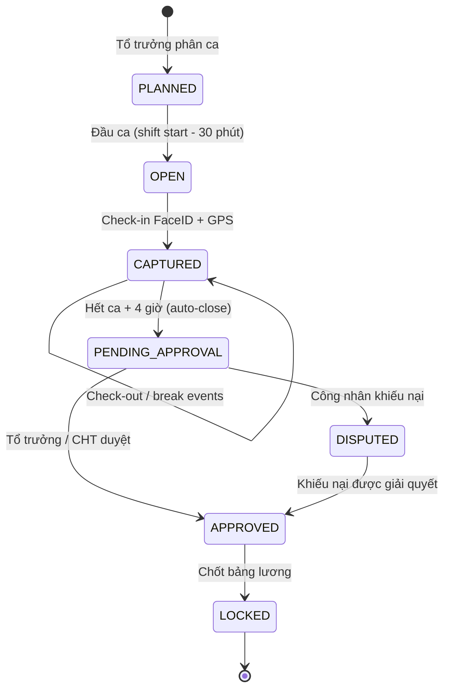
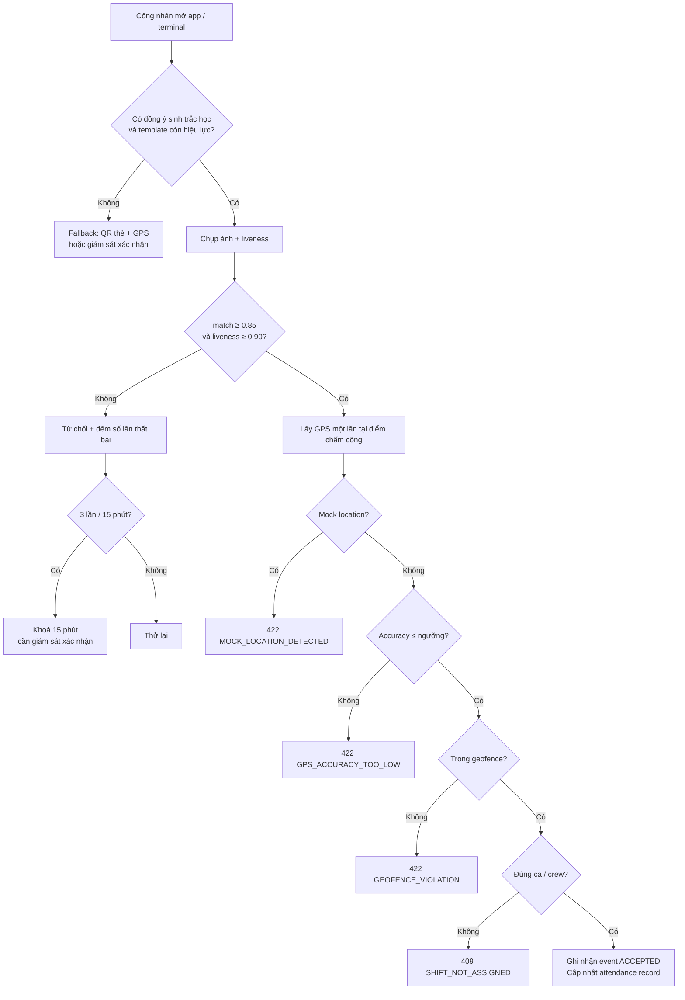
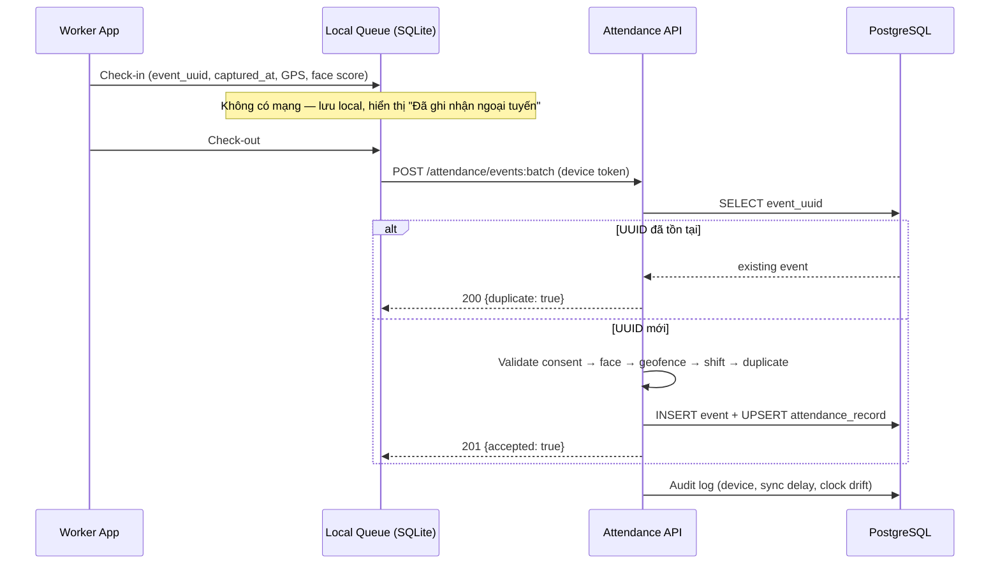
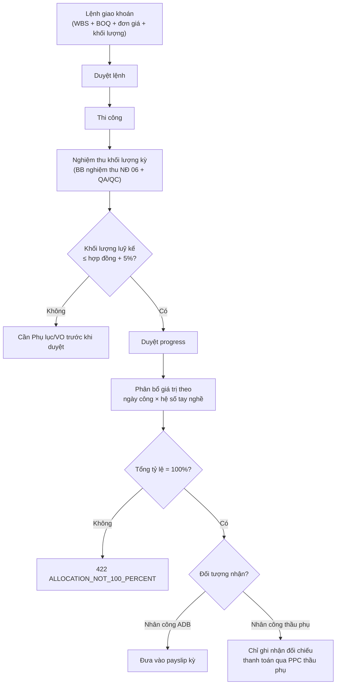
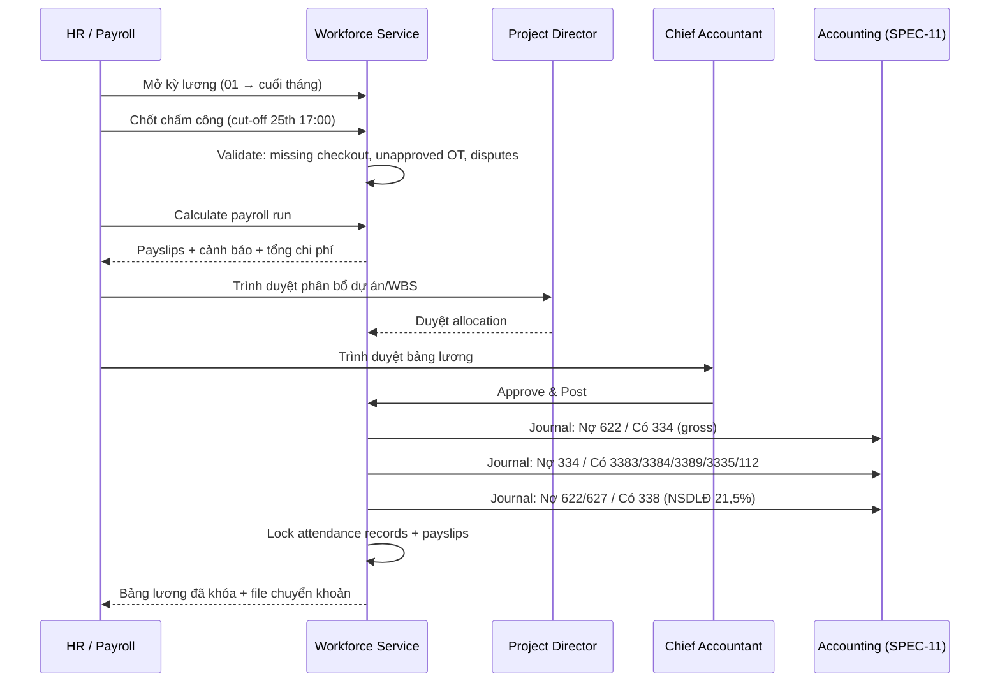
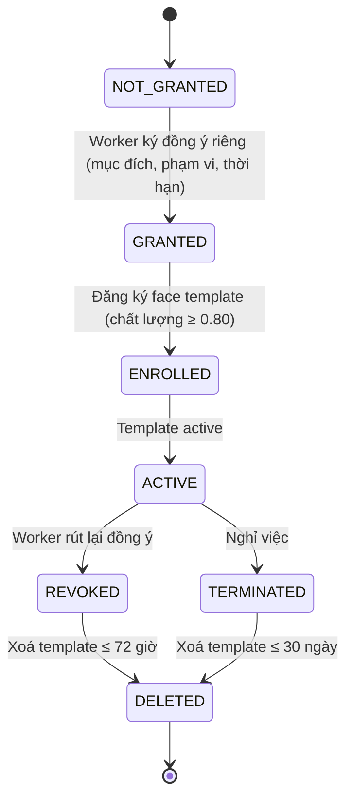

# SPEC-10: Quản lý Nhân lực Công trường, Chấm công FaceID/GPS, Định mức Ca & Bảng lương

> **Module**: 10 — Nhân lực Công trường & Chấm công (Workforce & Attendance)
> **Author**: BA Agent (PC-4 — `ba-hant_lap`)
> **Task**: TASK-025 — "Dac ta Module 10 (Nhan luc & Cham cong GPS) va Module 11 (Ke toan Chi phi WIP D&B)"
> **Status**: Review (chờ Lead duyệt)
> **Version**: 1.0.0
> **Date**: 2026-10-21
> **Stack**: Java 21 + Spring Boot 3.3.x + PostgreSQL 17 + React 18 + TypeScript
> **Target Enterprise**: Ánh Dương Building (ADB) — Tổng thầu Thiết kế & Thi công (D&B) Hạng I
> **Schema**: `workforce_mgmt`
> **Migration Target**: `backend/src/main/resources/db/migration/V7__create_workforce_tables.sql`
> **Package Target**: `com.anhduongbuilding.erp.workforce`
> **Companion Spec**: [SPEC-11](SPEC-11-WIP-ACCOUNTING.md) — Kế toán Chi phí WIP & Doanh thu POC

> [!NOTE]
> **Quy ước đánh số Module**: Theo phân công của Lead trong TASK-025, **Module 10 = Nhân lực & Chấm công**, **Module 11 = Kế toán WIP/POC**.
> Trong `docs/plans/ENTERPRISE_ARCHITECTURE_ROADMAP.md`, Phân hệ 10 mang tên "Kế toán Chi phí Công trình Dở dang (TK 154)" và nhân lực nằm rải rác ở Phân hệ 02 (Nhật ký & Nhân công hiện trường).
> Tài liệu này giữ cách đánh số của TASK-025 và là **nguồn dữ liệu gốc (system of record)** cho giờ công — là đầu vào bắt buộc của TK 622/1542 ở SPEC-11.

---

## 1. Business Objectives & Legal / Regulatory Foundation

### 1.1 Vì sao Chấm công là Hệ thống Ghi nhận Tài chính, không chỉ là Máy điểm danh

ADB vận hành đồng thời nhiều công trường công nghiệp với 3 nguồn lao động khác nhau: **nhân công cơ hữu** (hợp đồng lao động với ADB), **nhân công thầu phụ** (làm việc dưới danh nghĩa công ty thầu phụ nhưng thi công trên công trường ADB) và **lao động thời vụ theo ngày**. Một hệ thống chấm công đúng không thể chỉ trả lời "ai có mặt"; nó phải trả lời được 5 câu hỏi tài chính và pháp lý:

1. **Trả lương đúng người, đúng giờ, đúng hệ số.** Tiền lương làm thêm giờ, làm việc ban đêm và phụ cấp nặng nhọc là các khoản có hệ số pháp định. Chỉ cần tính sai hệ số ban đêm (30%) hoặc làm thêm giờ ban đêm (200%/270%/390%) trên toàn bộ 2.000 công nhân, sai lệch một tháng có thể vượt hàng trăm triệu đồng và tạo rủi ro tranh chấp lao động tập thể.
2. **Chứng minh tuân thủ giới hạn giờ làm.** Thanh tra lao động kiểm tra giới hạn 8 giờ/ngày, 48 giờ/tuần, 40 giờ làm thêm/tháng, 200 giờ/năm. Nhật ký chấm công thô (raw events) có GPS, ảnh và dấu thời gian là bằng chứng duy nhất chống lại một kết luận vi phạm.
3. **Kiểm soát năng suất theo định mức.** Thông tư 12/2021/TT-BXD quy định hao phí nhân công cho từng mã công tác. Nếu không so sánh giờ công thực tế với giờ công định mức theo WBS, ADB không biết tổ đội nào đang lãng phí nhân công — và chi phí 622 tăng mà không có cảnh báo.
4. **Quản lý tổ đội khoán không thất thoát.** Khoán theo khối lượng là mô hình phổ biến tại ADB. Nếu không có nghiệm thu khối lượng, phân bổ theo ngày công và đối chiếu với chấm công, một tổ đội 20 người có thể được thanh toán cho 26 người.
5. **Bảo vệ dữ liệu sinh trắc học.** FaceID là **dữ liệu cá nhân nhạy cảm** theo Nghị định 13/2023/NĐ-CP. Xử lý sai (không có đồng ý, lưu ảnh vô thời hạn, theo dõi vị trí liên tục) tạo rủi ro pháp lý và rủi ro danh tiếng lớn hơn nhiều so với lợi ích của việc chống chấm công hộ.

Ngoài ra, hợp đồng FIDIC D&B yêu cầu Nhà thầu duy trì **hồ sơ nhân sự và thiết bị** (Sub-Clause 6.10 — Records of Contractor's Personnel and Equipment) và tuân thủ pháp luật lao động (Sub-Clause 6.4 — Labour Laws). Chấm công điện tử chính là hồ sơ đó.

### 1.2 Legal & Regulatory Framework

| Instrument | Scope applied | Key obligations applied |
|---|---|---|
| **Bộ luật Lao động 2019** (Luật 45/2019/QH14) | Thời giờ làm việc, tiền lương | Điều 98 (tiền lương làm thêm giờ, làm việc ban đêm: 150%/200%/300%, ban đêm +30%, làm thêm giờ ban đêm +20%); Điều 105 (8 giờ/ngày, 48 giờ/tuần); Điều 106 (giờ làm việc ban đêm 22:00–06:00); Điều 107 (giới hạn làm thêm giờ); Điều 109 (nghỉ giữa giờ ít nhất 30 phút, ca đêm 45 phút, **tính vào giờ làm việc**) |
| **Nghị định 145/2020/NĐ-CP** | Chi tiết thi hành BLLĐ về điều kiện lao động, quan hệ lao động | Điều 55 (tiền lương làm thêm giờ), Điều 56 (tiền lương làm việc ban đêm = 130%), Điều 57 (tiền lương làm thêm giờ vào ban đêm: 200%/270%/390%) |
| **Nghị quyết 17/2022/UBTVQH15** | Giới hạn làm thêm giờ | Nâng trần làm thêm giờ tháng lên **60 giờ** đối với trường hợp đủ điều kiện hưởng trần 300 giờ/năm |
| **Nghị định 74/2024/NĐ-CP** | Lương tối thiểu vùng | Vùng I 4.960.000 đ/tháng; II 4.410.000; III 3.860.000; IV 3.450.000 (làm sàn kiểm tra lương cơ bản) |
| **Thông tư 11/2020/TT-BLĐTBXH** | Danh mục nghề, công việc nặng nhọc, độc hại, nguy hiểm | Xác định nhóm điều kiện lao động; áp dụng giờ làm việc rút ngắn **7 giờ/ngày, 42 giờ/tuần** (6 giờ/ngày với nhóm đặc biệt nặng nhọc) |
| **Luật An toàn, vệ sinh lao động 2015** + **Nghị định 44/2016/NĐ-CP** | Huấn luyện an toàn | Thẻ an toàn, chứng nhận huấn luyện nhóm 1–4; điều kiện vào công trường |
| **Nghị định 13/2023/NĐ-CP** | Bảo vệ dữ liệu cá nhân | Dữ liệu sinh trắc học là dữ liệu nhạy cảm; cần đồng ý riêng, thông báo mục đích, đánh giá tác động xử lý (DPIA), quyền rút lại đồng ý |
| **Luật Kế toán 2015** (Luật 88/2015/QH13) | Chứng từ kế toán | Lưu trữ tài liệu kế toán (bảng lương, bảng chấm công) **10 năm** |
| **Thông tư 200/2014/TT-BTC** | Chế độ kế toán | Tiền lương trực tiếp → TK 622 → kết chuyển TK 154; BHXH/BHYT/BHTN → TK 338 |
| **Thông tư 12/2021/TT-BXD** | Định mức xây dựng | Hao phí nhân công (công/mã hiệu) → định mức giờ công để đo năng suất |
| **Thông tư 111/2013/TT-BTC** (sửa đổi bởi TT 92/2015/TT-BTC) | Thuế thu nhập cá nhân | Giảm trừ gia cảnh, biểu thuế lũy tiến, mức miễn thuế phụ cấp ăn ca **730.000 đ/tháng** |
| **Luật BHXH 2014** + **Nghị định 143/2018/NĐ-CP** | Bảo hiểm xã hội | Tỷ lệ đóng: NLĐ 10,5% (8% BHXH + 1,5% BHYT + 1% BHTN); NSDLĐ 21,5% (17,5% + 3% + 1%) |
| **FIDIC Yellow Book 2017 (D&B)** | Hợp đồng tổng thầu | Sub-Clause 6.4 (Labour Laws), 6.5 (Working Hours), 6.10 (Records of Contractor's Personnel and Equipment) |

> **Ghi chú pháp lý**: Các mức lương tối thiểu, mức giảm trừ và tỷ lệ đóng bảo hiểm thay đổi theo năm. Tất cả được đưa vào bảng cấu hình (`workforce_mgmt.workforce_alert_rules`, `pay_periods`, `allowance_types`) và **không hard-code** trong mã nguồn.

### 1.3 Workforce KPI Model

| KPI | Definition | Target (ADB) |
|---|---|---|
| **Attendance rate** | (số ngày công có mặt / số ngày công phân ca) × 100 | ≥ 98% |
| **First-attempt face success** | % lượt check-in FACE_ID thành công ngay lần đầu | ≥ 99% |
| **Missing check-out rate** | % bản ghi không có check-out / tổng bản ghi | ≤ 0,5% |
| **Overtime ratio** | giờ làm thêm / tổng giờ làm việc | ≤ 15% |
| **OT cap breaches** | số lao động vượt 40 giờ làm thêm/tháng | 0 |
| **Norm productivity ratio** | giờ công định mức / giờ công thực tế | 1,00 – 1,10 |
| **Labour cost ratio** | chi phí nhân công trực tiếp / doanh thu nghiệm thu | ≤ 18% |
| **Payroll dispute rate** | số khiếu nại lương / số phiếu lương | ≤ 0,5% |
| **Payroll on-time** | bảng lương được duyệt và chi trả trước ngày 05 tháng sau | 100% |
| **Biometric consent coverage** | % worker có đồng ý trước khi đăng ký FaceID | 100% |

---

## 2. User Stories

| ID | Role | User Story | Ref |
|---|---|---|---|
| US-10-01 | Chuyên viên Nhân sự (HR Officer) | As an **HR Officer**, I want to **maintain the employee master with labour contract, salary and labour category**, so that payroll has a single legal source of truth. | §6.1, §6.2 |
| US-10-02 | HR Officer | As an **HR Officer**, I want to **classify each job as normal / heavy-hazardous / especially heavy-hazardous with its statutory hours (8h / 7h / 6h)**, so that standard hours and hazard allowance are computed correctly. | §4.1, §6.1 |
| US-10-03 | Tổ trưởng (Foreman) | As a **Foreman**, I want to **assign my crew to a shift and work-front for each day**, so that attendance is validated against a real plan. | §3.1, §6.9 |
| US-10-04 | Công nhân (Worker) | As a **Worker**, I want to **check in with my face and GPS in under 5 seconds at the site gate**, so that I do not lose working time queueing. | §3.2 |
| US-10-05 | Worker | As a **Worker**, I want to **check in offline in the basement or far yard and have it sync later**, so that a weak network never erases a worked day. | §3.3 |
| US-10-06 | Foreman | As a **Foreman**, I want a **live attendance board by crew and shift**, so that I can find missing workers before the shift starts. | §3.1, §8.1 |
| US-10-07 | Foreman | As a **Foreman**, I want to **verify a failed face match with a photo and a reason**, so that a legitimate worker is not blocked by a dirty camera. | §3.2 |
| US-10-08 | Worker | As a **Worker**, I want to **dispute a wrong timesheet from my phone**, so that my pay is corrected without a paper form. | §3.7 |
| US-10-09 | Foreman | As a **Foreman**, I want to **raise an overtime request with an automatic cap check**, so that I know before the shift whether the overtime is legal. | §3.4 |
| US-10-10 | HR Officer | As an **HR Officer**, I want a **monthly overtime-cap compliance view per worker and crew**, so that I can stop scheduling before the Inspectorate does. | §4.5, §8.1 |
| US-10-11 | Kỹ sư QS | As a **QS Engineer**, I want to **record work norms from Circular 12/2021 by BOQ code and compare earned vs actual man-hours**, so that I can challenge an under-performing crew with data. | §3.5, §6.18 |
| US-10-12 | Foreman | As a **Foreman**, I want to **create a piece-rate work order and record accepted quantities**, so that my crew is paid for the work actually accepted, not for the work claimed. | §3.5, §6.22 |
| US-10-13 | HR Officer | As an **HR Officer**, I want to **allocate the piece-rate value to each worker by attendance days and skill coefficient**, so that the split is transparent and defensible. | §4.7, §6.24 |
| US-10-14 | Kế toán tiền lương (Payroll Accountant) | As a **Payroll Accountant**, I want to **run payroll with overtime, night, hazard, meal and piece-rate components**, so that every payslip is calculated by rule, not by spreadsheet. | §4.2–§4.4, §8.3 |
| US-10-15 | Kế toán trưởng (Chief Accountant) | As a **Chief Accountant**, I want to **approve the payroll run and post it once to TK 622**, so that the GL is accurate and never double-posted. | §3.6, §9.2 |
| US-10-16 | Giám đốc dự án (PD) | As a **Project Director**, I want **labour cost allocated by project and WBS**, so that each project carries its true direct labour cost. | §4.8, §6.28 |
| US-10-17 | HR Officer | As an **HR Officer**, I want to **register and revoke biometric consent with an audit trail**, so that ADB complies with Decree 13/2023. | §3.8, §6.5 |
| US-10-18 | Kiểm toán nội bộ (Auditor) | As an **Auditor**, I want an **immutable trail of every attendance change, approval and payroll posting**, so that I can reconstruct any payslip. | §3.9, §6.15 |
| US-10-19 | Chỉ huy trưởng (Site Manager) | As a **Site Manager**, I want the system to **reconcile attendance headcount with the site diary**, so that the daily report cannot contradict the payroll. | §4.9, §9.3 |
| US-10-20 | Ban Giám đốc | As a **Director**, I want a **headcount, overtime and labour-cost dashboard across projects**, so that I can see labour risk before month-end. | §8.1 |
| US-10-21 | HR Officer | As an **HR Officer**, I want to **settle final pay on termination including leave and deductions**, so that the employee leaves with a legally correct settlement. | §3.6, §4.10 |
| US-10-22 | Worker | As a **Worker**, I want to **view my own payslip and attendance history**, so that I can verify my pay without asking HR. | §8.2 |

---

## 3. End-to-End Business Workflows

### 3.1 Workflow 1 — Daily Attendance Lifecycle



**Rule ATT-1 (Identity gate)**: A check-in is accepted only if the `worker` is `ACTIVE`, has an active membership in the assigned `crew`, and — for `FACE_ID` / `FACE_ID_GPS` — has a valid, non-revoked biometric consent and an active face template. Otherwise: `WORKER_NOT_ACTIVE`, `CREW_MEMBER_NOT_ACTIVE`, `BIOMETRIC_CONSENT_REQUIRED`.

**Rule ATT-2 (Geofence gate)**: GPS is validated against the site's active check-in geofences:
```
distance_m = haversine(event.lat, event.lng, geofence.center_lat, geofence.center_lng)
accepted  = distance_m <= geofence.radius_m
            AND event.gps_accuracy_m <= geofence.max_gps_accuracy_m
            AND event.is_mock_location = FALSE
```
If `distance_m > radius_m` → **422 `GEOFENCE_VIOLATION`**. If accuracy is worse than the configured maximum → **422 `GPS_ACCURACY_TOO_LOW`**. If the device reports a mock provider → **422 `MOCK_LOCATION_DETECTED`**. The raw event is still persisted with `status='REJECTED'` for audit and anti-fraud analytics.

**Rule ATT-3 (Face gate)**: `face_match_score >= 0.85` and `face_liveness_score >= 0.90` (both configurable per project). A failure returns **422 `FACE_MATCH_LOW_SCORE`** or **422 `FACE_LIVENESS_FAILED`**. **Three consecutive failures within 15 minutes** lock the worker's biometric channel for 15 minutes (`423 FACE_LOCKED`) and require a supervisor verification with a photo (`MANUAL` event). Lock events are reported to HR daily.

**Rule ATT-4 (Idempotency)**: Every device event carries a client-generated `event_uuid`. The database enforces `UNIQUE(event_uuid)`. A retried offline event returns **200** with `"duplicate": true` and the existing event id — never a second attendance movement.

**Rule ATT-5 (One movement per shift)**: A worker may have only one accepted `CHECK_IN` per `(worker, work_date, shift, project)`. A second check-in returns **409 `ALREADY_CHECKED_IN`**. A `CHECK_OUT` requires an open attendance record; otherwise **409 `NO_OPEN_CHECK_IN`**.

**Rule ATT-6 (Offline capture)**: Events may be captured with no network and synced later. Sync within **24 hours** is auto-accepted (subject to all other gates). Sync later than 24 hours creates `status='PENDING_VERIFICATION'` and **202 Accepted**; a supervisor must confirm. A device clock drift greater than **10 minutes** versus server time adds the flag `CLOCK_DRIFT` and requires confirmation.

**Rule ATT-7 (Break & payable time)**: Payable minutes are derived from the shift template. Under Article 109 of the Labour Code, **the mid-shift break counts as working time**; therefore `work_shifts.break_paid = TRUE` by default for site shifts. Office shift `CA_HC` has a 60-minute unpaid lunch and a 9-hour span → 8 payable hours. A shift with no break events still deducts the configured break automatically.

**Rule ATT-8 (Night split)**: Night time is **22:00–06:00 Asia/Ho_Chi_Minh** (Article 106). A shift that crosses midnight (e.g. `CA_3`, 22:00–06:00) is attributed to the **shift start date** (`work_date`), and its minutes are split between regular-night and overtime-night. The split is performed on local time, never on UTC.

**Rule ATT-9 (Rounding)**: Payable time is computed in whole minutes and rounded to the nearest **15 minutes** at record level (`ot_rounding_minutes = 15`). Overtime is paid only from the first **30 minutes** (`ot_minimum_minutes = 30`); a 20-minute overrun is not payable, a 38-minute overrun rounds to 45 minutes. Configuration is per project.

**Rule ATT-10 (Missing check-out)**: At `shift_end + 4 hours` a scheduled job closes the record at the last accepted event and flags `MISSING_CHECK_OUT`. Until a supervisor adjustment is approved, pay is capped at the **standard shift duration** — never at an unbounded open interval.

**Rule ATT-11 (Approval & cut-off)**: Attendance must be `APPROVED` by the Foreman or Site Manager **before 12:00 of the next working day**. Payroll cut-off is the **25th at 17:00**; records after cut-off roll into the next period with an explicit `LATE_ATTENDANCE` adjustment.

**Rule ATT-12 (Immutability)**: An `APPROVED` or `LOCKED` record is never edited in place. Corrections are made through `attendance_adjustments`, which store `old_value`, `new_value`, reason, evidence and approver. A database trigger blocks direct `UPDATE`/`DELETE` on `LOCKED` records.

**Rule ATT-13 (Disputes)**: A worker may dispute within **7 days** of the record date. A dispute **does not stop payroll** (wages must be paid on time); the disputed record is paid per the approved system value and, if the dispute is upheld, the delta is paid in the next period as an adjustment. This avoids unlawful wage withholding.

**Rule ATT-14 (Subcontractor workers)**: Subcontractor workers are recorded in `workers` with `worker_type='SUBCONTRACTOR_WORKER'` and are **not paid by ADB payroll**. Their attendance serves four purposes: (a) FIDIC Sub-Clause 6.10 personnel records; (b) HSE headcount and hours for LOST_TIMEFR; (c) verification of the labour content behind a subcontractor PPC; (d) productivity comparison against Circular 12/2021 norms. Their wages flow through the subcontractor PPC in [SPEC-04](SPEC-04-SUBCONTRACTORS.md), never through `payslips`.

### 3.2 Workflow 2 — FaceID + GPS Check-in Decision Tree



### 3.3 Workflow 3 — Offline Sync & Idempotency



### 3.4 Workflow 4 — Overtime Approval with Statutory Cap

```mermaid
flowchart LR
    A["Tổ trưởng tạo OT request<br/>(người / tổ đội, ngày, giờ)"] --> B["Tính giờ OT luỹ kế tháng<br/>và năm của từng worker"]
    B --> C{"Vượt trần ngày<br/>(4h / 3,5h / 3h)?"}
    C -- Có --> R1["422 OVERTIME_DAILY_CAP_EXCEEDED"]
    C -- Không --> D{"Vượt trần tháng<br/>(40h, hoặc 60h nếu đủ điều kiện)?"}
    D -- Có --> R2["422 OVERTIME_MONTHLY_CAP_EXCEEDED<br/>(chặn duyệt TRƯỚC khi làm)"]
    D -- Không --> E{"Vượt trần năm<br/>(200h / 300h)?"}
    E -- Có --> R3["422 OVERTIME_ANNUAL_CAP_EXCEEDED"]
    E -- Không --> F["APPROVED"]
    F --> G["Chấm công thực tế"]
    G --> H{"Giờ thực tế vượt trần?"}
    H -- Có --> I["VẪN TRẢ LƯƠNG đủ giờ<br/>+ cảnh báo OVERTIME_CAP_BREACH<br/>+ báo cáo tuân thủ"]
    H -- Không --> J["Tính lương bình thường"]
```



> **Nguyên tắc lao động**: Hệ thống **không bao giờ cắt giờ đã làm** để "giữ trần". Trần làm thêm giờ là giới hạn **lập kế hoạch**; nếu thực tế vượt, ADB vẫn phải trả đủ và xử lý vi phạm bằng biện pháp quản trị. Đây là điểm khác biệt cốt lõi giữa một ERP hiểu luật và một bảng tính.

### 3.5 Workflow 5 — Crew Piece-Rate (Tổ đội Khoán)



**Rule KHOAN-1**: A work order must be `APPROVED` before any progress is recorded. It must reference a `wbs_item_id` and a BOQ item code; the unit price is the contract piece rate.

**Rule KHOAN-2**: Progress requires an acceptance record (`acceptance_record_no`) and, where quality holds apply, a QA/QC inspection reference ([SPEC-08](SPEC-08-QAQC-INSPECTION.md)). Cumulative quantity above **105%** of the contract quantity is blocked until a Variation Order is approved.

**Rule KHOAN-3**: Allocation basis is one of `ATTENDANCE_DAYS`, `EQUAL_SHARE`, `SKILL_COEFFICIENT`, `MANUAL`. For `ATTENDANCE_DAYS` and `SKILL_COEFFICIENT`, the engine uses approved attendance days of the crew in the progress period. The sum of `allocated_ratio` must be **100% ± 0.01** (deferred constraint trigger).

**Rule KHOAN-4**: A worker paid by piece rate for a period is not also paid the day-rate component for the same hours. `crew_members.pay_mode` is `DAY_RATE`, `PIECE_RATE` or `PIECE_RATE_TOP_UP`; a `PIECE_RATE` member's attendance is used for allocation, not for a second base wage.

**Rule KHOAN-5**: Rounding is applied to the last allocation line so that the sum of allocated amounts equals the accepted progress amount exactly (no 1-VND drift).

### 3.6 Workflow 6 — Monthly Payroll Close & GL Posting



### 3.7 Workflow 7 — Timesheet Dispute

**Rule DISP-1**: A worker can open a dispute within 7 days, with a reason and optional photo. The record moves to `DISPUTED`; payroll still pays the approved value on time.

**Rule DISP-2**: The Foreman responds within **2 working days**; the Site Manager resolves within **5 working days**. Resolution outcomes: `RESOLVED_EMPLOYEE` (adjustment in next period), `RESOLVED_COMPANY` (no change, reason recorded), `WITHDRAWN`.

**Rule DISP-3**: Every dispute and resolution is visible to HR and the Auditor; dispute rate is a payroll KPI.

### 3.8 Workflow 8 — Biometric Consent Lifecycle (Decree 13/2023)



**Rule PRIV-1**: Consent must be **separate, specific and revocable**, recorded with version, purpose, data scope, timestamp, IP and evidence. A blanket consent inside an employment contract is not accepted.

**Rule PRIV-2 (Data minimisation)**: GPS is captured **only at check-in/check-out**, never continuously; background location tracking is disabled in the mobile SDK. The system stores the coordinate of the checkpoint, not a movement trace.

**Rule PRIV-3 (Retention)**: Face images in object storage: **90 days**. Face templates: until consent is revoked or employment ends, then deleted within **72 hours / 30 days** respectively. Raw GPS coordinates: **12 months**, then aggregated to site/date. Attendance and payroll records: **10 years** (Accounting Law).

**Rule PRIV-4 (Revocation)**: On revocation, the template is deleted within 72 hours, `workers.biometric_consent_status='REVOKED'`, and the worker falls back to QR card + GPS. Revocation cannot be used as grounds for discipline.

**Rule PRIV-5 (Subcontractor DPA)**: Before enrolling a subcontractor worker, a data processing agreement between ADB and the subcontractor must exist (`biometric_consents.dpa_reference`), identifying ADB as processor and the subcontractor as controller (or joint controller per the agreement).

**Rule PRIV-6 (Audit)**: Every read of a face template or image is logged with user, purpose and timestamp. Access is restricted to `HR_OFFICER`, `SYSTEM_ADMIN` and `AUDITOR` with break-glass approval.

### 3.9 Workflow 9 — Audit Trail

**Rule AUD-1**: The following are append-only: `attendance_events`, `attendance_adjustments`, `payroll_runs` status transitions, `payslips` after payment, `biometric_consents`. Deletion is forbidden except by the retention job.

**Rule AUD-2**: Every approval stores `approved_by`, `approved_at` and the authenticated role. A user cannot approve their own overtime request or their own payroll run (segregation of duties).

**Rule AUD-3**: An auditor can reconstruct any payslip from: attendance events → attendance record → approved adjustments → payroll inputs → payslip lines → journal entry.

---

## 4. Business Rules, Formulas & Thresholds

### 4.1 Time Computation (authoritative)

```
shift_span_minutes   = (shift.end_time - shift.start_time), +1440 if crosses_midnight
payable_minutes_raw  = shift_span_minutes - (break_paid ? 0 : break_minutes)
scheduled_minutes    = shift.standard_hours × 60
worked_minutes       = checkout_at - checkin_at (local time, capped at shift_end + max_ot)
payable_minutes      = min(worked_minutes, scheduled_minutes + ot_approved_minutes)
regular_minutes      = min(payable_minutes, scheduled_minutes)
overtime_minutes     = max(0, payable_minutes - scheduled_minutes)
```

**Invariant**: `regular_minutes + overtime_minutes = payable_minutes`.

**Night split** (local time, 22:00–06:00):
```
night_regular_minutes   = overlap(regular_interval, night_windows)
overtime_night_minutes  = overlap(overtime_interval, night_windows)
night_minutes           = night_regular_minutes        -- KHÔNG bao gồm OT night
total_night_hours       = night_minutes + overtime_night_minutes   (chỉ để báo cáo)
```

> `night_minutes` deliberately excludes overtime-night minutes. Overtime-night pay already contains the 30% night premium inside the 200%/270%/390% multiplier; including it again in `night_minutes` would double-pay the premium.

**Rounding**:
```
payable_minutes = round_to_nearest(payable_minutes, 15)
if overtime_minutes < 30 then overtime_minutes = 0
overtime_minutes = round_to_nearest(overtime_minutes, 15)
```

### 4.2 Pay Formulas

```
hourly_rate = base_salary / (standard_working_days_in_period × labor_category.standard_hours_per_day)
```

| Component | Formula | Legal basis |
|---|---|---|
| **Regular pay** | `regular_hours × hourly_rate` | BLLĐ Điều 90, 94 |
| **Overtime — normal day** | `ot_hours × hourly_rate × 150%` | BLLĐ Điều 98.1.a; NĐ 145/2020 Điều 55 |
| **Overtime — weekly rest** | `ot_hours × hourly_rate × 200%` | BLLĐ Điều 98.1.b |
| **Overtime — public holiday / paid leave** | `ot_hours × hourly_rate × 300%` | BLLĐ Điều 98.1.c |
| **Night work (regular hours)** | `night_hours × hourly_rate × 30%` (additional) | BLLĐ Điều 98.3; NĐ 145/2020 Điều 56 |
| **Overtime at night — normal day** | `ot_night_hours × hourly_rate × 200%` (all-inclusive) | NĐ 145/2020 Điều 57 |
| **Overtime at night — weekly rest** | `ot_night_hours × hourly_rate × 270%` | NĐ 145/2020 Điều 57 |
| **Overtime at night — holiday** | `ot_night_hours × hourly_rate × 390%` | NĐ 145/2020 Điều 57 |
| **Hazard allowance** | `base_salary × hazard_allowance_rate` or fixed amount, pro-rated by attendance days | Labour Code + company policy |
| **Meal allowance** | `meal_rate × attendance_days`, tax-exempt up to 730.000 đ/month | TT 111/2013/TT-BTC |
| **Piece rate** | `accepted_quantity × unit_price × allocated_ratio` | Crew work order |
| **Gross pay** | regular + OT + night + hazard + meal + other allowances + piece rate | — |

**Derivation of the 200/270/390 multipliers** (NĐ 145/2020 Điều 57):
```
Night OT on normal day   = 150% + 30% + (20% × 150%) = 200%
Night OT on weekly rest  = 200% + 30% + (20% × 200%) = 270%
Night OT on public holiday = 300% + 30% + (20% × 300%) = 390%
```

> For monthly-salaried employees, the public holiday itself is already paid in the monthly base; the 300% is the **additional** amount for working on that holiday. The payroll engine therefore pays `300% × hourly × hours` as the holiday-work component, plus the normal monthly salary.

### 4.3 Deductions (Employee)

| Deduction | Rate / Formula | Cap / Note |
|---|---|---|
| **BHXH** | 8,0% of insurance salary | Insurance salary capped at 20× lương cơ sở |
| **BHYT** | 1,5% | Same cap |
| **BHTN** | 1,0% | Same cap; contract ≥ 3 months |
| **Union fee** | 1,0% | Only for union members |
| **PIT** | Progressive 7 brackets (5% → 35%) | Personal deduction 11.000.000 đ/month; dependent 4.400.000 đ/person/month |
| **Salary advance** | Outstanding advance | Cannot exceed net pay; carry forward if exceeded |
| **Other** | Court order, damage, etc. | Must have legal basis and employee acknowledgement |

**PIT monthly brackets**: 0–5M: 5%; 5–10M: 10%; 10–18M: 15%; 18–32M: 20%; 32–52M: 25%; 52–80M: 30%; >80M: 35%.

**Taxable income** = gross − BHXH/BHYT/BHTN − union fee − tax-exempt allowances (meal ≤ 730.000 đ/month) − personal deduction − dependants × 4.400.000.

### 4.4 Employer Cost

| Component | Rate | Account |
|---|---|---|
| BHXH (hưu trí, ốm đau, thai sản, TNLĐ-BNN) | 17,5% | 3383 / 3384 / 3386 |
| BHYT | 3,0% | 3384 |
| BHTN | 1,0% | 3389 |
| **Total employer contribution** | **21,5%** | 622 (direct labour) / 627 (indirect labour) |
| Union fee (employer) | 2,0% | 627 |

### 4.5 Overtime Caps

| Limit | Standard | Extended (eligible) | Legal basis |
|---|---|---|---|
| Per day | ≤ 4 h (50% of 8 h) | — | BLLĐ Điều 107.1 |
| Per day — heavy/hazardous (7 h) | ≤ 3,5 h | — | BLLĐ Điều 107.1 |
| Per day — especially heavy (6 h) | ≤ 3,0 h | — | BLLĐ Điều 107.1 |
| Per month | 40 h | **60 h** | BLLĐ Điều 107.2; NQ 17/2022/UBTVQH15 |
| Per year | 200 h | **300 h** | BLLĐ Điều 107.3 |
| Weekly total | ≤ 48 h normal + OT not exceeding legal cap | — | BLLĐ Điều 105 |

**Eligibility for the 60 h / 300 h regime** is configured per project (`overtime_cap_rules.extended_cap_eligible`) with a documented legal basis. It is **FALSE by default** — ADB must not assume eligibility.

**Cap evaluation is prospective**: an OT request that would breach a cap is rejected before the shift. Actual hours that breach a cap are still paid and raise `OVERTIME_CAP_BREACH`.

### 4.6 Productivity vs Circular 12/2021 Norms

```
earned_manhours = accepted_quantity × norm.labor_norm_manhours / norm.norm_quantity
actual_manhours = SUM(attendance.payable_hours) of the crew on the WBS in the period
productivity_ratio = earned_manhours / actual_manhours
variance_manhours   = actual_manhours - earned_manhours
```

| Ratio | Classification | Action |
|---|---|---|
| ≥ 1,10 | `AHEAD_OF_NORM` | Good; verify quality was not traded for speed |
| 1,00 – 1,10 | `ON_NORM` | Normal |
| 0,90 – 1,00 | `BELOW_NORM` | Foreman review |
| < 0,90 | `CRITICAL_BELOW_NORM` | Site Manager + QS review; possible rework or waiting time |

**Rule PROD-1**: A `CRITICAL_BELOW_NORM` crew for **3 consecutive days** triggers a root-cause task (waiting for materials? rework? overtime? insufficient skill?). The review is recorded; it is not automatically a penalty.

### 4.7 Piece-Rate Allocation

```
weight_i = attendance_days_i × skill_coefficient_i
ratio_i  = weight_i / Σ(weight_j) × 100
amount_i = ROUND(progress.current_amount × ratio_i / 100, 0)
```
The last line absorbs rounding so that `Σ amount_i = progress.current_amount`.

Default skill coefficients (configurable): `B1 = 1,00`, `B2 = 1,05`, `B3 = 1,10`, `B4 = 1,15`, `B5 = 1,20`, `B6 = 1,30`, `B7 = 1,40`.

### 4.8 Labour Cost Allocation

```
attendance_cost_i = approved_payable_hours_i × hourly_rate_i
allocation_pct    = attendance_cost_i / Σ attendance_cost × 100
```

- Allocation is by **project** and **WBS item**, derived from `attendance_records.project_id` / `wbs_item_id`.
- If an employee has no attendance in the period (monthly salary, paid leave), allocation uses `employees.home_project_id` at 100%.
- The sum of allocations per payslip must be **100% ± 0,01**; otherwise `422 ALLOCATION_NOT_100_PERCENT`.
- Unallocated employer contributions go to **627** (indirect labour).

### 4.9 Attendance vs Site Diary Reconciliation

```
attendance_headcount = COUNT(attendance_records WHERE work_date = d AND status IN ('PRESENT','HALF_DAY'))
diary_headcount      = daily_site_diaries.direct_manpower_count + subcontractor_manpower_count
variance_pct         = ABS(attendance_headcount - diary_headcount) / GREATEST(diary_headcount, 1) × 100
```

If `variance_pct > 10%` → **409 `MANPOWER_VARIANCE_EXCEEDED`** when the Site Manager tries to approve the diary; an explanation is required and attached to the diary. This enforces a single truth between payroll and the daily report.

### 4.10 Final Settlement on Termination

```
final_pay = unused_annual_leave_days × daily_rate
          + current_month_worked_days × daily_rate
          + pro_rated_allowances
          - outstanding_advances
          - PIT / employee insurance
```
Severance (trợ cấp thôi việc) and job-loss allowance (trợ cấp mất việc) are computed per Articles 46–47 of the Labour Code when eligible and recorded as a separate payslip line `SEVERANCE`.

### 4.11 Rounding & Currency Rules

- All money is `NUMERIC(18,2)`, VND, rounded half-up at the **line** level.
- Hours are `NUMERIC(6,2)`, derived from integer minutes; no floating point in Java (`BigDecimal` only).
- Payroll totals are the sum of rounded lines, never re-rounded from an unrounded total.
- A payslip's `net_pay` may not be negative; a negative result creates a carry-forward (`NEGATIVE_NET_PAY`) instead of a negative payment.

---

## 5. Acceptance Criteria (Gherkin)

```gherkin
# ─────────────────────────────────────────────────────────────────────────
# SPEC-10 — Acceptance Criteria
# Ref: US-10-01 … US-10-22
# ─────────────────────────────────────────────────────────────────────────

Scenario AC-10-01: Chấm công FaceID + GPS trong geofence — chấp nhận
  Given một công nhân "ADB-W-00123" đang ACTIVE và có đồng ý sinh trắc học
  And được phân vào tổ đội "TO-THEP-01", ca "CA_1" ngày 2026-10-21
  And geofence cổng A có bán kính 150 m và dung sai GPS tối đa 50 m
  When công nhân chấm công vào lúc 05:58 với GPS cách tâm cổng 22,4 m, accuracy 8,4 m
  And điểm khớp khuôn mặt là 0,962 và liveness là 0,981
  Then event phải có status "ACCEPTED"
  And phải tạo attendance record cho ngày 2026-10-21, ca "CA_1"
  And kết quả trả về phải có httpStatus 201
  And phải ghi nhận geofence result "INSIDE"

Scenario AC-10-02: Chấm công ngoài geofence — từ chối
  Given một công nhân đã được phân ca hợp lệ
  When công nhân chấm công tại vị trí cách tâm geofence 412,7 m (bán kính cho phép 150 m)
  Then hệ thống phải từ chối với httpStatus 422 và mã lỗi "GEOFENCE_VIOLATION"
  And event phải được lưu với status "REJECTED"
  And KHÔNG được tạo attendance record
  And thông báo lỗi phải nêu khoảng cách thực tế và bán kính cho phép

Scenario AC-10-03: GPS giả lập (mock location) — từ chối
  Given thiết bị chấm công báo cờ mock location = true
  When công nhân gửi yêu cầu chấm công
  Then hệ thống phải từ chối với httpStatus 422 và mã lỗi "MOCK_LOCATION_DETECTED"
  And phải ghi nhận sự kiện vào audit log
  And phải tăng bộ đếm gian lận của thiết bị

Scenario AC-10-04: Điểm khớp khuôn mặt thấp — từ chối và khoá sau 3 lần
  Given ngưỡng khớp khuôn mặt là 0,85
  When công nhân chấm công với điểm khớp 0,72 lần thứ nhất
  Then hệ thống phải từ chối với mã lỗi "FACE_MATCH_LOW_SCORE"
  When công nhân thử lần thứ hai và thứ ba đều thất bại trong 15 phút
  Then lần thứ ba phải trả về httpStatus 423 và mã lỗi "FACE_LOCKED"
  And công nhân phải được chuyển sang quy trình giám sát xác nhận thủ công

Scenario AC-10-05: Chấm công trùng ca — từ chối
  Given công nhân đã có attendance record ACCEPTED cho ngày 2026-10-21, ca "CA_1"
  When công nhân gửi thêm một CHECK_IN cho cùng ngày và cùng ca
  Then hệ thống phải từ chối với httpStatus 409 và mã lỗi "ALREADY_CHECKED_IN"
  And không được tạo thêm attendance record

Scenario AC-10-06: Đồng bộ ngoại tuyến trùng lặp — idempotent
  Given thiết bị đã gửi event có event_uuid "9f1c7a2e-..." thành công
  When thiết bị gửi lại cùng event_uuid do timeout mạng
  Then hệ thống phải trả về httpStatus 200 với "duplicate": true
  And phải trả về đúng eventId đã tồn tại
  And số attendance record không được tăng

Scenario AC-10-07: Đồng bộ muộn quá 24 giờ — cần xác nhận
  Given một event được ghi ngoại tuyến lúc 06:00 ngày 2026-10-19
  When thiết bị đồng bộ lúc 09:00 ngày 2026-10-21 (độ trễ 51 giờ)
  Then hệ thống phải trả về httpStatus 202
  And event phải có status "PENDING_VERIFICATION"
  And phải tạo nhiệm vụ xác nhận cho Tổ trưởng
  And giờ công chỉ được tính sau khi xác nhận

Scenario AC-10-08: Ca đêm qua nửa đêm — tách giờ ban đêm đúng
  Given ca "CA_3" có giờ 22:00–06:00 và được tính vào ngày công 2026-10-21
  When công nhân check-in 21:52 và check-out 06:30 ngày 2026-10-22
  Then regular_hours phải bằng 8,00
  And overtime_hours phải bằng 1,00 (30 phút làm thêm, làm tròn 15 phút)
  And night_minutes phải bằng 480 (toàn bộ giờ thường nằm trong 22:00–06:00)
  And overtime_night_minutes phải bằng 30
  And work_date của bản ghi phải là 2026-10-21

Scenario AC-10-09: Nghỉ giữa giờ được tính vào giờ làm việc
  Given ca "CA_1" 06:00–14:00 có break_minutes = 30 và break_paid = true
  When công nhân check-in 05:55 và check-out 14:00
  Then payable_minutes phải bằng 480
  And regular_hours phải bằng 8,00
  And break_minutes không được trừ khỏi giờ trả lương

Scenario AC-10-10: Làm thêm giờ ngày thường — hệ số 150%
  Given đơn giá giờ của công nhân là 50.000 đ
  And có OT request đã duyệt cho 2 giờ vào ngày thường
  When bảng lương kỳ được tính
  Then tiền làm thêm giờ phải bằng 2 × 50.000 × 150% = 150.000 đ

Scenario AC-10-11: Làm thêm giờ ban đêm ngày thường — hệ số 200%
  Given đơn giá giờ là 50.000 đ
  And công nhân làm thêm 2 giờ trong khung 22:00–06:00 vào ngày thường
  When bảng lương được tính
  Then tiền làm thêm giờ ban đêm phải bằng 2 × 50.000 × 200% = 200.000 đ
  And KHÔNG được cộng thêm 30% phụ cấp ban đêm lần thứ hai

Scenario AC-10-12: Làm thêm giờ ngày lễ — hệ số 300%, ban đêm 390%
  Given đơn giá giờ là 50.000 đ
  And công nhân làm thêm 1 giờ vào ngày lễ
  When bảng lương được tính
  Then tiền làm thêm ngày lễ phải bằng 50.000 × 300% = 150.000 đ
  And nếu giờ đó nằm trong khung ban đêm thì phải bằng 50.000 × 390% = 195.000 đ

Scenario AC-10-13: Nghề nặng nhọc 7 giờ/ngày — giờ thứ 8 là làm thêm
  Given công nhân thuộc nhóm "HEAVY_HAZARDOUS" có standard_hours_per_day = 7
  And ca làm việc tiêu chuẩn 7 giờ
  When công nhân làm việc 8 giờ trong ngày thường
  Then regular_hours phải bằng 7,00
  And overtime_hours phải bằng 1,00
  And giờ thứ 8 phải được trả với hệ số 150%
  And phụ cấp nặng nhọc phải được tính theo cấu hình nhóm lao động

Scenario AC-10-14: Vượt trần làm thêm giờ tháng — chặn duyệt trước, không cắt giờ đã làm
  Given công nhân đã làm thêm 39 giờ trong tháng
  When Tổ trưởng tạo OT request 2 giờ nữa (tổng 41 giờ > trần 40 giờ)
  Then hệ thống phải từ chối với httpStatus 422 và mã lỗi "OVERTIME_MONTHLY_CAP_EXCEEDED"
  And OT request phải giữ trạng thái "REJECTED"
  But nếu công nhân đã thực tế làm 41 giờ trước khi bị phát hiện
  Then bảng lương vẫn phải trả đủ 41 giờ
  And phải tạo cảnh báo "OVERTIME_CAP_BREACH" cho HR và Giám đốc dự án

Scenario AC-10-15: Làm thêm giờ không có phê duyệt — cảnh báo, không tự động cắt lương
  Given công nhân có 3 giờ làm thêm thực tế nhưng không có OT request
  When bảng lương được tính
  Then hệ thống phải gắn cờ "OT_NOT_APPROVED" trên payslip
  And phải yêu cầu Tổ trưởng xác nhận trong 2 ngày làm việc
  And nếu được xác nhận thì phải trả theo hệ số luật định
  And nếu không được xác nhận thì phải chuyển HR xử lý, KHÔNG tự động xoá giờ

Scenario AC-10-16: Tính khấu trừ BHXH, công đoàn và thuế TNCN
  Given lương gross tháng của công nhân là 15.000.000 đ
  And không có người phụ thuộc, không có phụ cấp miễn thuế
  When bảng lương được tính
  Then BHXH/BHYT/BHTN phải bằng 1.575.000 đ (10,5%)
  And phí công đoàn phải bằng 150.000 đ (1%)
  And thu nhập tính thuế phải bằng 2.275.000 đ
  And thuế TNCN phải bằng 113.750 đ (5%)
  And thực lĩnh phải bằng 13.161.250 đ

Scenario AC-10-17: Phụ cấp ăn ca vượt mức miễn thuế
  Given phụ cấp ăn ca là 30.000 đ/ngày và công nhân đi làm 26 ngày
  When bảng lương được tính
  Then tổng phụ cấp ăn ca là 780.000 đ
  And chỉ 730.000 đ được miễn thuế TNCN
  And 50.000 đ phải được cộng vào thu nhập tính thuế

Scenario AC-10-18: Khoán tổ đội — phân bổ không đủ 100% bị chặn
  Given một lệnh giao khoán đã duyệt với giá trị nghiệm thu kỳ này là 120.000.000 đ
  And tổ đội có 5 công nhân với ngày công và hệ số tay nghề
  When HR phân bổ với tổng tỷ lệ 97,5%
  Then hệ thống phải từ chối với httpStatus 422 và mã lỗi "ALLOCATION_NOT_100_PERCENT"
  And không được tạo phiếu chi khoán
  When HR phân bổ lại với tổng tỷ lệ 100%
  Then tổng số tiền phân bổ phải bằng đúng 120.000.000 đ (dòng cuối hấp thụ sai số làm tròn)

Scenario AC-10-19: Nghiệm thu khoán vượt khối lượng hợp đồng quá 5%
  Given lệnh giao khoán có khối lượng 1.000 m2
  And luỹ kế đã nghiệm thu 1.040 m2
  When Tổ trưởng nhập nghiệm thu kỳ này 20 m2 (luỹ kế 1.060 m2 = 106%)
  Then hệ thống phải từ chối với httpStatus 409 và mã lỗi "PIECE_RATE_QUANTITY_EXCEEDS_CONTRACT"
  And phải yêu cầu Phụ lục hợp đồng/Variation Order trước khi duyệt

Scenario AC-10-20: Bảng lương đã khoá — không sửa trực tiếp
  Given kỳ lương "2026-10" đã ở trạng thái "APPROVED" và bảng lương đã khoá
  When người dùng cố sửa giờ công của một bản ghi đã LOCKED
  Then hệ thống phải từ chối với httpStatus 409 và mã lỗi "PAY_PERIOD_LOCKED"
  And phải hướng dẫn tạo adjustment cho kỳ kế tiếp

Scenario AC-10-21: Rút lại đồng ý sinh trắc học — xoá template, chuyển QR
  Given công nhân đã đồng ý và đang dùng FaceID
  When công nhân rút lại đồng ý
  Then workers.biometric_consent_status phải chuyển "REVOKED"
  And face template phải bị xoá trong vòng 72 giờ
  And lần chấm công tiếp theo phải dùng QR + GPS hoặc giám sát xác nhận
  And việc rút lại đồng ý KHÔNG được dùng làm căn cứ kỷ luật

Scenario AC-10-22: Đối chiếu chấm công với nhật ký công trường
  Given nhật ký ngày 2026-10-21 ghi 120 nhân công
  And hệ thống chấm công ghi nhận 102 người có mặt
  When Chỉ huy trưởng duyệt nhật ký
  Then hệ thống phải trả về httpStatus 409 và mã lỗi "MANPOWER_VARIANCE_EXCEEDED"
  And phải hiển thị chênh lệch 15% và yêu cầu giải trình
  And nhật ký chỉ được duyệt sau khi có giải trình kèm minh chứng

Scenario AC-10-23: Phân bổ chi phí lương theo dự án/WBS — tổng 100%
  Given một nhân công làm việc cho 2 dự án trong kỳ
  And giờ công dự án A là 120 giờ, dự án B là 40 giờ
  When bảng lương được tính
  Then tỷ lệ phân bổ dự án A phải là 75% và dự án B là 25%
  And tổng tỷ lệ phải bằng 100% ± 0,01
  And chi phí phải được hạch toán vào TK 622 theo từng dự án/WBS

Scenario AC-10-24: Kỳ lương đã duyệt — không cho tính lại
  Given kỳ lương "2026-10" đã APPROVED
  When Payroll Accountant gọi lại API calculate
  Then hệ thống phải từ chối với httpStatus 409 và mã lỗi "PAYROLL_RUN_ALREADY_APPROVED"
  And phải hướng dẫn tạo kỳ điều chỉnh (supplementary run)
```

---

## 6. Database Schema (PostgreSQL DDL)

> **Schema**: `workforce_mgmt`
> **FK rule** (consistent with SPEC-08/SPEC-09): hard FK only to `core_iam.users`, `project_mgmt.projects`, `project_mgmt.wbs_items` (V1). References to modules whose migration is deployed later (`subcontractor_mgmt` V2, `inventory_mgmt` V3, `equipment_mgmt` V4) are **logical references** (`BIGINT` + documented business key); the physical FK is added by a later migration. This keeps `V7` deployable in isolation.
> **Money**: `NUMERIC(18,2)` VND. **Time**: `TIMESTAMPTZ`; business dates computed in `Asia/Ho_Chi_Minh`.

```sql
-- ==========================================================
-- V7 — Schema: workforce_mgmt
-- Module 10 — Nhân lực Công trường & Chấm công FaceID/GPS
-- ==========================================================

CREATE SCHEMA IF NOT EXISTS workforce_mgmt;

-- ── 0. Hàm dùng chung ───────────────────────────────────────────────────
CREATE OR REPLACE FUNCTION workforce_mgmt.fn_touch_updated_at()
RETURNS TRIGGER
LANGUAGE plpgsql
AS $$
BEGIN
    NEW.updated_at := CURRENT_TIMESTAMP;
    RETURN NEW;
END;
$$;

-- ── 1. Nhóm nghề & điều kiện lao động ──────────────────────────────────
CREATE TABLE IF NOT EXISTS workforce_mgmt.labor_categories (
    id BIGSERIAL PRIMARY KEY,
    code VARCHAR(30) UNIQUE NOT NULL,                 -- 'LD-01','LD-02'
    name VARCHAR(150) NOT NULL,
    work_condition VARCHAR(30) NOT NULL DEFAULT 'NORMAL'
        CHECK (work_condition IN ('NORMAL','HEAVY_HAZARDOUS','ESPECIALLY_HEAVY_HAZARDOUS')),
    standard_hours_per_day NUMERIC(4,2) NOT NULL DEFAULT 8.00
        CHECK (standard_hours_per_day BETWEEN 4.00 AND 12.00),
    standard_hours_per_week NUMERIC(5,2) NOT NULL DEFAULT 48.00
        CHECK (standard_hours_per_week BETWEEN 20.00 AND 60.00),
    night_work_applicable BOOLEAN NOT NULL DEFAULT FALSE,
    hazard_allowance_rate NUMERIC(6,3) NOT NULL DEFAULT 0.000
        CHECK (hazard_allowance_rate BETWEEN 0 AND 100),
    hazard_allowance_amount NUMERIC(18,2) NOT NULL DEFAULT 0.00
        CHECK (hazard_allowance_amount >= 0),
    regulatory_basis TEXT,                            -- 'Thông tư 11/2020/TT-BLĐTBXH'
    is_active BOOLEAN NOT NULL DEFAULT TRUE,
    created_at TIMESTAMP WITH TIME ZONE NOT NULL DEFAULT CURRENT_TIMESTAMP,
    updated_at TIMESTAMP WITH TIME ZONE NOT NULL DEFAULT CURRENT_TIMESTAMP,
    CONSTRAINT chk_labor_category_normal_hours
        CHECK (work_condition <> 'NORMAL' OR standard_hours_per_day = 8.00),
    CONSTRAINT chk_labor_category_reduced_hours
        CHECK (work_condition = 'NORMAL' OR standard_hours_per_day <= 7.00),
    CONSTRAINT chk_labor_category_especially_hours
        CHECK (work_condition <> 'ESPECIALLY_HEAVY_HAZARDOUS' OR standard_hours_per_day <= 6.00)
);

-- ── 2. Hồ sơ nhân viên ADB (chủ thể trả lương) ──────────────────────────
CREATE TABLE IF NOT EXISTS workforce_mgmt.employees (
    id BIGSERIAL PRIMARY KEY,
    employee_code VARCHAR(30) UNIQUE NOT NULL,        -- 'ADB-E-00421'
    full_name VARCHAR(150) NOT NULL,
    date_of_birth DATE,
    gender VARCHAR(10) CHECK (gender IN ('MALE','FEMALE','OTHER')),
    national_id_encrypted TEXT,                       -- CCCD mã hoá ở tầng ứng dụng (AES-256-GCM)
    national_id_hash CHAR(64) UNIQUE,                 -- SHA-256 để chống trùng, không lưu plaintext
    phone VARCHAR(20),
    email VARCHAR(150),
    permanent_address TEXT,
    labor_category_id BIGINT NOT NULL REFERENCES workforce_mgmt.labor_categories(id),
    job_title VARCHAR(100) NOT NULL,
    employment_type VARCHAR(30) NOT NULL
        CHECK (employment_type IN ('PERMANENT','FIXED_TERM','SEASONAL','PROBATION','PART_TIME')),
    hire_date DATE NOT NULL,
    termination_date DATE,
    termination_reason TEXT,
    social_insurance_no VARCHAR(20),
    personal_tax_code VARCHAR(20),
    bank_account_no VARCHAR(30),
    bank_name VARCHAR(150),
    base_salary NUMERIC(18,2) NOT NULL DEFAULT 0.00 CHECK (base_salary >= 0),
    salary_currency CHAR(3) NOT NULL DEFAULT 'VND',
    region_code VARCHAR(5) NOT NULL DEFAULT 'I'
        CHECK (region_code IN ('I','II','III','IV')),
    payment_method VARCHAR(20) NOT NULL DEFAULT 'BANK_TRANSFER'
        CHECK (payment_method IN ('BANK_TRANSFER','CASH')),
    home_project_id BIGINT REFERENCES project_mgmt.projects(id),
    status VARCHAR(20) NOT NULL DEFAULT 'ACTIVE'
        CHECK (status IN ('ACTIVE','SUSPENDED','TERMINATED')),
    photo_url TEXT,
    created_at TIMESTAMP WITH TIME ZONE NOT NULL DEFAULT CURRENT_TIMESTAMP,
    updated_at TIMESTAMP WITH TIME ZONE NOT NULL DEFAULT CURRENT_TIMESTAMP,
    CONSTRAINT chk_employee_termination_date
        CHECK (termination_date IS NULL OR termination_date >= hire_date)
);

-- ── 3. Hợp đồng lao động ────────────────────────────────────────────────
CREATE TABLE IF NOT EXISTS workforce_mgmt.employment_contracts (
    id BIGSERIAL PRIMARY KEY,
    contract_no VARCHAR(50) UNIQUE NOT NULL,
    employee_id BIGINT NOT NULL REFERENCES workforce_mgmt.employees(id) ON DELETE CASCADE,
    contract_type VARCHAR(30) NOT NULL
        CHECK (contract_type IN ('INDEFINITE','FIXED_TERM','SEASONAL','PROBATION','PART_TIME')),
    start_date DATE NOT NULL,
    end_date DATE,
    base_salary NUMERIC(18,2) NOT NULL DEFAULT 0.00 CHECK (base_salary >= 0),
    allowance_amount NUMERIC(18,2) NOT NULL DEFAULT 0.00 CHECK (allowance_amount >= 0),
    signed_date DATE,
    status VARCHAR(20) NOT NULL DEFAULT 'DRAFT'
        CHECK (status IN ('DRAFT','ACTIVE','EXPIRED','TERMINATED')),
    document_url TEXT,
    created_at TIMESTAMP WITH TIME ZONE NOT NULL DEFAULT CURRENT_TIMESTAMP,
    updated_at TIMESTAMP WITH TIME ZONE NOT NULL DEFAULT CURRENT_TIMESTAMP,
    CONSTRAINT chk_contract_dates CHECK (end_date IS NULL OR end_date >= start_date)
);

-- ── 4. Danh tính công trường (cả nhân công ADB và thầu phụ) ─────────────
CREATE TABLE IF NOT EXISTS workforce_mgmt.workers (
    id BIGSERIAL PRIMARY KEY,
    worker_code VARCHAR(30) UNIQUE NOT NULL,          -- 'ADB-W-00123','SUB-W-00981'
    full_name VARCHAR(150) NOT NULL,
    date_of_birth DATE,
    national_id_hash CHAR(64),
    phone VARCHAR(20),
    worker_type VARCHAR(30) NOT NULL
        CHECK (worker_type IN ('DIRECT_EMPLOYEE','SUBCONTRACTOR_WORKER','CASUAL_DAY_LABOR')),
    employee_id BIGINT UNIQUE REFERENCES workforce_mgmt.employees(id) ON DELETE RESTRICT,
    subcontractor_id BIGINT,                          -- logical FK → subcontractor_mgmt.subcontractors(id)
    subcontract_id BIGINT,                            -- logical FK → subcontractor_mgmt.subcontracts(id)
    labor_category_id BIGINT NOT NULL REFERENCES workforce_mgmt.labor_categories(id),
    job_title VARCHAR(100),
    safety_card_no VARCHAR(50),
    safety_training_expiry DATE,
    qr_card_no VARCHAR(50) UNIQUE,
    biometric_consent_status VARCHAR(20) NOT NULL DEFAULT 'NOT_GRANTED'
        CHECK (biometric_consent_status IN ('NOT_GRANTED','GRANTED','REVOKED')),
    photo_url TEXT,
    status VARCHAR(20) NOT NULL DEFAULT 'ACTIVE'
        CHECK (status IN ('ACTIVE','SUSPENDED','BLOCKED','TERMINATED')),
    blocked_reason TEXT,
    created_at TIMESTAMP WITH TIME ZONE NOT NULL DEFAULT CURRENT_TIMESTAMP,
    updated_at TIMESTAMP WITH TIME ZONE NOT NULL DEFAULT CURRENT_TIMESTAMP,
    CONSTRAINT chk_worker_employee_link
        CHECK ((worker_type = 'DIRECT_EMPLOYEE' AND employee_id IS NOT NULL)
            OR (worker_type <> 'DIRECT_EMPLOYEE' AND employee_id IS NULL)),
    CONSTRAINT chk_worker_subcontractor_link
        CHECK (worker_type <> 'SUBCONTRACTOR_WORKER' OR subcontractor_id IS NOT NULL)
);

-- ── 5. Đồng ý xử lý dữ liệu sinh trắc học (NĐ 13/2023) ──────────────────
CREATE TABLE IF NOT EXISTS workforce_mgmt.biometric_consents (
    id BIGSERIAL PRIMARY KEY,
    worker_id BIGINT NOT NULL REFERENCES workforce_mgmt.workers(id) ON DELETE CASCADE,
    consent_version VARCHAR(20) NOT NULL,
    purpose VARCHAR(255) NOT NULL DEFAULT 'ATTENDANCE_IDENTITY_VERIFICATION',
    data_scope JSONB NOT NULL DEFAULT '["FACE_TEMPLATE","CHECKPOINT_GPS"]'::jsonb,
    controller_entity VARCHAR(30) NOT NULL DEFAULT 'ADB'
        CHECK (controller_entity IN ('ADB','SUBCONTRACTOR')),
    dpa_reference VARCHAR(100),                       -- Hợp đồng xử lý dữ liệu với thầu phụ
    granted BOOLEAN NOT NULL,
    granted_at TIMESTAMP WITH TIME ZONE,
    revoked_at TIMESTAMP WITH TIME ZONE,
    evidence_url TEXT,
    captured_ip INET,
    created_at TIMESTAMP WITH TIME ZONE NOT NULL DEFAULT CURRENT_TIMESTAMP,
    CONSTRAINT chk_consent_granted_at CHECK (granted = FALSE OR granted_at IS NOT NULL),
    CONSTRAINT chk_consent_revoked_at CHECK (revoked_at IS NULL OR revoked_at >= granted_at)
);

-- ── 6. Face template (chỉ lưu tham chiếu vault, KHÔNG lưu ảnh trong DB) ──
CREATE TABLE IF NOT EXISTS workforce_mgmt.face_templates (
    id BIGSERIAL PRIMARY KEY,
    worker_id BIGINT NOT NULL REFERENCES workforce_mgmt.workers(id) ON DELETE CASCADE,
    template_ref TEXT NOT NULL,                       -- vault object key (mã hoá)
    template_hash CHAR(64) NOT NULL,
    algorithm VARCHAR(50) NOT NULL DEFAULT 'ARC_FACE_1.0',
    quality_score NUMERIC(5,4) CHECK (quality_score BETWEEN 0 AND 1),
    is_active BOOLEAN NOT NULL DEFAULT TRUE,
    enrolled_at TIMESTAMP WITH TIME ZONE NOT NULL DEFAULT CURRENT_TIMESTAMP,
    enrolled_by BIGINT REFERENCES core_iam.users(id),
    revoked_at TIMESTAMP WITH TIME ZONE,
    revoke_reason TEXT,
    created_at TIMESTAMP WITH TIME ZONE NOT NULL DEFAULT CURRENT_TIMESTAMP
);

CREATE UNIQUE INDEX IF NOT EXISTS uq_face_template_active
    ON workforce_mgmt.face_templates (worker_id) WHERE is_active;

-- ── 7. Công trường & geofence ───────────────────────────────────────────
CREATE TABLE IF NOT EXISTS workforce_mgmt.work_sites (
    id BIGSERIAL PRIMARY KEY,
    site_code VARCHAR(50) UNIQUE NOT NULL,
    project_id BIGINT NOT NULL REFERENCES project_mgmt.projects(id) ON DELETE CASCADE,
    name VARCHAR(255) NOT NULL,
    address TEXT,
    timezone VARCHAR(50) NOT NULL DEFAULT 'Asia/Ho_Chi_Minh',
    is_active BOOLEAN NOT NULL DEFAULT TRUE,
    created_at TIMESTAMP WITH TIME ZONE NOT NULL DEFAULT CURRENT_TIMESTAMP,
    updated_at TIMESTAMP WITH TIME ZONE NOT NULL DEFAULT CURRENT_TIMESTAMP
);

CREATE TABLE IF NOT EXISTS workforce_mgmt.site_geofences (
    id BIGSERIAL PRIMARY KEY,
    site_id BIGINT NOT NULL REFERENCES workforce_mgmt.work_sites(id) ON DELETE CASCADE,
    zone_code VARCHAR(50) NOT NULL,
    zone_name VARCHAR(150) NOT NULL,
    zone_type VARCHAR(30) NOT NULL DEFAULT 'GATE'
        CHECK (zone_type IN ('GATE','WORK_FRONT','WAREHOUSE','CAMP','OFFICE','FABRICATION_YARD')),
    center_latitude NUMERIC(10,7) NOT NULL CHECK (center_latitude BETWEEN -90 AND 90),
    center_longitude NUMERIC(10,7) NOT NULL CHECK (center_longitude BETWEEN -180 AND 180),
    radius_m INTEGER NOT NULL DEFAULT 150 CHECK (radius_m BETWEEN 10 AND 5000),
    max_gps_accuracy_m INTEGER NOT NULL DEFAULT 100 CHECK (max_gps_accuracy_m BETWEEN 5 AND 500),
    is_check_in_point BOOLEAN NOT NULL DEFAULT TRUE,
    is_active BOOLEAN NOT NULL DEFAULT TRUE,
    created_at TIMESTAMP WITH TIME ZONE NOT NULL DEFAULT CURRENT_TIMESTAMP,
    UNIQUE (site_id, zone_code)
);

-- ── 8. Ca làm việc ──────────────────────────────────────────────────────
CREATE TABLE IF NOT EXISTS workforce_mgmt.work_shifts (
    id BIGSERIAL PRIMARY KEY,
    shift_code VARCHAR(20) UNIQUE NOT NULL,           -- 'CA_1','CA_2','CA_3','CA_HC'
    name VARCHAR(100) NOT NULL,
    start_time TIME NOT NULL,
    end_time TIME NOT NULL,
    break_minutes INTEGER NOT NULL DEFAULT 30 CHECK (break_minutes BETWEEN 0 AND 240),
    break_paid BOOLEAN NOT NULL DEFAULT TRUE,          -- BLLĐ Điều 109: nghỉ giữa giờ tính vào giờ làm việc
    is_night_shift BOOLEAN NOT NULL DEFAULT FALSE,
    standard_hours NUMERIC(4,2) NOT NULL DEFAULT 8.00
        CHECK (standard_hours > 0 AND standard_hours <= 12),
    late_grace_minutes INTEGER NOT NULL DEFAULT 5 CHECK (late_grace_minutes BETWEEN 0 AND 60),
    early_leave_grace_minutes INTEGER NOT NULL DEFAULT 5 CHECK (early_leave_grace_minutes BETWEEN 0 AND 60),
    crosses_midnight BOOLEAN GENERATED ALWAYS AS (end_time <= start_time) STORED,
    is_active BOOLEAN NOT NULL DEFAULT TRUE,
    created_at TIMESTAMP WITH TIME ZONE NOT NULL DEFAULT CURRENT_TIMESTAMP
);

-- ── 9. Tổ đội thi công ──────────────────────────────────────────────────
CREATE TABLE IF NOT EXISTS workforce_mgmt.labor_crews (
    id BIGSERIAL PRIMARY KEY,
    crew_code VARCHAR(50) UNIQUE NOT NULL,
    name VARCHAR(150) NOT NULL,
    project_id BIGINT NOT NULL REFERENCES project_mgmt.projects(id) ON DELETE CASCADE,
    contractor_type VARCHAR(30) NOT NULL DEFAULT 'DIRECT'
        CHECK (contractor_type IN ('DIRECT','SUBCONTRACTOR','MIXED')),
    subcontractor_id BIGINT,                          -- logical FK → subcontractor_mgmt.subcontractors(id)
    subcontract_id BIGINT,                            -- logical FK → subcontractor_mgmt.subcontracts(id)
    foreman_worker_id BIGINT REFERENCES workforce_mgmt.workers(id),
    default_shift_id BIGINT REFERENCES workforce_mgmt.work_shifts(id),
    wbs_item_id BIGINT REFERENCES project_mgmt.wbs_items(id),
    cost_code VARCHAR(50),
    status VARCHAR(20) NOT NULL DEFAULT 'ACTIVE'
        CHECK (status IN ('PLANNED','ACTIVE','SUSPENDED','DEMOBILIZED')),
    created_at TIMESTAMP WITH TIME ZONE NOT NULL DEFAULT CURRENT_TIMESTAMP,
    updated_at TIMESTAMP WITH TIME ZONE NOT NULL DEFAULT CURRENT_TIMESTAMP,
    CONSTRAINT chk_crew_subcontractor
        CHECK (contractor_type = 'DIRECT' OR subcontractor_id IS NOT NULL)
);

CREATE TABLE IF NOT EXISTS workforce_mgmt.crew_members (
    id BIGSERIAL PRIMARY KEY,
    crew_id BIGINT NOT NULL REFERENCES workforce_mgmt.labor_crews(id) ON DELETE CASCADE,
    worker_id BIGINT NOT NULL REFERENCES workforce_mgmt.workers(id) ON DELETE CASCADE,
    crew_role VARCHAR(30) NOT NULL DEFAULT 'WORKER'
        CHECK (crew_role IN ('FOREMAN','DEPUTY_FOREMAN','SKILLED_WORKER','GENERAL_WORKER','OPERATOR','SAFETY_MONITOR')),
    skill_grade VARCHAR(10),                          -- 'B1'..'B7'
    pay_mode VARCHAR(30) NOT NULL DEFAULT 'DAY_RATE'
        CHECK (pay_mode IN ('DAY_RATE','PIECE_RATE','PIECE_RATE_TOP_UP')),
    daily_rate NUMERIC(18,2) NOT NULL DEFAULT 0.00 CHECK (daily_rate >= 0),
    joined_date DATE NOT NULL,
    left_date DATE,
    is_active BOOLEAN NOT NULL DEFAULT TRUE,
    created_at TIMESTAMP WITH TIME ZONE NOT NULL DEFAULT CURRENT_TIMESTAMP,
    CONSTRAINT chk_crew_member_dates CHECK (left_date IS NULL OR left_date >= joined_date)
);

CREATE UNIQUE INDEX IF NOT EXISTS uq_crew_member_active
    ON workforce_mgmt.crew_members (crew_id, worker_id) WHERE is_active;

-- ── 10. Phân ca ─────────────────────────────────────────────────────────
CREATE TABLE IF NOT EXISTS workforce_mgmt.shift_assignments (
    id BIGSERIAL PRIMARY KEY,
    project_id BIGINT NOT NULL REFERENCES project_mgmt.projects(id) ON DELETE CASCADE,
    site_id BIGINT NOT NULL REFERENCES workforce_mgmt.work_sites(id),
    crew_id BIGINT NOT NULL REFERENCES workforce_mgmt.labor_crews(id) ON DELETE CASCADE,
    shift_id BIGINT NOT NULL REFERENCES workforce_mgmt.work_shifts(id),
    work_date DATE NOT NULL,
    wbs_item_id BIGINT REFERENCES project_mgmt.wbs_items(id),
    planned_headcount INTEGER NOT NULL DEFAULT 0 CHECK (planned_headcount >= 0),
    supervisor_id BIGINT REFERENCES core_iam.users(id),
    status VARCHAR(20) NOT NULL DEFAULT 'PLANNED'
        CHECK (status IN ('PLANNED','CONFIRMED','CANCELLED')),
    notes TEXT,
    created_at TIMESTAMP WITH TIME ZONE NOT NULL DEFAULT CURRENT_TIMESTAMP,
    updated_at TIMESTAMP WITH TIME ZONE NOT NULL DEFAULT CURRENT_TIMESTAMP,
    UNIQUE (crew_id, work_date, shift_id)
);

-- ── 11. Thiết bị chấm công ──────────────────────────────────────────────
CREATE TABLE IF NOT EXISTS workforce_mgmt.attendance_devices (
    id BIGSERIAL PRIMARY KEY,
    device_code VARCHAR(50) UNIQUE NOT NULL,
    device_type VARCHAR(30) NOT NULL
        CHECK (device_type IN ('FACE_TERMINAL','MOBILE_ANDROID','MOBILE_IOS','TABLET_KIOSK')),
    serial_no VARCHAR(80),
    site_id BIGINT REFERENCES workforce_mgmt.work_sites(id),
    geofence_id BIGINT REFERENCES workforce_mgmt.site_geofences(id),
    api_key_hash CHAR(64) NOT NULL,
    app_version VARCHAR(30),
    last_seen_at TIMESTAMP WITH TIME ZONE,
    status VARCHAR(20) NOT NULL DEFAULT 'ACTIVE'
        CHECK (status IN ('ACTIVE','SUSPENDED','LOST')),
    registered_by BIGINT REFERENCES core_iam.users(id),
    created_at TIMESTAMP WITH TIME ZONE NOT NULL DEFAULT CURRENT_TIMESTAMP
);

-- ── 12. Sự kiện chấm công thô (append-only) ─────────────────────────────
CREATE TABLE IF NOT EXISTS workforce_mgmt.attendance_events (
    id BIGSERIAL PRIMARY KEY,
    event_uuid UUID NOT NULL UNIQUE,                  -- idempotency key từ thiết bị
    worker_id BIGINT NOT NULL REFERENCES workforce_mgmt.workers(id),
    project_id BIGINT NOT NULL REFERENCES project_mgmt.projects(id) ON DELETE CASCADE,
    site_id BIGINT REFERENCES workforce_mgmt.work_sites(id),
    geofence_id BIGINT REFERENCES workforce_mgmt.site_geofences(id),
    crew_id BIGINT REFERENCES workforce_mgmt.labor_crews(id),
    shift_id BIGINT REFERENCES workforce_mgmt.work_shifts(id),
    device_id BIGINT REFERENCES workforce_mgmt.attendance_devices(id),
    event_type VARCHAR(20) NOT NULL
        CHECK (event_type IN ('CHECK_IN','CHECK_OUT','BREAK_START','BREAK_END')),
    method VARCHAR(20) NOT NULL
        CHECK (method IN ('FACE_ID','FACE_ID_GPS','GPS','QR_CARD','PIN','MANUAL')),
    captured_at TIMESTAMP WITH TIME ZONE NOT NULL,
    received_at TIMESTAMP WITH TIME ZONE NOT NULL DEFAULT CURRENT_TIMESTAMP,
    server_time_offset_seconds INTEGER,
    latitude NUMERIC(10,7) CHECK (latitude BETWEEN -90 AND 90),
    longitude NUMERIC(10,7) CHECK (longitude BETWEEN -180 AND 180),
    gps_accuracy_m NUMERIC(8,2) CHECK (gps_accuracy_m >= 0),
    distance_to_geofence_m NUMERIC(10,2) CHECK (distance_to_geofence_m >= 0),
    is_mock_location BOOLEAN NOT NULL DEFAULT FALSE,
    face_match_score NUMERIC(5,4) CHECK (face_match_score BETWEEN 0 AND 1),
    face_liveness_score NUMERIC(5,4) CHECK (face_liveness_score BETWEEN 0 AND 1),
    face_template_version INTEGER,
    photo_url TEXT,
    is_offline_capture BOOLEAN NOT NULL DEFAULT FALSE,
    status VARCHAR(25) NOT NULL DEFAULT 'ACCEPTED'
        CHECK (status IN ('ACCEPTED','REJECTED','FLAGGED','PENDING_VERIFICATION')),
    rejection_code VARCHAR(80),
    rejection_reason TEXT,
    verified_by BIGINT REFERENCES core_iam.users(id),
    verified_at TIMESTAMP WITH TIME ZONE,
    verification_note TEXT,
    metadata JSONB NOT NULL DEFAULT '{}'::jsonb,
    created_at TIMESTAMP WITH TIME ZONE NOT NULL DEFAULT CURRENT_TIMESTAMP,
    CONSTRAINT chk_event_gps_required
        CHECK (method = 'MANUAL' OR method = 'PIN' OR (latitude IS NOT NULL AND longitude IS NOT NULL)),
    CONSTRAINT chk_event_face_required
        CHECK (method NOT IN ('FACE_ID','FACE_ID_GPS') OR face_match_score IS NOT NULL)
);

-- ── 13. Bảng công ngày (authoritative) ──────────────────────────────────
CREATE TABLE IF NOT EXISTS workforce_mgmt.attendance_records (
    id BIGSERIAL PRIMARY KEY,
    worker_id BIGINT NOT NULL REFERENCES workforce_mgmt.workers(id),
    project_id BIGINT NOT NULL REFERENCES project_mgmt.projects(id) ON DELETE CASCADE,
    site_id BIGINT REFERENCES workforce_mgmt.work_sites(id),
    crew_id BIGINT REFERENCES workforce_mgmt.labor_crews(id),
    shift_id BIGINT NOT NULL REFERENCES workforce_mgmt.work_shifts(id),
    wbs_item_id BIGINT REFERENCES project_mgmt.wbs_items(id),
    work_date DATE NOT NULL,
    check_in_at TIMESTAMP WITH TIME ZONE,
    check_out_at TIMESTAMP WITH TIME ZONE,
    first_event_id BIGINT REFERENCES workforce_mgmt.attendance_events(id) ON DELETE SET NULL,
    last_event_id BIGINT REFERENCES workforce_mgmt.attendance_events(id) ON DELETE SET NULL,
    scheduled_minutes INTEGER NOT NULL DEFAULT 0 CHECK (scheduled_minutes >= 0),
    payable_minutes INTEGER NOT NULL DEFAULT 0 CHECK (payable_minutes >= 0),
    regular_minutes INTEGER NOT NULL DEFAULT 0 CHECK (regular_minutes BETWEEN 0 AND 960),
    overtime_minutes INTEGER NOT NULL DEFAULT 0 CHECK (overtime_minutes BETWEEN 0 AND 480),
    night_minutes INTEGER NOT NULL DEFAULT 0 CHECK (night_minutes BETWEEN 0 AND 960),
    overtime_night_minutes INTEGER NOT NULL DEFAULT 0 CHECK (overtime_night_minutes BETWEEN 0 AND 480),
    break_minutes INTEGER NOT NULL DEFAULT 0 CHECK (break_minutes >= 0),
    late_minutes INTEGER NOT NULL DEFAULT 0 CHECK (late_minutes >= 0),
    early_leave_minutes INTEGER NOT NULL DEFAULT 0 CHECK (early_leave_minutes >= 0),
    regular_hours NUMERIC(6,2) GENERATED ALWAYS AS (ROUND(regular_minutes / 60.0, 2)) STORED,
    overtime_hours NUMERIC(6,2) GENERATED ALWAYS AS (ROUND(overtime_minutes / 60.0, 2)) STORED,
    night_hours NUMERIC(6,2) GENERATED ALWAYS AS (ROUND(night_minutes / 60.0, 2)) STORED,
    overtime_night_hours NUMERIC(6,2) GENERATED ALWAYS AS (ROUND(overtime_night_minutes / 60.0, 2)) STORED,
    is_absent BOOLEAN GENERATED ALWAYS AS (check_in_at IS NULL) STORED,
    attendance_status VARCHAR(20) NOT NULL DEFAULT 'PRESENT'
        CHECK (attendance_status IN ('PRESENT','ABSENT','HALF_DAY','PAID_LEAVE','UNPAID_LEAVE','SICK_LEAVE','HOLIDAY','OFF_SITE')),
    source VARCHAR(20) NOT NULL DEFAULT 'AUTO'
        CHECK (source IN ('AUTO','MANUAL','ADJUSTED')),
    status VARCHAR(25) NOT NULL DEFAULT 'DRAFT'
        CHECK (status IN ('DRAFT','PENDING_APPROVAL','APPROVED','LOCKED','DISPUTED')),
    approved_by BIGINT REFERENCES core_iam.users(id),
    approved_at TIMESTAMP WITH TIME ZONE,
    payroll_run_id BIGINT,                            -- FK bổ sung sau khi tạo payroll_runs
    notes TEXT,
    created_at TIMESTAMP WITH TIME ZONE NOT NULL DEFAULT CURRENT_TIMESTAMP,
    updated_at TIMESTAMP WITH TIME ZONE NOT NULL DEFAULT CURRENT_TIMESTAMP,
    UNIQUE (worker_id, work_date, shift_id, project_id),
    CONSTRAINT chk_attendance_time_order
        CHECK (check_out_at IS NULL OR check_in_at IS NULL OR check_out_at > check_in_at),
    CONSTRAINT chk_attendance_minutes_sum
        CHECK (payable_minutes = regular_minutes + overtime_minutes),
    CONSTRAINT chk_attendance_ot_night
        CHECK (overtime_night_minutes <= overtime_minutes AND overtime_night_minutes <= night_minutes),
    CONSTRAINT chk_attendance_night
        CHECK (night_minutes <= regular_minutes)
);

-- ── 14. Điều chỉnh bảng công (append-only) ──────────────────────────────
CREATE TABLE IF NOT EXISTS workforce_mgmt.attendance_adjustments (
    id BIGSERIAL PRIMARY KEY,
    attendance_record_id BIGINT NOT NULL REFERENCES workforce_mgmt.attendance_records(id) ON DELETE CASCADE,
    adjustment_type VARCHAR(30) NOT NULL
        CHECK (adjustment_type IN ('CHECK_IN','CHECK_OUT','HOURS','STATUS','COST_ALLOCATION','WBS')),
    old_value JSONB,
    new_value JSONB NOT NULL,
    reason TEXT NOT NULL,
    evidence_url TEXT,
    requested_by BIGINT NOT NULL REFERENCES core_iam.users(id),
    requested_at TIMESTAMP WITH TIME ZONE NOT NULL DEFAULT CURRENT_TIMESTAMP,
    status VARCHAR(20) NOT NULL DEFAULT 'PENDING'
        CHECK (status IN ('PENDING','APPROVED','REJECTED')),
    approved_by BIGINT REFERENCES core_iam.users(id),
    approved_at TIMESTAMP WITH TIME ZONE,
    rejection_reason TEXT,
    created_at TIMESTAMP WITH TIME ZONE NOT NULL DEFAULT CURRENT_TIMESTAMP
);

-- ── 15. Trần làm thêm giờ ───────────────────────────────────────────────
CREATE TABLE IF NOT EXISTS workforce_mgmt.overtime_cap_rules (
    id BIGSERIAL PRIMARY KEY,
    rule_code VARCHAR(50) UNIQUE NOT NULL,
    daily_max_hours NUMERIC(4,2) NOT NULL DEFAULT 4.00 CHECK (daily_max_hours > 0),
    monthly_max_hours NUMERIC(6,2) NOT NULL DEFAULT 40.00 CHECK (monthly_max_hours > 0),
    monthly_max_hours_extended NUMERIC(6,2) NOT NULL DEFAULT 60.00
        CHECK (monthly_max_hours_extended >= monthly_max_hours),
    annual_max_hours NUMERIC(7,2) NOT NULL DEFAULT 200.00 CHECK (annual_max_hours > 0),
    annual_max_hours_extended NUMERIC(7,2) NOT NULL DEFAULT 300.00
        CHECK (annual_max_hours_extended >= annual_max_hours),
    extended_cap_eligible BOOLEAN NOT NULL DEFAULT FALSE,
    effective_from DATE NOT NULL,
    effective_to DATE,
    legal_basis TEXT,
    is_active BOOLEAN NOT NULL DEFAULT TRUE,
    created_at TIMESTAMP WITH TIME ZONE NOT NULL DEFAULT CURRENT_TIMESTAMP,
    CONSTRAINT chk_ot_cap_dates CHECK (effective_to IS NULL OR effective_to >= effective_from)
);

-- ── 16. Yêu cầu làm thêm giờ ────────────────────────────────────────────
CREATE TABLE IF NOT EXISTS workforce_mgmt.overtime_requests (
    id BIGSERIAL PRIMARY KEY,
    request_no VARCHAR(50) UNIQUE NOT NULL,           -- 'OT-101-2026-10-0021'
    project_id BIGINT NOT NULL REFERENCES project_mgmt.projects(id) ON DELETE CASCADE,
    crew_id BIGINT REFERENCES workforce_mgmt.labor_crews(id),
    worker_id BIGINT REFERENCES workforce_mgmt.workers(id),
    shift_id BIGINT REFERENCES workforce_mgmt.work_shifts(id),
    work_date DATE NOT NULL,
    requested_hours NUMERIC(5,2) NOT NULL CHECK (requested_hours > 0 AND requested_hours <= 4.00),
    day_type VARCHAR(20) NOT NULL DEFAULT 'NORMAL'
        CHECK (day_type IN ('NORMAL','WEEKLY_REST','PUBLIC_HOLIDAY','PAID_LEAVE')),
    reason TEXT NOT NULL,
    status VARCHAR(20) NOT NULL DEFAULT 'PENDING'
        CHECK (status IN ('DRAFT','PENDING','APPROVED','REJECTED','CANCELLED')),
    requested_by BIGINT NOT NULL REFERENCES core_iam.users(id),
    approved_by BIGINT REFERENCES core_iam.users(id),
    approved_at TIMESTAMP WITH TIME ZONE,
    rejection_reason TEXT,
    monthly_hours_before NUMERIC(6,2) DEFAULT 0.00,
    annual_hours_before NUMERIC(7,2) DEFAULT 0.00,
    cap_rule_id BIGINT REFERENCES workforce_mgmt.overtime_cap_rules(id),
    cap_check VARCHAR(20) DEFAULT 'WITHIN_CAP'
        CHECK (cap_check IN ('WITHIN_CAP','NEAR_CAP','EXCEEDS_CAP')),
    created_at TIMESTAMP WITH TIME ZONE NOT NULL DEFAULT CURRENT_TIMESTAMP,
    updated_at TIMESTAMP WITH TIME ZONE NOT NULL DEFAULT CURRENT_TIMESTAMP,
    CONSTRAINT chk_ot_request_target CHECK (worker_id IS NOT NULL OR crew_id IS NOT NULL)
);

-- ── 17. Định mức lao động (Thông tư 12/2021/TT-BXD) ─────────────────────
CREATE TABLE IF NOT EXISTS workforce_mgmt.work_norms (
    id BIGSERIAL PRIMARY KEY,
    norm_code VARCHAR(50) UNIQUE NOT NULL,            -- 'AF.11111-NC'
    norm_source VARCHAR(50) NOT NULL DEFAULT 'TT_12_2021_BXD',
    norm_chapter VARCHAR(100),
    boq_item_code VARCHAR(50),
    description TEXT NOT NULL,
    unit VARCHAR(30) NOT NULL,
    norm_quantity NUMERIC(16,4) NOT NULL DEFAULT 1.0000 CHECK (norm_quantity > 0),
    labor_norm_manhours NUMERIC(12,4) NOT NULL CHECK (labor_norm_manhours > 0),
    crew_composition JSONB NOT NULL DEFAULT '[]'::jsonb,
    work_condition VARCHAR(30) NOT NULL DEFAULT 'NORMAL'
        CHECK (work_condition IN ('NORMAL','HEAVY_HAZARDOUS','ESPECIALLY_HEAVY_HAZARDOUS')),
    effective_from DATE NOT NULL,
    effective_to DATE,
    is_active BOOLEAN NOT NULL DEFAULT TRUE,
    created_at TIMESTAMP WITH TIME ZONE NOT NULL DEFAULT CURRENT_TIMESTAMP,
    CONSTRAINT chk_norm_dates CHECK (effective_to IS NULL OR effective_to >= effective_from)
);

-- ── 18. Năng suất thực tế vs định mức ───────────────────────────────────
CREATE TABLE IF NOT EXISTS workforce_mgmt.productivity_records (
    id BIGSERIAL PRIMARY KEY,
    project_id BIGINT NOT NULL REFERENCES project_mgmt.projects(id) ON DELETE CASCADE,
    wbs_item_id BIGINT NOT NULL REFERENCES project_mgmt.wbs_items(id),
    crew_id BIGINT NOT NULL REFERENCES workforce_mgmt.labor_crews(id),
    work_date DATE NOT NULL,
    boq_item_code VARCHAR(50) NOT NULL,
    norm_id BIGINT NOT NULL REFERENCES workforce_mgmt.work_norms(id),
    quantity NUMERIC(16,4) NOT NULL CHECK (quantity > 0),
    unit VARCHAR(30) NOT NULL,
    actual_manhours NUMERIC(10,2) NOT NULL CHECK (actual_manhours >= 0),
    earned_manhours NUMERIC(10,2) NOT NULL CHECK (earned_manhours >= 0),
    productivity_ratio NUMERIC(8,4) GENERATED ALWAYS AS
        (ROUND(earned_manhours / NULLIF(actual_manhours, 0), 4)) STORED,
    variance_manhours NUMERIC(10,2) GENERATED ALWAYS AS
        (ROUND(actual_manhours - earned_manhours, 2)) STORED,
    status VARCHAR(20) NOT NULL DEFAULT 'DRAFT'
        CHECK (status IN ('DRAFT','VERIFIED','REJECTED')),
    verified_by BIGINT REFERENCES core_iam.users(id),
    verified_at TIMESTAMP WITH TIME ZONE,
    created_at TIMESTAMP WITH TIME ZONE NOT NULL DEFAULT CURRENT_TIMESTAMP,
    UNIQUE (crew_id, work_date, wbs_item_id, boq_item_code)
);

-- ── 19. Danh mục phụ cấp ────────────────────────────────────────────────
CREATE TABLE IF NOT EXISTS workforce_mgmt.allowance_types (
    id BIGSERIAL PRIMARY KEY,
    code VARCHAR(30) UNIQUE NOT NULL,                 -- 'HAZARD','MOBILE','MEAL'
    name VARCHAR(150) NOT NULL,
    calculation_method VARCHAR(30) NOT NULL
        CHECK (calculation_method IN ('FIXED_PER_DAY','FIXED_PER_MONTH','PERCENT_BASE_SALARY','PER_HOUR','PER_NIGHT_SHIFT','PERCENT_GROSS')),
    default_rate NUMERIC(10,4) NOT NULL DEFAULT 0.0000 CHECK (default_rate >= 0),
    default_amount NUMERIC(18,2) NOT NULL DEFAULT 0.00 CHECK (default_amount >= 0),
    unit VARCHAR(30),
    is_taxable BOOLEAN NOT NULL DEFAULT TRUE,
    tax_exempt_cap_monthly NUMERIC(18,2),
    is_insurance_base BOOLEAN NOT NULL DEFAULT FALSE,
    regulatory_basis TEXT,
    is_active BOOLEAN NOT NULL DEFAULT TRUE,
    created_at TIMESTAMP WITH TIME ZONE NOT NULL DEFAULT CURRENT_TIMESTAMP
);

CREATE TABLE IF NOT EXISTS workforce_mgmt.employee_allowances (
    id BIGSERIAL PRIMARY KEY,
    employee_id BIGINT NOT NULL REFERENCES workforce_mgmt.employees(id) ON DELETE CASCADE,
    allowance_type_id BIGINT NOT NULL REFERENCES workforce_mgmt.allowance_types(id),
    rate NUMERIC(10,4) NOT NULL DEFAULT 0.0000 CHECK (rate >= 0),
    amount NUMERIC(18,2) NOT NULL DEFAULT 0.00 CHECK (amount >= 0),
    effective_from DATE NOT NULL,
    effective_to DATE,
    is_active BOOLEAN NOT NULL DEFAULT TRUE,
    approved_by BIGINT REFERENCES core_iam.users(id),
    created_at TIMESTAMP WITH TIME ZONE NOT NULL DEFAULT CURRENT_TIMESTAMP,
    UNIQUE (employee_id, allowance_type_id, effective_from),
    CONSTRAINT chk_emp_allowance_dates CHECK (effective_to IS NULL OR effective_to >= effective_from)
);

-- ── 20. Lệnh giao khoán tổ đội ──────────────────────────────────────────
CREATE TABLE IF NOT EXISTS workforce_mgmt.crew_work_orders (
    id BIGSERIAL PRIMARY KEY,
    order_no VARCHAR(50) UNIQUE NOT NULL,             -- 'KHOAN-101-2026-0007'
    project_id BIGINT NOT NULL REFERENCES project_mgmt.projects(id) ON DELETE CASCADE,
    crew_id BIGINT NOT NULL REFERENCES workforce_mgmt.labor_crews(id),
    wbs_item_id BIGINT NOT NULL REFERENCES project_mgmt.wbs_items(id),
    boq_item_code VARCHAR(50),
    work_description TEXT NOT NULL,
    unit VARCHAR(30) NOT NULL,
    contract_quantity NUMERIC(16,4) NOT NULL CHECK (contract_quantity > 0),
    unit_price NUMERIC(18,4) NOT NULL CHECK (unit_price >= 0),
    total_value NUMERIC(18,2) GENERATED ALWAYS AS
        (ROUND(contract_quantity * unit_price, 2)) STORED,
    allocation_basis VARCHAR(30) NOT NULL DEFAULT 'ATTENDANCE_DAYS'
        CHECK (allocation_basis IN ('ATTENDANCE_DAYS','EQUAL_SHARE','SKILL_COEFFICIENT','MANUAL')),
    start_date DATE NOT NULL,
    end_date DATE,
    status VARCHAR(20) NOT NULL DEFAULT 'DRAFT'
        CHECK (status IN ('DRAFT','APPROVED','IN_PROGRESS','COMPLETED','SETTLED','CANCELLED')),
    approved_by BIGINT REFERENCES core_iam.users(id),
    approved_at TIMESTAMP WITH TIME ZONE,
    created_at TIMESTAMP WITH TIME ZONE NOT NULL DEFAULT CURRENT_TIMESTAMP,
    updated_at TIMESTAMP WITH TIME ZONE NOT NULL DEFAULT CURRENT_TIMESTAMP,
    CONSTRAINT chk_work_order_dates CHECK (end_date IS NULL OR end_date >= start_date)
);

-- ── 21. Nghiệm thu khối lượng khoán ─────────────────────────────────────
CREATE TABLE IF NOT EXISTS workforce_mgmt.crew_work_progress (
    id BIGSERIAL PRIMARY KEY,
    work_order_id BIGINT NOT NULL REFERENCES workforce_mgmt.crew_work_orders(id) ON DELETE CASCADE,
    progress_no VARCHAR(50) UNIQUE NOT NULL,
    progress_date DATE NOT NULL,
    previous_quantity NUMERIC(16,4) NOT NULL DEFAULT 0.0000 CHECK (previous_quantity >= 0),
    current_quantity NUMERIC(16,4) NOT NULL CHECK (current_quantity > 0),
    cumulative_quantity NUMERIC(16,4) NOT NULL CHECK (cumulative_quantity >= 0),
    current_amount NUMERIC(18,2) NOT NULL CHECK (current_amount >= 0),
    cumulative_amount NUMERIC(18,2) NOT NULL DEFAULT 0.00 CHECK (cumulative_amount >= 0),
    acceptance_record_no VARCHAR(80),
    qaqc_inspection_id BIGINT,                        -- logical FK → qaqc_mgmt.qaqc_inspections(id)
    status VARCHAR(20) NOT NULL DEFAULT 'DRAFT'
        CHECK (status IN ('DRAFT','SUBMITTED','VERIFIED','APPROVED','REJECTED')),
    verified_by BIGINT REFERENCES core_iam.users(id),
    approved_by BIGINT REFERENCES core_iam.users(id),
    approved_at TIMESTAMP WITH TIME ZONE,
    created_at TIMESTAMP WITH TIME ZONE NOT NULL DEFAULT CURRENT_TIMESTAMP,
    CONSTRAINT chk_progress_quantity_sum
        CHECK (cumulative_quantity = previous_quantity + current_quantity)
);

-- ── 22. Phân bổ giá trị khoán cho từng công nhân ────────────────────────
CREATE TABLE IF NOT EXISTS workforce_mgmt.crew_work_allocations (
    id BIGSERIAL PRIMARY KEY,
    crew_work_progress_id BIGINT NOT NULL REFERENCES workforce_mgmt.crew_work_progress(id) ON DELETE CASCADE,
    worker_id BIGINT NOT NULL REFERENCES workforce_mgmt.workers(id),
    allocated_ratio NUMERIC(7,4) NOT NULL CHECK (allocated_ratio > 0 AND allocated_ratio <= 100),
    days_worked NUMERIC(5,1) NOT NULL DEFAULT 0.0 CHECK (days_worked >= 0),
    skill_coefficient NUMERIC(5,2) NOT NULL DEFAULT 1.00 CHECK (skill_coefficient > 0),
    allocated_amount NUMERIC(18,2) NOT NULL DEFAULT 0.00 CHECK (allocated_amount >= 0),
    payment_recipient VARCHAR(30) NOT NULL DEFAULT 'EMPLOYEE_PAYROLL'
        CHECK (payment_recipient IN ('EMPLOYEE_PAYROLL','SUBCONTRACTOR_PPC','CASH')),
    payslip_id BIGINT,                                -- logical FK → payslips(id)
    status VARCHAR(20) NOT NULL DEFAULT 'DRAFT'
        CHECK (status IN ('DRAFT','APPROVED','SETTLED')),
    created_at TIMESTAMP WITH TIME ZONE NOT NULL DEFAULT CURRENT_TIMESTAMP,
    UNIQUE (crew_work_progress_id, worker_id)
);

-- ── 23. Kỳ lương ────────────────────────────────────────────────────────
CREATE TABLE IF NOT EXISTS workforce_mgmt.pay_periods (
    id BIGSERIAL PRIMARY KEY,
    period_code VARCHAR(10) UNIQUE NOT NULL,          -- '2026-10'
    period_year SMALLINT NOT NULL CHECK (period_year BETWEEN 2000 AND 2100),
    period_month SMALLINT NOT NULL CHECK (period_month BETWEEN 1 AND 12),
    start_date DATE NOT NULL,
    end_date DATE NOT NULL,
    standard_working_days NUMERIC(4,1) NOT NULL DEFAULT 26.0
        CHECK (standard_working_days BETWEEN 15 AND 31),
    status VARCHAR(20) NOT NULL DEFAULT 'OPEN'
        CHECK (status IN ('OPEN','CALCULATING','CALCULATED','APPROVED','PAID','CLOSED')),
    locked_at TIMESTAMP WITH TIME ZONE,
    locked_by BIGINT REFERENCES core_iam.users(id),
    created_at TIMESTAMP WITH TIME ZONE NOT NULL DEFAULT CURRENT_TIMESTAMP,
    updated_at TIMESTAMP WITH TIME ZONE NOT NULL DEFAULT CURRENT_TIMESTAMP,
    UNIQUE (period_year, period_month),
    CONSTRAINT chk_pay_period_dates CHECK (end_date >= start_date)
);

-- ── 24. Lần chạy bảng lương ─────────────────────────────────────────────
CREATE TABLE IF NOT EXISTS workforce_mgmt.payroll_runs (
    id BIGSERIAL PRIMARY KEY,
    run_no VARCHAR(50) UNIQUE NOT NULL,               -- 'PR-2026-10-R01'
    pay_period_id BIGINT NOT NULL REFERENCES workforce_mgmt.pay_periods(id),
    project_id BIGINT REFERENCES project_mgmt.projects(id),
    run_type VARCHAR(30) NOT NULL DEFAULT 'MONTHLY'
        CHECK (run_type IN ('MONTHLY','PROJECT','FINAL_SETTLEMENT','SUPPLEMENTARY')),
    revision INTEGER NOT NULL DEFAULT 1 CHECK (revision > 0),
    status VARCHAR(20) NOT NULL DEFAULT 'DRAFT'
        CHECK (status IN ('DRAFT','CALCULATED','REVIEWED','APPROVED','PAID','CANCELLED')),
    employee_count INTEGER NOT NULL DEFAULT 0 CHECK (employee_count >= 0),
    total_gross NUMERIC(18,2) NOT NULL DEFAULT 0.00 CHECK (total_gross >= 0),
    total_employee_deductions NUMERIC(18,2) NOT NULL DEFAULT 0.00 CHECK (total_employee_deductions >= 0),
    total_employer_contributions NUMERIC(18,2) NOT NULL DEFAULT 0.00 CHECK (total_employer_contributions >= 0),
    total_net NUMERIC(18,2) NOT NULL DEFAULT 0.00 CHECK (total_net >= 0),
    calculated_at TIMESTAMP WITH TIME ZONE,
    calculated_by BIGINT REFERENCES core_iam.users(id),
    approved_at TIMESTAMP WITH TIME ZONE,
    approved_by BIGINT REFERENCES core_iam.users(id),
    paid_at TIMESTAMP WITH TIME ZONE,
    journal_entry_id BIGINT,                          -- logical FK → accounting_mgmt.journal_entries(id)
    created_at TIMESTAMP WITH TIME ZONE NOT NULL DEFAULT CURRENT_TIMESTAMP,
    updated_at TIMESTAMP WITH TIME ZONE NOT NULL DEFAULT CURRENT_TIMESTAMP,
    UNIQUE NULLS NOT DISTINCT (pay_period_id, project_id, run_type, revision)
);

-- ── 25. Phiếu lương ─────────────────────────────────────────────────────
CREATE TABLE IF NOT EXISTS workforce_mgmt.payslips (
    id BIGSERIAL PRIMARY KEY,
    payroll_run_id BIGINT NOT NULL REFERENCES workforce_mgmt.payroll_runs(id) ON DELETE CASCADE,
    employee_id BIGINT NOT NULL REFERENCES workforce_mgmt.employees(id),
    project_id BIGINT REFERENCES project_mgmt.projects(id),
    days_worked NUMERIC(5,1) NOT NULL DEFAULT 0.0 CHECK (days_worked >= 0),
    regular_hours NUMERIC(8,2) NOT NULL DEFAULT 0.00 CHECK (regular_hours >= 0),
    overtime_hours NUMERIC(8,2) NOT NULL DEFAULT 0.00 CHECK (overtime_hours >= 0),
    night_hours NUMERIC(8,2) NOT NULL DEFAULT 0.00 CHECK (night_hours >= 0),
    overtime_night_hours NUMERIC(8,2) NOT NULL DEFAULT 0.00 CHECK (overtime_night_hours >= 0),
    base_salary NUMERIC(18,2) NOT NULL DEFAULT 0.00 CHECK (base_salary >= 0),
    hourly_rate NUMERIC(18,4) NOT NULL DEFAULT 0.0000 CHECK (hourly_rate >= 0),
    regular_pay NUMERIC(18,2) NOT NULL DEFAULT 0.00 CHECK (regular_pay >= 0),
    overtime_pay NUMERIC(18,2) NOT NULL DEFAULT 0.00 CHECK (overtime_pay >= 0),
    night_pay NUMERIC(18,2) NOT NULL DEFAULT 0.00 CHECK (night_pay >= 0),
    hazard_allowance NUMERIC(18,2) NOT NULL DEFAULT 0.00 CHECK (hazard_allowance >= 0),
    meal_allowance NUMERIC(18,2) NOT NULL DEFAULT 0.00 CHECK (meal_allowance >= 0),
    other_allowances NUMERIC(18,2) NOT NULL DEFAULT 0.00 CHECK (other_allowances >= 0),
    piece_rate_pay NUMERIC(18,2) NOT NULL DEFAULT 0.00 CHECK (piece_rate_pay >= 0),
    gross_pay NUMERIC(18,2) NOT NULL DEFAULT 0.00 CHECK (gross_pay >= 0),
    bhxh_employee NUMERIC(18,2) NOT NULL DEFAULT 0.00 CHECK (bhxh_employee >= 0),
    bhyt_employee NUMERIC(18,2) NOT NULL DEFAULT 0.00 CHECK (bhyt_employee >= 0),
    bhtn_employee NUMERIC(18,2) NOT NULL DEFAULT 0.00 CHECK (bhtn_employee >= 0),
    union_fee NUMERIC(18,2) NOT NULL DEFAULT 0.00 CHECK (union_fee >= 0),
    pit_amount NUMERIC(18,2) NOT NULL DEFAULT 0.00 CHECK (pit_amount >= 0),
    advance_deduction NUMERIC(18,2) NOT NULL DEFAULT 0.00 CHECK (advance_deduction >= 0),
    other_deductions NUMERIC(18,2) NOT NULL DEFAULT 0.00 CHECK (other_deductions >= 0),
    total_deductions NUMERIC(18,2) NOT NULL DEFAULT 0.00 CHECK (total_deductions >= 0),
    net_pay NUMERIC(18,2) NOT NULL DEFAULT 0.00 CHECK (net_pay >= 0),
    bhxh_employer NUMERIC(18,2) NOT NULL DEFAULT 0.00 CHECK (bhxh_employer >= 0),
    bhyt_employer NUMERIC(18,2) NOT NULL DEFAULT 0.00 CHECK (bhyt_employer >= 0),
    bhtn_employer NUMERIC(18,2) NOT NULL DEFAULT 0.00 CHECK (bhtn_employer >= 0),
    total_employer_cost NUMERIC(18,2) NOT NULL DEFAULT 0.00 CHECK (total_employer_cost >= 0),
    status VARCHAR(20) NOT NULL DEFAULT 'DRAFT'
        CHECK (status IN ('DRAFT','CALCULATED','APPROVED','PAID','CANCELLED')),
    paid_at TIMESTAMP WITH TIME ZONE,
    notes TEXT,
    created_at TIMESTAMP WITH TIME ZONE NOT NULL DEFAULT CURRENT_TIMESTAMP,
    UNIQUE (payroll_run_id, employee_id)
);

-- ── 26. Phân bổ chi phí lương theo dự án/WBS ─────────────────────────────
CREATE TABLE IF NOT EXISTS workforce_mgmt.payroll_cost_allocations (
    id BIGSERIAL PRIMARY KEY,
    payslip_id BIGINT NOT NULL REFERENCES workforce_mgmt.payslips(id) ON DELETE CASCADE,
    project_id BIGINT NOT NULL REFERENCES project_mgmt.projects(id),
    wbs_item_id BIGINT REFERENCES project_mgmt.wbs_items(id),
    cost_element VARCHAR(10) NOT NULL DEFAULT '622'
        CHECK (cost_element IN ('622','627')),
    allocation_percentage NUMERIC(7,4) NOT NULL CHECK (allocation_percentage > 0 AND allocation_percentage <= 100),
    allocated_amount NUMERIC(18,2) NOT NULL DEFAULT 0.00 CHECK (allocated_amount >= 0),
    created_at TIMESTAMP WITH TIME ZONE NOT NULL DEFAULT CURRENT_TIMESTAMP,
    UNIQUE NULLS NOT DISTINCT (payslip_id, project_id, wbs_item_id, cost_element)
);

-- ── 27. Khiếu nại bảng công ─────────────────────────────────────────────
CREATE TABLE IF NOT EXISTS workforce_mgmt.attendance_disputes (
    id BIGSERIAL PRIMARY KEY,
    dispute_no VARCHAR(50) UNIQUE NOT NULL,
    attendance_record_id BIGINT NOT NULL REFERENCES workforce_mgmt.attendance_records(id) ON DELETE CASCADE,
    worker_id BIGINT NOT NULL REFERENCES workforce_mgmt.workers(id),
    raised_at TIMESTAMP WITH TIME ZONE NOT NULL DEFAULT CURRENT_TIMESTAMP,
    reason TEXT NOT NULL,
    evidence_url TEXT,
    status VARCHAR(30) NOT NULL DEFAULT 'OPEN'
        CHECK (status IN ('OPEN','UNDER_REVIEW','RESOLVED_EMPLOYEE','RESOLVED_COMPANY','WITHDRAWN')),
    resolution TEXT,
    resolved_by BIGINT REFERENCES core_iam.users(id),
    resolved_at TIMESTAMP WITH TIME ZONE,
    created_at TIMESTAMP WITH TIME ZONE NOT NULL DEFAULT CURRENT_TIMESTAMP
);

-- ── 28. Thống kê ngày (dashboard + HSE cross-link) ───────────────────────
CREATE TABLE IF NOT EXISTS workforce_mgmt.workforce_daily_stats (
    id BIGSERIAL PRIMARY KEY,
    project_id BIGINT NOT NULL REFERENCES project_mgmt.projects(id) ON DELETE CASCADE,
    stat_date DATE NOT NULL,
    shift_id BIGINT NOT NULL REFERENCES workforce_mgmt.work_shifts(id),
    planned_headcount INTEGER NOT NULL DEFAULT 0 CHECK (planned_headcount >= 0),
    present_headcount INTEGER NOT NULL DEFAULT 0 CHECK (present_headcount >= 0),
    absent_count INTEGER NOT NULL DEFAULT 0 CHECK (absent_count >= 0),
    direct_headcount INTEGER NOT NULL DEFAULT 0 CHECK (direct_headcount >= 0),
    subcontractor_headcount INTEGER NOT NULL DEFAULT 0 CHECK (subcontractor_headcount >= 0),
    total_worked_hours NUMERIC(10,2) NOT NULL DEFAULT 0.00 CHECK (total_worked_hours >= 0),
    total_ot_hours NUMERIC(10,2) NOT NULL DEFAULT 0.00 CHECK (total_ot_hours >= 0),
    total_night_hours NUMERIC(10,2) NOT NULL DEFAULT 0.00 CHECK (total_night_hours >= 0),
    attendance_rate NUMERIC(5,2) NOT NULL DEFAULT 0.00 CHECK (attendance_rate BETWEEN 0 AND 100),
    created_at TIMESTAMP WITH TIME ZONE NOT NULL DEFAULT CURRENT_TIMESTAMP,
    updated_at TIMESTAMP WITH TIME ZONE NOT NULL DEFAULT CURRENT_TIMESTAMP,
    UNIQUE (project_id, stat_date, shift_id)
);

-- ── 29. Ngưỡng cảnh báo nhân lực ────────────────────────────────────────
CREATE TABLE IF NOT EXISTS workforce_mgmt.workforce_alert_rules (
    id BIGSERIAL PRIMARY KEY,
    rule_code VARCHAR(80) UNIQUE NOT NULL,
    rule_name VARCHAR(255) NOT NULL,
    category VARCHAR(50) NOT NULL
        CHECK (category IN ('ATTENDANCE','FACE','GPS','OVERTIME','PRODUCTIVITY','PAYROLL','PRIVACY')),
    metric VARCHAR(80) NOT NULL,
    operator VARCHAR(10) NOT NULL CHECK (operator IN ('GT','GTE','LT','LTE','EQ','NEQ')),
    threshold_value NUMERIC(14,4) NOT NULL,
    unit VARCHAR(30),
    severity VARCHAR(20) NOT NULL DEFAULT 'WARNING'
        CHECK (severity IN ('INFO','WARNING','CRITICAL')),
    is_active BOOLEAN NOT NULL DEFAULT TRUE,
    created_at TIMESTAMP WITH TIME ZONE NOT NULL DEFAULT CURRENT_TIMESTAMP
);

-- ── 30. FK bổ sung (tránh vòng lặp tạo bảng) ────────────────────────────
ALTER TABLE workforce_mgmt.attendance_records
    DROP CONSTRAINT IF EXISTS fk_attendance_payroll_run;
ALTER TABLE workforce_mgmt.attendance_records
    ADD CONSTRAINT fk_attendance_payroll_run
    FOREIGN KEY (payroll_run_id) REFERENCES workforce_mgmt.payroll_runs(id) ON DELETE SET NULL;

-- ── 31. Index chiến lược ────────────────────────────────────────────────
CREATE INDEX IF NOT EXISTS idx_workers_employee ON workforce_mgmt.workers (employee_id);
CREATE INDEX IF NOT EXISTS idx_workers_subcontractor ON workforce_mgmt.workers (subcontractor_id);
CREATE INDEX IF NOT EXISTS idx_workers_status ON workforce_mgmt.workers (status, worker_type);
CREATE INDEX IF NOT EXISTS idx_consent_worker ON workforce_mgmt.biometric_consents (worker_id, granted, revoked_at);
CREATE INDEX IF NOT EXISTS idx_geofence_site ON workforce_mgmt.site_geofences (site_id, is_check_in_point);
CREATE INDEX IF NOT EXISTS idx_crew_project ON workforce_mgmt.labor_crews (project_id, status);
CREATE INDEX IF NOT EXISTS idx_crew_member_worker ON workforce_mgmt.crew_members (worker_id, is_active);
CREATE INDEX IF NOT EXISTS idx_shift_assignment_date ON workforce_mgmt.shift_assignments (project_id, work_date);
CREATE INDEX IF NOT EXISTS idx_event_worker_time ON workforce_mgmt.attendance_events (worker_id, captured_at DESC);
CREATE INDEX IF NOT EXISTS idx_event_project_time ON workforce_mgmt.attendance_events (project_id, captured_at DESC);
CREATE INDEX IF NOT EXISTS idx_event_status ON workforce_mgmt.attendance_events (status) WHERE status <> 'ACCEPTED';
CREATE INDEX IF NOT EXISTS idx_attendance_project_date ON workforce_mgmt.attendance_records (project_id, work_date);
CREATE INDEX IF NOT EXISTS idx_attendance_worker_date ON workforce_mgmt.attendance_records (worker_id, work_date);
CREATE INDEX IF NOT EXISTS idx_attendance_status ON workforce_mgmt.attendance_records (status, work_date);
CREATE INDEX IF NOT EXISTS idx_attendance_wbs ON workforce_mgmt.attendance_records (wbs_item_id, work_date);
CREATE INDEX IF NOT EXISTS idx_adjustment_record ON workforce_mgmt.attendance_adjustments (attendance_record_id, status);
CREATE INDEX IF NOT EXISTS idx_ot_request_worker_date ON workforce_mgmt.overtime_requests (worker_id, work_date);
CREATE INDEX IF NOT EXISTS idx_ot_request_project_date ON workforce_mgmt.overtime_requests (project_id, work_date, status);
CREATE INDEX IF NOT EXISTS idx_progress_order ON workforce_mgmt.crew_work_progress (work_order_id, status);
CREATE INDEX IF NOT EXISTS idx_alloc_progress ON workforce_mgmt.crew_work_allocations (crew_work_progress_id);
CREATE INDEX IF NOT EXISTS idx_payslip_run ON workforce_mgmt.payslips (payroll_run_id, status);
CREATE INDEX IF NOT EXISTS idx_payslip_employee ON workforce_mgmt.payslips (employee_id);
CREATE INDEX IF NOT EXISTS idx_alloc_payslip ON workforce_mgmt.payroll_cost_allocations (payslip_id);
CREATE INDEX IF NOT EXISTS idx_dispute_worker ON workforce_mgmt.attendance_disputes (worker_id, status);
CREATE INDEX IF NOT EXISTS idx_daily_stats_date ON workforce_mgmt.workforce_daily_stats (project_id, stat_date);

COMMENT ON TABLE workforce_mgmt.attendance_events IS
    'Sự kiện chấm công thô, append-only. Bằng chứng pháp lý cho giờ làm, GPS và khuôn mặt.';
COMMENT ON COLUMN workforce_mgmt.attendance_records.night_minutes IS
    'Số phút ban đêm trong GIỜ THƯỜNG (22:00-06:00). KHÔNG bao gồm OT night để tránh trả trùng phụ cấp 30%.';
COMMENT ON COLUMN workforce_mgmt.attendance_records.overtime_night_minutes IS
    'Số phút làm thêm vào ban đêm; đã bao gồm toàn bộ hệ số 200%/270%/390%.';
COMMENT ON TABLE workforce_mgmt.face_templates IS
    'Chỉ lưu tham chiếu vault đã mã hoá. Không lưu ảnh khuôn mặt trong database.';

-- ── 32. Trigger toàn vẹn ────────────────────────────────────────────────
CREATE OR REPLACE FUNCTION workforce_mgmt.fn_block_locked_attendance()
RETURNS TRIGGER
LANGUAGE plpgsql
AS $$
BEGIN
    IF OLD.status = 'LOCKED' THEN
        RAISE EXCEPTION 'PAY_PERIOD_LOCKED: attendance record % is locked', OLD.id
            USING ERRCODE = 'P0001';
    END IF;
    RETURN NEW;
END;
$$;

DROP TRIGGER IF EXISTS trg_block_locked_attendance ON workforce_mgmt.attendance_records;
CREATE TRIGGER trg_block_locked_attendance
    BEFORE UPDATE OR DELETE ON workforce_mgmt.attendance_records
    FOR EACH ROW EXECUTE FUNCTION workforce_mgmt.fn_block_locked_attendance();

CREATE OR REPLACE FUNCTION workforce_mgmt.fn_face_template_requires_consent()
RETURNS TRIGGER
LANGUAGE plpgsql
AS $$
BEGIN
    IF NEW.is_active AND NOT EXISTS (
        SELECT 1
          FROM workforce_mgmt.biometric_consents c
         WHERE c.worker_id = NEW.worker_id
           AND c.granted = TRUE
           AND c.revoked_at IS NULL
    ) THEN
        RAISE EXCEPTION 'BIOMETRIC_CONSENT_REQUIRED: worker %', NEW.worker_id
            USING ERRCODE = 'P0001';
    END IF;
    RETURN NEW;
END;
$$;

DROP TRIGGER IF EXISTS trg_face_template_consent ON workforce_mgmt.face_templates;
CREATE TRIGGER trg_face_template_consent
    BEFORE INSERT OR UPDATE ON workforce_mgmt.face_templates
    FOR EACH ROW EXECUTE FUNCTION workforce_mgmt.fn_face_template_requires_consent();

CREATE OR REPLACE FUNCTION workforce_mgmt.fn_check_payslip_allocation_total()
RETURNS TRIGGER
LANGUAGE plpgsql
AS $$
DECLARE
    v_payslip_id BIGINT;
    v_total NUMERIC(18,4);
BEGIN
    v_payslip_id := COALESCE(NEW.payslip_id, OLD.payslip_id);

    SELECT COALESCE(SUM(allocation_percentage), 0)
      INTO v_total
      FROM workforce_mgmt.payroll_cost_allocations
     WHERE payslip_id = v_payslip_id;

    IF v_total <> 0 AND ABS(v_total - 100.0000) > 0.0100 THEN
        RAISE EXCEPTION 'ALLOCATION_NOT_100_PERCENT: payslip % totals %', v_payslip_id, v_total
            USING ERRCODE = 'P0001';
    END IF;
    RETURN NULL;
END;
$$;

DROP TRIGGER IF EXISTS trg_payslip_allocation_total ON workforce_mgmt.payroll_cost_allocations;
CREATE CONSTRAINT TRIGGER trg_payslip_allocation_total
    AFTER INSERT OR UPDATE OR DELETE ON workforce_mgmt.payroll_cost_allocations
    DEFERRABLE INITIALLY DEFERRED
    FOR EACH ROW EXECUTE FUNCTION workforce_mgmt.fn_check_payslip_allocation_total();

CREATE OR REPLACE FUNCTION workforce_mgmt.fn_check_crew_allocation_total()
RETURNS TRIGGER
LANGUAGE plpgsql
AS $$
DECLARE
    v_progress_id BIGINT;
    v_total NUMERIC(18,4);
BEGIN
    v_progress_id := COALESCE(NEW.crew_work_progress_id, OLD.crew_work_progress_id);

    SELECT COALESCE(SUM(allocated_ratio), 0)
      INTO v_total
      FROM workforce_mgmt.crew_work_allocations
     WHERE crew_work_progress_id = v_progress_id;

    IF v_total <> 0 AND ABS(v_total - 100.0000) > 0.0100 THEN
        RAISE EXCEPTION 'ALLOCATION_NOT_100_PERCENT: crew progress % totals %', v_progress_id, v_total
            USING ERRCODE = 'P0001';
    END IF;
    RETURN NULL;
END;
$$;

DROP TRIGGER IF EXISTS trg_crew_allocation_total ON workforce_mgmt.crew_work_allocations;
CREATE CONSTRAINT TRIGGER trg_crew_allocation_total
    AFTER INSERT OR UPDATE OR DELETE ON workforce_mgmt.crew_work_allocations
    DEFERRABLE INITIALLY DEFERRED
    FOR EACH ROW EXECUTE FUNCTION workforce_mgmt.fn_check_crew_allocation_total();

DROP TRIGGER IF EXISTS trg_labor_category_touch ON workforce_mgmt.labor_categories;
CREATE TRIGGER trg_labor_category_touch BEFORE UPDATE ON workforce_mgmt.labor_categories
    FOR EACH ROW EXECUTE FUNCTION workforce_mgmt.fn_touch_updated_at();

DROP TRIGGER IF EXISTS trg_employee_touch ON workforce_mgmt.employees;
CREATE TRIGGER trg_employee_touch BEFORE UPDATE ON workforce_mgmt.employees
    FOR EACH ROW EXECUTE FUNCTION workforce_mgmt.fn_touch_updated_at();

DROP TRIGGER IF EXISTS trg_worker_touch ON workforce_mgmt.workers;
CREATE TRIGGER trg_worker_touch BEFORE UPDATE ON workforce_mgmt.workers
    FOR EACH ROW EXECUTE FUNCTION workforce_mgmt.fn_touch_updated_at();

DROP TRIGGER IF EXISTS trg_attendance_touch ON workforce_mgmt.attendance_records;
CREATE TRIGGER trg_attendance_touch BEFORE UPDATE ON workforce_mgmt.attendance_records
    FOR EACH ROW EXECUTE FUNCTION workforce_mgmt.fn_touch_updated_at();

DROP TRIGGER IF EXISTS trg_payroll_run_touch ON workforce_mgmt.payroll_runs;
CREATE TRIGGER trg_payroll_run_touch BEFORE UPDATE ON workforce_mgmt.payroll_runs
    FOR EACH ROW EXECUTE FUNCTION workforce_mgmt.fn_touch_updated_at();

-- ── 33. Dữ liệu nền (seed) ──────────────────────────────────────────────
INSERT INTO workforce_mgmt.work_shifts
    (shift_code, name, start_time, end_time, break_minutes, break_paid, is_night_shift, standard_hours, late_grace_minutes, early_leave_grace_minutes)
VALUES
    ('CA_1',  'Ca 1 (06:00-14:00)', '06:00', '14:00', 30, TRUE,  FALSE, 8.00, 5, 5),
    ('CA_2',  'Ca 2 (14:00-22:00)', '14:00', '22:00', 30, TRUE,  FALSE, 8.00, 5, 5),
    ('CA_3',  'Ca 3 (22:00-06:00)', '22:00', '06:00', 45, TRUE,  TRUE,  8.00, 5, 5),
    ('CA_HC', 'Hành chính (08:00-17:00)', '08:00', '17:00', 60, FALSE, FALSE, 8.00, 5, 5)
ON CONFLICT (shift_code) DO NOTHING;

INSERT INTO workforce_mgmt.labor_categories
    (code, name, work_condition, standard_hours_per_day, standard_hours_per_week, night_work_applicable, hazard_allowance_rate, regulatory_basis)
VALUES
    ('LD-01', 'Thợ chính xây dựng', 'NORMAL', 8.00, 48.00, TRUE, 0.000, 'BLLĐ 2019 Điều 105'),
    ('LD-02', 'Thợ hàn kết cấu thép', 'HEAVY_HAZARDOUS', 7.00, 42.00, TRUE, 10.000, 'Thông tư 11/2020/TT-BLĐTBXH'),
    ('LD-03', 'Thợ vận hành cần cẩu / máy thi công', 'HEAVY_HAZARDOUS', 7.00, 42.00, TRUE, 15.000, 'Thông tư 11/2020/TT-BLĐTBXH'),
    ('LD-04', 'Công nhân không gian kín / hầm', 'ESPECIALLY_HEAVY_HAZARDOUS', 6.00, 36.00, TRUE, 20.000, 'Thông tư 11/2020/TT-BLĐTBXH'),
    ('LD-05', 'Nhân viên văn phòng công trường', 'NORMAL', 8.00, 48.00, FALSE, 0.000, 'BLLĐ 2019 Điều 105')
ON CONFLICT (code) DO NOTHING;

INSERT INTO workforce_mgmt.allowance_types
    (code, name, calculation_method, default_rate, default_amount, unit, is_taxable, tax_exempt_cap_monthly, is_insurance_base, regulatory_basis)
VALUES
    ('HAZARD', 'Phụ cấp nặng nhọc, độc hại, nguy hiểm', 'PERCENT_BASE_SALARY', 10.0000, 0.00, 'PERCENT', TRUE, NULL, TRUE, 'Thông tư 11/2020/TT-BLĐTBXH'),
    ('MOBILE', 'Phụ cấp lưu động', 'FIXED_PER_DAY', 0.0000, 50000.00, 'VND/ngày', TRUE, NULL, FALSE, 'Thỏa ước lao động tập thể'),
    ('MEAL', 'Phụ cấp ăn ca', 'FIXED_PER_DAY', 0.0000, 30000.00, 'VND/ngày', TRUE, 730000.00, FALSE, 'Thông tư 111/2013/TT-BTC'),
    ('ATTENDANCE', 'Phụ cấp chuyên cần', 'FIXED_PER_MONTH', 0.0000, 500000.00, 'VND/tháng', TRUE, NULL, FALSE, 'Thỏa ước lao động tập thể'),
    ('RESPONSIBILITY', 'Phụ cấp trách nhiệm', 'PERCENT_BASE_SALARY', 5.0000, 0.00, 'PERCENT', TRUE, NULL, TRUE, 'Thỏa ước lao động tập thể'),
    ('NIGHT_MEAL', 'Phụ cấp ăn ca đêm', 'PER_NIGHT_SHIFT', 0.0000, 50000.00, 'VND/ca đêm', TRUE, NULL, FALSE, 'Thỏa ước lao động tập thể'),
    ('PHONE', 'Phụ cấp điện thoại công vụ', 'FIXED_PER_MONTH', 0.0000, 300000.00, 'VND/tháng', FALSE, NULL, FALSE, 'Thông tư 111/2013/TT-BTC')
ON CONFLICT (code) DO NOTHING;

INSERT INTO workforce_mgmt.overtime_cap_rules
    (rule_code, daily_max_hours, monthly_max_hours, monthly_max_hours_extended,
     annual_max_hours, annual_max_hours_extended, extended_cap_eligible, effective_from, legal_basis)
VALUES
    ('VN-LABOUR-2019', 4.00, 40.00, 60.00, 200.00, 300.00, FALSE, DATE '2021-01-01',
     'BLLĐ 2019 Điều 107; Nghị quyết 17/2022/UBTVQH15')
ON CONFLICT (rule_code) DO NOTHING;

INSERT INTO workforce_mgmt.workforce_alert_rules
    (rule_code, rule_name, category, metric, operator, threshold_value, unit, severity)
VALUES
    ('WF-ATT-RATE-LOW', 'Tỷ lệ chấm công dưới ngưỡng', 'ATTENDANCE', 'attendance_rate', 'LT', 95.00, 'PERCENT', 'WARNING'),
    ('WF-FACE-FAIL-HIGH', 'Tỷ lệ nhận diện khuôn mặt thất bại cao', 'FACE', 'face_fail_rate', 'GT', 2.00, 'PERCENT', 'WARNING'),
    ('WF-GPS-OUTSIDE', 'Chấm công ngoài geofence', 'GPS', 'geofence_rejection_count', 'GT', 5, 'EVENTS/DAY', 'CRITICAL'),
    ('WF-OT-RATIO-HIGH', 'Tỷ lệ làm thêm giờ vượt 15%', 'OVERTIME', 'overtime_ratio', 'GT', 15.00, 'PERCENT', 'WARNING'),
    ('WF-OT-CAP-BREACH', 'Vượt trần làm thêm giờ tháng', 'OVERTIME', 'ot_monthly_hours', 'GT', 40.00, 'HOURS', 'CRITICAL'),
    ('WF-PROD-CRITICAL', 'Năng suất dưới 90% định mức', 'PRODUCTIVITY', 'productivity_ratio', 'LT', 0.90, 'RATIO', 'WARNING'),
    ('WF-PAY-DISPUTE', 'Tỷ lệ khiếu nại lương vượt 0,5%', 'PAYROLL', 'dispute_rate', 'GT', 0.50, 'PERCENT', 'WARNING')
ON CONFLICT (rule_code) DO NOTHING;
```

### 6.1 Data Integrity Notes

| Invariant | Enforcement |
|---|---|
| One active face template per worker | Partial unique index `uq_face_template_active` |
| No enrollment without consent | Trigger `trg_face_template_consent` |
| One attendance record per worker/shift/day/project | `UNIQUE (worker_id, work_date, shift_id, project_id)` |
| Regular + overtime = payable minutes | `chk_attendance_minutes_sum` |
| OT night cannot exceed OT total | `chk_attendance_ot_night` |
| Payroll allocation totals 100% | Deferred constraint trigger `trg_payslip_allocation_total` |
| Piece-rate allocation totals 100% | Deferred constraint trigger `trg_crew_allocation_total` |
| Locked attendance cannot be edited | Trigger `trg_block_locked_attendance` |
| Idempotent device events | `UNIQUE (event_uuid)` |
| Leave/absence records carry zero pay minutes | Service rule + `attendance_status` |

### 6.2 Partitioning & Volume Guidance

`attendance_events` is the highest-volume table: 2.000 workers × 4 events/day × 300 days ≈ **2,4 triệu dòng/năm**. At that volume, a B-tree on `(project_id, captured_at)` is sufficient; if ADB exceeds 10 million events/year, convert `attendance_events` to **monthly RANGE partitioning on `captured_at`** (the unique `event_uuid` must then include the partition key). The migration must remain backward compatible: create the partitioned table, copy, swap, and keep the same API.

---

## 7. REST API Specification

### 7.1 Conventions

| Item | Standard |
|---|---|
| Base path | `/api/v1/workforce` |
| Auth | `Authorization: Bearer <JWT>`; device terminals use `X-Device-Token` + mTLS |
| Content type | `application/json; charset=utf-8` |
| Idempotency | `X-Idempotency-Key` header on every POST that creates money or attendance; device events also carry `eventUuid` |
| Timezone | ISO-8601 with offset (`2026-10-21T05:58:12+07:00`); server stores UTC |
| Pagination | `page` (0-based), `size` (max 200), `sort=field,asc|desc` |
| Error envelope | `{ timestamp, status, code, message, details, traceId }` |
| Money | JSON number with 2 decimals, VND |
| Soft delete | Not used for attendance; status transitions only |

**Standard error envelope**

```json
{
  "timestamp": "2026-10-21T06:01:44.120+07:00",
  "status": 422,
  "code": "GEOFENCE_VIOLATION",
  "message": "Vị trí chấm công nằm ngoài vùng cho phép của công trường.",
  "details": {
    "workerCode": "ADB-W-00123",
    "siteCode": "ADB-BD-FACTORY-01",
    "distanceM": 412.7,
    "allowedRadiusM": 150,
    "gpsAccuracyM": 9.1
  },
  "traceId": "4f7c2a91b3e84d0e"
}
```

### 7.2 Endpoint Catalogue

| Method | Path | Description | Roles |
|---|---|---|---|
| `POST` | `/employees` | Create employee + labour contract | `HR_OFFICER`, `HR_MANAGER` |
| `GET` | `/employees` | Search employees (code, name, status, project) | `HR_OFFICER`, `PAYROLL_ACCOUNTANT`, `AUDITOR` |
| `POST` | `/workers` | Create site worker identity (direct/subcontractor) | `HR_OFFICER`, `SITE_MANAGER` |
| `POST` | `/workers/{id}/consents` | Record biometric consent | `HR_OFFICER` |
| `DELETE` | `/workers/{id}/consents/current` | Revoke consent (logical; template deleted by job) | `HR_OFFICER`, `WORKER` (self) |
| `POST` | `/crews` | Create crew | `SITE_MANAGER`, `FOREMAN` |
| `POST` | `/crews/{id}/members` | Add worker to crew | `FOREMAN`, `HR_OFFICER` |
| `POST` | `/shift-assignments` | Assign crew to shift/work-front/date | `FOREMAN`, `SITE_MANAGER` |
| `POST` | `/attendance/check-in` | Online FaceID + GPS check-in | `WORKER`, device |
| `POST` | `/attendance/check-out` | Online check-out | `WORKER`, device |
| `POST` | `/attendance/events:batch` | Offline batch sync (idempotent) | device |
| `GET` | `/attendance/records` | Query timesheet by project/date/crew/status | `FOREMAN`, `SITE_MANAGER`, `HR_OFFICER`, `PAYROLL_ACCOUNTANT` |
| `POST` | `/attendance/records/{id}/approve` | Approve a timesheet record | `FOREMAN`, `SITE_MANAGER` |
| `POST` | `/attendance/records:bulk-approve` | Approve all clean records of a crew/day | `SITE_MANAGER` |
| `POST` | `/attendance/adjustments` | Request a correction (append-only) | `FOREMAN`, `HR_OFFICER` |
| `POST` | `/attendance/adjustments/{id}/approve` | Approve/reject an adjustment | `SITE_MANAGER`, `HR_MANAGER` |
| `POST` | `/disputes` | Worker raises a timesheet dispute | `WORKER` (self) |
| `POST` | `/disputes/{id}/resolve` | Resolve a dispute | `SITE_MANAGER`, `HR_MANAGER` |
| `POST` | `/overtime-requests` | Create OT request with cap check | `FOREMAN`, `SITE_MANAGER` |
| `POST` | `/overtime-requests/{id}/approve` | Approve/reject OT | `SITE_MANAGER`, `PROJECT_DIRECTOR` |
| `GET` | `/overtime/compliance` | Monthly cap compliance per worker/crew | `HR_OFFICER`, `PROJECT_DIRECTOR` |
| `POST` | `/work-orders` | Create piece-rate work order | `QS_ENGINEER`, `SITE_MANAGER` |
| `POST` | `/work-orders/{id}/progress` | Record accepted quantity | `QS_ENGINEER`, `FOREMAN` |
| `POST` | `/work-progress/{id}/allocations` | Allocate piece-rate value | `HR_OFFICER`, `PAYROLL_ACCOUNTANT` |
| `POST` | `/payroll-runs` | Calculate payroll for a period | `PAYROLL_ACCOUNTANT` |
| `POST` | `/payroll-runs/{id}/approve` | Approve and post to GL (single posting) | `CHIEF_ACCOUNTANT` |
| `POST` | `/payroll-runs/{id}/pay` | Mark paid + produce bank file | `CHIEF_ACCOUNTANT` |
| `GET` | `/payslips/{id}` | Payslip detail with allocation and audit | `PAYROLL_ACCOUNTANT`, `WORKER` (self), `AUDITOR` |
| `GET` | `/dashboard` | Headcount, attendance, OT, labour cost KPIs | `SITE_MANAGER`, `PROJECT_DIRECTOR`, `HR_MANAGER` |
| `GET` | `/reconciliation/diary` | Attendance vs site diary variance | `SITE_MANAGER`, `PROJECT_DIRECTOR` |

### 7.3 Schema — `POST /attendance/check-in`

**Request**

```json
{
  "eventUuid": "9f1c7a2e-4b6d-4c1a-9e77-2f3b8a1d5c60",
  "workerCode": "ADB-W-00123",
  "projectId": 101,
  "siteId": 12,
  "crewId": 34,
  "shiftId": 1,
  "eventType": "CHECK_IN",
  "method": "FACE_ID_GPS",
  "capturedAt": "2026-10-21T05:58:12+07:00",
  "deviceId": "FT-GATE-A-03",
  "location": {
    "latitude": 10.8231234,
    "longitude": 106.7212345,
    "accuracyM": 8.4,
    "isMock": false
  },
  "biometric": {
    "faceImageRef": "s3://adb-face-prod/2026/10/21/ADB-W-00123-055812.jpg",
    "matchScore": 0.962,
    "livenessScore": 0.981,
    "templateVersion": 3
  },
  "offline": false
}
```

**Response `201 Created`**

```json
{
  "eventId": 900123,
  "eventUuid": "9f1c7a2e-4b6d-4c1a-9e77-2f3b8a1d5c60",
  "status": "ACCEPTED",
  "duplicate": false,
  "worker": {
    "id": 481,
    "workerCode": "ADB-W-00123",
    "fullName": "Nguyễn Văn A",
    "workerType": "DIRECT_EMPLOYEE"
  },
  "attendanceRecordId": 55001,
  "geofence": {
    "zoneCode": "GATE-A",
    "distanceM": 22.4,
    "allowedRadiusM": 150,
    "result": "INSIDE"
  },
  "face": {
    "matchScore": 0.962,
    "livenessScore": 0.981,
    "threshold": 0.85,
    "result": "PASSED"
  },
  "computed": {
    "workDate": "2026-10-21",
    "shiftCode": "CA_1",
    "scheduledMinutes": 480,
    "regularMinutes": 480,
    "overtimeMinutes": 0,
    "nightMinutes": 0,
    "attendanceStatus": "PRESENT"
  },
  "warnings": []
}
```

**Rejection `422 Unprocessable Entity`**

```json
{
  "timestamp": "2026-10-21T06:01:44.120+07:00",
  "status": 422,
  "code": "GEOFENCE_VIOLATION",
  "message": "Vị trí chấm công nằm ngoài vùng cho phép của công trường.",
  "details": {
    "distanceM": 412.7,
    "allowedRadiusM": 150,
    "gpsAccuracyM": 9.1,
    "zoneCode": "GATE-A"
  },
  "traceId": "4f7c2a91b3e84d0e"
}
```

### 7.4 Schema — `POST /attendance/events:batch`

**Request**

```json
{
  "deviceId": "MOB-AND-77",
  "appVersion": "2.4.1",
  "events": [
    {
      "eventUuid": "1a2b3c4d-0001-4a2b-9c3d-000000000001",
      "workerCode": "ADB-W-00123",
      "projectId": 101,
      "siteId": 12,
      "crewId": 34,
      "shiftId": 1,
      "eventType": "CHECK_IN",
      "method": "FACE_ID_GPS",
      "capturedAt": "2026-10-20T05:55:02+07:00",
      "location": { "latitude": 10.82312, "longitude": 106.72123, "accuracyM": 12.0, "isMock": false },
      "biometric": { "faceImageRef": "s3://...", "matchScore": 0.951, "livenessScore": 0.970 },
      "offline": true
    },
    {
      "eventUuid": "1a2b3c4d-0002-4a2b-9c3d-000000000002",
      "workerCode": "ADB-W-00124",
      "projectId": 101,
      "siteId": 12,
      "crewId": 34,
      "shiftId": 1,
      "eventType": "CHECK_IN",
      "method": "FACE_ID_GPS",
      "capturedAt": "2026-10-20T05:55:40+07:00",
      "location": { "latitude": 10.82700, "longitude": 106.72500, "accuracyM": 11.0, "isMock": false },
      "biometric": { "faceImageRef": "s3://...", "matchScore": 0.781, "livenessScore": 0.960 },
      "offline": true
    }
  ]
}
```

**Response `207 Multi-Status`**

```json
{
  "accepted": 1,
  "rejected": 1,
  "duplicates": 0,
  "results": [
    {
      "eventUuid": "1a2b3c4d-0001-4a2b-9c3d-000000000001",
      "status": "ACCEPTED",
      "eventId": 900130,
      "attendanceRecordId": 55010
    },
    {
      "eventUuid": "1a2b3c4d-0002-4a2b-9c3d-000000000002",
      "status": "REJECTED",
      "code": "FACE_MATCH_LOW_SCORE",
      "message": "Điểm khớp khuôn mặt 0,781 thấp hơn ngưỡng 0,85."
    }
  ],
  "sync": {
    "receivedAt": "2026-10-21T09:00:03+07:00",
    "maxDelayHours": 51.0,
    "lateEventsRequiringApproval": 2
  }
}
```

### 7.5 Schema — `POST /payroll-runs`

**Request**

```json
{
  "payPeriodId": 34,
  "projectId": null,
  "runType": "MONTHLY",
  "includeUnapprovedAttendance": false,
  "allocationBasis": "ATTENDANCE_HOURS",
  "applyMinimumWageCheck": true,
  "note": "Bảng lương tháng 10/2026 toàn công ty"
}
```

**Response `201 Created`**

```json
{
  "payrollRunId": 812,
  "runNo": "PR-2026-10-R01",
  "payPeriod": "2026-10",
  "status": "CALCULATED",
  "employeeCount": 214,
  "totals": {
    "grossPay": 6482500000.00,
    "employeeDeductions": 712350000.00,
    "employerContributions": 1393737500.00,
    "netPay": 5770150000.00,
    "totalEmployerCost": 7876237500.00
  },
  "breakdown": {
    "regularPay": 4820000000.00,
    "overtimePay": 612500000.00,
    "nightPay": 88400000.00,
    "hazardAllowance": 355000000.00,
    "mealAllowance": 162000000.00,
    "pieceRatePay": 449000000.00
  },
  "warnings": [
    {
      "code": "OT_NOT_APPROVED",
      "severity": "WARNING",
      "count": 7,
      "message": "7 phiếu lương có giờ làm thêm chưa được duyệt. Cần xác nhận trước khi APPROVE."
    },
    {
      "code": "MISSING_CHECK_OUT",
      "severity": "WARNING",
      "count": 3,
      "message": "3 bản ghi thiếu check-out đã được đóng tự động."
    }
  ],
  "blockingErrors": []
}
```

### 7.6 Schema — `POST /payroll-runs/{id}/approve`

**Request**

```json
{
  "approvedBy": 77,
  "postToGl": true,
  "effectiveDate": "2026-10-31",
  "note": "Đã đối chiếu với bảng chấm công và phân bổ dự án"
}
```

**Response `200 OK`**

```json
{
  "payrollRunId": 812,
  "status": "APPROVED",
  "approvedAt": "2026-10-31T16:42:10+07:00",
  "lockedAttendanceRecords": 12840,
  "journalEntries": [
    {
      "journalEntryId": 55101,
      "entryNo": "JE-2026-10-PR-0001",
      "description": "Lương phải trả tháng 10/2026",
      "totalDebit": 6482500000.00,
      "totalCredit": 6482500000.00,
      "lines": [
        { "accountCode": "622", "debit": 6482500000.00, "credit": 0.00, "projectAllocations": 8 },
        { "accountCode": "334", "debit": 0.00, "credit": 6482500000.00 }
      ]
    },
    {
      "journalEntryId": 55102,
      "entryNo": "JE-2026-10-PR-0002",
      "description": "Khấu trừ BHXH, BHYT, BHTN, thuế TNCN, công đoàn và chi trả",
      "totalDebit": 6482500000.00,
      "totalCredit": 6482500000.00
    },
    {
      "journalEntryId": 55103,
      "entryNo": "JE-2026-10-PR-0003",
      "description": "Phần đóng góp của người sử dụng lao động",
      "totalDebit": 1393737500.00,
      "totalCredit": 1393737500.00
    }
  ],
  "glPostingStatus": "POSTED"
}
```

> **Idempotency**: if `approve` is called twice, the second call returns **409 `PAYROLL_RUN_ALREADY_APPROVED`** and the existing journal entry ids. The GL never receives a duplicate payroll posting.

### 7.7 Schema — `GET /payslips/{id}`

```json
{
  "payslipId": 99821,
  "payrollRunId": 812,
  "payPeriod": "2026-10",
  "employee": {
    "employeeCode": "ADB-E-00421",
    "fullName": "Nguyễn Văn A",
    "jobTitle": "Thợ hàn kết cấu",
    "laborCategory": "LD-02",
    "standardHoursPerDay": 7.0
  },
  "attendance": {
    "daysWorked": 26.0,
    "regularHours": 182.00,
    "overtimeHours": 12.50,
    "nightHours": 8.00,
    "overtimeNightHours": 2.00
  },
  "earnings": {
    "baseSalary": 15000000.00,
    "hourlyRate": 82317.00,
    "regularPay": 15000000.00,
    "overtimePay": 1543443.75,
    "nightPay": 197560.80,
    "hazardAllowance": 1500000.00,
    "mealAllowance": 780000.00,
    "pieceRatePay": 0.00,
    "grossPay": 19021004.55
  },
  "deductions": {
    "bhxhEmployee": 1200000.00,
    "bhytEmployee": 225000.00,
    "bhtnEmployee": 150000.00,
    "unionFee": 150000.00,
    "pitAmount": 361450.68,
    "advanceDeduction": 0.00,
    "otherDeductions": 0.00,
    "totalDeductions": 2086450.68
  },
  "netPay": 16934553.87,
  "employerCost": {
    "bhxhEmployer": 2625000.00,
    "bhytEmployer": 450000.00,
    "bhtnEmployer": 150000.00,
    "totalEmployerCost": 22245000.55
  },
  "allocations": [
    { "projectCode": "ADB-BD-FACTORY-01", "wbsCode": "5.2", "percentage": 75.0, "amount": 14265753.41, "costElement": "622" },
    { "projectCode": "ADB-LA-WAREHOUSE-02", "wbsCode": "3.1", "percentage": 25.0, "amount": 4755750.46, "costElement": "622" }
  ],
  "status": "APPROVED",
  "audit": {
    "calculatedAt": "2026-10-30T22:14:02+07:00",
    "approvedAt": "2026-10-31T16:42:10+07:00",
    "approvedBy": "Trần Thị B (CHIEF_ACCOUNTANT)",
    "journalEntryId": 55101
  }
}
```

### 7.8 Schema — `POST /work-orders/{id}/progress`

**Request**

```json
{
  "progressDate": "2026-10-20",
  "currentQuantity": 120.5,
  "acceptanceRecordNo": "BBNT-2026-10-118",
  "qaqcInspectionId": 4412,
  "note": "Nghiệm thu cốt thép sàn tầng 2"
}
```

**Response `201 Created`**

```json
{
  "progressId": 2201,
  "progressNo": "KHOAN-101-2026-0007-P03",
  "workOrderId": 77,
  "previousQuantity": 940.0,
  "currentQuantity": 120.5,
  "cumulativeQuantity": 1060.5,
  "contractQuantity": 1000.0,
  "cumulativePercentage": 106.05,
  "currentAmount": 144600000.00,
  "status": "VERIFIED",
  "warnings": [
    {
      "code": "PIECE_RATE_QUANTITY_NEAR_LIMIT",
      "message": "Khối lượng luỹ kế đạt 106,05% hợp đồng; cần Phụ lục/VO trước khi nghiệm thu kỳ tiếp theo."
    }
  ]
}
```

### 7.9 Error Code Registry

| HTTP | Code | Meaning | Recovery |
|---|---|---|---|
| 401 | `DEVICE_NOT_REGISTERED` | Device token unknown | Register device |
| 403 | `DEVICE_SUSPENDED` | Device blocked/lost | Contact system admin |
| 403 | `BIOMETRIC_CONSENT_REQUIRED` | No valid consent | Capture consent or use QR |
| 403 | `BIOMETRIC_CONSENT_REVOKED` | Consent revoked | Use QR + GPS / supervisor |
| 409 | `WORKER_NOT_ACTIVE` | Worker suspended/terminated | HR reactivation |
| 409 | `CREW_MEMBER_NOT_ACTIVE` | Worker not in crew today | Foreman adds member |
| 409 | `SHIFT_NOT_ASSIGNED` | No shift assignment | Create assignment |
| 409 | `ALREADY_CHECKED_IN` | Duplicate check-in | Use check-out |
| 409 | `NO_OPEN_CHECK_IN` | Check-out without check-in | Supervisor manual event |
| 409 | `PAY_PERIOD_LOCKED` | Period approved/closed | Adjustment in next period |
| 409 | `PAYROLL_RUN_ALREADY_APPROVED` | Duplicate approval | Fetch existing journals |
| 409 | `MANPOWER_VARIANCE_EXCEEDED` | Attendance vs diary > 10% | Attach explanation |
| 409 | `PIECE_RATE_QUANTITY_EXCEEDS_CONTRACT` | Cumulative > 105% | Approve VO first |
| 422 | `GEOFENCE_VIOLATION` | Outside allowed radius | Move to checkpoint or supervisor |
| 422 | `GPS_ACCURACY_TOO_LOW` | Accuracy worse than max | Retry outdoors |
| 422 | `MOCK_LOCATION_DETECTED` | Mock GPS provider | Disable mock; investigate |
| 422 | `FACE_MATCH_LOW_SCORE` | Match < threshold | Retry / supervisor verify |
| 422 | `FACE_LIVENESS_FAILED` | Liveness < threshold | Retry in better light |
| 423 | `FACE_LOCKED` | 3 failures / 15 min | Wait 15 min + supervisor |
| 202 | `LATE_SYNC_REQUIRES_APPROVAL` | Sync > 24h | Supervisor confirms |
| 422 | `OVERTIME_DAILY_CAP_EXCEEDED` | OT > 50% of normal day | Reduce OT |
| 422 | `OVERTIME_MONTHLY_CAP_EXCEEDED` | OT > 40h/60h | Stop scheduling |
| 422 | `OVERTIME_ANNUAL_CAP_EXCEEDED` | OT > 200h/300h | Stop scheduling |
| 422 | `ALLOCATION_NOT_100_PERCENT` | Allocation sum ≠ 100% | Fix allocation |
| 422 | `NEGATIVE_NET_PAY` | Deductions exceed gross | Carry forward |
| 422 | `MINIMUM_WAGE_VIOLATION` | Base salary below regional floor | Adjust salary |
| 422 | `INVALID_STATE_TRANSITION` | Illegal status change | Refresh + follow workflow |

---

## 8. UI / UX Description

### 8.1 Desktop — Workforce Control Center

The module follows the ADB dark-slate enterprise design system (see `skills/enterprise-ui-ux-design-system`).

**Layout**

```
┌──────────────────────────────────────────────────────────────────────────────┐
│ TOPBAR: Project selector │ Date 21/10/2026 │ Shift filter │ + Thao tác mới   │
├──────────────────────────────────────────────────────────────────────────────┤
│ KPI ROW (4 cards)                                                            │
│ [Quân số hôm nay 1.842] [Tỷ lệ chấm công 98,4%] [Giờ OT tháng 6.240h]        │
│ [Chi phí nhân công 6,48 tỷ]                                                  │
├──────────────────────────────────────────────────────────────────────────────┤
│ TABS: Bảng công │ Chấm công trực tiếp │ Làm thêm giờ │ Khoán │ Bảng lương   │
├──────────────────────────────────────────────────────────────────────────────┤
│ LIVE ATTENDANCE BOARD                                                        │
│ ┌───────────────┬───────────────┬───────────────┬──────────────────────────┐ │
│ │ Tổ đội        │ Ca            │ Có mặt / KH   │ Trạng thái               │ │
│ │ TO-THEP-01    │ CA_1          │ 38 / 40       │ ● 2 vắng, 1 ngoài geofence│ │
│ └───────────────┴───────────────┴───────────────┴──────────────────────────┘ │
│ TIMESHEET GRID (sticky header, zebra, click row → drawer)                    │
└──────────────────────────────────────────────────────────────────────────────┘
```

**Components**

| Component | Behaviour |
|---|---|
| **KPI cards** | `bg-slate-900 border-slate-800 rounded-xl`; value `text-2xl font-extrabold`; trend badge emerald/rose; labour cost formatted `Intl.NumberFormat('vi-VN')` |
| **Live board** | Auto-refresh every 30s via SSE; green `PRESENT`, amber `LATE`, rose `ABSENT`, sky `OFF_SITE` |
| **Timesheet grid** | Sticky header, row click opens **detail drawer**; inline edit disabled once `APPROVED` |
| **Detail drawer** | Tabs: Tổng hợp │ Sự kiện thô (map + face score + geofence distance) │ Điều chỉnh │ Audit |
| **OT approval queue** | Shows monthly accumulated hours vs cap as a mini progress bar; red when ≥ 90% |
| **Payroll wizard** | 4 steps: Kiểm tra dữ liệu → Tính lương → Duyệt phân bổ → Duyệt & hạch toán; blocking errors shown before the approve button |
| **Geofence map** | Leaflet map with circle overlays per zone; rejected events plotted as red pins |
| **Face failure monitor** | List of workers with ≥ 2 failures today; action "Xác nhận thủ công" |

**States**

- **Empty**: "Chưa có phân ca cho ngày này" + CTA "Tạo phân ca".
- **Loading**: skeleton rows, never a blank white screen.
- **Error**: inline banner with `code`, `traceId`, and a retry action; no raw stack traces.
- **Offline (desktop)**: banner "Mất kết nối — dữ liệu đang được lưu tạm" (the site office network is unreliable).

### 8.2 Mobile — Worker Check-in

```
┌──────────────────────────────┐
│  ADB Workforce       [VI]    │
├──────────────────────────────┤
│  Ca 1 · 06:00-14:00          │
│  Cổng A · ADB Bình Dương     │
│                              │
│      ┌────────────────┐      │
│      │                │      │
│      │   FACE CAMERA  │      │
│      │                │      │
│      └────────────────┘      │
│   ● GPS: 8,4 m  (tốt)        │
│   ● Trong vùng: 22,4 m       │
│                              │
│   [  CHẤM CÔNG VÀO  ]        │
│                              │
│  Hôm nay: 05:58 ● Đã vào ca  │
│  [Lịch sử]  [Phiếu lương]    │
└──────────────────────────────┘
```

| Rule | Detail |
|---|---|
| **One-tap** | Check-in must complete in ≤ 5 seconds on a mid-range Android device |
| **Feedback** | Green success animation + haptic; red error with a **human-readable Vietnamese** reason, not an error code alone |
| **GPS indicator** | Three states: `Tốt` (≤ 20 m), `Trung bình` (20–50 m), `Yếu` (> 50 m) |
| **Offline** | Amber banner "Ngoại tuyến — sẽ tự đồng bộ"; queued count visible |
| **Consent** | First use shows a separate consent screen with purpose, scope, retention and a "Từ chối" path to QR |
| **No background location** | The app never requests `ACCESS_BACKGROUND_LOCATION`; this is a release gate |
| **Payslip** | Read-only, PDF export, dispute button per day |

### 8.3 Payroll Wizard — Guardrails

1. **Step 1 — Data readiness**: counts of unapproved records, missing check-outs, OT without approval, disputes, and employees below minimum wage. Red items block, amber items require acknowledgement.
2. **Step 2 — Calculation**: progress bar; results grid with per-employee gross/net; export to Excel for the Chief Accountant.
3. **Step 3 — Allocation review**: project/WBS split; a red badge if any payslip ≠ 100%.
4. **Step 4 — Approval**: shows the exact journal entries to be posted (accounts, debit, credit); the approve button is disabled until the Chief Accountant ticks "Tôi đã kiểm tra bảng lương và phân bổ".
5. **Post-approval**: attendance and payslips become `LOCKED`; a banner offers "Tạo kỳ điều chỉnh" instead of editing.

### 8.4 Accessibility & Ergonomics

- Minimum font size `text-xs` (12px); table headers `text-[11px] uppercase tracking-wider`.
- Contrast ≥ 4.5:1 for body text on `bg-slate-950`.
- All icon-only buttons have `aria-label`.
- The timesheet grid supports keyboard navigation (arrow keys, Enter to open drawer).
- Colour is never the only signal: status badges include text (`VẮNG`, `TRỄ`, `OT`).
- Mobile check-in works with gloves: primary button ≥ 56px height.

---

## 9. Integration & Data Contracts

### 9.1 Upstream / Downstream Matrix

| Direction | Module | Contract | Frequency |
|---|---|---|---|
| ← | SPEC-02 Site Diary | Headcount reconciliation (`attendance` vs `diary`) | Daily |
| ← | SPEC-04 Subcontractors | Active subcontractor + subcontract for worker identity | On change |
| → | SPEC-08 QA/QC | Piece-rate progress requires an accepted inspection | Per progress |
| → | SPEC-09 HSE | Total worked hours + headcount for LOST_TIMEFR/TRIR; toolbox attendance cross-check | Daily |
| → | SPEC-11 Accounting | Payroll cost transactions (TK 622) + employer contributions | Monthly |
| → | SPEC-06 Equipment | Operator hours (who operated which machine) | Daily |
| → | SPEC-12 BI | Headcount, OT, productivity, labour cost KPIs | Hourly snapshot |

### 9.2 Accounting Mapping (to SPEC-11)

| Event | Debit | Credit | Cost element | Notes |
|---|---|---|---|---|
| Accrue gross payroll (direct labour) | `622` | `334` | `LABOR` | Split by project/WBS via `payroll_cost_allocations` |
| Accrue gross payroll (indirect labour) | `627` | `334` | `OVERHEAD` | Site office, supervision |
| Employee deductions | `334` | `3383`, `3384`, `3389`, `3335`, `3382` | — | BHXH/BHYT/BHTN, PIT, union |
| Net pay | `334` | `112` / `111` | — | Bank transfer or cash |
| Employer contributions (direct) | `622` | `3383`, `3384`, `3389` | `LABOR` | 21,5% |
| Employer contributions (indirect) | `627` | `3383`, `3384`, `3389` | `OVERHEAD` | 21,5% |
| Piece-rate top-up | `622` | `334` | `LABOR` | Only for direct employees |
| Severance / job-loss allowance | `622` (or `627`) | `334` | `LABOR` | Per Labour Code Articles 46–47 |

> The payload sent to SPEC-11 is a **cost transaction**, not a journal entry. SPEC-11 owns the double-entry. This keeps the accounting rules in one place and makes the workforce module testable in isolation.

### 9.3 Event Contract — `workforce.payroll.approved`

```json
{
  "eventId": "evt-7f3c9a12-20261031",
  "eventType": "workforce.payroll.approved",
  "eventVersion": "1.0",
  "occurredAt": "2026-10-31T16:42:10+07:00",
  "producer": "workforce-service",
  "correlationId": "PR-2026-10-R01",
  "payload": {
    "payrollRunId": 812,
    "payPeriodId": 34,
    "periodCode": "2026-10",
    "currency": "VND",
    "totalGross": 6482500000.00,
    "totalEmployeeDeductions": 712350000.00,
    "totalEmployerContributions": 1393737500.00,
    "totalNet": 5770150000.00,
    "allocations": [
      {
        "projectId": 101,
        "wbsItemId": 5021,
        "costElement": "LABOR",
        "amount": 4861875000.00,
        "accountCode": "622"
      }
    ],
    "journalReference": "JE-2026-10-PR-0001"
  }
}
```

**Delivery guarantees**: at-least-once + idempotent consumer. SPEC-11 de-duplicates on `(sourceModule='WORKFORCE', sourceDocumentType='PAYROLL_RUN', sourceDocumentId=812)`.

### 9.4 Event Contract — `workforce.attendance.approved`

Used by HSE for hours worked and by BI. Payload includes only aggregates (no biometric data, no GPS coordinates), preserving privacy by design.

### 9.5 Site Diary Reconciliation API

`GET /api/v1/workforce/reconciliation/diary?projectId=101&date=2026-10-21`

```json
{
  "projectId": 101,
  "date": "2026-10-21",
  "attendance": { "direct": 78, "subcontractor": 24, "total": 102 },
  "diary": { "direct": 90, "subcontractor": 30, "total": 120 },
  "variance": { "absolute": -18, "percentage": -15.0, "status": "EXCEEDED" },
  "requiresExplanation": true,
  "topReasons": [
    { "code": "NO_SHIFT_ASSIGNMENT", "count": 9 },
    { "code": "OFFLINE_NOT_SYNCED", "count": 6 },
    { "code": "SUBCONTRACTOR_NOT_ENROLLED", "count": 3 }
  ]
}
```

---

## 10. Non-Functional Requirements

| Requirement | Target | Verification |
|---|---|---|
| Check-in API latency (p95) | ≤ 800 ms including face match | k6 load test, 200 req/s |
| Batch sync throughput | 5.000 events/minute | Load test |
| Attendance board refresh | ≤ 30 s | SSE integration test |
| Payroll calculation (2.000 employees) | ≤ 90 s | Benchmark |
| Concurrent users | 200 (site + office) | Load test |
| Availability | 99,5% during shift hours (05:00–23:00) | Monitoring |
| Offline tolerance | 72 hours of events on device | Mobile test |
| Data retention | Attendance/payroll 10 years; GPS raw 12 months; face images 90 days | Retention job audit |
| RPO / RTO | 15 min / 2 h | Restore drill |
| Security | TLS 1.3, AES-256 at rest, field-level encryption for CCCD | Security review |
| Privacy | No background location; consent before enrollment; DPIA completed | Release gate |
| Audit | 100% of approvals and adjustments traceable | Auditor sampling |
| Localisation | Vietnamese UI, `vi-VN` number/date formats | UI test |
| Accessibility | WCAG 2.1 AA for desktop | Audit |

### 10.1 Security Controls

- **RBAC + ABAC**: a Foreman sees only their crews; a Project Director sees only their projects.
- **Segregation of duties**: the person who calculates payroll cannot approve it; the person who requests OT cannot approve it.
- **Field-level encryption**: `national_id_encrypted`, bank account, face template references.
- **Rate limiting**: 10 check-in attempts/minute/worker; 100 batch syncs/hour/device.
- **Device binding**: device token + certificate pinning; a lost device is revoked immediately.
- **Audit log immutability**: append-only table with monthly hash chain (optional Phase 2).

---

## 11. Dependencies, Risks & Open Questions

### 11.1 Dependencies

- [x] V1 `core_iam.users`, `project_mgmt.projects`, `project_mgmt.wbs_items`
- [x] SPEC-02 site diary (headcount reconciliation)
- [ ] SPEC-04 subcontractor master (logical FK; required before subcontractor worker enrollment)
- [ ] SPEC-08 QA/QC inspection ids (piece-rate acceptance)
- [ ] SPEC-11 accounting journal (payroll posting)
- [ ] Face recognition vendor / on-premise inference service (liveness + template vault)
- [ ] Object storage with 90-day lifecycle policy for face images

### 11.2 Risks

| Risk | Likelihood | Impact | Mitigation |
|---|---|---|---|
| Face recognition fails for workers with PPE/masks/dust | High | Medium | Threshold tuning per site; QR fallback; supervisor verification; never block a legitimate worker permanently |
| GPS drift on large steel structures / basements | High | Medium | Multiple geofences per site; accuracy threshold; offline + manual fallback; no wage loss |
| Workers perceive biometrics as surveillance | Medium | High | Consent-first, no continuous tracking, union communication, revocation without penalty |
| Subcontractor refuses to provide worker identity data | Medium | High | Make it a subcontract obligation (FIDIC 6.10 + NĐ 13/2023 DPA); block site access without enrollment |
| Overtime cap breaches at peak | High | High | Prospective cap check, weekly forecast, temporary workforce, documented extended-cap eligibility only where lawful |
| Payroll calculation error | Low | Critical | Golden-dataset tests, four-eyes approval, parallel run for the first 2 months |
| Device clock/timezone manipulation | Medium | High | Server time authority; drift flag; NTP enforcement on terminals |
| Data breach of biometric vault | Low | Critical | Vault isolation, encryption, break-glass access, DPIA, incident response plan |

### 11.3 Open Questions (for Lead / HR)

| ID | Question | Why it matters | Proposed default |
|---|---|---|---|
| Q-10-01 | Does ADB apply a 6-day week (26 days/month) or a 5,5-day week? | Determines `standard_working_days` and hourly rate | 26 days, configurable per period |
| Q-10-02 | Which ADB projects are eligible for the 60h/300h overtime regime? | Legal eligibility is fact-specific | FALSE until Legal confirms |
| Q-10-03 | Is the company union active, and is the 1% union fee deducted from all employees? | Affects net pay | Only for union members, opt-in field |
| Q-10-04 | Does ADB pay a 13th-month salary, and in which period? | Payroll run type and PIT timing | Separate `SUPPLEMENTARY` run in December |
| Q-10-05 | Are subcontractor workers enrolled in ADB's FaceID, or only QR? | Privacy + DPA scope | QR + GPS by default; FaceID only with DPA |
| Q-10-06 | What is the face-image retention period agreed with the works council? | Decree 13 compliance | 90 days |
| Q-10-07 | Should piece-rate top-up be allowed for direct employees? | Avoid double payment | Only with explicit work order type and PD approval |

### 11.4 Definition of Done (Dev + Tester)

- [ ] Flyway `V7` applies cleanly on an empty DB and on a copy of production.
- [ ] JPA entities/repositories/services/controllers in `com.anhduongbuilding.erp.workforce`.
- [ ] OpenAPI 3.1 contract published; frontend types generated.
- [ ] Unit tests: `PayrollCalculationTest`, `OvertimeCapTest`, `NightShiftPayTest`, `PieceRateAllocationTest`, `GeofenceValidationTest`, `FaceGateTest`, `AttendanceIdempotencyTest`, `BiometricConsentTest`.
- [ ] Integration tests: check-in → approval → payroll → journal posting (testcontainers PostgreSQL).
- [ ] Golden dataset: 30 payslips verified line-by-line against an Excel model approved by the Chief Accountant.
- [ ] Privacy review: no background location permission, consent screen, retention jobs, DPIA signed.
- [ ] Load test at 200 req/s check-in, p95 ≤ 800 ms.
- [ ] UI: desktop control center + mobile check-in + payroll wizard, dark-slate tokens, empty/error/offline states.
- [ ] Runbook: device onboarding, consent revocation, payroll rollback (reversal run).

<!-- SPEC10-END -->

