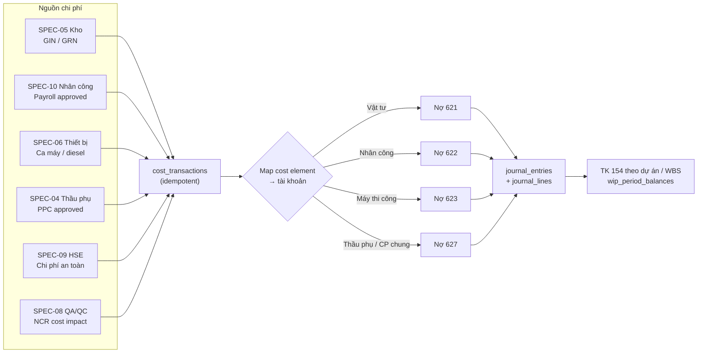
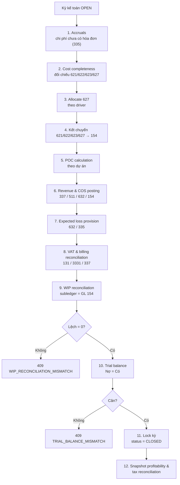
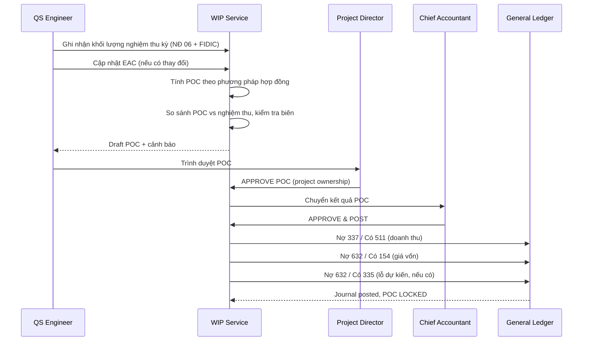
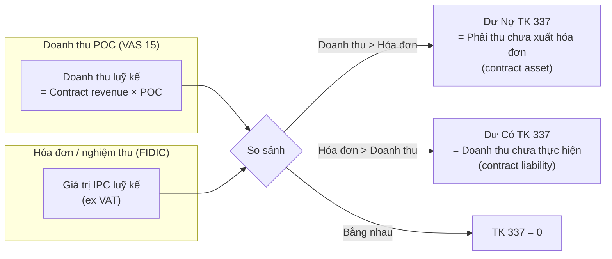
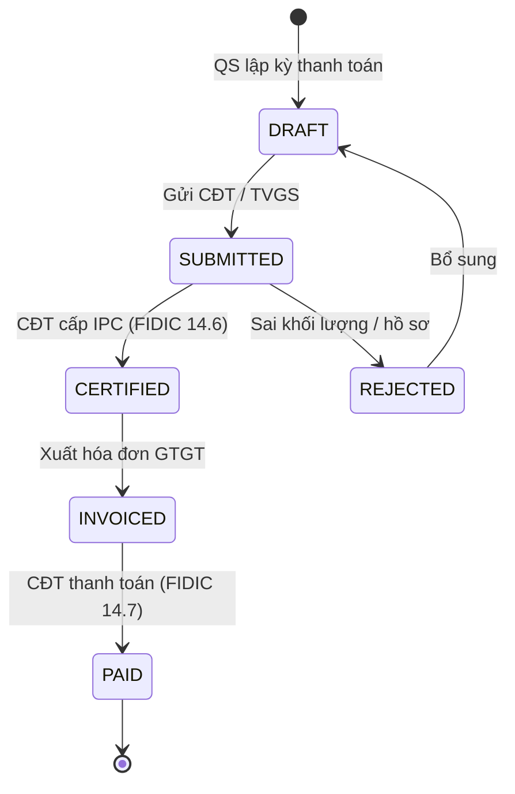
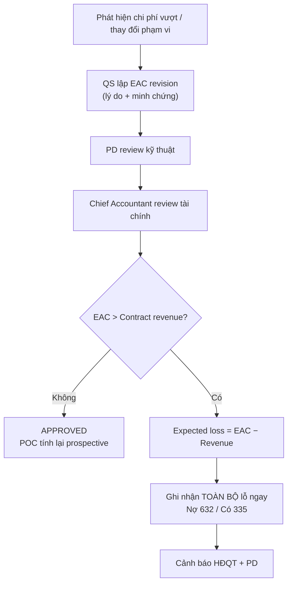
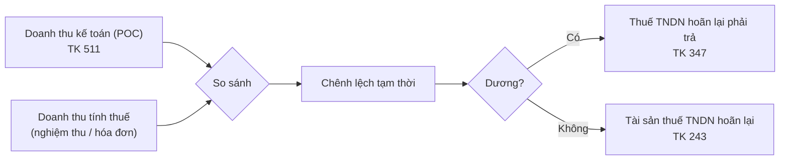

# SPEC-11: Kế toán Quản trị Công trình — WIP (TK 154), Doanh thu POC & Đối chiếu Nghiệm thu

> **Module**: 11 — Kế toán Chi phí Sản xuất Dở dang (WIP) & Doanh thu theo Tỷ lệ Hoàn thành (POC)
> **Author**: BA Agent (PC-4 — `ba-hant_lap`)
> **Task**: TASK-025 — "Dac ta Module 10 (Nhan luc & Cham cong GPS) va Module 11 (Ke toan Chi phi WIP D&B)"
> **Status**: Review (chờ Lead duyệt)
> **Version**: 1.0.0
> **Date**: 2026-10-21
> **Stack**: Java 21 + Spring Boot 3.3.x + PostgreSQL 17 + React 18 + TypeScript
> **Target Enterprise**: Ánh Dương Building (ADB) — Tổng thầu Thiết kế & Thi công (D&B) Hạng I
> **Schema**: `accounting_mgmt`
> **Migration Target**: `backend/src/main/resources/db/migration/V8__create_wip_accounting_tables.sql`
> **Package Target**: `com.anhduongbuilding.erp.accounting`
> **Companion Spec**: [SPEC-10](SPEC-10-WORKFORCE-ATTENDANCE.md) — Nhân lực, Chấm công & Bảng lương

> [!NOTE]
> **Quy ước đánh số Module**: Theo phân công của Lead trong TASK-025, **Module 10 = Nhân lực & Chấm công**, **Module 11 = Kế toán WIP/POC**.
> Trong `docs/plans/ENTERPRISE_ARCHITECTURE_ROADMAP.md`, WIP được đánh số **Phân hệ 10** và nhân lực nằm trong Phân hệ 02.
> Tài liệu này giữ cách đánh số của TASK-025. Đây là **nguồn dữ liệu gốc** cho doanh thu, giá vốn và chi phí dở dang; mọi module khác chỉ gửi **cost transaction**, không tự ghi bút toán.

---

## 1. Business Objectives & Legal / Regulatory Foundation

### 1.1 Vì sao WIP/POC là Trái tim Tài chính của Nhà thầu D&B

Một dự án thiết kế & thi công công nghiệp của ADB kéo dài 12–24 tháng, doanh thu 100–500 tỷ đồng, và có ba dòng thời gian khác nhau:

1. **Dòng chi phí**: vật tư xuất kho hôm nay, lương công nhân cuối tháng, ca máy hôm qua, PPC thầu phụ kỳ này — tất cả phát sinh **liên tục**.
2. **Dòng nghiệm thu**: khối lượng được Chủ đầu tư/TVGS chấp thuận theo từng đợt, có biên bản nghiệm thu theo Nghị định 06/2021/NĐ-CP và Chứng chỉ Thanh toán theo FIDIC.
3. **Dòng hóa đơn & tiền**: hóa đơn GTGT, khấu trừ tạm ứng, giữ lại bảo hành, thu tiền — thường **chậm hơn** nghiệm thu và chậm hơn rất nhiều so với chi phí.

Nếu chỉ hạch toán theo hóa đơn, ADB sẽ có những tháng "lãi giả" (đã chi phí nhưng chưa xuất hóa đơn) và những tháng "lỗ giả" (xuất hóa đơn cho khối lượng đã làm từ kỳ trước). Nếu chỉ hạch toán theo tiền, ADB không biết dự án nào đang thực sự lãi. **Kế toán quản trị WIP/POC** là cầu nối ba dòng thời gian đó:

- **TK 154** giữ chi phí sản xuất dở dang theo từng dự án/WBS.
- **POC (Percentage of Completion)** ghi nhận doanh thu và giá vốn theo tiến độ thực tế, không theo hóa đơn.
- **TK 337** giữ chênh lệch giữa doanh thu đã ghi nhận và giá trị đã xuất hóa đơn — chính là "phải thu chưa xuất hóa đơn" (contract asset) hoặc "doanh thu chưa thực hiện" (contract liability).
- **TK 632** nhận giá vốn tương ứng, để lợi nhuận gộp phản ánh đúng tiến độ.

Ba con số này phải khóa với nhau theo một phương trình kiểm soát được. Nếu không, ADB không thể trả lời câu hỏi mà Hội đồng quản trị hỏi mỗi tháng: **"Dự án này lãi hay lỗ, và nếu lỗ thì lỗ bao nhiêu?"**

### 1.2 Nguyên tắc Kế toán Quản trị vs Kế toán Tài chính

ADB vận hành **một sổ cái, hai góc nhìn**:

| Góc nhìn | Mục đích | Cơ sở | Tần suất |
|---|---|---|---|
| **Kế toán quản trị (management accounting)** | Lãi/lỗ theo dự án, WIP, dòng tiền, cảnh báo sớm | POC, EAC, chi phí cam kết | Hàng tuần / theo kỳ |
| **Kế toán tài chính (statutory)** | Báo cáo tài chính, thuế, kiểm toán | TT 200/2014/TT-BTC, VAS 15, hóa đơn, nghiệm thu | Hàng tháng / quý / năm |
| **Kế toán thuế (tax)** | Thuế TNDN, GTGT | Doanh thu theo nghiệm thu/hóa đơn, chi phí đủ điều kiện | Hàng quý / năm |

Sai lầm phổ biến là dùng **một** con số doanh thu cho cả ba. SPEC-11 tách bạch:
- `poc_calculations` → doanh thu quản trị & tài chính theo VAS 15.
- `progress_billings` + `sales_invoices` → doanh thu xuất hóa đơn, VAT.
- `tax_revenue_reconciliations` → chênh lệch tạm thời và thuế TNDN hoãn lại.

### 1.3 Legal & Regulatory Framework

| Instrument | Scope applied | Key obligations applied |
|---|---|---|
| **Luật Kế toán 2015** (Luật 88/2015/QH13) | Chứng từ, sổ kế toán, kỳ kế toán, lưu trữ | Chứng từ phải có đủ nội dung; sổ kế toán phản ánh đầy đủ nghiệp vụ; lưu trữ tài liệu kế toán **10 năm**; kỳ kế toán năm |
| **Thông tư 200/2014/TT-BTC** | Chế độ kế toán doanh nghiệp | TK 154 (chi phí sản xuất, kinh doanh dở dang); TK 621/622/623/627 (chi phí sản xuất); TK 632 (giá vốn); TK 511 (doanh thu); TK 337 (thanh toán theo tiến độ kế hoạch hợp đồng xây dựng); TK 131 (phải thu khách hàng); TK 3331 (VAT đầu ra) |
| **VAS 15 — Hợp đồng xây dựng** (ban hành kèm Quyết định 165/2002/QĐ-BTC) | Ghi nhận doanh thu, chi phí hợp đồng xây dựng | Đoạn 30–31: doanh thu và chi phí ghi nhận theo **tỷ lệ phần trăm công việc hoàn thành** khi kết quả ước tính đáng tin cậy; các phương pháp xác định POC (tỷ lệ chi phí thực tế/tổng chi phí dự toán, khảo sát khối lượng, đo lường công việc hoàn thành); đoạn 36: **lỗ dự kiến phải ghi nhận ngay** |
| **VAS 14 — Doanh thu và thu nhập khác** | Nguyên tắc doanh thu | Điều kiện ghi nhận doanh thu; nguyên tắc phù hợp chi phí |
| **Nghị định 06/2021/NĐ-CP** | Quản lý chất lượng, nghiệm thu, bàn giao, bảo hành | Biên bản nghiệm thu công việc/hạng mục/công trình; mức giữ lại bảo hành **3%–5%** giá trị hợp đồng; thời hạn bảo hành |
| **FIDIC Yellow Book 2017 (D&B)** | Hợp đồng tổng thầu | Sub-Clause 12 (Measurement), 13 (Variations and Adjustments), 14.3 (Application for Interim Payment Certificates), 14.6 (Interim Payment Certificates), 14.7 (Payment), 14.8 (Delayed Payment), 14.9 (Release of Retention Money), 14.10–14.12 (Statement at Completion / Final Statement), Clause 20 (Claims) |
| **Thông tư 12/2021/TT-BXD** | Định mức xây dựng | Cơ sở xây dựng **EAC** (tổng chi phí dự toán còn lại) và định mức chi phí để kiểm soát vượt |
| **Luật Thuế GTGT** + **Nghị định 123/2020/NĐ-CP** + **Thông tư 78/2021/TT-BTC** | Hóa đơn điện tử, thuế GTGT | Thời điểm lập hóa đơn, ký hiệu/mẫu số, VAT 8%/10% theo quy định từng thời kỳ |
| **Luật Thuế TNDN** + **Thông tư 96/2015/TT-BTC** | Thuế thu nhập doanh nghiệp | Doanh thu tính thuế theo nghiệm thu/hóa đơn; chi phí được trừ khi có chứng từ hợp lệ; chênh lệch tạm thời so với POC |
| **IFRS 15** (chuẩn mực tham chiếu) | Hợp đồng với khách hàng | Ghi nhận doanh thu theo nghĩa vụ hoàn thành; contract asset / contract liability; dùng khi ADB báo cáo cho khách hàng/chủ đầu tư nước ngoài |

> **Ghi chú về VAS 15 và IFRS 15**: VAS 15 vẫn là chuẩn mực áp dụng cho hợp đồng xây dựng tại Việt Nam. ADB thiết kế mô hình dữ liệu tương thích cả hai: `POC_COST` (cost-to-cost) tương đương IFRS 15 "input method"; `POC_SURVEY` tương đương "output method"; contract asset/liability ánh xạ vào TK 337.

### 1.4 WIP & POC KPI Model

| KPI | Definition | Target (ADB) |
|---|---|---|
| **WIP balance** | Số dư TK 154 cuối kỳ (chi phí chưa kết chuyển giá vốn) | Theo kế hoạch dự án; cảnh báo nếu > 15% doanh thu kỳ |
| **WIP days** | `WIP / (EAC / số ngày dự án)` | ≤ 45 ngày |
| **POC vs Certified variance** | `(Doanh thu POC − Giá trị nghiệm thu) / Giá trị nghiệm thu` | ≤ ±5% |
| **Unbilled receivable** | Dư Nợ TK 337 (doanh thu > hóa đơn) | ≤ 20% doanh thu luỹ kế |
| **Deferred revenue** | Dư Có TK 337 (hóa đơn > doanh thu) | Theo dõi, không để kéo dài > 90 ngày |
| **Gross margin (POC)** | `(Doanh thu POC − Giá vốn) / Doanh thu POC` | ≥ 12% (mục tiêu D&B) |
| **EAC variance** | `(EAC hiện tại − EAC gốc) / EAC gốc` | ≤ 5%; > 10% phải trình HĐQT |
| **Cost overrun at completion** | `EAC > Contract revenue` | 0 dự án |
| **Retention receivable** | Tiền bảo hành đang giữ tại CĐT | ≤ 5% giá trị hợp đồng |
| **Advance outstanding** | Tạm ứng chưa thu hồi | Thu hồi 100% khi đạt 80% khối lượng |
| **Billing realization** | `Đã xuất hóa đơn / Doanh thu POC luỹ kế` | 85%–115% |
| **Close on-time** | Kỳ kế toán đóng trước ngày 10 tháng sau | 100% |

---

## 2. User Stories

| ID | Role | User Story | Ref |
|---|---|---|---|
| US-11-01 | Kế toán trưởng (Chief Accountant) | As a **Chief Accountant**, I want a **chart of accounts aligned to Circular 200/2014**, so that every transaction maps to a legal account. | §6.1 |
| US-11-02 | Kế toán tổng hợp (GL Accountant) | As a **GL Accountant**, I want **material, labour, equipment and subcontract costs posted automatically to 621/622/623/627 by project and WBS**, so that I do not re-key data from five modules. | §3.1, §9 |
| US-11-03 | GL Accountant | As a **GL Accountant**, I want **duplicate source documents rejected idempotently**, so that a retried integration never double-counts cost. | §3.1, §6.8 |
| US-11-04 | Kỹ sư QS | As a **QS Engineer**, I want to **record approved measurement quantities with the NĐ 06 acceptance record**, so that revenue has documentary evidence, not an estimate. | §3.3, §6.11 |
| US-11-05 | QS Engineer | As a **QS Engineer**, I want **POC calculated by cost-to-cost, survey or milestone**, so that each contract uses the method its data supports. | §3.3, §4.3 |
| US-11-06 | Giám đốc dự án (PD) | As a **Project Director**, I want to **approve the POC and revenue before posting**, so that profit is owned by the project leader, not by the accounting engine. | §3.3 |
| US-11-07 | Chief Accountant | As a **Chief Accountant**, I want **revenue, billing and cash reconciled in TK 337**, so that unbilled and deferred amounts are explainable line by line. | §3.4, §4.6 |
| US-11-08 | Ban Giám đốc (CFO) | As a **CFO**, I want a **WIP cockpit by project and WBS**, so that I see where cost is stuck before month-end. | §3.2, §8.1 |
| US-11-09 | QS / PD | As a **Project Director**, I want to **revise EAC with approval and an audit trail**, so that a forecast change is governed, not silent. | §3.6, §6.19 |
| US-11-10 | CFO | As a **CFO**, I want **an expected contract loss recognized immediately**, so that ADB does not carry a doomed project at a fake profit. | §3.6, §4.5 |
| US-11-11 | Chief Accountant | As a **Chief Accountant**, I want a **guided monthly close** (accruals → 154 transfer → POC → VAT → reconciliation → lock), so that closing is repeatable and auditable. | §3.2 |
| US-11-12 | Kiểm toán nội bộ (Auditor) | As an **Auditor**, I want **closed periods to be immutable and every reversal traceable**, so that financial statements cannot be rewritten. | §3.7, §6.6 |
| US-11-13 | QS / Chief Accountant | As a **Chief Accountant**, I want to **issue FIDIC interim payment certificates with advance recovery and retention**, so that billing follows the contract, not a spreadsheet. | §3.5, §6.15 |
| US-11-14 | Chief Accountant | As a **Chief Accountant**, I want to **track retention receivable and release it in tranches**, so that ADB collects warranty money on time. | §3.5, §4.7 |
| US-11-15 | Chief Accountant | As a **Chief Accountant**, I want **advance recovery capped and scheduled**, so that ADB never over-recovers or forgets an advance. | §4.7 |
| US-11-16 | CFO | As a **CFO**, I want a **project P&L (revenue, cost of sales, gross profit, WIP, cash)**, so that each project is a managed business unit. | §6.21 |
| US-11-17 | Kế toán thuế (Tax Accountant) | As a **Tax Accountant**, I want **accounting revenue vs tax revenue reconciled with deferred tax**, so that the CIT return and the financial statements both reconcile. | §3.8, §6.20 |
| US-11-18 | CFO | As a **CFO**, I want **WIP aging and negative-WIP alerts**, so that unbilled cost and over-recognition are visible early. | §4.2, §8.1 |
| US-11-19 | GL Accountant | As a **GL Accountant**, I want a **trial balance and project cost ledger**, so that I can close with confidence. | §7, §8.1 |
| US-11-20 | PD | As a **Project Director**, I want **approved variations to increase contract revenue prospectively**, so that POC reflects the real contract value. | §3.9, §6.5 |
| US-11-21 | Chief Accountant | As a **Chief Accountant**, I want **corrections by reversal, never by editing a posted entry**, so that the audit trail is complete. | §3.7 |
| US-11-22 | CFO | As a **CFO**, I want a **13-week cash forecast from billing, retention and advance**, so that working capital is planned, not discovered. | §4.7, §8.1 |
| US-11-23 | GL Accountant | As a **GL Accountant**, I want **site overhead (627) allocated by a documented driver**, so that project margins are comparable. | §4.9 |
| US-11-24 | System / GL Accountant | As a **GL Accountant**, I want **failed integrations visible and retryable**, so that a network glitch does not silently lose cost. | §3.1, §6.23 |

---

## 3. End-to-End Business Workflows

### 3.1 Workflow 1 — Cost Accumulation Pipeline



**Rule WIP-1 (Single entry point)**: Every cost enters accounting through `cost_transactions`. No module may write directly to `journal_entries` except the accounting service itself.

**Rule WIP-2 (Idempotency — canonical)**: `UNIQUE (source_module, source_document_type, source_document_id, source_line_no, cost_element)`. A retried event returns **409 `DUPLICATE_COST_POSTING`** with the existing `transactionNo` and `journalEntryId`. **This is the rule validated by the Tester suite `CostPostingIdempotencyTest`.**

**Rule WIP-3 (Cost element mapping)**: `cost_element` determines the debit account:

| Cost element | Source | Debit account | WIP sub-account |
|---|---|---|---|
| `MATERIAL` | Inventory GIN | `621` | `1541` |
| `LABOR` | Workforce payroll | `622` | `1542` |
| `EQUIPMENT` | Equipment engine hours / diesel | `623` | `1543` |
| `SUBCONTRACT` | Subcontractor PPC | `627` (ADB policy) | `1547` |
| `OVERHEAD` | Site overhead, HSE, QA/QC | `627` | `1547` |
| `OTHER` | Manual approved | `627` or `1547` | `1547` |

> **ADB policy note**: Subcontractor construction payments are mapped to **627 (chi phí sản xuất chung) / 1547**, following the roadmap's `1547 — Chi phí sản xuất chung / thuê ngoài`. Enterprises that treat subcontract work as direct material/labour may map to `621`/`622`; the mapping is configuration (`cost_codes.default_account_code`), not code.

**Rule WIP-4 (Cost allocation)**: A cost transaction may be split across WBS items via `cost_allocations`. If no allocation rows exist, 100% goes to the header `wbs_item_id`. If allocation rows exist, they must sum to **100% ± 0,01**, otherwise **422 `COST_ALLOCATION_NOT_100_PERCENT`**.

**Rule WIP-5 (Period gate)**: A cost can only be posted into a period with `status='OPEN'`. Posting into a closed period returns **409 `PERIOD_CLOSED`**. Late invoices for a closed period are posted in the current open period with `transaction_date` = original date and an explanatory note (`LATE_COST`).

**Rule WIP-6 (Approval)**: Manual cost transactions above **50.000.000 đ** require approval by the Chief Accountant before posting. Automatic integrations post directly but remain reversible.

### 3.2 Workflow 2 — Monthly Close Sequence



**Rule CLOSE-1 (Order is mandatory)**: The close steps run in the order above. Step 5 (POC) cannot run before step 4 (cost transfer), and step 10 cannot pass before step 9 (WIP reconciliation).

**Rule CLOSE-2 (No empty close)**: A period with zero posted entries cannot be closed without an explicit `NO_ACTIVITY` confirmation.

**Rule CLOSE-3 (Four-eyes)**: The person who runs the close cannot be the person who approves it. The close run records `executed_by` and `approved_by`.

**Rule CLOSE-4 (Immutability)**: After `CLOSED`, no journal entry can be inserted, updated or deleted in that period. Corrections are made in the next open period by reversal.

**Rule CLOSE-5 (Close checklist is data)**: `period_close_runs.checklist` stores each step with `status`, `startedAt`, `finishedAt`, `metrics` and `errorCode`. The UI renders it as a stepper; the API returns it for automation.

**Rule CLOSE-6 (Year-end)**: Period 12 close also runs the year-end sequence: CIT provisional, deferred tax, closing entries to 911/421. The year-end period cannot be reopened without a General Director approval.

### 3.3 Workflow 3 — POC Calculation & Approval



**Rule POC-1 (Method by contract)**: Each project has one `revenue_method` in `project_financial_profiles`:
- `COST_TO_COST`: POC = chi phí thực tế luỹ kế / EAC.
- `SURVEY_CERTIFIED`: POC = giá trị nghiệm thu luỹ kế / doanh thu hợp đồng.
- `MILESTONE`: POC = giá trị mốc đã đạt / doanh thu hợp đồng.

**Rule POC-2 (Reliability gate)**: POC cannot be calculated if `current_eac` is null/zero, contract revenue is null/zero, or there is no approved EAC. → **422 `POC_INPUT_INCOMPLETE`** / **409 `EAC_NOT_APPROVED`**.

**Rule POC-3 (Evidence)**: `SURVEY_CERTIFIED` requires approved `progress_measurements`; `MILESTONE` requires an approved milestone record; `COST_TO_COST` requires posted cost transactions through the period. A POC without evidence is rejected with `POC_EVIDENCE_MISSING`.

**Rule POC-4 (Approval chain)**: POC status flows `DRAFT → CALCULATED → REVIEWED → APPROVED → POSTED`. `APPROVED` requires the Project Director; `POSTED` requires the Chief Accountant. Segregation of duties is enforced.

**Rule POC-5 (Cumulative, not period-only)**: Revenue is always computed **cumulatively** and the current-period amount is the delta versus the last posted POC. A prior-period error is corrected by a **cumulative catch-up**, not by editing history.

**Rule POC-6 (Negative catch-up)**: If POC decreases, `current_revenue_recognized` is negative. This is allowed only if `cumulative_revenue >= 0`; otherwise **422 `NEGATIVE_CATCH_UP_NOT_ALLOWED`**. The UI must show a red "điều chỉnh giảm" entry with reason.

**Rule POC-7 (Variance guard)**: If `|POC revenue − certified value| / certified value > 5%`, the calculation is flagged `POC_VS_CERTIFIED_VARIANCE` and requires a written explanation before `APPROVED`. This is the "đối chiếu doanh thu nghiệm thu theo POC" control.

**Rule POC-8 (One approved POC per project-period)**: A second `APPROVED` POC for the same project and period is rejected with **409 `POC_ALREADY_APPROVED`**. A revision creates a new `revision` with the prior one `REVERSED` (not edited).

**Rule POC-9 (VAT)**: POC revenue is **exclusive of VAT**. VAT is recognized only when an invoice is issued (`sales_invoices`), per Vietnamese tax law. Never post VAT on an unbilled POC.

### 3.4 Workflow 4 — Revenue, Billing & TK 337 Bridge



**Rule REV-1 (TK 337 is the bridge)**: `balance_337 = cumulative_billed_ex_vat − cumulative_revenue_recognized`. A **debit** balance is an unbilled receivable; a **credit** balance is deferred revenue. This single invariant explains the entire gap between POC profit and invoiced revenue.

**Rule REV-2 (Billing is not revenue)**: Issuing an IPC or an invoice does **not** create revenue. It debits `131` and credits `337` (plus VAT to `3331`). Revenue was already recognized by POC.

**Rule REV-3 (Retention is not a revenue reduction)**: Retention money is withheld from cash but remains a receivable (`131` detail). It is never netted against revenue.

**Rule REV-4 (Advance is a liability)**: Customer advances are recorded in `131` detail (credit) or a dedicated advance sub-account. Recovery reduces the receivable; it is never revenue.

**Rule REV-5 (No revenue without a contract)**: A project without an approved `project_financial_profiles` cannot recognize revenue. → **422 `CONTRACT_VALUE_MISSING`**.

**Rule REV-6 (Variations)**: Only **approved** variations (`contract_variations.status='APPROVED'`) are included in contract revenue. Pending or rejected variations are disclosed as a memo item, never recognized. → **409 `VARIATION_NOT_APPROVED`** when an attempt is made to include them.

**Rule REV-7 (Claims)**: Claims under FIDIC Clause 20 are **not revenue** until determined or agreed. They are tracked in Module 12 (Claims/EOT/VO) and disclosed; recognizing an unapproved claim is prohibited.

**Rule REV-8 (Defects / penalties)**: Liquidated damages and backcharges reduce the transaction price only when they are probable and measurable, with a documented FIDIC/contract basis; otherwise they are a provision, not a revenue adjustment.

### 3.5 Workflow 5 — FIDIC Interim Payment Certificate (IPC)



**Rule BILL-1 (IPC composition)**:
```
gross_certified_value      = Σ approved measurement values in the period
advance_recovery           = MIN(remaining_advance, gross × recovery_rate)
retention_amount           = MIN(gross × retention_rate, retention_cap − cumulative_retention)
other_deductions           = backcharges, penalties, utilities
net_before_vat             = gross − advance_recovery − retention − other_deductions
vat_amount                 = net_before_vat × vat_rate
total_incl_vat             = net_before_vat + vat_amount
```

**Rule BILL-2 (Retention cap)**: Default 5%, hard-capped at **5% of the contract value** (NĐ 06/2021 range 3%–5%). A rate outside 0–5 is rejected with **422 `RETENTION_RATE_OUT_OF_RANGE`**.

**Rule BILL-3 (Advance recovery)**: Recovery starts at the first IPC and must complete by **80% completion**. Over-recovery is rejected with **422 `ADVANCE_OVER_RECOVERY`**. The outstanding advance is never allowed to go negative.

**Rule BILL-4 (Invoice timing)**: An e-invoice is issued only after the IPC is `CERTIFIED`. Invoice cancellation/adjustment follows NĐ 123/2020; the original invoice is never deleted.

**Rule BILL-5 (Currency)**: IPC and invoices are in VND. If a contract is in USD, the accounting currency conversion uses the State Bank rate on the invoice date; the FX difference is recorded in `515`/`635`, not in revenue.

### 3.6 Workflow 6 — EAC Revision & Expected Loss



**Rule EAC-1**: EAC revisions are append-only (`eac_revisions`). The approved revision updates `project_financial_profiles.current_eac`, and POC is recalculated prospectively.

**Rule EAC-2**: An EAC revision requires approval by the PD **and** the Chief Accountant. A revision that turns a profit into a loss also requires the General Director.

**Rule EAC-3 (Expected loss)**: Per VAS 15 paragraph 36, when `EAC > contract revenue`, the **entire expected loss** is recognized immediately, regardless of POC. The provision is `contract_loss_provisions`; the entry is `Nợ 632 / Có 335`. It is not spread over the remaining period.

**Rule EAC-4 (Reversal of loss)**: If a later EAC revision removes the loss, the provision is reversed **only to the extent that the loss is no longer expected**, never below zero, and with a documented reason.

### 3.7 Workflow 7 — Correction by Reversal

**Rule COR-1**: A posted journal entry is never edited. A correction creates a **reversal entry** that mirrors the original (debit ↔ credit), linked by `reversal_of_entry_id`, with a mandatory reason.

**Rule COR-2**: The original entry status becomes `REVERSED`; the reversal is a new `POSTED` entry in an **open period**. If the original period is closed, the reversal is posted in the current period (prior-period adjustment) with disclosure.

**Rule COR-3**: A reversal of a POC posting also reverses the linked cost-of-sales and loss provision. The POC record becomes `REVERSED`; a new revision is required.

### 3.8 Workflow 8 — Tax Revenue Reconciliation



**Rule TAX-1**: Accounting revenue (VAS 15 POC) and tax revenue (accepted/invoiced value) are reconciled every period in `tax_revenue_reconciliations`. The difference is a **temporary difference**, not an error.

**Rule TAX-2**: Deferred tax is computed at the statutory CIT rate (20% default, configurable). A deferred tax asset is recognized only when future taxable profit is probable; otherwise it is disclosed but not booked.

**Rule TAX-3**: VAT is never part of revenue or WIP. Input VAT is credited to `1331`; output VAT to `3331`. POC revenue is always net of VAT.

### 3.9 Workflow 9 — Variation Order (FIDIC Clause 13)

**Rule VO-1**: A variation is recorded in `contract_variations` with type `INSTRUCTION`, `PROVISIONAL_SUM`, `DAYWORK` or `RATE_CHANGE`, and its FIDIC clause reference.

**Rule VO-2**: Only `APPROVED` variations update `project_financial_profiles.approved_variations_value`, which drives `current_contract_value` and therefore POC revenue.

**Rule VO-3**: A variation is incorporated into revenue **prospectively** from its `effective_period_id`. Prior approved POCs are not restated unless the variation corrects a prior-period error, in which case a cumulative catch-up is used with disclosure.

---

## 4. Business Rules, Formulas & Thresholds

### 4.1 Cost Accumulation

```
cost_incurred_cumulative(project, period) =
    Σ cost_transactions.amount_ex_vat
    WHERE status = 'POSTED'
      AND transaction_date <= period.end_date
      AND cost_element IN ('MATERIAL','LABOR','EQUIPMENT','SUBCONTRACT','OVERHEAD','OTHER')
```

Cost is accumulated **net of VAT**. Non-deductible costs (e.g. a penalty without a valid invoice) are still recorded, but flagged `tax_deductible = FALSE` for the CIT reconciliation.

### 4.2 WIP Balance

```
cumulative_cost_of_sales = ROUND(POC × EAC, 2)
wip_closing_balance      = cost_incurred_cumulative − cumulative_cost_of_sales
```

| Situation | Meaning | Treatment |
|---|---|---|
| `WIP > 0` | Chi phí đã phát sinh nhiều hơn giá vốn đã ghi nhận | Hợp lệ khi POC theo nghiệm thu/khảo sát chậm hơn chi phí; theo dõi WIP aging |
| `WIP = 0` | Cost-to-cost với POC = cost/EAC | Bình thường; WIP kinh tế nằm ở TK 337 (phải thu chưa xuất hóa đơn) |
| `WIP < 0` | Đã ghi nhận giá vốn vượt chi phí thực tế | **Bất thường**: cần trích trước chi phí (TK 335) hoặc điều chỉnh POC; chặn close với `NEGATIVE_WIP_REQUIRES_ACCRUAL` nếu vượt ngưỡng -1% EAC |

**Rule WIP-7**: `wip_closing_balance` must equal `opening + additions − cost_of_sales` in `wip_period_balances`. Any difference is a reconciliation break.

**Rule WIP-8**: WIP is reported **by project and by WBS**. A project-level WIP without WBS detail is allowed only for costs that cannot be allocated (e.g. mobilisation), and must be flagged `UNALLOCATED`.

### 4.3 POC Methods

**Method A — Cost-to-cost (default, VAS 15 / IFRS 15 input method)**

```
poc_percentage = cost_incurred_cumulative / EAC
cumulative_revenue = contract_revenue_ex_vat × poc_percentage
cumulative_cost_of_sales = poc_percentage × EAC
```

Because `cumulative_cost_of_sales = cost_incurred_cumulative`, **WIP = 0** in this method. This is not an error: the unbilled position is carried in TK 337. This point must be explained to management, otherwise they will think WIP "disappeared".

**Method B — Survey / certified value (output method)**

```
poc_percentage = certified_value_cumulative / contract_revenue_ex_vat
cumulative_cost_of_sales = poc_percentage × EAC
wip_closing_balance = cost_incurred_cumulative − cumulative_cost_of_sales
```

**Method C — Milestone**

```
poc_percentage = approved_milestone_value_cumulative / contract_revenue_ex_vat
```

**Rule POC-10**: POC is clamped to `[0, 1]`. A POC above 100% requires an approved variation or a correction; it is never silently capped without a flag.

**Rule POC-11**: If `EAC = 0` or `contract_revenue = 0`, POC is not calculated; the system raises `POC_INPUT_INCOMPLETE`. No division by zero, ever.

### 4.4 Revenue & Cost of Sales

```
cumulative_revenue_recognized = ROUND(contract_revenue_ex_vat × POC, 2)
current_revenue_recognized    = cumulative_revenue_recognized − prior_revenue_recognized
cumulative_cost_of_sales      = ROUND(POC × EAC, 2)
current_cost_of_sales         = cumulative_cost_of_sales − prior_cost_of_sales
cumulative_gross_profit       = cumulative_revenue_recognized − cumulative_cost_of_sales
current_gross_profit          = current_revenue_recognized − current_cost_of_sales
```

**Rule REV-9**: `current_cost_of_sales` cannot exceed the **remaining unexpensed cost** (`cost_incurred − prior_cost_of_sales`) unless an accrual (TK 335) is posted first. Otherwise **422 `COST_OF_SALES_EXCEEDS_INCURRED`**.

### 4.5 Expected Loss Provision

```
expected_loss_total = MAX(0, EAC − contract_revenue_ex_vat)
gross_profit_before_provision = cumulative_revenue_recognized − cumulative_cost_of_sales
required_provision = MAX(0, expected_loss_total + MIN(0, gross_profit_before_provision))
current_provision  = required_provision − provision_recognized_to_date
```

Accounting entry: `Nợ 632 / Có 335` for `current_provision`. The provision is presented as a reduction of WIP/contract asset and disclosed in the notes.

### 4.6 TK 337 Bridge

```
billed_cumulative_ex_vat = Σ progress_billings.net_before_vat (status IN ('CERTIFIED','INVOICED','PAID'))
balance_337 = billed_cumulative_ex_vat − cumulative_revenue_recognized
```

- `balance_337 > 0` → **Dư Có** (billed ahead) → deferred revenue.
- `balance_337 < 0` → **Dư Nợ** (revenue ahead) → unbilled receivable / contract asset.

### 4.7 Retention & Advance

```
retention_per_ipc = MIN(gross × retention_rate, retention_cap − cumulative_retention)
retention_cap      = contract_value × retention_cap_rate     -- 5% mặc định, tối đa 5%
advance_recovery   = MIN(advance_outstanding, gross × advance_recovery_rate)
advance_outstanding = advance_amount − recovered_to_date
```

**Retention release schedule** (FIDIC 14.9 / NĐ 06/2021):
- Tranche 1 (`FIRST_HALF`): at Taking-Over Certificate / nghiệm thu bàn giao — 50%.
- Tranche 2 (`SECOND_HALF`): at expiry of the Defects Notification Period / hết bảo hành — 50%.
- A release requires an approved `retention_releases` record and a journal `Nợ 112 / Có 131`.

### 4.8 EAC & Margin

```
eac_variance_pct = (current_eac − original_eac) / original_eac × 100
projected_margin = (contract_revenue − current_eac) / contract_revenue × 100
```

| EAC variance | Severity | Action |
|---|---|---|
| ≤ 5% | `NORMAL` | Monitor |
| 5%–10% | `WARNING` | PD + CFO review; update forecast |
| > 10% | `CRITICAL` | Board notification; recovery plan |
| EAC > revenue | `LOSS` | Immediate provision per §4.5 |

### 4.9 Overhead (627) Allocation

627 is allocated to projects using one documented driver:
- `DIRECT_COST` (default): share = project direct cost / total direct cost.
- `LABOUR_HOURS`: share = project direct labour hours / total direct labour hours.
- `CONTRACT_VALUE`: share = project contract value / total contract value.
- `MANUAL`: approved allocation with a schedule.

**Rule OH-1**: The allocation basis is fixed at the start of the fiscal year and disclosed. Changing it mid-year requires CFO approval.

**Rule OH-2**: 627 allocated to a project is added to `wip_period_balances.additions_overhead_627` and participates in the 154 transfer.

### 4.10 Tax Reconciliation

```
accounting_revenue = cumulative_revenue_recognized (POC, ex VAT)
tax_revenue        = cumulative_certified_or_invoiced_value (ex VAT)
temporary_difference = accounting_revenue − tax_revenue
deferred_tax_amount  = ROUND(temporary_difference × cit_rate / 100, 2)
```

- `temporary_difference > 0` → accounting revenue ahead → **deferred tax liability** (TK 347).
- `temporary_difference < 0` → tax revenue ahead → **deferred tax asset** (TK 243), subject to recoverability.

### 4.11 Worked Example (authoritative)

**Inputs**

| Item | Value (VND) |
|---|---|
| Contract revenue (ex VAT) | 100.000.000.000 |
| Original EAC | 85.000.000.000 |
| Cost incurred cumulative | 42.500.000.000 |
| Prior POC revenue recognized | 40.000.000.000 |
| Prior cost of sales | 34.000.000.000 |
| Certified value cumulative (survey method) | 45.000.000.000 |
| Billed cumulative (ex VAT) | 40.000.000.000 |
| Advance received | 10.000.000.000 |
| Advance recovered to date | 4.000.000.000 |
| Retention rate | 5% |

**Method A — Cost-to-cost**

| Line | Calculation | Value |
|---|---|---|
| POC | 42.500 / 85.000 | 50,0000% |
| Cumulative revenue | 100.000 × 50% | 50.000.000.000 |
| Current revenue | 50.000 − 40.000 | 10.000.000.000 |
| Cumulative COS | 50% × 85.000 | 42.500.000.000 |
| Current COS | 42.500 − 34.000 | 8.500.000.000 |
| Cumulative gross profit | 50.000 − 42.500 | 7.500.000.000 |
| Current gross profit | 10.000 − 8.500 | 1.500.000.000 |
| WIP closing (154) | 42.500 − 42.500 | 0 |
| TK 337 balance | 40.000 − 50.000 | −10.000.000.000 (Dư Nợ = phải thu chưa xuất hóa đơn) |

**Method B — Survey certified (same cost data)**

| Line | Calculation | Value |
|---|---|---|
| POC | 45.000 / 100.000 | 45,0000% |
| Cumulative revenue | 100.000 × 45% | 45.000.000.000 |
| Current revenue | 45.000 − 40.000 | 5.000.000.000 |
| Cumulative COS | 45% × 85.000 | 38.250.000.000 |
| Current COS | 38.250 − 34.000 | 4.250.000.000 |
| WIP closing (154) | 42.500 − 38.250 | 4.250.000.000 |
| TK 337 balance | 40.000 − 45.000 | +5.000.000.000 (Dư Có = doanh thu chưa thực hiện) |
| Cumulative gross profit | 45.000 − 38.250 | 6.750.000.000 |

**Expected loss variant**: if EAC rises to 108.000.000.000 while revenue stays 100.000.000.000:
- POC (cost-to-cost) = 42.500 / 108.000 = 39,3519%
- Cumulative revenue = 39.351.851.852
- Cumulative COS = 42.500.000.000
- Gross profit before provision = −3.148.148.148
- Expected loss total = 8.000.000.000
- Required provision = 8.000.000.000 − 3.148.148.148 = 4.851.851.852
- Journal: `Nợ 632 / Có 335` 4.851.851.852

### 4.12 Journal Entry Matrix

| # | Business event | Debit | Credit | Amount basis |
|---|---|---|---|---|
| 1 | Material issued to site | `621` | `152` | Cost transaction (ex VAT) |
| 2 | Direct labour accrued | `622` | `334` | Payroll allocation |
| 3 | Equipment shift cost | `623` | `214` / `111` / `152` / `334` | Engine hours, diesel |
| 4 | Subcontractor PPC approved | `627` (or `1547`) | `331` | PPC net + VAT treatment |
| 5 | Site overhead incurred | `627` | `111` / `112` / `331` / `334` | Invoice / payroll |
| 6 | Month-end transfer | `1541/1542/1543/1547` | `621/622/623/627` | Period totals |
| 7 | POC revenue | `337` | `511` | Current revenue delta |
| 8 | POC cost of sales | `632` | `154` | Current COS delta |
| 9 | Expected loss provision | `632` | `335` | Current provision |
| 10 | IPC certified | `131` | `337` | IPC net before VAT |
| 11 | Output VAT on invoice | `131` | `3331` | VAT amount |
| 12 | Advance received | `112` | `131` (advance detail) | Cash |
| 13 | Advance recovered | `131` (advance detail) | `131` (trade detail) | Recovery amount |
| 14 | Retention withheld | `131` (retention detail) | `131` (trade detail) | Retention amount |
| 15 | Customer payment | `112` | `131` | Cash |
| 16 | Retention release | `112` | `131` (retention detail) | Released amount |
| 17 | Reversal of a posted entry | Mirror of original | Mirror of original | Original amount |

> **Presentation**: On the balance sheet, the net of `131` trade, `131` retention, `131` advance and `337` is presented as **contract asset** or **contract liability** per project — never netted across projects.

---

## 5. Acceptance Criteria (Gherkin)

```gherkin
# ─────────────────────────────────────────────────────────────────────────
# SPEC-11 — Acceptance Criteria
# Ref: US-11-01 … US-11-24
# ─────────────────────────────────────────────────────────────────────────

Scenario AC-11-01: Hạch toán chi phí vật tư từ phiếu xuất kho — Nợ 621
  Given dự án "ADB-BD-FACTORY-01" đang mở kỳ kế toán "2026-10"
  And có phiếu xuất kho "GIN-2026-00412" dòng 3 trị giá 595.000.000 đ (chưa VAT)
  When hệ thống nhận cost transaction từ module Kho
  Then phải tạo bút toán Nợ 621 / Có 152 với số tiền 595.000.000 đ
  And phải gắn project_id = 101 và wbs_item_id = 5021
  And cost transaction phải có status "POSTED" và journalEntryId khác null
  And kết quả trả về phải có httpStatus 201

Scenario AC-11-02: Gửi trùng phiếu xuất kho — chống trùng idempotent
  Given cost transaction từ "GIN-2026-00412" dòng 3 đã được POSTED
  When module Kho gửi lại cùng source document và cùng dòng
  Then hệ thống phải từ chối với httpStatus 409 và mã lỗi "DUPLICATE_COST_POSTING"
  And phải trả về transactionNo và journalEntryId đã tồn tại
  And số dư TK 621 không được tăng thêm

Scenario AC-11-03: Hạch toán lương từ bảng lương đã duyệt — Nợ 622 theo WBS
  Given bảng lương "PR-2026-10-R01" đã APPROVED với tổng gross 6.482.500.000 đ
  And phân bổ 75% cho dự án A/WBS 5.2 và 25% cho dự án B/WBS 3.1
  When hệ thống nhận sự kiện "workforce.payroll.approved"
  Then phải tạo bút toán Nợ 622 cho dự án A là 4.861.875.000 đ
  And Nợ 622 cho dự án B là 1.620.625.000 đ
  And Có 334 tổng cộng 6.482.500.000 đ
  And bút toán phải cân Nợ = Có

Scenario AC-11-04: Chi phí thầu phụ từ PPC — Nợ 627/1547
  Given chứng chỉ PPC "PPC-2026-10-003" đã APPROVED với giá trị trước VAT 2.000.000.000 đ
  When hệ thống nhận cost transaction từ module Thầu phụ
  Then phải hạch toán Nợ 627 (chi tiết 1547) / Có 331
  And cost element phải là "SUBCONTRACT"
  And phải gắn đúng dự án và WBS của hợp đồng giao khoán

Scenario AC-11-05: Kết chuyển chi phí cuối kỳ vào TK 154
  Given trong kỳ có số dư TK 621 = 18.500.000.000 đ, TK 622 = 6.482.500.000 đ
  And TK 623 = 3.100.000.000 đ, TK 627 = 9.200.000.000 đ
  When chạy bước "kết chuyển 621/622/623/627 → 154"
  Then phải tạo bút toán Nợ 1541 / Có 621 18.500.000.000 đ
  And Nợ 1542 / Có 622 6.482.500.000 đ
  And Nợ 1543 / Có 623 3.100.000.000 đ
  And Nợ 1547 / Có 627 9.200.000.000 đ
  And số dư cuối kỳ của 621, 622, 623, 627 phải bằng 0

Scenario AC-11-06: Tính POC theo cost-to-cost — doanh thu và giá vốn đúng
  Given doanh thu hợp đồng chưa VAT là 100.000.000.000 đ
  And EAC đã duyệt là 85.000.000.000 đ
  And chi phí luỹ kế đã POSTED là 42.500.000.000 đ
  When tính POC theo phương pháp "COST_TO_COST"
  Then POC phải bằng 0,500000
  And doanh thu luỹ kế phải bằng 50.000.000.000 đ
  And giá vốn luỹ kế phải bằng 42.500.000.000 đ
  And WIP closing phải bằng 0 đ
  And lợi nhuận gộp luỹ kế phải bằng 7.500.000.000 đ

Scenario AC-11-07: Tính POC theo nghiệm thu — WIP dương 4,25 tỷ
  Given doanh thu hợp đồng 100.000.000.000 đ, EAC 85.000.000.000 đ
  And chi phí luỹ kế 42.500.000.000 đ
  And giá trị nghiệm thu luỹ kế đã duyệt là 45.000.000.000 đ
  When tính POC theo phương pháp "SURVEY_CERTIFIED"
  Then POC phải bằng 0,450000
  And doanh thu luỹ kế phải bằng 45.000.000.000 đ
  And giá vốn luỹ kế phải bằng 38.250.000.000 đ
  And WIP closing phải bằng 4.250.000.000 đ

Scenario AC-11-08: Doanh thu POC vượt hóa đơn — dư Nợ TK 337
  Given doanh thu POC luỹ kế là 50.000.000.000 đ
  And giá trị đã xuất hóa đơn luỹ kế (chưa VAT) là 40.000.000.000 đ
  When đối chiếu TK 337
  Then số dư TK 337 phải là dư Nợ 10.000.000.000 đ
  And phải được phân loại là "UNBILLED_RECEIVABLE" (contract asset)
  And không được ghi nhận VAT trên phần chưa xuất hóa đơn

Scenario AC-11-09: Hóa đơn vượt doanh thu POC — dư Có TK 337
  Given doanh thu POC luỹ kế là 45.000.000.000 đ
  And giá trị đã xuất hóa đơn luỹ kế là 50.000.000.000 đ
  When đối chiếu TK 337
  Then số dư TK 337 phải là dư Có 5.000.000.000 đ
  And phải được phân loại là "DEFERRED_REVENUE" (contract liability)
  And phải cảnh báo nếu kéo dài quá 90 ngày

Scenario AC-11-10: Chênh lệch POC và nghiệm thu vượt 5% — chặn duyệt
  Given doanh thu POC luỹ kế là 49.030.000.000 đ
  And giá trị nghiệm thu luỹ kế là 45.500.000.000 đ
  And chênh lệch là 7,76% (> 5%)
  When Giám đốc dự án duyệt POC
  Then hệ thống phải chặn với httpStatus 422 và mã lỗi "POC_VS_CERTIFIED_VARIANCE_REQUIRES_EXPLANATION"
  And phải hiển thị cả hai con số và tỷ lệ chênh lệch
  And chỉ được duyệt sau khi có giải trình bằng văn bản

Scenario AC-11-11: POC giảm — điều chỉnh giảm luỹ kế (negative catch-up)
  Given POC kỳ trước là 50% và doanh thu luỹ kế đã ghi nhận 50.000.000.000 đ
  When POC kỳ này giảm còn 47%
  Then doanh thu luỹ kế mới phải là 47.000.000.000 đ
  And doanh thu kỳ này phải là −3.000.000.000 đ
  And phải hiển thị là bút toán điều chỉnh giảm
  And doanh thu luỹ kế không được âm

Scenario AC-11-12: EAC vượt doanh thu — ghi nhận toàn bộ lỗ dự kiến ngay
  Given doanh thu hợp đồng 100.000.000.000 đ
  And EAC mới được duyệt là 108.000.000.000 đ
  And chi phí luỹ kế 42.500.000.000 đ
  When tính POC và lỗ dự kiến
  Then POC phải bằng 0,393519
  And lỗ dự kiến toàn hợp đồng phải bằng 8.000.000.000 đ
  And provision kỳ này phải bằng 4.851.851.852 đ
  And phải hạch toán Nợ 632 / Có 335 đúng số tiền trên
  And phải gửi cảnh báo tới Giám đốc dự án và HĐQT

Scenario AC-11-13: Giá vốn vượt chi phí đã phát sinh — chặn
  Given chi phí luỹ kế đã POSTED là 42.500.000.000 đ
  And giá vốn luỹ kế đã ghi nhận trước đó là 40.000.000.000 đ
  When POC mới yêu cầu giá vốn luỹ kế 45.000.000.000 đ
  Then hệ thống phải từ chối với httpStatus 422 và mã lỗi "COST_OF_SALES_EXCEEDS_INCURRED"
  And phải yêu cầu trích trước chi phí (TK 335) trước khi ghi nhận

Scenario AC-11-14: WIP âm vượt ngưỡng — chặn đóng kỳ
  Given WIP closing của dự án là −1.500.000.000 đ
  And ngưỡng cho phép là −1% EAC
  When chạy đóng kỳ
  Then hệ thống phải chặn với httpStatus 409 và mã lỗi "NEGATIVE_WIP_REQUIRES_ACCRUAL"
  And phải liệt kê dự án và số tiền cần trích trước

Scenario AC-11-15: Đóng kỳ khi sổ cái và sổ chi tiết WIP lệch — chặn
  Given tổng dư TK 154 trên sổ cái là 42.500.000.000 đ
  And tổng WIP trên sổ chi tiết dự án là 42.480.000.000 đ
  When chạy đóng kỳ
  Then hệ thống phải chặn với httpStatus 409 và mã lỗi "WIP_RECONCILIATION_MISMATCH"
  And phải hiển thị chênh lệch 20.000.000 đ theo từng dự án

Scenario AC-11-16: Đóng kỳ khi bảng cân đối phát sinh không cân — chặn
  Given tổng phát sinh Nợ là 120.000.000.000 đ
  And tổng phát sinh Có là 119.999.000.000 đ
  When chạy bước kiểm tra trial balance
  Then hệ thống phải chặn với httpStatus 409 và mã lỗi "TRIAL_BALANCE_MISMATCH"
  And kỳ phải giữ trạng thái "OPEN"

Scenario AC-11-17: Hạch toán vào kỳ đã đóng — từ chối
  Given kỳ kế toán "2026-09" đã CLOSED
  When kế toán cố ghi một bút toán vào kỳ đó
  Then hệ thống phải từ chối với httpStatus 409 và mã lỗi "PERIOD_CLOSED"
  And phải hướng dẫn ghi vào kỳ hiện tại dưới dạng điều chỉnh kỳ trước

Scenario AC-11-18: Bút toán không cân — từ chối
  Given một bút toán có tổng Nợ 100.000.000 đ và tổng Có 99.000.000 đ
  When kế toán cố POST bút toán
  Then hệ thống phải từ chối với httpStatus 422 và mã lỗi "JOURNAL_NOT_BALANCED"
  And trạng thái bút toán phải giữ "DRAFT"
  And không được cập nhật số dư

Scenario AC-11-19: Giữ lại bảo hành 5% và trần 5% giá trị hợp đồng
  Given hợp đồng có giá trị 100.000.000.000 đ
  And tỷ lệ giữ lại bảo hành là 5%
  And luỹ kế đã giữ 4.900.000.000 đ
  When lập IPC kỳ này với giá trị nghiệm thu 10.000.000.000 đ
  Then tiền giữ lại kỳ này phải bằng 100.000.000 đ (chạm trần 5.000.000.000 đ)
  And không được giữ vượt quá 5.000.000.000 đ

Scenario AC-11-20: Thu hồi tạm ứng vượt số dư — từ chối
  Given tạm ứng đã nhận là 10.000.000.000 đ
  And đã thu hồi 9.500.000.000 đ
  When IPC kỳ này cố thu hồi thêm 1.000.000.000 đ
  Then hệ thống phải từ chối với httpStatus 422 và mã lỗi "ADVANCE_OVER_RECOVERY"
  And số thu hồi tối đa phải là 500.000.000 đ

Scenario AC-11-21: Phụ lục hợp đồng đã duyệt — cập nhật doanh thu hợp đồng
  Given hợp đồng gốc có doanh thu 100.000.000.000 đ
  And có VO-01 được duyệt với giá trị 2.000.000.000 đ
  When tính lại POC
  Then doanh thu hợp đồng hiện tại phải bằng 102.000.000.000 đ
  And POC phải được tính trên cơ sở doanh thu mới
  And VO chưa duyệt không được đưa vào doanh thu

Scenario AC-11-22: Đối chiếu doanh thu kế toán và doanh thu thuế — thuế hoãn lại
  Given doanh thu POC luỹ kế là 50.000.000.000 đ
  And doanh thu tính thuế luỹ kế (nghiệm thu/hóa đơn) là 40.000.000.000 đ
  And thuế suất TNDN là 20%
  When chạy đối chiếu thuế
  Then chênh lệch tạm thời phải là 10.000.000.000 đ
  And thuế TNDN hoãn lại phải trả phải là 2.000.000.000 đ
  And phải ghi nhận vào TK 347

Scenario AC-11-23: Sửa bút toán đã POST — chỉ được đảo bút toán
  Given một bút toán doanh thu POC đã POSTED
  When kế toán cố sửa trực tiếp số tiền
  Then hệ thống phải từ chối với httpStatus 409 và mã lỗi "POSTED_ENTRY_IMMUTABLE"
  And phải hướng dẫn tạo bút toán đảo (reversal) có lý do
  And bút toán đảo phải liên kết với bút toán gốc qua reversal_of_entry_id

Scenario AC-11-24: Duyệt POC lần hai cho cùng dự án/kỳ — từ chối
  Given dự án 101 đã có POC APPROVED cho kỳ "2026-10"
  When người dùng duyệt thêm một POC khác cho cùng dự án và kỳ
  Then hệ thống phải từ chối với httpStatus 409 và mã lỗi "POC_ALREADY_APPROVED"
  And phải hướng dẫn tạo revision (đảo POC cũ trước)
```

---

## 6. Database Schema (PostgreSQL DDL)

> **Schema**: `accounting_mgmt`
> **FK rule**: hard FK to `core_iam.users`, `project_mgmt.projects`, `project_mgmt.wbs_items` (V1). References to `estimating_costing.boq_items` (V1), `subcontractor_mgmt` (V2), `workforce_mgmt` (V7) are **logical references** (`BIGINT` / `VARCHAR` + documented business key) to keep `V8` deployable independently. The physical FK is added in a later hardening migration.
> **Money**: `NUMERIC(18,2)` VND. **Rates**: `NUMERIC(9,6)` for POC, `NUMERIC(5,2)` for percentages. **No floating point.**

```sql
-- ==========================================================
-- V8 — Schema: accounting_mgmt
-- Module 11 — WIP (TK 154) & Doanh thu POC (VAS 15)
-- ==========================================================

CREATE SCHEMA IF NOT EXISTS accounting_mgmt;

CREATE OR REPLACE FUNCTION accounting_mgmt.fn_touch_updated_at()
RETURNS TRIGGER
LANGUAGE plpgsql
AS $$
BEGIN
    NEW.updated_at := CURRENT_TIMESTAMP;
    RETURN NEW;
END;
$$;

-- ── 1. Hệ thống tài khoản (Thông tư 200/2014/TT-BTC) ────────────────────
CREATE TABLE IF NOT EXISTS accounting_mgmt.chart_of_accounts (
    id BIGSERIAL PRIMARY KEY,
    account_code VARCHAR(20) UNIQUE NOT NULL,
    account_name VARCHAR(200) NOT NULL,
    parent_code VARCHAR(20) REFERENCES accounting_mgmt.chart_of_accounts(account_code),
    account_level SMALLINT NOT NULL DEFAULT 1 CHECK (account_level BETWEEN 1 AND 5),
    account_type VARCHAR(20) NOT NULL
        CHECK (account_type IN ('ASSET','LIABILITY','EQUITY','REVENUE','EXPENSE','RESULT')),
    normal_balance VARCHAR(10) NOT NULL CHECK (normal_balance IN ('DEBIT','CREDIT')),
    is_detail_by_project BOOLEAN NOT NULL DEFAULT FALSE,
    is_detail_by_wbs BOOLEAN NOT NULL DEFAULT FALSE,
    is_foreign_currency BOOLEAN NOT NULL DEFAULT FALSE,
    is_postable BOOLEAN NOT NULL DEFAULT TRUE,
    is_active BOOLEAN NOT NULL DEFAULT TRUE,
    created_at TIMESTAMP WITH TIME ZONE NOT NULL DEFAULT CURRENT_TIMESTAMP
);

-- ── 2. Kỳ kế toán ───────────────────────────────────────────────────────
CREATE TABLE IF NOT EXISTS accounting_mgmt.fiscal_periods (
    id BIGSERIAL PRIMARY KEY,
    period_code VARCHAR(10) UNIQUE NOT NULL,          -- '2026-10'
    fiscal_year SMALLINT NOT NULL CHECK (fiscal_year BETWEEN 2000 AND 2100),
    period_no SMALLINT NOT NULL CHECK (period_no BETWEEN 1 AND 13),
    start_date DATE NOT NULL,
    end_date DATE NOT NULL,
    status VARCHAR(20) NOT NULL DEFAULT 'OPEN'
        CHECK (status IN ('OPEN','CLOSING','CLOSED')),
    closed_by BIGINT REFERENCES core_iam.users(id),
    closed_at TIMESTAMP WITH TIME ZONE,
    reopened_by BIGINT REFERENCES core_iam.users(id),
    reopened_at TIMESTAMP WITH TIME ZONE,
    reopen_reason TEXT,
    created_at TIMESTAMP WITH TIME ZONE NOT NULL DEFAULT CURRENT_TIMESTAMP,
    updated_at TIMESTAMP WITH TIME ZONE NOT NULL DEFAULT CURRENT_TIMESTAMP,
    UNIQUE (fiscal_year, period_no),
    CONSTRAINT chk_fiscal_period_dates CHECK (end_date >= start_date)
);

-- ── 3. Hồ sơ tài chính dự án (hợp đồng, POC method, retention) ──────────
CREATE TABLE IF NOT EXISTS accounting_mgmt.project_financial_profiles (
    id BIGSERIAL PRIMARY KEY,
    project_id BIGINT UNIQUE NOT NULL REFERENCES project_mgmt.projects(id) ON DELETE CASCADE,
    contract_no VARCHAR(50),
    contract_type VARCHAR(30) NOT NULL DEFAULT 'LUMP_SUM'
        CHECK (contract_type IN ('LUMP_SUM','UNIT_PRICE','COST_PLUS','EPC_TURNKEY')),
    original_contract_value NUMERIC(18,2) NOT NULL CHECK (original_contract_value >= 0),
    approved_variations_value NUMERIC(18,2) NOT NULL DEFAULT 0.00 CHECK (approved_variations_value >= 0),
    current_contract_value NUMERIC(18,2) GENERATED ALWAYS AS
        (original_contract_value + approved_variations_value) STORED,
    vat_rate NUMERIC(5,2) NOT NULL DEFAULT 10.00 CHECK (vat_rate BETWEEN 0 AND 20),
    currency CHAR(3) NOT NULL DEFAULT 'VND',
    revenue_method VARCHAR(30) NOT NULL DEFAULT 'COST_TO_COST'
        CHECK (revenue_method IN ('COST_TO_COST','SURVEY_CERTIFIED','MILESTONE')),
    poc_threshold NUMERIC(5,2) NOT NULL DEFAULT 5.00 CHECK (poc_threshold BETWEEN 0 AND 100),
    advance_rate NUMERIC(5,2) NOT NULL DEFAULT 10.00 CHECK (advance_rate BETWEEN 0 AND 50),
    advance_recovery_threshold NUMERIC(5,2) NOT NULL DEFAULT 80.00
        CHECK (advance_recovery_threshold BETWEEN 0 AND 100),
    retention_rate NUMERIC(5,2) NOT NULL DEFAULT 5.00 CHECK (retention_rate BETWEEN 0 AND 5),
    retention_cap_rate NUMERIC(5,2) NOT NULL DEFAULT 5.00 CHECK (retention_cap_rate BETWEEN 0 AND 5),
    warranty_months INTEGER NOT NULL DEFAULT 24 CHECK (warranty_months BETWEEN 0 AND 120),
    original_eac NUMERIC(18,2),
    current_eac NUMERIC(18,2) CHECK (current_eac IS NULL OR current_eac >= 0),
    eac_approved_by BIGINT REFERENCES core_iam.users(id),
    eac_approved_at TIMESTAMP WITH TIME ZONE,
    contract_signed_date DATE,
    status VARCHAR(20) NOT NULL DEFAULT 'ACTIVE'
        CHECK (status IN ('ACTIVE','SUSPENDED','COMPLETED','SETTLED')),
    created_at TIMESTAMP WITH TIME ZONE NOT NULL DEFAULT CURRENT_TIMESTAMP,
    updated_at TIMESTAMP WITH TIME ZONE NOT NULL DEFAULT CURRENT_TIMESTAMP,
    CONSTRAINT chk_retention_cap CHECK (retention_rate <= retention_cap_rate)
);

-- ── 4. Mã chi phí nội bộ ────────────────────────────────────────────────
CREATE TABLE IF NOT EXISTS accounting_mgmt.cost_codes (
    id BIGSERIAL PRIMARY KEY,
    code VARCHAR(50) UNIQUE NOT NULL,                 -- 'MAT-CONCRETE','LAB-DIRECT'
    name VARCHAR(200) NOT NULL,
    cost_element VARCHAR(30) NOT NULL
        CHECK (cost_element IN ('MATERIAL','LABOR','EQUIPMENT','SUBCONTRACT','OVERHEAD','OTHER')),
    default_account_code VARCHAR(20) NOT NULL REFERENCES accounting_mgmt.chart_of_accounts(account_code),
    wip_account_code VARCHAR(20) NOT NULL REFERENCES accounting_mgmt.chart_of_accounts(account_code),
    allocation_basis VARCHAR(30) DEFAULT 'DIRECT'
        CHECK (allocation_basis IN ('DIRECT','DIRECT_COST','LABOUR_HOURS','CONTRACT_VALUE','MANUAL')),
    tax_deductible_default BOOLEAN NOT NULL DEFAULT TRUE,
    is_active BOOLEAN NOT NULL DEFAULT TRUE,
    created_at TIMESTAMP WITH TIME ZONE NOT NULL DEFAULT CURRENT_TIMESTAMP
);

-- ── 5. Phụ lục hợp đồng / Variation Order (FIDIC Clause 13) ─────────────
CREATE TABLE IF NOT EXISTS accounting_mgmt.contract_variations (
    id BIGSERIAL PRIMARY KEY,
    project_id BIGINT NOT NULL REFERENCES project_mgmt.projects(id) ON DELETE CASCADE,
    variation_no VARCHAR(50) NOT NULL,                -- 'VO-01','VO-02'
    title VARCHAR(255) NOT NULL,
    description TEXT,
    vo_type VARCHAR(30) NOT NULL DEFAULT 'INSTRUCTION'
        CHECK (vo_type IN ('INSTRUCTION','PROVISIONAL_SUM','DAYWORK','RATE_CHANGE','OMISSION')),
    fidic_clause VARCHAR(50) NOT NULL DEFAULT 'FIDIC_13',
    submitted_value NUMERIC(18,2) NOT NULL DEFAULT 0.00 CHECK (submitted_value >= 0),
    approved_value NUMERIC(18,2) NOT NULL DEFAULT 0.00 CHECK (approved_value >= 0),
    status VARCHAR(20) NOT NULL DEFAULT 'DRAFT'
        CHECK (status IN ('DRAFT','SUBMITTED','UNDER_REVIEW','APPROVED','REJECTED','INCORPORATED')),
    submitted_by BIGINT REFERENCES core_iam.users(id),
    submitted_at TIMESTAMP WITH TIME ZONE,
    approved_by BIGINT REFERENCES core_iam.users(id),
    approved_at TIMESTAMP WITH TIME ZONE,
    effective_period_id BIGINT REFERENCES accounting_mgmt.fiscal_periods(id),
    document_url TEXT,
    created_at TIMESTAMP WITH TIME ZONE NOT NULL DEFAULT CURRENT_TIMESTAMP,
    updated_at TIMESTAMP WITH TIME ZONE NOT NULL DEFAULT CURRENT_TIMESTAMP,
    UNIQUE (project_id, variation_no)
);

-- ── 6. Bút toán (header) ────────────────────────────────────────────────
CREATE TABLE IF NOT EXISTS accounting_mgmt.journal_entries (
    id BIGSERIAL PRIMARY KEY,
    entry_no VARCHAR(50) UNIQUE NOT NULL,             -- 'JE-2026-10-000123'
    entry_date DATE NOT NULL,
    period_id BIGINT NOT NULL REFERENCES accounting_mgmt.fiscal_periods(id),
    project_id BIGINT REFERENCES project_mgmt.projects(id),
    entry_type VARCHAR(30) NOT NULL
        CHECK (entry_type IN ('AUTO_COST','AUTO_PAYROLL','AUTO_REVENUE','AUTO_CLOSING','AUTO_BILLING','MANUAL','REVERSAL','TAX')),
    source_module VARCHAR(30)
        CHECK (source_module IS NULL OR source_module IN
            ('INVENTORY','WORKFORCE','EQUIPMENT','SUBCONTRACTOR','HSE','QAQC','BILLING','MANUAL','SYSTEM')),
    source_document_type VARCHAR(50),
    source_document_id VARCHAR(80),
    description TEXT NOT NULL,
    currency CHAR(3) NOT NULL DEFAULT 'VND',
    exchange_rate NUMERIC(18,6) NOT NULL DEFAULT 1.000000 CHECK (exchange_rate > 0),
    total_debit NUMERIC(18,2) NOT NULL DEFAULT 0.00 CHECK (total_debit >= 0),
    total_credit NUMERIC(18,2) NOT NULL DEFAULT 0.00 CHECK (total_credit >= 0),
    status VARCHAR(20) NOT NULL DEFAULT 'DRAFT'
        CHECK (status IN ('DRAFT','PENDING_APPROVAL','POSTED','REVERSED','CANCELLED')),
    idempotency_key VARCHAR(200) UNIQUE,
    created_by BIGINT REFERENCES core_iam.users(id),
    posted_by BIGINT REFERENCES core_iam.users(id),
    posted_at TIMESTAMP WITH TIME ZONE,
    approved_by BIGINT REFERENCES core_iam.users(id),
    reversed_by BIGINT REFERENCES core_iam.users(id),
    reversed_at TIMESTAMP WITH TIME ZONE,
    reversal_reason TEXT,
    reversal_of_entry_id BIGINT REFERENCES accounting_mgmt.journal_entries(id),
    created_at TIMESTAMP WITH TIME ZONE NOT NULL DEFAULT CURRENT_TIMESTAMP,
    updated_at TIMESTAMP WITH TIME ZONE NOT NULL DEFAULT CURRENT_TIMESTAMP,
    CONSTRAINT chk_journal_posted_balance CHECK (status <> 'POSTED' OR total_debit = total_credit)
);

-- ── 7. Bút toán (lines) ─────────────────────────────────────────────────
CREATE TABLE IF NOT EXISTS accounting_mgmt.journal_lines (
    id BIGSERIAL PRIMARY KEY,
    journal_entry_id BIGINT NOT NULL REFERENCES accounting_mgmt.journal_entries(id) ON DELETE CASCADE,
    line_no INTEGER NOT NULL CHECK (line_no > 0),
    account_code VARCHAR(20) NOT NULL REFERENCES accounting_mgmt.chart_of_accounts(account_code),
    project_id BIGINT REFERENCES project_mgmt.projects(id),
    wbs_item_id BIGINT REFERENCES project_mgmt.wbs_items(id),
    cost_code_id BIGINT REFERENCES accounting_mgmt.cost_codes(id),
    debit_amount NUMERIC(18,2) NOT NULL DEFAULT 0.00 CHECK (debit_amount >= 0),
    credit_amount NUMERIC(18,2) NOT NULL DEFAULT 0.00 CHECK (credit_amount >= 0),
    description TEXT,
    partner_name VARCHAR(255),
    partner_tax_code VARCHAR(30),
    invoice_no VARCHAR(50),
    vat_rate NUMERIC(5,2),
    foreign_amount NUMERIC(18,2),
    metadata JSONB NOT NULL DEFAULT '{}'::jsonb,
    created_at TIMESTAMP WITH TIME ZONE NOT NULL DEFAULT CURRENT_TIMESTAMP,
    UNIQUE (journal_entry_id, line_no),
    CONSTRAINT chk_journal_line_one_side
        CHECK ((debit_amount > 0 AND credit_amount = 0)
            OR (credit_amount > 0 AND debit_amount = 0))
);

-- ── 8. Giao dịch chi phí (single entry point từ mọi module) ─────────────
CREATE TABLE IF NOT EXISTS accounting_mgmt.cost_transactions (
    id BIGSERIAL PRIMARY KEY,
    transaction_no VARCHAR(50) UNIQUE NOT NULL,       -- 'CT-2026-10-004512'
    project_id BIGINT NOT NULL REFERENCES project_mgmt.projects(id) ON DELETE CASCADE,
    wbs_item_id BIGINT REFERENCES project_mgmt.wbs_items(id),
    cost_code_id BIGINT NOT NULL REFERENCES accounting_mgmt.cost_codes(id),
    cost_element VARCHAR(30) NOT NULL
        CHECK (cost_element IN ('MATERIAL','LABOR','EQUIPMENT','SUBCONTRACT','OVERHEAD','OTHER')),
    source_module VARCHAR(30) NOT NULL
        CHECK (source_module IN ('INVENTORY','WORKFORCE','EQUIPMENT','SUBCONTRACTOR','HSE','QAQC','BILLING','MANUAL','SYSTEM')),
    source_document_type VARCHAR(50) NOT NULL,
    source_document_id VARCHAR(80) NOT NULL,
    source_line_no INTEGER NOT NULL DEFAULT 1 CHECK (source_line_no > 0),
    transaction_date DATE NOT NULL,
    period_id BIGINT NOT NULL REFERENCES accounting_mgmt.fiscal_periods(id),
    description TEXT NOT NULL,
    quantity NUMERIC(16,4),
    unit VARCHAR(30),
    amount_ex_vat NUMERIC(18,2) NOT NULL CHECK (amount_ex_vat <> 0),
    vat_amount NUMERIC(18,2) NOT NULL DEFAULT 0.00 CHECK (vat_amount >= 0),
    amount_inc_vat NUMERIC(18,2) GENERATED ALWAYS AS (amount_ex_vat + vat_amount) STORED,
    currency CHAR(3) NOT NULL DEFAULT 'VND',
    exchange_rate NUMERIC(18,6) NOT NULL DEFAULT 1.000000 CHECK (exchange_rate > 0),
    partner_name VARCHAR(255),
    partner_tax_code VARCHAR(30),
    invoice_no VARCHAR(50),
    tax_deductible BOOLEAN NOT NULL DEFAULT TRUE,
    status VARCHAR(20) NOT NULL DEFAULT 'DRAFT'
        CHECK (status IN ('DRAFT','PENDING_ALLOCATION','POSTED','REVERSED','FAILED')),
    journal_entry_id BIGINT REFERENCES accounting_mgmt.journal_entries(id),
    reversal_of_transaction_id BIGINT REFERENCES accounting_mgmt.cost_transactions(id),
    posted_at TIMESTAMP WITH TIME ZONE,
    created_at TIMESTAMP WITH TIME ZONE NOT NULL DEFAULT CURRENT_TIMESTAMP,
    updated_at TIMESTAMP WITH TIME ZONE NOT NULL DEFAULT CURRENT_TIMESTAMP,
    UNIQUE (source_module, source_document_type, source_document_id, source_line_no, cost_element),
    CONSTRAINT chk_cost_posted_has_journal CHECK (status <> 'POSTED' OR journal_entry_id IS NOT NULL)
);

-- ── 9. Phân bổ chi phí theo WBS ─────────────────────────────────────────
CREATE TABLE IF NOT EXISTS accounting_mgmt.cost_allocations (
    id BIGSERIAL PRIMARY KEY,
    cost_transaction_id BIGINT NOT NULL REFERENCES accounting_mgmt.cost_transactions(id) ON DELETE CASCADE,
    project_id BIGINT NOT NULL REFERENCES project_mgmt.projects(id),
    wbs_item_id BIGINT REFERENCES project_mgmt.wbs_items(id),
    cost_code_id BIGINT REFERENCES accounting_mgmt.cost_codes(id),
    allocation_percentage NUMERIC(7,4) NOT NULL CHECK (allocation_percentage > 0 AND allocation_percentage <= 100),
    allocated_amount NUMERIC(18,2) NOT NULL CHECK (allocated_amount <> 0),
    created_at TIMESTAMP WITH TIME ZONE NOT NULL DEFAULT CURRENT_TIMESTAMP,
    UNIQUE NULLS NOT DISTINCT (cost_transaction_id, wbs_item_id, cost_code_id)
);

-- ── 10. Số dư WIP theo kỳ / dự án / WBS ─────────────────────────────────
CREATE TABLE IF NOT EXISTS accounting_mgmt.wip_period_balances (
    id BIGSERIAL PRIMARY KEY,
    project_id BIGINT NOT NULL REFERENCES project_mgmt.projects(id) ON DELETE CASCADE,
    wbs_item_id BIGINT REFERENCES project_mgmt.wbs_items(id),
    period_id BIGINT NOT NULL REFERENCES accounting_mgmt.fiscal_periods(id),
    opening_balance_154 NUMERIC(18,2) NOT NULL DEFAULT 0.00,
    additions_material_621 NUMERIC(18,2) NOT NULL DEFAULT 0.00,
    additions_labor_622 NUMERIC(18,2) NOT NULL DEFAULT 0.00,
    additions_equipment_623 NUMERIC(18,2) NOT NULL DEFAULT 0.00,
    additions_overhead_627 NUMERIC(18,2) NOT NULL DEFAULT 0.00,
    additions_subcontract_1547 NUMERIC(18,2) NOT NULL DEFAULT 0.00,
    transfers_in NUMERIC(18,2) NOT NULL DEFAULT 0.00,
    transfers_out NUMERIC(18,2) NOT NULL DEFAULT 0.00,
    cost_of_sales_632 NUMERIC(18,2) NOT NULL DEFAULT 0.00,
    closing_balance_154 NUMERIC(18,2) GENERATED ALWAYS AS
        (opening_balance_154 + additions_material_621 + additions_labor_622
         + additions_equipment_623 + additions_overhead_627 + additions_subcontract_1547
         + transfers_in - transfers_out - cost_of_sales_632) STORED,
    computed_at TIMESTAMP WITH TIME ZONE NOT NULL DEFAULT CURRENT_TIMESTAMP,
    created_at TIMESTAMP WITH TIME ZONE NOT NULL DEFAULT CURRENT_TIMESTAMP,
    UNIQUE NULLS NOT DISTINCT (project_id, wbs_item_id, period_id)
);

-- ── 11. Khối lượng nghiệm thu ───────────────────────────────────────────
CREATE TABLE IF NOT EXISTS accounting_mgmt.progress_measurements (
    id BIGSERIAL PRIMARY KEY,
    measurement_no VARCHAR(50) UNIQUE NOT NULL,       -- 'BB-NT-2026-10-118'
    project_id BIGINT NOT NULL REFERENCES project_mgmt.projects(id) ON DELETE CASCADE,
    period_id BIGINT NOT NULL REFERENCES accounting_mgmt.fiscal_periods(id),
    wbs_item_id BIGINT NOT NULL REFERENCES project_mgmt.wbs_items(id),
    boq_item_id BIGINT,                               -- logical FK → estimating_costing.boq_items(id)
    boq_item_code VARCHAR(50),
    measurement_date DATE NOT NULL,
    measurement_type VARCHAR(30) NOT NULL DEFAULT 'SITE_MEASUREMENT'
        CHECK (measurement_type IN ('SITE_MEASUREMENT','MILESTONE','ACCEPTANCE_RECORD')),
    previous_quantity NUMERIC(16,4) NOT NULL DEFAULT 0.0000 CHECK (previous_quantity >= 0),
    current_quantity NUMERIC(16,4) NOT NULL CHECK (current_quantity > 0),
    cumulative_quantity NUMERIC(16,4) NOT NULL CHECK (cumulative_quantity >= 0),
    unit VARCHAR(30) NOT NULL,
    unit_price NUMERIC(18,4) NOT NULL DEFAULT 0.0000 CHECK (unit_price >= 0),
    current_value NUMERIC(18,2) NOT NULL CHECK (current_value >= 0),
    cumulative_value NUMERIC(18,2) NOT NULL DEFAULT 0.00 CHECK (cumulative_value >= 0),
    acceptance_record_no VARCHAR(80),
    qaqc_inspection_id BIGINT,                        -- logical FK → qaqc_mgmt.qaqc_inspections(id)
    evidence_urls JSONB NOT NULL DEFAULT '[]'::jsonb,
    measured_by BIGINT REFERENCES core_iam.users(id),
    verified_by BIGINT REFERENCES core_iam.users(id),
    approved_by BIGINT REFERENCES core_iam.users(id),
    approved_at TIMESTAMP WITH TIME ZONE,
    status VARCHAR(20) NOT NULL DEFAULT 'DRAFT'
        CHECK (status IN ('DRAFT','SUBMITTED','VERIFIED','APPROVED','REJECTED','SUPERSEDED')),
    notes TEXT,
    created_at TIMESTAMP WITH TIME ZONE NOT NULL DEFAULT CURRENT_TIMESTAMP,
    updated_at TIMESTAMP WITH TIME ZONE NOT NULL DEFAULT CURRENT_TIMESTAMP,
    CONSTRAINT chk_measurement_quantity
        CHECK (cumulative_quantity = previous_quantity + current_quantity)
);

-- ── 12. Tính toán POC ───────────────────────────────────────────────────
CREATE TABLE IF NOT EXISTS accounting_mgmt.poc_calculations (
    id BIGSERIAL PRIMARY KEY,
    calculation_no VARCHAR(50) UNIQUE NOT NULL,       -- 'POC-101-2026-10-R01'
    project_id BIGINT NOT NULL REFERENCES project_mgmt.projects(id) ON DELETE CASCADE,
    period_id BIGINT NOT NULL REFERENCES accounting_mgmt.fiscal_periods(id),
    revision INTEGER NOT NULL DEFAULT 1 CHECK (revision > 0),
    method VARCHAR(30) NOT NULL
        CHECK (method IN ('COST_TO_COST','SURVEY_CERTIFIED','MILESTONE')),
    contract_revenue_ex_vat NUMERIC(18,2) NOT NULL CHECK (contract_revenue_ex_vat >= 0),
    approved_variations_value NUMERIC(18,2) NOT NULL DEFAULT 0.00 CHECK (approved_variations_value >= 0),
    total_contract_revenue NUMERIC(18,2) GENERATED ALWAYS AS
        (contract_revenue_ex_vat + approved_variations_value) STORED,
    total_estimated_cost_eac NUMERIC(18,2) NOT NULL CHECK (total_estimated_cost_eac > 0),
    cost_incurred_cumulative NUMERIC(18,2) NOT NULL CHECK (cost_incurred_cumulative >= 0),
    poc_percentage NUMERIC(9,6) NOT NULL CHECK (poc_percentage BETWEEN 0 AND 1),
    certified_value_cumulative NUMERIC(18,2) NOT NULL DEFAULT 0.00 CHECK (certified_value_cumulative >= 0),
    prior_revenue_recognized NUMERIC(18,2) NOT NULL DEFAULT 0.00,
    cumulative_revenue_recognized NUMERIC(18,2) NOT NULL DEFAULT 0.00,
    current_revenue_recognized NUMERIC(18,2) NOT NULL DEFAULT 0.00,
    prior_cost_of_sales NUMERIC(18,2) NOT NULL DEFAULT 0.00,
    cumulative_cost_of_sales NUMERIC(18,2) NOT NULL DEFAULT 0.00,
    current_cost_of_sales NUMERIC(18,2) NOT NULL DEFAULT 0.00,
    cumulative_gross_profit NUMERIC(18,2) NOT NULL DEFAULT 0.00,
    current_gross_profit NUMERIC(18,2) NOT NULL DEFAULT 0.00,
    expected_loss_provision NUMERIC(18,2) NOT NULL DEFAULT 0.00 CHECK (expected_loss_provision >= 0),
    wip_closing_balance NUMERIC(18,2) NOT NULL DEFAULT 0.00,
    poc_vs_certified_variance_pct NUMERIC(9,4) NOT NULL DEFAULT 0.0000,
    variance_flag BOOLEAN NOT NULL DEFAULT FALSE,
    status VARCHAR(20) NOT NULL DEFAULT 'DRAFT'
        CHECK (status IN ('DRAFT','CALCULATED','REVIEWED','APPROVED','POSTED','REVERSED')),
    calculated_by BIGINT REFERENCES core_iam.users(id),
    calculated_at TIMESTAMP WITH TIME ZONE,
    reviewed_by BIGINT REFERENCES core_iam.users(id),
    reviewed_at TIMESTAMP WITH TIME ZONE,
    approved_by BIGINT REFERENCES core_iam.users(id),
    approved_at TIMESTAMP WITH TIME ZONE,
    journal_entry_id BIGINT REFERENCES accounting_mgmt.journal_entries(id),
    reversal_of_calculation_id BIGINT REFERENCES accounting_mgmt.poc_calculations(id),
    notes TEXT,
    created_at TIMESTAMP WITH TIME ZONE NOT NULL DEFAULT CURRENT_TIMESTAMP,
    updated_at TIMESTAMP WITH TIME ZONE NOT NULL DEFAULT CURRENT_TIMESTAMP,
    UNIQUE (project_id, period_id, revision),
    CONSTRAINT chk_poc_revenue_delta
        CHECK (current_revenue_recognized = cumulative_revenue_recognized - prior_revenue_recognized),
    CONSTRAINT chk_poc_cos_delta
        CHECK (current_cost_of_sales = cumulative_cost_of_sales - prior_cost_of_sales),
    CONSTRAINT chk_poc_gross_profit
        CHECK (cumulative_gross_profit = cumulative_revenue_recognized - cumulative_cost_of_sales),
    CONSTRAINT chk_poc_current_gross_profit
        CHECK (current_gross_profit = current_revenue_recognized - current_cost_of_sales),
    CONSTRAINT chk_poc_wip
        CHECK (wip_closing_balance = cost_incurred_cumulative - cumulative_cost_of_sales)
);

-- ── 13. POC chi tiết theo WBS ───────────────────────────────────────────
CREATE TABLE IF NOT EXISTS accounting_mgmt.poc_wbs_details (
    id BIGSERIAL PRIMARY KEY,
    poc_calculation_id BIGINT NOT NULL REFERENCES accounting_mgmt.poc_calculations(id) ON DELETE CASCADE,
    wbs_item_id BIGINT NOT NULL REFERENCES project_mgmt.wbs_items(id),
    contract_value NUMERIC(18,2) NOT NULL CHECK (contract_value >= 0),
    estimated_cost_eac NUMERIC(18,2) NOT NULL CHECK (estimated_cost_eac >= 0),
    cost_incurred_cumulative NUMERIC(18,2) NOT NULL CHECK (cost_incurred_cumulative >= 0),
    poc_percentage NUMERIC(9,6) NOT NULL CHECK (poc_percentage BETWEEN 0 AND 1),
    revenue_recognized NUMERIC(18,2) NOT NULL DEFAULT 0.00,
    cost_of_sales NUMERIC(18,2) NOT NULL DEFAULT 0.00,
    wip_balance NUMERIC(18,2) NOT NULL DEFAULT 0.00,
    created_at TIMESTAMP WITH TIME ZONE NOT NULL DEFAULT CURRENT_TIMESTAMP,
    UNIQUE (poc_calculation_id, wbs_item_id)
);

-- ── 14. Trích trước lỗ hợp đồng (VAS 15 đoạn 36) ────────────────────────
CREATE TABLE IF NOT EXISTS accounting_mgmt.contract_loss_provisions (
    id BIGSERIAL PRIMARY KEY,
    project_id BIGINT NOT NULL REFERENCES project_mgmt.projects(id) ON DELETE CASCADE,
    period_id BIGINT NOT NULL REFERENCES accounting_mgmt.fiscal_periods(id),
    poc_calculation_id BIGINT REFERENCES accounting_mgmt.poc_calculations(id),
    contract_revenue NUMERIC(18,2) NOT NULL CHECK (contract_revenue >= 0),
    eac NUMERIC(18,2) NOT NULL CHECK (eac >= 0),
    expected_loss_total NUMERIC(18,2) NOT NULL CHECK (expected_loss_total >= 0),
    provision_prior NUMERIC(18,2) NOT NULL DEFAULT 0.00 CHECK (provision_prior >= 0),
    current_provision NUMERIC(18,2) NOT NULL CHECK (current_provision >= 0),
    provision_recognized_to_date NUMERIC(18,2) NOT NULL DEFAULT 0.00 CHECK (provision_recognized_to_date >= 0),
    status VARCHAR(20) NOT NULL DEFAULT 'DRAFT'
        CHECK (status IN ('DRAFT','APPROVED','POSTED','REVERSED')),
    approved_by BIGINT REFERENCES core_iam.users(id),
    approved_at TIMESTAMP WITH TIME ZONE,
    journal_entry_id BIGINT REFERENCES accounting_mgmt.journal_entries(id),
    notes TEXT,
    created_at TIMESTAMP WITH TIME ZONE NOT NULL DEFAULT CURRENT_TIMESTAMP,
    UNIQUE (project_id, period_id)
);

-- ── 15. Chứng chỉ thanh toán / IPC (FIDIC 14.6) ─────────────────────────
CREATE TABLE IF NOT EXISTS accounting_mgmt.progress_billings (
    id BIGSERIAL PRIMARY KEY,
    billing_no VARCHAR(50) UNIQUE NOT NULL,           -- 'IPC-2026-10'
    project_id BIGINT NOT NULL REFERENCES project_mgmt.projects(id) ON DELETE CASCADE,
    period_id BIGINT NOT NULL REFERENCES accounting_mgmt.fiscal_periods(id),
    ipc_no VARCHAR(50) NOT NULL,
    billing_type VARCHAR(20) NOT NULL DEFAULT 'INTERIM'
        CHECK (billing_type IN ('INTERIM','MILESTONE','FINAL')),
    billing_date DATE NOT NULL,
    gross_certified_value NUMERIC(18,2) NOT NULL CHECK (gross_certified_value >= 0),
    cumulative_certified_value NUMERIC(18,2) NOT NULL DEFAULT 0.00 CHECK (cumulative_certified_value >= 0),
    advance_recovery NUMERIC(18,2) NOT NULL DEFAULT 0.00 CHECK (advance_recovery >= 0),
    retention_amount NUMERIC(18,2) NOT NULL DEFAULT 0.00 CHECK (retention_amount >= 0),
    other_deductions NUMERIC(18,2) NOT NULL DEFAULT 0.00 CHECK (other_deductions >= 0),
    net_before_vat NUMERIC(18,2) GENERATED ALWAYS AS
        (gross_certified_value - advance_recovery - retention_amount - other_deductions) STORED,
    vat_rate NUMERIC(5,2) NOT NULL DEFAULT 10.00 CHECK (vat_rate BETWEEN 0 AND 20),
    vat_amount NUMERIC(18,2) NOT NULL DEFAULT 0.00 CHECK (vat_amount >= 0),
    total_incl_vat NUMERIC(18,2) NOT NULL DEFAULT 0.00 CHECK (total_incl_vat >= 0),
    status VARCHAR(20) NOT NULL DEFAULT 'DRAFT'
        CHECK (status IN ('DRAFT','SUBMITTED','CERTIFIED','INVOICED','PAID','CANCELLED')),
    submitted_at TIMESTAMP WITH TIME ZONE,
    certified_at TIMESTAMP WITH TIME ZONE,
    certified_by BIGINT REFERENCES core_iam.users(id),
    approved_by BIGINT REFERENCES core_iam.users(id),
    journal_entry_id BIGINT REFERENCES accounting_mgmt.journal_entries(id),
    notes TEXT,
    created_at TIMESTAMP WITH TIME ZONE NOT NULL DEFAULT CURRENT_TIMESTAMP,
    updated_at TIMESTAMP WITH TIME ZONE NOT NULL DEFAULT CURRENT_TIMESTAMP,
    UNIQUE (project_id, ipc_no),
    CONSTRAINT chk_billing_total CHECK (total_incl_vat = net_before_vat + vat_amount),
    CONSTRAINT chk_billing_net_positive CHECK
        (gross_certified_value >= advance_recovery + retention_amount + other_deductions)
);

-- ── 16. Tạm ứng của Chủ đầu tư (FIDIC 14.2) ─────────────────────────────
CREATE TABLE IF NOT EXISTS accounting_mgmt.advance_payments (
    id BIGSERIAL PRIMARY KEY,
    project_id BIGINT NOT NULL REFERENCES project_mgmt.projects(id) ON DELETE CASCADE,
    advance_no VARCHAR(50) NOT NULL,
    received_date DATE NOT NULL,
    advance_amount NUMERIC(18,2) NOT NULL CHECK (advance_amount > 0),
    recovery_rate NUMERIC(5,2) NOT NULL DEFAULT 10.00 CHECK (recovery_rate BETWEEN 0 AND 100),
    recovered_to_date NUMERIC(18,2) NOT NULL DEFAULT 0.00 CHECK (recovered_to_date >= 0),
    outstanding NUMERIC(18,2) GENERATED ALWAYS AS (advance_amount - recovered_to_date) STORED,
    guarantee_no VARCHAR(50),
    guarantee_expiry DATE,
    status VARCHAR(20) NOT NULL DEFAULT 'OUTSTANDING'
        CHECK (status IN ('OUTSTANDING','FULLY_RECOVERED','CANCELLED')),
    created_at TIMESTAMP WITH TIME ZONE NOT NULL DEFAULT CURRENT_TIMESTAMP,
    updated_at TIMESTAMP WITH TIME ZONE NOT NULL DEFAULT CURRENT_TIMESTAMP,
    UNIQUE (project_id, advance_no),
    CONSTRAINT chk_advance_recovery CHECK (recovered_to_date <= advance_amount)
);

-- ── 17. Giữ lại bảo hành (NĐ 06/2021; FIDIC 14.9) ───────────────────────
CREATE TABLE IF NOT EXISTS accounting_mgmt.retention_receivables (
    id BIGSERIAL PRIMARY KEY,
    project_id BIGINT NOT NULL REFERENCES project_mgmt.projects(id) ON DELETE CASCADE,
    billing_id BIGINT REFERENCES accounting_mgmt.progress_billings(id),
    retention_amount NUMERIC(18,2) NOT NULL CHECK (retention_amount >= 0),
    cumulative_retention NUMERIC(18,2) NOT NULL DEFAULT 0.00 CHECK (cumulative_retention >= 0),
    retention_rate NUMERIC(5,2) NOT NULL CHECK (retention_rate BETWEEN 0 AND 5),
    release_tranche VARCHAR(20) NOT NULL DEFAULT 'SECOND_HALF'
        CHECK (release_tranche IN ('FIRST_HALF','SECOND_HALF')),
    release_trigger VARCHAR(30) NOT NULL DEFAULT 'WARRANTY_EXPIRY'
        CHECK (release_trigger IN ('TAKING_OVER','DFNP_EXPIRY','WARRANTY_EXPIRY','MANUAL')),
    release_due_date DATE,
    released_amount NUMERIC(18,2) NOT NULL DEFAULT 0.00 CHECK (released_amount >= 0),
    released_date DATE,
    status VARCHAR(20) NOT NULL DEFAULT 'HELD'
        CHECK (status IN ('HELD','PARTIALLY_RELEASED','RELEASED','FORFEITED')),
    created_at TIMESTAMP WITH TIME ZONE NOT NULL DEFAULT CURRENT_TIMESTAMP,
    updated_at TIMESTAMP WITH TIME ZONE NOT NULL DEFAULT CURRENT_TIMESTAMP,
    UNIQUE (billing_id, release_tranche),
    CONSTRAINT chk_retention_release CHECK (released_amount <= retention_amount)
);

-- ── 18. Hóa đơn GTGT điện tử ────────────────────────────────────────────
CREATE TABLE IF NOT EXISTS accounting_mgmt.sales_invoices (
    id BIGSERIAL PRIMARY KEY,
    project_id BIGINT NOT NULL REFERENCES project_mgmt.projects(id) ON DELETE CASCADE,
    billing_id BIGINT REFERENCES accounting_mgmt.progress_billings(id),
    invoice_no VARCHAR(50) NOT NULL,
    invoice_symbol VARCHAR(20) NOT NULL,              -- '1C26TAA'
    invoice_series VARCHAR(10),
    invoice_date DATE NOT NULL,
    buyer_name VARCHAR(255) NOT NULL,
    buyer_tax_code VARCHAR(30),
    amount_ex_vat NUMERIC(18,2) NOT NULL CHECK (amount_ex_vat >= 0),
    vat_rate NUMERIC(5,2) NOT NULL DEFAULT 10.00 CHECK (vat_rate BETWEEN 0 AND 20),
    vat_amount NUMERIC(18,2) NOT NULL DEFAULT 0.00 CHECK (vat_amount >= 0),
    total_incl_vat NUMERIC(18,2) NOT NULL DEFAULT 0.00 CHECK (total_incl_vat >= 0),
    e_invoice_provider VARCHAR(50),
    e_invoice_code VARCHAR(100),
    status VARCHAR(20) NOT NULL DEFAULT 'DRAFT'
        CHECK (status IN ('DRAFT','ISSUED','SENT','CANCELLED','ADJUSTED')),
    issued_by BIGINT REFERENCES core_iam.users(id),
    issued_at TIMESTAMP WITH TIME ZONE,
    created_at TIMESTAMP WITH TIME ZONE NOT NULL DEFAULT CURRENT_TIMESTAMP,
    UNIQUE (invoice_symbol, invoice_no),
    CONSTRAINT chk_invoice_total CHECK (total_incl_vat = amount_ex_vat + vat_amount)
);

-- ── 19. Điều chỉnh EAC (append-only) ────────────────────────────────────
CREATE TABLE IF NOT EXISTS accounting_mgmt.eac_revisions (
    id BIGSERIAL PRIMARY KEY,
    project_id BIGINT NOT NULL REFERENCES project_mgmt.projects(id) ON DELETE CASCADE,
    revision_no INTEGER NOT NULL CHECK (revision_no > 0),
    previous_eac NUMERIC(18,2),
    revised_eac NUMERIC(18,2) NOT NULL CHECK (revised_eac >= 0),
    reason TEXT NOT NULL,
    evidence_url TEXT,
    proposed_by BIGINT REFERENCES core_iam.users(id),
    proposed_at TIMESTAMP WITH TIME ZONE NOT NULL DEFAULT CURRENT_TIMESTAMP,
    approved_by BIGINT REFERENCES core_iam.users(id),
    approved_at TIMESTAMP WITH TIME ZONE,
    status VARCHAR(20) NOT NULL DEFAULT 'DRAFT'
        CHECK (status IN ('DRAFT','SUBMITTED','APPROVED','REJECTED')),
    effective_period_id BIGINT REFERENCES accounting_mgmt.fiscal_periods(id),
    created_at TIMESTAMP WITH TIME ZONE NOT NULL DEFAULT CURRENT_TIMESTAMP,
    UNIQUE (project_id, revision_no)
);

-- ── 20. Đối chiếu doanh thu kế toán vs doanh thu thuế ───────────────────
CREATE TABLE IF NOT EXISTS accounting_mgmt.tax_revenue_reconciliations (
    id BIGSERIAL PRIMARY KEY,
    project_id BIGINT NOT NULL REFERENCES project_mgmt.projects(id) ON DELETE CASCADE,
    period_id BIGINT NOT NULL REFERENCES accounting_mgmt.fiscal_periods(id),
    accounting_revenue NUMERIC(18,2) NOT NULL DEFAULT 0.00 CHECK (accounting_revenue >= 0),
    tax_revenue NUMERIC(18,2) NOT NULL DEFAULT 0.00 CHECK (tax_revenue >= 0),
    temporary_difference NUMERIC(18,2) GENERATED ALWAYS AS
        (accounting_revenue - tax_revenue) STORED,
    cit_rate NUMERIC(5,2) NOT NULL DEFAULT 20.00 CHECK (cit_rate BETWEEN 0 AND 50),
    deferred_tax_amount NUMERIC(18,2) GENERATED ALWAYS AS
        (ROUND((accounting_revenue - tax_revenue) * cit_rate / 100.0, 2)) STORED,
    deferred_tax_type VARCHAR(20) GENERATED ALWAYS AS
        (CASE WHEN accounting_revenue > tax_revenue THEN 'LIABILITY'
              WHEN accounting_revenue < tax_revenue THEN 'ASSET'
              ELSE 'NONE' END) STORED,
    status VARCHAR(20) NOT NULL DEFAULT 'DRAFT'
        CHECK (status IN ('DRAFT','REVIEWED','POSTED')),
    notes TEXT,
    created_at TIMESTAMP WITH TIME ZONE NOT NULL DEFAULT CURRENT_TIMESTAMP,
    UNIQUE (project_id, period_id)
);

-- ── 21. Snapshot lợi nhuận dự án ────────────────────────────────────────
CREATE TABLE IF NOT EXISTS accounting_mgmt.project_profitability_snapshots (
    id BIGSERIAL PRIMARY KEY,
    project_id BIGINT NOT NULL REFERENCES project_mgmt.projects(id) ON DELETE CASCADE,
    period_id BIGINT NOT NULL REFERENCES accounting_mgmt.fiscal_periods(id),
    revenue_recognized_cumulative NUMERIC(18,2) NOT NULL DEFAULT 0.00,
    cost_of_sales_cumulative NUMERIC(18,2) NOT NULL DEFAULT 0.00,
    gross_profit_cumulative NUMERIC(18,2) NOT NULL DEFAULT 0.00,
    gross_margin_pct NUMERIC(9,4) GENERATED ALWAYS AS
        (ROUND(gross_profit_cumulative / NULLIF(revenue_recognized_cumulative, 0) * 100.0, 4)) STORED,
    wip_balance NUMERIC(18,2) NOT NULL DEFAULT 0.00,
    billed_cumulative NUMERIC(18,2) NOT NULL DEFAULT 0.00,
    unbilled_receivable NUMERIC(18,2) NOT NULL DEFAULT 0.00,
    deferred_revenue NUMERIC(18,2) NOT NULL DEFAULT 0.00,
    retention_held NUMERIC(18,2) NOT NULL DEFAULT 0.00,
    advance_outstanding NUMERIC(18,2) NOT NULL DEFAULT 0.00,
    cash_received_cumulative NUMERIC(18,2) NOT NULL DEFAULT 0.00,
    current_eac NUMERIC(18,2),
    contract_value NUMERIC(18,2),
    created_at TIMESTAMP WITH TIME ZONE NOT NULL DEFAULT CURRENT_TIMESTAMP,
    UNIQUE (project_id, period_id)
);

-- ── 22. Lần chạy đóng kỳ ────────────────────────────────────────────────
CREATE TABLE IF NOT EXISTS accounting_mgmt.period_close_runs (
    id BIGSERIAL PRIMARY KEY,
    period_id BIGINT NOT NULL REFERENCES accounting_mgmt.fiscal_periods(id),
    run_no VARCHAR(50) UNIQUE NOT NULL,
    checklist JSONB NOT NULL DEFAULT '[]'::jsonb,
    metrics JSONB NOT NULL DEFAULT '{}'::jsonb,
    status VARCHAR(20) NOT NULL DEFAULT 'RUNNING'
        CHECK (status IN ('RUNNING','PASSED','FAILED','CLOSED')),
    error_code VARCHAR(80),
    error_message TEXT,
    executed_by BIGINT REFERENCES core_iam.users(id),
    executed_at TIMESTAMP WITH TIME ZONE NOT NULL DEFAULT CURRENT_TIMESTAMP,
    approved_by BIGINT REFERENCES core_iam.users(id),
    approved_at TIMESTAMP WITH TIME ZONE,
    completed_at TIMESTAMP WITH TIME ZONE,
    notes TEXT
);

-- ── 23. Nhật ký tích hợp (inbound) ──────────────────────────────────────
CREATE TABLE IF NOT EXISTS accounting_mgmt.accounting_integration_log (
    id BIGSERIAL PRIMARY KEY,
    source_module VARCHAR(30) NOT NULL,
    source_document_type VARCHAR(50) NOT NULL,
    source_document_id VARCHAR(80) NOT NULL,
    payload JSONB NOT NULL DEFAULT '{}'::jsonb,
    status VARCHAR(20) NOT NULL DEFAULT 'RECEIVED'
        CHECK (status IN ('RECEIVED','PROCESSED','DUPLICATE','FAILED','RETRYING')),
    error_code VARCHAR(80),
    error_message TEXT,
    retry_count INTEGER NOT NULL DEFAULT 0 CHECK (retry_count >= 0),
    processed_at TIMESTAMP WITH TIME ZONE,
    created_at TIMESTAMP WITH TIME ZONE NOT NULL DEFAULT CURRENT_TIMESTAMP,
    UNIQUE (source_module, source_document_type, source_document_id)
);

-- ── 24. Ngưỡng cảnh báo WIP ─────────────────────────────────────────────
CREATE TABLE IF NOT EXISTS accounting_mgmt.wip_alert_rules (
    id BIGSERIAL PRIMARY KEY,
    rule_code VARCHAR(80) UNIQUE NOT NULL,
    rule_name VARCHAR(255) NOT NULL,
    category VARCHAR(50) NOT NULL
        CHECK (category IN ('WIP','POC','MARGIN','BILLING','RETENTION','ADVANCE','CLOSE','TAX')),
    metric VARCHAR(80) NOT NULL,
    operator VARCHAR(10) NOT NULL CHECK (operator IN ('GT','GTE','LT','LTE','EQ','NEQ')),
    threshold_value NUMERIC(18,4) NOT NULL,
    unit VARCHAR(30),
    severity VARCHAR(20) NOT NULL DEFAULT 'WARNING'
        CHECK (severity IN ('INFO','WARNING','CRITICAL')),
    is_active BOOLEAN NOT NULL DEFAULT TRUE,
    created_at TIMESTAMP WITH TIME ZONE NOT NULL DEFAULT CURRENT_TIMESTAMP
);

-- ── 25. Index chiến lược ────────────────────────────────────────────────
CREATE INDEX IF NOT EXISTS idx_account_parent ON accounting_mgmt.chart_of_accounts (parent_code);
CREATE INDEX IF NOT EXISTS idx_period_status ON accounting_mgmt.fiscal_periods (status, fiscal_year);
CREATE INDEX IF NOT EXISTS idx_profile_status ON accounting_mgmt.project_financial_profiles (status);
CREATE INDEX IF NOT EXISTS idx_variation_project ON accounting_mgmt.contract_variations (project_id, status);
CREATE INDEX IF NOT EXISTS idx_journal_period ON accounting_mgmt.journal_entries (period_id, status);
CREATE INDEX IF NOT EXISTS idx_journal_project_date ON accounting_mgmt.journal_entries (project_id, entry_date);
CREATE INDEX IF NOT EXISTS idx_journal_source ON accounting_mgmt.journal_entries (source_module, source_document_id);
CREATE INDEX IF NOT EXISTS idx_line_entry ON accounting_mgmt.journal_lines (journal_entry_id);
CREATE INDEX IF NOT EXISTS idx_line_account ON accounting_mgmt.journal_lines (account_code, project_id);
CREATE INDEX IF NOT EXISTS idx_cost_project_date ON accounting_mgmt.cost_transactions (project_id, transaction_date);
CREATE INDEX IF NOT EXISTS idx_cost_period_element ON accounting_mgmt.cost_transactions (period_id, cost_element, status);
CREATE INDEX IF NOT EXISTS idx_cost_source ON accounting_mgmt.cost_transactions (source_module, source_document_id);
CREATE INDEX IF NOT EXISTS idx_cost_alloc_transaction ON accounting_mgmt.cost_allocations (cost_transaction_id);
CREATE INDEX IF NOT EXISTS idx_wip_period ON accounting_mgmt.wip_period_balances (period_id, project_id);
CREATE INDEX IF NOT EXISTS idx_measurement_project_period ON accounting_mgmt.progress_measurements (project_id, period_id, status);
CREATE INDEX IF NOT EXISTS idx_poc_project_period ON accounting_mgmt.poc_calculations (project_id, period_id, status);
CREATE INDEX IF NOT EXISTS idx_poc_wbs ON accounting_mgmt.poc_wbs_details (poc_calculation_id);
CREATE INDEX IF NOT EXISTS idx_billing_project_period ON accounting_mgmt.progress_billings (project_id, period_id, status);
CREATE INDEX IF NOT EXISTS idx_advance_project ON accounting_mgmt.advance_payments (project_id, status);
CREATE INDEX IF NOT EXISTS idx_retention_project ON accounting_mgmt.retention_receivables (project_id, status);
CREATE INDEX IF NOT EXISTS idx_invoice_project_date ON accounting_mgmt.sales_invoices (project_id, invoice_date);
CREATE INDEX IF NOT EXISTS idx_eac_project ON accounting_mgmt.eac_revisions (project_id, status);
CREATE INDEX IF NOT EXISTS idx_tax_project_period ON accounting_mgmt.tax_revenue_reconciliations (project_id, period_id);
CREATE INDEX IF NOT EXISTS idx_snapshot_period ON accounting_mgmt.project_profitability_snapshots (period_id);
CREATE INDEX IF NOT EXISTS idx_integration_status ON accounting_mgmt.accounting_integration_log (status, created_at);

COMMENT ON TABLE accounting_mgmt.cost_transactions IS
    'Single entry point cho mọi chi phí vào kế toán. UNIQUE source key chống hạch toán trùng.';
COMMENT ON COLUMN accounting_mgmt.poc_calculations.wip_closing_balance IS
    'WIP = cost_incurred - (POC × EAC). Với cost-to-cost, giá trị này = 0; contract asset nằm ở TK 337.';
COMMENT ON COLUMN accounting_mgmt.retention_receivables.retention_rate IS
    'Tỷ lệ giữ lại bảo hành 0-5% theo Nghị định 06/2021/NĐ-CP.';

-- ── 26. Trigger toàn vẹn ────────────────────────────────────────────────
CREATE OR REPLACE FUNCTION accounting_mgmt.fn_assert_journal_balanced()
RETURNS TRIGGER
LANGUAGE plpgsql
AS $$
DECLARE
    v_debit NUMERIC(18,2);
    v_credit NUMERIC(18,2);
    v_lines INTEGER;
BEGIN
    -- A journal header is created as DRAFT, its lines are inserted, then it is
    -- promoted to POSTED. Allowing a direct POSTED insert would bypass the
    -- balance check because the lines do not exist yet.
    IF TG_OP = 'INSERT' THEN
        IF NEW.status = 'POSTED' THEN
            RAISE EXCEPTION 'JOURNAL_MUST_BE_POSTED_AFTER_LINES: entry %', NEW.id
                USING ERRCODE = 'P0001';
        END IF;
        RETURN NEW;
    END IF;

    IF NEW.status = 'POSTED' AND OLD.status IS DISTINCT FROM 'POSTED' THEN
        SELECT COALESCE(SUM(debit_amount), 0),
               COALESCE(SUM(credit_amount), 0),
               COUNT(*)
          INTO v_debit, v_credit, v_lines
          FROM accounting_mgmt.journal_lines
         WHERE journal_entry_id = NEW.id;

        IF v_lines < 2 OR v_debit <> v_credit OR v_debit = 0 THEN
            RAISE EXCEPTION 'JOURNAL_NOT_BALANCED: entry % debit=% credit=% lines=%',
                NEW.id, v_debit, v_credit, v_lines
                USING ERRCODE = 'P0001';
        END IF;

        NEW.total_debit := v_debit;
        NEW.total_credit := v_credit;
    END IF;
    RETURN NEW;
END;
$$;

DROP TRIGGER IF EXISTS trg_journal_balance ON accounting_mgmt.journal_entries;
CREATE TRIGGER trg_journal_balance
    BEFORE INSERT OR UPDATE ON accounting_mgmt.journal_entries
    FOR EACH ROW EXECUTE FUNCTION accounting_mgmt.fn_assert_journal_balanced();

CREATE OR REPLACE FUNCTION accounting_mgmt.fn_block_posted_journal()
RETURNS TRIGGER
LANGUAGE plpgsql
AS $$
BEGIN
    IF TG_OP = 'DELETE' THEN
        IF OLD.status IN ('POSTED','REVERSED') THEN
            RAISE EXCEPTION 'POSTED_ENTRY_IMMUTABLE: entry %', OLD.id USING ERRCODE = 'P0001';
        END IF;
        RETURN OLD;
    END IF;

    IF OLD.status = 'REVERSED' THEN
        RAISE EXCEPTION 'POSTED_ENTRY_IMMUTABLE: entry % is reversed', OLD.id USING ERRCODE = 'P0001';
    END IF;

    IF OLD.status = 'POSTED' AND NEW.status = 'POSTED' THEN
        RAISE EXCEPTION 'POSTED_ENTRY_IMMUTABLE: entry %', OLD.id USING ERRCODE = 'P0001';
    END IF;

    RETURN NEW;
END;
$$;

DROP TRIGGER IF EXISTS trg_block_posted_journal ON accounting_mgmt.journal_entries;
CREATE TRIGGER trg_block_posted_journal
    BEFORE UPDATE OR DELETE ON accounting_mgmt.journal_entries
    FOR EACH ROW EXECUTE FUNCTION accounting_mgmt.fn_block_posted_journal();

CREATE OR REPLACE FUNCTION accounting_mgmt.fn_block_posted_journal_line()
RETURNS TRIGGER
LANGUAGE plpgsql
AS $$
DECLARE
    v_status VARCHAR(20);
    v_entry_id BIGINT;
BEGIN
    v_entry_id := COALESCE(NEW.journal_entry_id, OLD.journal_entry_id);

    SELECT status INTO v_status
      FROM accounting_mgmt.journal_entries
     WHERE id = v_entry_id;

    IF v_status NOT IN ('DRAFT','PENDING_APPROVAL') THEN
        RAISE EXCEPTION 'POSTED_ENTRY_IMMUTABLE: entry % is %', v_entry_id, v_status
            USING ERRCODE = 'P0001';
    END IF;

    IF TG_OP = 'DELETE' THEN
        RETURN OLD;
    END IF;
    RETURN NEW;
END;
$$;

DROP TRIGGER IF EXISTS trg_block_posted_journal_line ON accounting_mgmt.journal_lines;
CREATE TRIGGER trg_block_posted_journal_line
    BEFORE INSERT OR UPDATE OR DELETE ON accounting_mgmt.journal_lines
    FOR EACH ROW EXECUTE FUNCTION accounting_mgmt.fn_block_posted_journal_line();

CREATE OR REPLACE FUNCTION accounting_mgmt.fn_block_closed_period()
RETURNS TRIGGER
LANGUAGE plpgsql
AS $$
DECLARE
    v_status VARCHAR(20);
BEGIN
    SELECT status INTO v_status
      FROM accounting_mgmt.fiscal_periods
     WHERE id = NEW.period_id;

    IF v_status IS NULL OR v_status <> 'OPEN' THEN
        RAISE EXCEPTION 'PERIOD_CLOSED: period % is %', NEW.period_id, COALESCE(v_status, 'UNKNOWN')
            USING ERRCODE = 'P0001';
    END IF;
    RETURN NEW;
END;
$$;

DROP TRIGGER IF EXISTS trg_block_closed_period ON accounting_mgmt.journal_entries;
CREATE TRIGGER trg_block_closed_period
    BEFORE INSERT OR UPDATE OF period_id, status ON accounting_mgmt.journal_entries
    FOR EACH ROW EXECUTE FUNCTION accounting_mgmt.fn_block_closed_period();

CREATE OR REPLACE FUNCTION accounting_mgmt.fn_sync_variation_total()
RETURNS TRIGGER
LANGUAGE plpgsql
AS $$
DECLARE
    v_project_id BIGINT;
BEGIN
    v_project_id := COALESCE(NEW.project_id, OLD.project_id);

    UPDATE accounting_mgmt.project_financial_profiles p
       SET approved_variations_value = (
               SELECT COALESCE(SUM(v.approved_value), 0)
                 FROM accounting_mgmt.contract_variations v
                WHERE v.project_id = v_project_id
                  AND v.status = 'APPROVED'
           ),
           updated_at = CURRENT_TIMESTAMP
     WHERE p.project_id = v_project_id;

    RETURN NULL;
END;
$$;

DROP TRIGGER IF EXISTS trg_sync_variation_total ON accounting_mgmt.contract_variations;
CREATE TRIGGER trg_sync_variation_total
    AFTER INSERT OR UPDATE OR DELETE ON accounting_mgmt.contract_variations
    FOR EACH ROW EXECUTE FUNCTION accounting_mgmt.fn_sync_variation_total();

CREATE OR REPLACE FUNCTION accounting_mgmt.fn_check_cost_allocation_total()
RETURNS TRIGGER
LANGUAGE plpgsql
AS $$
DECLARE
    v_transaction_id BIGINT;
    v_total NUMERIC(18,4);
BEGIN
    v_transaction_id := COALESCE(NEW.cost_transaction_id, OLD.cost_transaction_id);

    SELECT COALESCE(SUM(allocation_percentage), 0)
      INTO v_total
      FROM accounting_mgmt.cost_allocations
     WHERE cost_transaction_id = v_transaction_id;

    IF v_total <> 0 AND ABS(v_total - 100.0000) > 0.0100 THEN
        RAISE EXCEPTION 'COST_ALLOCATION_NOT_100_PERCENT: transaction % totals %',
            v_transaction_id, v_total USING ERRCODE = 'P0001';
    END IF;
    RETURN NULL;
END;
$$;

DROP TRIGGER IF EXISTS trg_cost_allocation_total ON accounting_mgmt.cost_allocations;
CREATE CONSTRAINT TRIGGER trg_cost_allocation_total
    AFTER INSERT OR UPDATE OR DELETE ON accounting_mgmt.cost_allocations
    DEFERRABLE INITIALLY DEFERRED
    FOR EACH ROW EXECUTE FUNCTION accounting_mgmt.fn_check_cost_allocation_total();

CREATE OR REPLACE FUNCTION accounting_mgmt.fn_block_posted_poc()
RETURNS TRIGGER
LANGUAGE plpgsql
AS $$
BEGIN
    IF OLD.status = 'REVERSED' THEN
        RAISE EXCEPTION 'POSTED_POC_IMMUTABLE: calculation % is reversed', OLD.id USING ERRCODE = 'P0001';
    END IF;
    IF OLD.status = 'POSTED' AND NEW.status = 'POSTED' THEN
        RAISE EXCEPTION 'POSTED_POC_IMMUTABLE: calculation %', OLD.id USING ERRCODE = 'P0001';
    END IF;
    RETURN NEW;
END;
$$;

DROP TRIGGER IF EXISTS trg_block_posted_poc ON accounting_mgmt.poc_calculations;
CREATE TRIGGER trg_block_posted_poc
    BEFORE UPDATE ON accounting_mgmt.poc_calculations
    FOR EACH ROW EXECUTE FUNCTION accounting_mgmt.fn_block_posted_poc();

DROP TRIGGER IF EXISTS trg_period_touch ON accounting_mgmt.fiscal_periods;
CREATE TRIGGER trg_period_touch BEFORE UPDATE ON accounting_mgmt.fiscal_periods
    FOR EACH ROW EXECUTE FUNCTION accounting_mgmt.fn_touch_updated_at();

DROP TRIGGER IF EXISTS trg_profile_touch ON accounting_mgmt.project_financial_profiles;
CREATE TRIGGER trg_profile_touch BEFORE UPDATE ON accounting_mgmt.project_financial_profiles
    FOR EACH ROW EXECUTE FUNCTION accounting_mgmt.fn_touch_updated_at();

DROP TRIGGER IF EXISTS trg_cost_touch ON accounting_mgmt.cost_transactions;
CREATE TRIGGER trg_cost_touch BEFORE UPDATE ON accounting_mgmt.cost_transactions
    FOR EACH ROW EXECUTE FUNCTION accounting_mgmt.fn_touch_updated_at();

DROP TRIGGER IF EXISTS trg_billing_touch ON accounting_mgmt.progress_billings;
CREATE TRIGGER trg_billing_touch BEFORE UPDATE ON accounting_mgmt.progress_billings
    FOR EACH ROW EXECUTE FUNCTION accounting_mgmt.fn_touch_updated_at();

-- ── 27. Dữ liệu nền — Hệ thống tài khoản ────────────────────────────────
INSERT INTO accounting_mgmt.chart_of_accounts
    (account_code, account_name, parent_code, account_level, account_type, normal_balance,
     is_detail_by_project, is_detail_by_wbs, is_postable)
VALUES
    ('111', 'Tiền mặt', NULL, 1, 'ASSET', 'DEBIT', FALSE, FALSE, TRUE),
    ('112', 'Tiền gửi ngân hàng', NULL, 1, 'ASSET', 'DEBIT', FALSE, FALSE, TRUE),
    ('131', 'Phải thu khách hàng', NULL, 1, 'ASSET', 'DEBIT', TRUE, FALSE, TRUE),
    ('133', 'Thuế GTGT được khấu trừ', NULL, 1, 'ASSET', 'DEBIT', FALSE, FALSE, FALSE),
    ('152', 'Nguyên liệu, vật liệu', NULL, 1, 'ASSET', 'DEBIT', TRUE, FALSE, TRUE),
    ('153', 'Công cụ, dụng cụ', NULL, 1, 'ASSET', 'DEBIT', TRUE, FALSE, TRUE),
    ('154', 'Chi phí sản xuất, kinh doanh dở dang', NULL, 1, 'ASSET', 'DEBIT', TRUE, TRUE, TRUE),
    ('211', 'Tài sản cố định hữu hình', NULL, 1, 'ASSET', 'DEBIT', FALSE, FALSE, TRUE),
    ('214', 'Hao mòn tài sản cố định', NULL, 1, 'ASSET', 'CREDIT', FALSE, FALSE, TRUE),
    ('243', 'Tài sản thuế thu nhập hoãn lại', NULL, 1, 'ASSET', 'DEBIT', FALSE, FALSE, TRUE),
    ('331', 'Phải trả cho người bán', NULL, 1, 'LIABILITY', 'CREDIT', TRUE, FALSE, TRUE),
    ('333', 'Thuế và các khoản phải nộp Nhà nước', NULL, 1, 'LIABILITY', 'CREDIT', FALSE, FALSE, FALSE),
    ('334', 'Phải trả người lao động', NULL, 1, 'LIABILITY', 'CREDIT', FALSE, FALSE, TRUE),
    ('335', 'Chi phí phải trả', NULL, 1, 'LIABILITY', 'CREDIT', TRUE, FALSE, TRUE),
    ('337', 'Thanh toán theo tiến độ kế hoạch hợp đồng xây dựng', NULL, 1, 'LIABILITY', 'CREDIT', TRUE, FALSE, TRUE),
    ('338', 'Phải trả, phải nộp khác', NULL, 1, 'LIABILITY', 'CREDIT', FALSE, FALSE, FALSE),
    ('347', 'Thuế thu nhập hoãn lại phải trả', NULL, 1, 'LIABILITY', 'CREDIT', FALSE, FALSE, TRUE),
    ('411', 'Vốn đầu tư của chủ sở hữu', NULL, 1, 'EQUITY', 'CREDIT', FALSE, FALSE, TRUE),
    ('421', 'Lợi nhuận sau thuế chưa phân phối', NULL, 1, 'EQUITY', 'CREDIT', FALSE, FALSE, TRUE),
    ('511', 'Doanh thu bán hàng và cung cấp dịch vụ', NULL, 1, 'REVENUE', 'CREDIT', TRUE, TRUE, TRUE),
    ('515', 'Doanh thu hoạt động tài chính', NULL, 1, 'REVENUE', 'CREDIT', FALSE, FALSE, TRUE),
    ('621', 'Chi phí nguyên liệu, vật liệu trực tiếp', NULL, 1, 'EXPENSE', 'DEBIT', TRUE, TRUE, TRUE),
    ('622', 'Chi phí nhân công trực tiếp', NULL, 1, 'EXPENSE', 'DEBIT', TRUE, TRUE, TRUE),
    ('623', 'Chi phí sử dụng máy thi công', NULL, 1, 'EXPENSE', 'DEBIT', TRUE, TRUE, TRUE),
    ('627', 'Chi phí sản xuất chung', NULL, 1, 'EXPENSE', 'DEBIT', TRUE, TRUE, TRUE),
    ('632', 'Giá vốn hàng bán', NULL, 1, 'EXPENSE', 'DEBIT', TRUE, TRUE, TRUE),
    ('635', 'Chi phí tài chính', NULL, 1, 'EXPENSE', 'DEBIT', FALSE, FALSE, TRUE),
    ('642', 'Chi phí quản lý doanh nghiệp', NULL, 1, 'EXPENSE', 'DEBIT', FALSE, FALSE, TRUE),
    ('911', 'Xác định kết quả kinh doanh', NULL, 1, 'RESULT', 'DEBIT', FALSE, FALSE, TRUE)
ON CONFLICT (account_code) DO NOTHING;

INSERT INTO accounting_mgmt.chart_of_accounts
    (account_code, account_name, parent_code, account_level, account_type, normal_balance,
     is_detail_by_project, is_detail_by_wbs, is_postable)
VALUES
    ('1311', 'Phải thu khách hàng — thương mại', '131', 2, 'ASSET', 'DEBIT', TRUE, FALSE, TRUE),
    ('1312', 'Phải thu khách hàng — tạm ứng', '131', 2, 'ASSET', 'DEBIT', TRUE, FALSE, TRUE),
    ('1331', 'Thuế GTGT đầu vào được khấu trừ', '133', 2, 'ASSET', 'DEBIT', FALSE, FALSE, TRUE),
    ('1541', 'Chi phí NVL trực tiếp', '154', 2, 'ASSET', 'DEBIT', TRUE, TRUE, TRUE),
    ('1542', 'Chi phí nhân công trực tiếp', '154', 2, 'ASSET', 'DEBIT', TRUE, TRUE, TRUE),
    ('1543', 'Chi phí sử dụng máy thi công', '154', 2, 'ASSET', 'DEBIT', TRUE, TRUE, TRUE),
    ('1547', 'Chi phí sản xuất chung và thuê ngoài', '154', 2, 'ASSET', 'DEBIT', TRUE, TRUE, TRUE),
    ('3331', 'Thuế GTGT phải nộp', '333', 2, 'LIABILITY', 'CREDIT', FALSE, FALSE, TRUE),
    ('3334', 'Thuế thu nhập doanh nghiệp', '333', 2, 'LIABILITY', 'CREDIT', FALSE, FALSE, TRUE),
    ('3383', 'Bảo hiểm xã hội', '338', 2, 'LIABILITY', 'CREDIT', FALSE, FALSE, TRUE),
    ('3384', 'Bảo hiểm y tế', '338', 2, 'LIABILITY', 'CREDIT', FALSE, FALSE, TRUE),
    ('3389', 'Bảo hiểm thất nghiệp', '338', 2, 'LIABILITY', 'CREDIT', FALSE, FALSE, TRUE)
ON CONFLICT (account_code) DO NOTHING;

-- ── 28. Dữ liệu nền — Mã chi phí ────────────────────────────────────────
INSERT INTO accounting_mgmt.cost_codes
    (code, name, cost_element, default_account_code, wip_account_code, allocation_basis, tax_deductible_default)
VALUES
    ('MAT-CONCRETE',  'Bê tông thương phẩm',            'MATERIAL',   '621', '1541', 'DIRECT', TRUE),
    ('MAT-STEEL',     'Thép kết cấu',                   'MATERIAL',   '621', '1541', 'DIRECT', TRUE),
    ('MAT-FORMWORK',  'Cốp pha, giàn giáo',             'MATERIAL',   '621', '1541', 'DIRECT', TRUE),
    ('MAT-AGGREGATE', 'Cát, đá, vật liệu rời',          'MATERIAL',   '621', '1541', 'DIRECT', TRUE),
    ('LAB-DIRECT',    'Nhân công trực tiếp',            'LABOR',      '622', '1542', 'DIRECT', TRUE),
    ('EQUIP-CRANE',   'Cần cẩu, thiết bị nâng',         'EQUIPMENT',  '623', '1543', 'DIRECT', TRUE),
    ('EQUIP-EARTH',   'Máy đào, máy ủi, lu rung',       'EQUIPMENT',  '623', '1543', 'DIRECT', TRUE),
    ('SUB-STRUCTURE', 'Thầu phụ kết cấu',               'SUBCONTRACT','627', '1547', 'DIRECT', TRUE),
    ('SUB-MEP',       'Thầu phụ M&E, PCCC',             'SUBCONTRACT','627', '1547', 'DIRECT', TRUE),
    ('OH-SITE',       'Chi phí chung công trường',      'OVERHEAD',   '627', '1547', 'DIRECT_COST', TRUE),
    ('OH-SAFETY',     'Chi phí an toàn lao động',       'OVERHEAD',   '627', '1547', 'DIRECT_COST', TRUE),
    ('OH-QUALITY',    'Chi phí chất lượng, NCR',        'OVERHEAD',   '627', '1547', 'DIRECT_COST', TRUE),
    ('OH-INSURANCE',  'Bảo hiểm công trình',            'OVERHEAD',   '627', '1547', 'CONTRACT_VALUE', TRUE)
ON CONFLICT (code) DO NOTHING;

-- ── 29. Dữ liệu nền — Ngưỡng cảnh báo ───────────────────────────────────
INSERT INTO accounting_mgmt.wip_alert_rules
    (rule_code, rule_name, category, metric, operator, threshold_value, unit, severity)
VALUES
    ('WIP-VARIANCE-POC', 'Chênh lệch doanh thu POC và nghiệm thu vượt 5%', 'POC', 'poc_vs_certified_variance_pct', 'GT', 5.0000, 'PERCENT', 'WARNING'),
    ('WIP-DAYS-HIGH', 'Số ngày WIP vượt 45 ngày', 'WIP', 'wip_days', 'GT', 45.0000, 'DAYS', 'WARNING'),
    ('WIP-NEGATIVE', 'WIP âm vượt 1% EAC', 'WIP', 'wip_negative_pct', 'LT', -1.0000, 'PERCENT', 'CRITICAL'),
    ('WIP-EAC-VARIANCE', 'EAC vượt dự toán gốc 10%', 'MARGIN', 'eac_variance_pct', 'GT', 10.0000, 'PERCENT', 'CRITICAL'),
    ('WIP-MARGIN-LOW', 'Biên lợi nhuận gộp dưới 12%', 'MARGIN', 'gross_margin_pct', 'LT', 12.0000, 'PERCENT', 'WARNING'),
    ('WIP-BILLING-LOW', 'Tỷ lệ xuất hóa đơn dưới 85% doanh thu POC', 'BILLING', 'billing_realization_pct', 'LT', 85.0000, 'PERCENT', 'WARNING'),
    ('WIP-RETENTION-CAP', 'Tiền giữ lại bảo hành chạm trần 5%', 'RETENTION', 'retention_ratio_pct', 'GTE', 5.0000, 'PERCENT', 'INFO'),
    ('WIP-ADVANCE-OUT', 'Tạm ứng chưa thu hồi khi đã đạt 80% khối lượng', 'ADVANCE', 'advance_outstanding', 'GT', 0.0000, 'VND', 'CRITICAL'),
    ('WIP-CLOSE-LATE', 'Kỳ kế toán chưa đóng sau ngày 10', 'CLOSE', 'days_since_period_end', 'GT', 10.0000, 'DAYS', 'CRITICAL'),
    ('WIP-TAX-DIFF', 'Chênh lệch doanh thu kế toán và thuế vượt 10%', 'TAX', 'tax_revenue_variance_pct', 'GT', 10.0000, 'PERCENT', 'WARNING')
ON CONFLICT (rule_code) DO NOTHING;
```

### 6.1 Data Integrity Notes

| Invariant | Enforcement |
|---|---|
| Cost posting idempotent | `UNIQUE (source_module, source_document_type, source_document_id, source_line_no, cost_element)` |
| Cost allocation totals 100% | Deferred constraint trigger `trg_cost_allocation_total` |
| Journal debit = credit | `trg_journal_balance` at posting + `chk_journal_posted_balance` |
| One-sided journal lines | `chk_journal_line_one_side` |
| Posted entries immutable | `trg_block_posted_journal`, `trg_block_posted_journal_line` |
| Closed period immutable | `trg_block_closed_period` |
| Approved VO drives contract value | `trg_sync_variation_total` + generated `current_contract_value` |
| POC arithmetic consistency | `chk_poc_revenue_delta`, `chk_poc_cos_delta`, `chk_poc_gross_profit`, `chk_poc_wip` |
| WIP roll-forward | Generated `closing_balance_154` from opening + additions − COS |
| Retention ≤ 5% | `CHECK (retention_rate BETWEEN 0 AND 5)` + `chk_retention_cap` |
| Advance never negative | `chk_advance_recovery` + generated `outstanding` |
| Billing net + VAT = total | `chk_billing_total` |
| Invoice arithmetic | `chk_invoice_total` |
| One approved POC per project-period | Service rule + `UNIQUE (project_id, period_id, revision)` + `POC_ALREADY_APPROVED` |

### 6.2 Period Close Safety

Closing a period is a **database transaction with a checklist**, not a button that flips a status:

1. `period_close_runs` is created with `status='RUNNING'`.
2. Each step writes a JSON entry to `checklist` with metrics.
3. If any step fails, `status='FAILED'`, `error_code` is set, and `fiscal_periods.status` remains `OPEN`.
4. If all steps pass, `status='PASSED'`; a second user approves; only then `fiscal_periods.status='CLOSED'`.
5. The trigger `trg_block_closed_period` physically prevents any later journal entry in that period.

## 7. REST API Specification

### 7.1 Conventions

| Item | Standard |
|---|---|
| Base path | `/api/v1/accounting` |
| Auth | `Authorization: Bearer <JWT>`; internal ingestion uses mTLS + `X-Service-Identity` |
| Content type | `application/json; charset=utf-8` |
| Idempotency | `X-Idempotency-Key` **required** on every POST that creates money or a journal; the natural key `(source_module, source_document_type, source_document_id, source_line_no, cost_element)` is a second line of defence |
| Money | JSON **string** with exactly 2 decimals (`"4861875000.00"`). Never a JSON float: `0.1 + 0.2` must never decide a journal. Server uses `BigDecimal`, scale 2, `HALF_UP` |
| Rates | JSON string: POC 6 decimals (`"0.500000"`), percentages 4 decimals (`"11.1111"`) |
| Dates | `YYYY-MM-DD`; timestamps ISO-8601 with offset (`2026-10-31T16:42:10+07:00`); server stores UTC |
| Period | Addressed by `periodCode` (`"2026-10"`) in the path or body, never by a raw id from the client |
| Pagination | `page` (0-based), `size` (max 200, default 50), `sort=field,asc|desc` |
| Concurrency | State machines + unique constraints. A lost race returns **409**, not a silent overwrite |
| Correction | No `PUT`/`PATCH` on posted documents. Corrections use `/reverse` with a mandatory `reason` |
| Error envelope | `{ timestamp, status, code, message, details, traceId }` |
| Dry run | `"dryRun": true` on calculation/close endpoints returns the full result and posts nothing |

> **Why money is a string here but a number in SPEC-10**: workforce endpoints format display values for a human. Accounting endpoints are consumed by other services and by the GL; a string is the only JSON representation that preserves an exact decimal value across Java, JavaScript and Python without a float round-trip.

**Standard error envelope**

```json
{
  "timestamp": "2026-10-31T17:04:12.480+07:00",
  "status": 409,
  "code": "PERIOD_CLOSED",
  "message": "Kỳ kế toán 2026-09 đã đóng. Không thể hạch toán vào kỳ này.",
  "details": {
    "periodCode": "2026-09",
    "periodStatus": "CLOSED",
    "closedAt": "2026-10-08T10:12:44+07:00",
    "suggestedPeriodCode": "2026-10"
  },
  "traceId": "9c1e77b2a4d04f31"
}
```

**Role model**

| Code | Vietnamese | Typical holder |
|---|---|---|
| `COST_ACCOUNTANT` | Kế toán chi phí | Cost accounting team |
| `CHIEF_ACCOUNTANT` | Kế toán trưởng | statutory signer |
| `TAX_ACCOUNTANT` | Kế toán thuế | tax reconciliation |
| `QS_ENGINEER` | Kỹ sư QS | measurement + IPC drafting |
| `PROJECT_DIRECTOR` | Giám đốc dự án | POC/EAC technical approval |
| `GENERAL_DIRECTOR` | Tổng giám đốc | loss approval, period reopen |
| `AUDITOR` | Kiểm toán / kiểm soát | read-only, full trace |
| `SERVICE` | Hệ thống nguồn | machine ingestion only |

**RBAC matrix** — `R` read, `C` create/calculate, `A` approve, `P` post to GL, `X` reverse, `—` denied.

| Role | Cost transactions | POC | Billing / AR | EAC | Period close | Reports |
|---|---|---|---|---|---|---|
| `COST_ACCOUNTANT` | R C | R C | R C | R | R | R |
| `CHIEF_ACCOUNTANT` | R C A P X | R A P X | R A P X | R A | R P | R |
| `TAX_ACCOUNTANT` | R | R | R | — | R | R |
| `QS_ENGINEER` | R | R | R C | R C | — | R |
| `PROJECT_DIRECTOR` | R | R A | R A | R A | — | R |
| `GENERAL_DIRECTOR` | R | R | R | R A | R A | R |
| `AUDITOR` | R | R | R | R | R | R |
| `SERVICE` | C (ingest only) | — | — | — | — | — |

**Segregation of duties (hard rules, enforced in the service layer):**

1. The user who **calculates** a POC cannot **approve** it.
2. The user who **approves** a POC cannot **post** it to the GL.
3. The user who **creates** a cost transaction cannot **post** it.
4. The user who **executes** a period close cannot **approve** the close.
5. A reversal requires a user different from the original poster.

Violations return **403 `SEGREGATION_OF_DUTIES_VIOLATION`**.

### 7.2 Endpoint Catalogue

| Method | Path | Description | Roles |
|---|---|---|---|
| `POST` | `/cost-transactions` | Ingest one cost transaction (idempotent) | `COST_ACCOUNTANT`, `SERVICE` |
| `GET` | `/cost-transactions` | Search by project, period, element, status, source | all finance roles |
| `GET` | `/cost-transactions/{id}` | Detail + allocations + journal | all finance roles |
| `POST` | `/cost-transactions/{id}/allocations` | Set/replace WBS allocation (pre-posting only) | `COST_ACCOUNTANT` |
| `POST` | `/cost-transactions/{id}/post` | Post to GL (621/622/623/627 → 154) | `CHIEF_ACCOUNTANT` |
| `POST` | `/cost-transactions/{id}/reverse` | Reverse a posted cost transaction | `CHIEF_ACCOUNTANT` |
| `POST` | `/progress-measurements` | Record certified quantity for a period | `QS_ENGINEER` |
| `POST` | `/progress-measurements/{id}/approve` | Approve a measurement | `QS_ENGINEER` lead, `PROJECT_DIRECTOR` |
| `POST` | `/eac-revisions` | Propose an EAC revision | `QS_ENGINEER`, `PROJECT_DIRECTOR` |
| `POST` | `/eac-revisions/{id}/approve` | Approve EAC (PD + Chief Accountant) | `PROJECT_DIRECTOR`, `CHIEF_ACCOUNTANT` |
| `POST` | `/poc-calculations` | Calculate a draft POC | `COST_ACCOUNTANT` |
| `GET` | `/poc-calculations/{id}` | POC detail incl. WBS breakdown and journals | all finance roles |
| `POST` | `/poc-calculations/{id}/review` | Mark reviewed (technical) | `PROJECT_DIRECTOR` |
| `POST` | `/poc-calculations/{id}/approve` | Approve POC (commercial) | `PROJECT_DIRECTOR` |
| `POST` | `/poc-calculations/{id}/post` | Post revenue, COS and expected loss | `CHIEF_ACCOUNTANT` |
| `POST` | `/poc-calculations/{id}/reverse` | Reverse a posted POC | `CHIEF_ACCOUNTANT` |
| `GET` | `/projects/{projectId}/wip-summary` | WIP roll-forward + TK 337 bridge | all finance roles |
| `GET` | `/projects/{projectId}/profitability` | Project P&L, forecast and alerts | all finance roles |
| `POST` | `/progress-billings` | Create an IPC draft from measurements | `QS_ENGINEER` |
| `GET` | `/progress-billings/{id}` | IPC detail with deductions and journals | all finance roles |
| `POST` | `/progress-billings/{id}/certify` | Record Owner/TVGS certification (FIDIC 14.6) | `PROJECT_DIRECTOR` |
| `POST` | `/progress-billings/{id}/invoice` | Issue an e-invoice for a certified IPC | `CHIEF_ACCOUNTANT` |
| `POST` | `/advances` | Record an advance received | `CHIEF_ACCOUNTANT` |
| `POST` | `/retentions/{id}/release` | Release a retention tranche | `CHIEF_ACCOUNTANT` |
| `POST` | `/tax-reconciliations` | Build/refresh accounting-vs-tax revenue | `TAX_ACCOUNTANT` |
| `POST` | `/tax-reconciliations/{id}/post` | Post deferred tax (243/347) | `CHIEF_ACCOUNTANT` |
| `POST` | `/periods/{periodCode}/close-runs` | Execute the close checklist | `CHIEF_ACCOUNTANT` |
| `GET` | `/periods/{periodCode}/close-runs/{runId}` | Checklist status and metrics | all finance roles |
| `POST` | `/close-runs/{runId}/approve` | Second approval → close the period | `GENERAL_DIRECTOR` |
| `POST` | `/periods/{periodCode}/reopen` | Reopen a closed period (reason + dual approval) | `GENERAL_DIRECTOR` |
| `GET` | `/reports/trial-balance` | Trial balance by account, optional project slice | all finance roles |
| `GET` | `/reports/wip-aging` | WIP aging buckets per project | all finance roles |
| `GET` | `/reports/contract-asset-liability` | TK 337 position per project | all finance roles |
| `GET` | `/dashboard` | CFO cockpit KPIs | `CHIEF_ACCOUNTANT`, `PROJECT_DIRECTOR`, `GENERAL_DIRECTOR` |
| `POST` | `/internal/v1/cost-transactions` | Machine ingestion (mTLS, see §9.2) | `SERVICE` |

### 7.3 Schema — `POST /cost-transactions`

**Request**

```json
{
  "sourceModule": "WORKFORCE",
  "sourceDocumentType": "PAYROLL_RUN",
  "sourceDocumentId": "812",
  "sourceLineNo": 1,
  "transactionDate": "2026-10-31",
  "periodCode": "2026-10",
  "projectId": 101,
  "wbsItemId": 5021,
  "costCode": "LAB-DIRECT",
  "costElement": "LABOR",
  "description": "Lương công nhân trực tiếp tháng 10/2026 — tổ thép",
  "quantity": "1840.0000",
  "unit": "giờ",
  "amountExVat": "4861875000.00",
  "vatAmount": "0.00",
  "currency": "VND",
  "exchangeRate": "1.000000",
  "partnerName": null,
  "partnerTaxCode": null,
  "invoiceNo": null,
  "taxDeductible": true,
  "allocations": [
    {
      "wbsItemId": 5021,
      "costCode": "LAB-DIRECT",
      "percentage": "100.0000",
      "amount": "4861875000.00"
    }
  ]
}
```

**Response `201 Created`**

```json
{
  "costTransactionId": 4512,
  "transactionNo": "CT-2026-10-004512",
  "status": "PENDING_ALLOCATION",
  "period": { "id": 34, "code": "2026-10", "status": "OPEN" },
  "project": { "id": 101, "code": "ADB-BD-FACTORY-01" },
  "source": {
    "module": "WORKFORCE",
    "documentType": "PAYROLL_RUN",
    "documentId": "812",
    "lineNo": 1
  },
  "costElement": "LABOR",
  "amounts": {
    "exVat": "4861875000.00",
    "vat": "0.00",
    "incVat": "4861875000.00"
  },
  "allocation": {
    "totalPercentage": "100.0000",
    "totalAmount": "4861875000.00",
    "balanced": true
  },
  "duplicate": false,
  "warnings": []
}
```

**Duplicate submission — `200 OK`** (same natural key, no second row, no second journal)

```json
{
  "costTransactionId": 4512,
  "transactionNo": "CT-2026-10-004512",
  "status": "POSTED",
  "duplicate": true,
  "originalCreatedAt": "2026-10-31T16:02:11+07:00",
  "journalEntryId": 55101,
  "message": "Giao dịch đã tồn tại; trả về bản ghi gốc. Không tạo bút toán mới."
}
```

**Rejection `422` — allocation does not balance**

```json
{
  "timestamp": "2026-10-31T16:03:02.115+07:00",
  "status": 422,
  "code": "ALLOCATION_AMOUNT_MISMATCH",
  "message": "Tổng phân bổ 4.800.000.000 không bằng giá trị giao dịch 4.861.875.000.",
  "details": {
    "amountExVat": "4861875000.00",
    "allocatedTotal": "4800000000.00",
    "difference": "61875000.00",
    "tolerance": "0.01"
  },
  "traceId": "b21d44c9e0a74f18"
}
```

### 7.4 Schema — `POST /poc-calculations`

**Request**

```json
{
  "projectId": 101,
  "periodCode": "2026-10",
  "method": "COST_TO_COST",
  "eacRevisionId": 12,
  "certifiedValueCumulative": null,
  "dryRun": false,
  "notes": "Tính POC tháng 10/2026 — số liệu chi phí đã khóa sổ nội bộ ngày 05/11"
}
```

**Response `201 Created`**

```json
{
  "pocCalculationId": 7801,
  "calculationNo": "POC-101-2026-10-R01",
  "revision": 1,
  "status": "CALCULATED",
  "method": "COST_TO_COST",
  "project": { "id": 101, "code": "ADB-BD-FACTORY-01" },
  "period": { "code": "2026-10", "status": "OPEN" },
  "inputs": {
    "contractRevenueExVat": "100000000000.00",
    "approvedVariations": "0.00",
    "totalContractRevenue": "100000000000.00",
    "eac": "85000000000.00",
    "eacRevision": 3,
    "costIncurredCumulative": "42500000000.00",
    "certifiedValueCumulative": "45000000000.00"
  },
  "result": {
    "pocPercentage": "0.500000",
    "cumulativeRevenue": "50000000000.00",
    "priorRevenue": "40000000000.00",
    "currentRevenue": "10000000000.00",
    "cumulativeCostOfSales": "42500000000.00",
    "priorCostOfSales": "34000000000.00",
    "currentCostOfSales": "8500000000.00",
    "cumulativeGrossProfit": "7500000000.00",
    "currentGrossProfit": "1500000000.00",
    "wipClosingBalance": "0.00",
    "expectedLossProvision": "0.00",
    "costToComplete": "42500000000.00",
    "forecastGrossProfitAtCompletion": "15000000000.00",
    "forecastMarginPct": "15.0000"
  },
  "controls": {
    "certifiedValueCumulative": "45000000000.00",
    "pocVsCertifiedVariancePct": "11.1111",
    "thresholdPct": "5.0000",
    "varianceFlag": true,
    "requiresExplanation": true,
    "wipNegative": false,
    "cosExceedsCostIncurred": false
  },
  "journalsPreview": [
    {
      "entryType": "AUTO_REVENUE",
      "description": "Doanh thu POC tháng 10/2026 — ADB-BD-FACTORY-01",
      "lines": [
        { "accountCode": "337", "debit": "10000000000.00", "credit": "0.00" },
        { "accountCode": "511", "debit": "0.00", "credit": "10000000000.00" }
      ]
    },
    {
      "entryType": "AUTO_CLOSING",
      "description": "Giá vốn POC tháng 10/2026 — ADB-BD-FACTORY-01",
      "lines": [
        { "accountCode": "632", "debit": "8500000000.00", "credit": "0.00" },
        { "accountCode": "154", "debit": "0.00", "credit": "8500000000.00" }
      ]
    }
  ],
  "wbsDetails": [
    {
      "wbsItemId": 5021,
      "wbsCode": "5.2",
      "wbsName": "Kết cấu thép",
      "contractValue": "60000000000.00",
      "estimatedCostEac": "51000000000.00",
      "costIncurredCumulative": "25500000000.00",
      "pocPercentage": "0.500000",
      "revenueRecognized": "30000000000.00",
      "costOfSales": "25500000000.00",
      "wipBalance": "0.00"
    },
    {
      "wbsItemId": 5022,
      "wbsCode": "5.3",
      "wbsName": "Hoàn thiện",
      "contractValue": "40000000000.00",
      "estimatedCostEac": "34000000000.00",
      "costIncurredCumulative": "17000000000.00",
      "pocPercentage": "0.500000",
      "revenueRecognized": "20000000000.00",
      "costOfSales": "17000000000.00",
      "wipBalance": "0.00"
    }
  ],
  "warnings": [
    {
      "code": "POC_VS_CERTIFIED_VARIANCE",
      "severity": "WARNING",
      "message": "Doanh thu POC 50 tỷ cao hơn giá trị nghiệm thu luỹ kế 45 tỷ là 11,11% (ngưỡng 5%). Cần giải trình trước khi duyệt.",
      "fields": { "pocRevenue": "50000000000.00", "certifiedValue": "45000000000.00" }
    },
    {
      "code": "WIP-BILLING-LOW",
      "severity": "WARNING",
      "message": "Tỷ lệ xuất hóa đơn 80% doanh thu POC, thấp hơn ngưỡng 85%. Rủi ro dòng tiền."
    }
  ]
}
```

### 7.5 Schema — `POST /poc-calculations/{id}/post`

**Approve (commercial) — `POST /poc-calculations/{id}/approve`**

```json
{
  "approvedBy": 77,
  "acknowledgeVariance": true,
  "explanation": "Khối lượng thép tầng 3-4 đã thi công nhưng TVGS chưa ký biên bản nghiệm thu kỳ này; sẽ bổ sung trong IPC-08. Đã đối chiếu site diary."
}
```

```json
{
  "pocCalculationId": 7801,
  "calculationNo": "POC-101-2026-10-R01",
  "status": "APPROVED",
  "approvedBy": 77,
  "approvedAt": "2026-10-31T16:38:20+07:00",
  "varianceExplanationHash": "sha256:5f1c…9ab3",
  "nextAction": "POST_BY_CHIEF_ACCOUNTANT"
}
```

**Post to GL — `POST /poc-calculations/{id}/post`**

```json
{
  "postedBy": 12,
  "effectiveDate": "2026-10-31",
  "notes": "Khóa doanh thu và giá vốn tháng 10/2026"
}
```

**Response `200 OK`**

```json
{
  "pocCalculationId": 7801,
  "calculationNo": "POC-101-2026-10-R01",
  "status": "POSTED",
  "postedAt": "2026-10-31T16:42:10+07:00",
  "journals": [
    {
      "journalEntryId": 55201,
      "entryNo": "JE-2026-10-000301",
      "entryType": "AUTO_REVENUE",
      "totalDebit": "10000000000.00",
      "totalCredit": "10000000000.00",
      "lines": [
        { "accountCode": "337", "projectId": 101, "debit": "10000000000.00", "credit": "0.00" },
        { "accountCode": "511", "projectId": 101, "debit": "0.00", "credit": "10000000000.00" }
      ]
    },
    {
      "journalEntryId": 55202,
      "entryNo": "JE-2026-10-000302",
      "entryType": "AUTO_CLOSING",
      "totalDebit": "8500000000.00",
      "totalCredit": "8500000000.00",
      "lines": [
        { "accountCode": "632", "projectId": 101, "debit": "8500000000.00", "credit": "0.00" },
        { "accountCode": "154", "projectId": 101, "debit": "0.00", "credit": "8500000000.00" }
      ]
    }
  ],
  "balancesAfterPosting": {
    "wip154": "0.00",
    "tk337": "-10000000000.00",
    "deferredRevenue": "0.00",
    "contractAsset": "10000000000.00"
  },
  "idempotentReplay": false
}
```

> **Expected-loss variant**: when `EAC > contract revenue`, posting emits a **third** journal `Nợ 632 / Có 335` for `current_provision`. With EAC = 108.000.000.000 the amount is `"4851851852.00"` (see §4.11). The response carries it in `journals[2]` and `balancesAfterPosting.expectedLossProvision`.

**Rejection `409` — duplicate approval**

```json
{
  "timestamp": "2026-10-31T16:44:01.002+07:00",
  "status": 409,
  "code": "POC_ALREADY_APPROVED",
  "message": "Kỳ 2026-10 của dự án 101 đã có POC được duyệt (POC-101-2026-10-R01).",
  "details": {
    "existingCalculationId": 7801,
    "existingStatus": "POSTED",
    "existingJournalEntryId": 55201,
    "allowedAction": "REVERSE_THEN_CREATE_REVISION"
  },
  "traceId": "d8a1b0e4c7724e55"
}
```

### 7.6 Schema — `GET /projects/{projectId}/wip-summary`

`GET /api/v1/accounting/projects/101/wip-summary?periodCode=2026-10`

```json
{
  "projectId": 101,
  "projectCode": "ADB-BD-FACTORY-01",
  "projectName": "Nhà máy Bình Dương — Gói thầu D&B",
  "periodCode": "2026-10",
  "asOf": "2026-10-31",
  "currency": "VND",
  "wip": {
    "openingBalance154": "0.00",
    "additions": {
      "material621": "0.00",
      "labor622": "8500000000.00",
      "equipment623": "0.00",
      "overhead627": "0.00",
      "subcontract1547": "0.00",
      "total": "8500000000.00"
    },
    "transfersIn": "0.00",
    "transfersOut": "0.00",
    "costOfSales632": "8500000000.00",
    "closingBalance154": "0.00",
    "rollForwardVariance": "0.00"
  },
  "poc": {
    "method": "COST_TO_COST",
    "pocPercentage": "0.500000",
    "cumulativeRevenue": "50000000000.00",
    "currentRevenue": "10000000000.00",
    "cumulativeCostOfSales": "42500000000.00",
    "currentCostOfSales": "8500000000.00",
    "expectedLossProvision": "0.00",
    "approvedRevision": 1
  },
  "billing": {
    "cumulativeCertified": "40000000000.00",
    "cumulativeInvoiced": "40000000000.00",
    "billingRealizationPct": "80.0000",
    "retentionHeld": "2000000000.00",
    "advanceOutstanding": "6000000000.00"
  },
  "bridge337": {
    "cumulativeRevenue": "50000000000.00",
    "cumulativeBilled": "40000000000.00",
    "balance337": "-10000000000.00",
    "signConvention": "POSITIVE = CREDIT = DEFERRED_REVENUE; NEGATIVE = DEBIT = CONTRACT_ASSET",
    "presentation": "CONTRACT_ASSET",
    "presentationAmount": "10000000000.00"
  },
  "eac": {
    "currentEac": "85000000000.00",
    "approvedRevision": 3,
    "costToComplete": "42500000000.00"
  },
  "aging": [],
  "agingNote": "WIP = 0 theo phương pháp cost-to-cost; không phát sinh tuổi WIP.",
  "alerts": [
    {
      "ruleCode": "WIP-BILLING-LOW",
      "severity": "WARNING",
      "metric": "billing_realization_pct",
      "value": "80.0000",
      "threshold": "85.0000",
      "message": "Tỷ lệ xuất hóa đơn dưới 85% doanh thu POC."
    }
  ]
}
```

**Sign convention (authoritative)** — the single most misunderstood number in the module:

```
balance_337 = cumulative_billed_ex_vat − cumulative_revenue_recognized

balance_337 < 0  →  debit balance  →  CONTRACT ASSET   (phải thu chưa xuất hóa đơn)
balance_337 > 0  →  credit balance →  CONTRACT LIABILITY (doanh thu chưa thực hiện)
balance_337 = 0  →  revenue and billing are in lockstep
```

The API returns the **signed** value and a human-readable `presentation`; the UI must never show a negative "asset" without the label.

### 7.7 Schema — `POST /progress-billings`

**Request**

```json
{
  "projectId": 102,
  "periodCode": "2026-10",
  "ipcNo": "IPC-07",
  "billingType": "INTERIM",
  "billingDate": "2026-10-25",
  "measurementIds": [3301, 3302],
  "grossCertifiedValue": "12000000000.00",
  "otherDeductions": "0.00",
  "vatRate": "10.00",
  "notes": "IPC-07 theo FIDIC 14.3; TVGS đã xác nhận khối lượng ngày 24/10"
}
```

**Response `201 Created`**

```json
{
  "progressBillingId": 612,
  "billingNo": "IPC-2026-10-07",
  "ipcNo": "IPC-07",
  "projectId": 102,
  "projectCode": "ADB-LA-WAREHOUSE-02",
  "status": "DRAFT",
  "billingDate": "2026-10-25",
  "grossCertifiedValue": "12000000000.00",
  "deductions": {
    "advanceRecovery": "1200000000.00",
    "retention": "600000000.00",
    "other": "0.00",
    "total": "1800000000.00"
  },
  "netBeforeVat": "10200000000.00",
  "vat": { "rate": "10.00", "amount": "1020000000.00" },
  "totalInclVat": "11220000000.00",
  "cumulative": {
    "certifiedValue": "36000000000.00",
    "billingPct": "60.0000",
    "retentionHeld": "1800000000.00",
    "retentionCap": "3000000000.00",
    "advanceOutstanding": "2400000000.00"
  },
  "journalsPreview": [
    {
      "description": "Ghi nhận IPC-07 — giá trị nghiệm thu",
      "lines": [
        { "accountCode": "131", "detail": "TRADE", "debit": "12000000000.00", "credit": "0.00" },
        { "accountCode": "337", "detail": "CONTRACT", "debit": "0.00", "credit": "12000000000.00" }
      ]
    },
    {
      "description": "Thu hồi tạm ứng theo IPC-07",
      "lines": [
        { "accountCode": "131", "detail": "ADVANCE", "debit": "1200000000.00", "credit": "0.00" },
        { "accountCode": "131", "detail": "TRADE", "debit": "0.00", "credit": "1200000000.00" }
      ]
    },
    {
      "description": "Giữ lại bảo hành 5% theo NĐ 06/2021",
      "lines": [
        { "accountCode": "131", "detail": "RETENTION", "debit": "600000000.00", "credit": "0.00" },
        { "accountCode": "131", "detail": "TRADE", "debit": "0.00", "credit": "600000000.00" }
      ]
    },
    {
      "description": "Thuế GTGT đầu ra IPC-07",
      "lines": [
        { "accountCode": "131", "detail": "VAT", "debit": "1020000000.00", "credit": "0.00" },
        { "accountCode": "3331", "detail": "OUTPUT_VAT", "debit": "0.00", "credit": "1020000000.00" }
      ]
    }
  ],
  "warnings": []
}
```

**Rejection `422` — retention cap**

```json
{
  "timestamp": "2026-10-25T09:12:44.900+07:00",
  "status": 422,
  "code": "RETENTION_CAP_EXCEEDED",
  "message": "Giữ lại bảo hành vượt trần 5% giá trị hợp đồng.",
  "details": {
    "contractValue": "60000000000.00",
    "capRate": "5.00",
    "capAmount": "3000000000.00",
    "retentionHeld": "2900000000.00",
    "requested": "600000000.00",
    "allowed": "100000000.00"
  },
  "traceId": "77b0c4e1a9d24d10"
}
```

### 7.8 Schema — `POST /periods/{periodCode}/close-runs`

**Request**

```json
{
  "executedBy": 77,
  "dryRun": false,
  "notes": "Đóng kỳ 2026-10; đã hoàn tất đối chiếu nội bộ ngày 05/11"
}
```

**Response `202 Accepted`** — checklist passed, awaiting second approval

```json
{
  "closeRunId": 44,
  "runNo": "CLOSE-2026-10-R01",
  "periodCode": "2026-10",
  "status": "PASSED",
  "executedBy": 77,
  "startedAt": "2026-11-05T09:00:00+07:00",
  "completedAt": "2026-11-05T09:04:17+07:00",
  "checklist": [
    {
      "step": 1,
      "code": "COST_TRANSACTIONS_POSTED",
      "label": "Mọi giao dịch chi phí đã hạch toán",
      "result": "PASS",
      "metric": { "unposted": 0, "failed": 0 }
    },
    {
      "step": 2,
      "code": "POC_APPROVED",
      "label": "Mọi dự án có POC được duyệt",
      "result": "PASS",
      "metric": { "projects": 8, "approved": 8, "missing": 0 }
    },
    {
      "step": 3,
      "code": "JOURNAL_BALANCED",
      "label": "Bảng cân đối phát sinh cân",
      "result": "PASS",
      "metric": { "journals": 812, "unbalanced": 0, "difference": "0.00" }
    },
    {
      "step": 4,
      "code": "WIP_ROLL_FORWARD",
      "label": "Số dư TK 154 khớp roll-forward",
      "result": "PASS",
      "metric": { "opening": "0.00", "additions": "55250000000.00", "cos": "51000000000.00", "closing": "4250000000.00", "variance": "0.00" }
    },
    {
      "step": 5,
      "code": "SUBLEDGER_GL_MATCH",
      "label": "Sổ chi tiết WIP khớp sổ cái",
      "result": "PASS",
      "metric": { "subledger": "4250000000.00", "gl": "4250000000.00", "variance": "0.00" }
    },
    {
      "step": 6,
      "code": "RETENTION_ADVANCE_CAPS",
      "label": "Trần giữ lại và thu hồi tạm ứng hợp lệ",
      "result": "PASS",
      "metric": { "retentionBreaches": 0, "advanceBreaches": 0 }
    },
    {
      "step": 7,
      "code": "INTEGRATION_QUEUE_CLEAR",
      "label": "Không còn bản ghi tích hợp lỗi",
      "result": "PASS",
      "metric": { "received": 1842, "failed": 0, "retrying": 0 }
    },
    {
      "step": 8,
      "code": "TAX_RECONCILED",
      "label": "Đối chiếu doanh thu kế toán và thuế",
      "result": "WARNING",
      "metric": { "variancePct": "9.2000", "thresholdPct": "10.0000" },
      "message": "Chênh lệch 9,2% — dưới ngưỡng chặn nhưng cần giải trình trong thuyết minh."
    }
  ],
  "metrics": {
    "costTransactionsPosted": 1842,
    "pocPosted": 8,
    "journalsPosted": 812,
    "wipClosing154": "4250000000.00",
    "contractAssets": "20000000000.00",
    "contractLiabilities": "0.00",
    "taxVariancePct": "9.2000"
  },
  "blockingErrors": [],
  "nextAction": "AWAITING_SECOND_APPROVAL"
}
```

**Second approval — `POST /close-runs/44/approve`**

```json
{
  "approvedBy": 12,
  "confirmChecklist": true,
  "notes": "Đã kiểm tra checklist và báo cáo lợi nhuận dự án."
}
```

```json
{
  "closeRunId": 44,
  "periodCode": "2026-10",
  "closeStatus": "CLOSED",
  "periodStatus": "CLOSED",
  "closedAt": "2026-11-05T10:21:08+07:00",
  "lockedDocuments": {
    "journalEntries": 812,
    "costTransactions": 1842,
    "pocCalculations": 8
  },
  "reopenPolicy": "Chỉ Tổng giám đốc được mở lại; mọi bút toán điều chỉnh phát sinh trong kỳ hiện hành."
}
```

### 7.9 Schema — `GET /reports/trial-balance`

`GET /api/v1/accounting/reports/trial-balance?periodCode=2026-10&level=2&page=0&size=50`

```json
{
  "periodCode": "2026-10",
  "currency": "VND",
  "level": 2,
  "generatedAt": "2026-11-05T09:03:11+07:00",
  "reportType": "STATUTORY_TRIAL_BALANCE",
  "rowCount": 84,
  "returned": 6,
  "page": 0,
  "size": 50,
  "rows": [
    {
      "accountCode": "131",
      "accountName": "Phải thu khách hàng",
      "openingDebit": "40000000000.00",
      "openingCredit": "0.00",
      "periodDebit": "0.00",
      "periodCredit": "30000000000.00",
      "closingDebit": "10000000000.00",
      "closingCredit": "0.00"
    },
    {
      "accountCode": "154",
      "accountName": "Chi phí sản xuất, kinh doanh dở dang",
      "openingDebit": "0.00",
      "openingCredit": "0.00",
      "periodDebit": "55250000000.00",
      "periodCredit": "51000000000.00",
      "closingDebit": "4250000000.00",
      "closingCredit": "0.00"
    },
    {
      "accountCode": "335",
      "accountName": "Chi phí phải trả",
      "openingDebit": "0.00",
      "openingCredit": "0.00",
      "periodDebit": "0.00",
      "periodCredit": "4851851852.00",
      "closingDebit": "0.00",
      "closingCredit": "4851851852.00"
    },
    {
      "accountCode": "337",
      "accountName": "Thanh toán theo tiến độ kế hoạch hợp đồng xây dựng",
      "openingDebit": "0.00",
      "openingCredit": "0.00",
      "periodDebit": "20000000000.00",
      "periodCredit": "0.00",
      "closingDebit": "20000000000.00",
      "closingCredit": "0.00"
    },
    {
      "accountCode": "511",
      "accountName": "Doanh thu bán hàng và cung cấp dịch vụ",
      "openingDebit": "0.00",
      "openingCredit": "40000000000.00",
      "periodDebit": "0.00",
      "periodCredit": "20000000000.00",
      "closingDebit": "0.00",
      "closingCredit": "60000000000.00"
    },
    {
      "accountCode": "632",
      "accountName": "Giá vốn hàng bán",
      "openingDebit": "34000000000.00",
      "openingCredit": "0.00",
      "periodDebit": "17000000000.00",
      "periodCredit": "0.00",
      "closingDebit": "51000000000.00",
      "closingCredit": "0.00"
    }
  ],
  "totals": {
    "openingDebit": "250000000000.00",
    "openingCredit": "250000000000.00",
    "periodDebit": "620000000000.00",
    "periodCredit": "620000000000.00",
    "closingDebit": "500000000000.00",
    "closingCredit": "500000000000.00"
  },
  "balanced": true,
  "controls": {
    "journalCount": 812,
    "unpostedCount": 0,
    "difference": "0.00",
    "note": "Totals cover the full ledger; rows are paginated and are not additive on a single page."
  }
}
```

> A **project-filtered** trial balance (`&projectId=101`) sets `"reportType": "PROJECT_SLICE"` and `"balanced": null`, because a project slice deliberately excludes corporate accounts (411, 421, 642…). It is a management view, not a statutory report. The statutory close control uses the unfiltered report.

### 7.10 Schema — `GET /projects/{projectId}/profitability`

```json
{
  "projectId": 101,
  "projectCode": "ADB-BD-FACTORY-01",
  "periodCode": "2026-10",
  "currency": "VND",
  "contract": {
    "originalValue": "100000000000.00",
    "approvedVariations": "0.00",
    "currentValue": "100000000000.00"
  },
  "poc": {
    "method": "COST_TO_COST",
    "percentage": "0.500000",
    "currentRevenue": "10000000000.00",
    "cumulativeRevenue": "50000000000.00"
  },
  "cost": {
    "incurredCumulative": "42500000000.00",
    "currentCostOfSales": "8500000000.00",
    "cumulativeCostOfSales": "42500000000.00",
    "eac": "85000000000.00",
    "costToComplete": "42500000000.00"
  },
  "profit": {
    "currentGrossProfit": "1500000000.00",
    "cumulativeGrossProfit": "7500000000.00",
    "grossMarginPct": "15.0000",
    "forecastGrossProfitAtCompletion": "15000000000.00",
    "forecastMarginPct": "15.0000",
    "expectedLossProvision": "0.00"
  },
  "position": {
    "wip154": "0.00",
    "billedCumulative": "40000000000.00",
    "contractAsset": "10000000000.00",
    "contractLiability": "0.00",
    "retentionHeld": "2000000000.00",
    "advanceOutstanding": "6000000000.00",
    "cashReceivedCumulative": "30000000000.00"
  },
  "alerts": [
    {
      "ruleCode": "WIP-BILLING-LOW",
      "severity": "WARNING",
      "message": "Doanh thu POC vượt hóa đơn 10 tỷ — cần đẩy nhanh IPC-08."
    }
  ]
}
```

### 7.11 Error Code Registry

| HTTP | Code | Meaning | Recovery |
|---|---|---|---|
| 400 | `INVALID_PERIOD_CODE` | Period code malformed or outside fiscal year | Use `YYYY-MM` of an existing period |
| 400 | `INVALID_AMOUNT_PRECISION` | Money has > 2 decimals or is not a decimal string | Round with the agreed policy |
| 401 | `SERVICE_IDENTITY_REQUIRED` | Internal endpoint called without mTLS identity | Use the service mesh certificate |
| 403 | `ROLE_NOT_PERMITTED` | Role lacks the action | Request the correct role |
| 403 | `PROJECT_SCOPE_VIOLATION` | User not assigned to the project | ABAC assignment |
| 403 | `SEGREGATION_OF_DUTIES_VIOLATION` | Same user calculates and approves, or approves and posts | Assign a different approver |
| 404 | `PROJECT_PROFILE_NOT_FOUND` | No `project_financial_profiles` row | Create the financial profile first |
| 404 | `COST_TRANSACTION_NOT_FOUND` | Unknown id | Refresh the list |
| 404 | `POC_NOT_FOUND` | Unknown POC id | Refresh the list |
| 409 | `PERIOD_CLOSED` | Target period is closed | Post to the current open period |
| 409 | `PERIOD_NOT_OPEN` | Period is `CLOSING` | Wait for the close run to finish |
| 409 | `PERIOD_LOCKED_BY_CLOSE` | A close run holds an exclusive lock | Retry after the run |
| 409 | `POC_ALREADY_APPROVED` | A POC for this project-period is already approved | Reverse, then create a revision |
| 409 | `POC_ALREADY_POSTED` | Duplicate post attempt | Fetch the existing journals |
| 409 | `POC_ALREADY_REVERSED` | Reversal attempted twice | No action |
| 409 | `EAC_NOT_APPROVED` | `current_eac` missing or unapproved | Approve an EAC revision |
| 409 | `COST_ALREADY_POSTED` | Allocation edit after posting | Reverse, then re-ingest |
| 409 | `COST_ALREADY_REVERSED` | Duplicate reversal | No action |
| 409 | `BILLING_ALREADY_CERTIFIED` | IPC already certified | Amend via a new IPC revision |
| 409 | `DUPLICATE_SOURCE_DOCUMENT` | Natural key conflict with different amounts | Reconcile the source document |
| 409 | `JOURNAL_ALREADY_REVERSED` | Journal already reversed | No action |
| 409 | `CLOSE_RUN_IN_PROGRESS` | Another close run is running | Wait |
| 409 | `CLOSE_ALREADY_APPROVED` | Period already closed | Reopen with GD approval |
| 422 | `ALLOCATION_NOT_100_PERCENT` | Allocation percentages ≠ 100 | Fix the split |
| 422 | `ALLOCATION_AMOUNT_MISMATCH` | Allocated amounts ≠ transaction amount | Fix the split |
| 422 | `COST_AMOUNT_ZERO` | `amount_ex_vat = 0` | Skip or correct the source line |
| 422 | `POC_INPUT_INCOMPLETE` | Missing EAC, contract value or cost data | Complete the inputs |
| 422 | `POC_EVIDENCE_MISSING` | Survey/milestone method without approved evidence | Approve measurements first |
| 422 | `POC_VS_CERTIFIED_VARIANCE` | Variance > 5% without an explanation | Provide `explanation` and `acknowledgeVariance` |
| 422 | `NEGATIVE_CATCH_UP_NOT_ALLOWED` | Cumulative revenue would go below zero | Correct the prior data |
| 422 | `NEGATIVE_WIP_NOT_ALLOWED` | COS would exceed cost incurred | Recalculate or revise EAC |
| 422 | `COS_EXCEEDS_COST_INCURRED` | COS > cumulative cost | Fix the POC input |
| 422 | `CONTRACT_VALUE_MISSING` | No approved contract value | Complete the financial profile |
| 422 | `VARIATION_NOT_APPROVED` | VO included before approval | Approve the VO first |
| 422 | `RETENTION_RATE_OUT_OF_RANGE` | Rate outside 0–5% | Use 3–5% per NĐ 06/2021 |
| 422 | `RETENTION_CAP_EXCEEDED` | Cumulative retention > 5% of contract | Reduce the withheld amount |
| 422 | `ADVANCE_OVER_RECOVERY` | Recovery > outstanding advance | Cap at outstanding |
| 422 | `ADVANCE_RECOVERY_AFTER_THRESHOLD` | Recovery continues past 80% completion | Reconcile the advance |
| 422 | `JOURNAL_NOT_BALANCED` | Debit ≠ credit | Fix the entry |
| 422 | `BILLING_NET_NEGATIVE` | Deductions exceed gross certified value | Correct the deductions |
| 422 | `INVALID_STATE_TRANSITION` | Illegal status change | Refresh and follow the workflow |
| 422 | `CLOSE_CHECKLIST_FAILED` | One or more blocking checks failed | Resolve the failing step |
| 423 | `PERIOD_LOCKED` | Period locked by an in-flight close | Retry after the close |
| 500 | `GL_POSTING_FAILED` | Journal insert/post failed | Retry; inspect `traceId` |
| 500 | `INTEGRATION_PROCESSING_FAILED` | Inbound payload could not be processed | Inspect `accounting_integration_log` |

## 8. UI / UX Description

The module follows the ADB dark-slate enterprise design system (see `skills/enterprise-ui-ux-design-system`). The audience is a Chief Accountant and a Project Director who look at the screen for hours during month-end; density, numeric alignment and the ability to drill from a KPI to a journal line matter more than decoration.

### 8.1 Desktop — Project Finance Cockpit

```
┌────────────────────────────────────────────────────────────────────────────────────┐
│ TOPBAR: Công ty ▾ │ Kỳ 2026-10 ▾ │ Dự án: Tất cả ▾ │ [Đóng kỳ] [Xuất Excel]      │
├────────────────────────────────────────────────────────────────────────────────────┤
│ KPI ROW (5 cards)                                                                  │
│ [Doanh thu POC 50,0 tỷ] [WIP 154 4,25 tỷ] [Contract asset 10,0 tỷ]                │
│ [Lợi nhuận gộp 15,0%] [Hóa đơn / POC 80,0%]                                       │
├────────────────────────────────────────────────────────────────────────────────────┤
│ TABS: Tổng quan │ WIP & POC │ Hóa đơn & IPC │ Giữ lại / Tạm ứng │ Thuế │ Sổ cái    │
├────────────────────────────────────────────────────────────────────────────────────┤
│ LEFT: POC vs BILLED BRIDGE (waterfall)     │ RIGHT: WIP ROLL-FORWARD (stacked bar) │
│                                            │                                       │
│  Doanh thu POC  ███████████████████ 50,0   │  154 ███ 42,5 → 632 42,5 → 0          │
│  Đã xuất HĐ    ████████████████    40,0    │  Chi tiết: 621 █ 622 █ 623 █ 627      │
│  Chênh lệch    ██ 10,0 (contract asset)    │                                       │
├────────────────────────────────────────────────────────────────────────────────────┤
│ PROJECT TABLE (sortable, sticky header)                                            │
│ ┌──────────────────┬──────────┬──────────┬──────────┬────────┬──────────┬────────┐ │
│ │ Dự án            │ POC %    │ DT POC   │ WIP 154  │ 337    │ Margin   │ Cảnh báo│ │
│ │ ADB-BD-FACTORY-01│ 50,00%   │ 50,0 tỷ  │ 0,0      │ -10,0  │ 15,00%   │ ⚠ 2    │ │
│ │ ADB-LA-WAREHOUSE │ 38,40%   │ 12,8 tỷ  │ 1,1 tỷ   │ +0,4   │ 11,20%   │ ●      │ │
│ └──────────────────┴──────────┴──────────┴──────────┴────────┴──────────┴────────┘ │
│ Row click → right drawer: POC detail │ WBS breakdown │ Journals │ Audit            │
└────────────────────────────────────────────────────────────────────────────────────┘
```

**Components**

| Component | Behaviour |
|---|---|
| **KPI cards** | `bg-slate-900 border-slate-800 rounded-xl`; label `text-[11px] uppercase tracking-wider text-slate-400`; value `text-2xl font-extrabold tabular-nums`; variance badge emerald/rose with an arrow and the word (`TĂNG`/`GIẢM`), never colour alone |
| **POC vs Billed bridge** | Waterfall from cumulative revenue to cumulative billing; the gap is labelled `CONTRACT ASSET` (debit) or `DEFERRED REVENUE` (credit); hover shows the formula and both operands |
| **WIP roll-forward** | Stacked bar: opening + 621 + 622 + 623 + 627 + 1547 − 632 = closing; a non-zero `rollForwardVariance` turns the bar red with a link to the reconciliation report |
| **Project table** | Sticky header, zebra rows, right-aligned numbers, `tabular-nums`; the 337 column shows sign and label (`-10,0 CA` / `+0,4 DR`); row click opens the drawer without losing scroll position |
| **Detail drawer** | Tabs: `Tổng hợp` │ `POC theo WBS` │ `Bút toán` │ `Chứng từ nguồn` │ `Audit`; the journal tab shows debit/credit and a link to the source document |
| **Alert chips** | Rule code in the tooltip, Vietnamese message in the row; clicking filters the table to the affected projects |
| **Period selector** | Closed periods show a lock icon and are read-only; selecting one never silently switches to another period |
| **Export** | Excel export mirrors the on-screen filters and writes the filter set into a header row, so a printed report is reproducible |

### 8.2 POC Wizard — Guardrails

The wizard is deliberately linear. A user cannot post revenue from a single click on a table row.

```
Bước 1  Kiểm tra đầu vào     →  Bước 2  Tính POC     →  Bước 3  Soát biến động
        (EAC, hợp đồng, chi phí)     (cost-to-cost / survey)   (POC vs nghiệm thu, WIP)
                                              ↓
Bước 5  Hạch toán            ←  Bước 4  Duyệt
        (KT trưởng)                  (Giám đốc dự án)
```

| Step | Screen | Blocking conditions | Amber conditions |
|---|---|---|---|
| **1 — Inputs** | Contract value, approved VOs, current EAC and its approval, cost incurred to date, method | Missing EAC, missing contract value, unapproved VO included | EAC older than 60 days; cost transactions unposted |
| **2 — Calculate** | Live result: POC %, cumulative/current revenue, COS, WIP, gross profit | COS > cost incurred, negative WIP, negative cumulative revenue | POC moved > 10 percentage points versus prior period |
| **3 — Variance review** | Bridge chart POC vs certified; WBS table; top 5 cost overruns | Variance > 5% without explanation | Billing realisation < 85%; WIP days > 45 |
| **4 — Approve** | Read-only summary + explanation box + four-eyes confirmation | Approver = calculator | — |
| **5 — Post** | Exact journal preview (account, debit, credit, project); period status | Period closed; poster = approver | Expected-loss provision present (requires GD acknowledgement) |

**Interaction rules**

- The **Next** button is disabled while a blocking condition exists; hovering explains why in Vietnamese, with a link to the fixing screen.
- The explanation for a >5% variance is stored with a SHA-256 hash in the audit trail; editing it after approval is impossible.
- On step 5 the user must tick **"Tôi đã kiểm tra bút toán và kỳ kế toán"** before the post button activates.
- After posting, the wizard becomes a read-only receipt with journal numbers and a **"Tạo bản điều chỉnh"** action that starts a reversal, not an edit.

### 8.3 WIP & TK 337 Drill-down

The most common month-end question is *"why is WIP 4.25 billion?"*. The screen answers it in three clicks:

1. **Project** → WIP card → drawer opens on the WIP tab.
2. **WBS** → the WBS table shows contract value, EAC, cost incurred, POC, revenue, COS, WIP per WBS; the sum equals the project total (a footer row proves it).
3. **Transaction** → clicking a WBS row filters cost transactions by `wbs_item_id`; each line shows source module, document number, date, amount and journal number.

**TK 337 panel**

```
┌──────────────────────────────────────────────────────────────┐
│ TK 337 — Cầu nối doanh thu và hóa đơn                        │
│                                                              │
│  Doanh thu luỹ kế (511)          50.000.000.000              │
│  Giá trị đã xuất hóa đơn         40.000.000.000              │
│  ────────────────────────────────────────────────            │
│  Số dư 337                      -10.000.000.000              │
│  → DƯ NỢ = PHẢI THU CHƯA XUẤT HÓA ĐƠN (contract asset)       │
│                                                              │
│  [Xem hóa đơn]  [Xem POC]  [Đối chiếu IPC]                   │
└──────────────────────────────────────────────────────────────┘
```

- The sign is always shown together with a word. A red negative number without a label is a defect.
- `balance_337` is reconciled against `131 + 3331` in a mini-table; a mismatch shows a link to the close checklist step `SUBLEDGER_GL_MATCH`.

### 8.4 Period Close Cockpit

```
┌────────────────────────────────────────────────────────────────────────────┐
│ ĐÓNG KỲ 2026-10                                     Trạng thái: PASSED     │
├────────────────────────────────────────────────────────────────────────────┤
│ ① Chi phí ──── ② POC ──── ③ Cân đối ──── ④ WIP ──── ⑤ Thuế ──── ⑥ Duyệt  │
│    ✓             ✓             ✓             ✓            ⚠            ○   │
├────────────────────────────────────────────────────────────────────────────┤
│ CHECKLIST                                                                  │
│ ✓ 1.842 giao dịch chi phí đã hạch toán                       0 lỗi         │
│ ✓ 8/8 dự án có POC được duyệt                                0 thiếu       │
│ ✓ 812 bút toán cân                                          0 lệch        │
│ ✓ TK 154 khớp roll-forward                                   0 lệch        │
│ ✓ Sổ chi tiết khớp sổ cái                                    0 lệch        │
│ ⚠ Chênh lệch doanh thu kế toán/thuế 9,2% (ngưỡng 10%)        cần giải trình│
│ ✓ Hàng đợi tích hợp trống                                    0 lỗi         │
├────────────────────────────────────────────────────────────────────────────┤
│ [Chạy lại kiểm tra]                    [Trình duyệt đóng kỳ] (disabled)    │
└────────────────────────────────────────────────────────────────────────────┘
```

| Rule | Detail |
|---|---|
| **Blocking vs warning** | Red items block the approve button; amber items require a written note but do not block |
| **Re-run safety** | "Chạy lại kiểm tra" creates a new `period_close_runs` row; prior runs are never overwritten |
| **Second approval** | The approve button is visible only to `GENERAL_DIRECTOR`; the executor sees "Đang chờ duyệt" |
| **Irreversibility** | The confirmation dialog lists what will be locked (counts of journals, cost transactions, POCs) and requires typing the period code |
| **Reopen** | Hidden behind a danger-zone menu; requires a reason, GD approval, and shows a permanent banner on the period |

### 8.5 States, Accessibility & Formatting

**States**

- **Empty**: "Chưa có dữ liệu POC cho kỳ này" + CTA "Tính POC" (only if the user has the role).
- **Loading**: skeletons shaped like the final table; no layout shift.
- **Partial**: if one project fails to compute, the other rows still render and the failed row shows its error code inline.
- **Error**: banner with `code`, Vietnamese message, `traceId` copy button; never a stack trace.
- **Read-only**: closed period shows a lock banner and disables every mutating control, including keyboard shortcuts.
- **Stale data**: if the read replica lags more than 5 seconds, a "số liệu đang cập nhật" chip appears next to the timestamp.

**Formatting**

- Numbers: `Intl.NumberFormat('vi-VN')`; money with 0 decimals in KPI cards and 2 decimals in tables and journals; negative values use a leading minus, not parentheses, in tables (parentheses are reserved for the statutory export).
- Percentages: 2 decimals on screen, 4 in exports, 6 never shown to a human.
- Currency code is always visible (`VND`) on totals; no bare numbers in a multi-currency context.
- Dates: `dd/MM/yyyy`; period as `MM/yyyy`.

**Accessibility**

- Contrast ≥ 4.5:1 for body text on `bg-slate-950`; the amber warning token is tested against the dark background.
- All icon-only buttons have `aria-label`; the bridge chart has a text alternative listing the three values.
- Tables support keyboard navigation; the drawer traps focus and closes on `Esc`.
- Colour is never the only signal: every status has a text label (`LỆCH`, `THIẾU`, `ĐÃ KHÓA`).
- Minimum font size 12px; numeric columns `tabular-nums` so digits align vertically.
- The close checklist is a semantic `<ol>` with `aria-current="step"`, usable by a screen reader.

## 9. Integration & Data Contracts

### 9.1 Upstream / Downstream Matrix

| Direction | Module | Contract | Frequency | Failure mode |
|---|---|---|---|---|
| ← | SPEC-02 Site Diary | Accepted work quantities as corroborating evidence for measurements | Daily | Warning only |
| ← | SPEC-03 BOQ & Costing | `boq_items` code, unit, contract quantity, unit price | On BOQ approval | Blocking for measurement |
| ← | SPEC-04 Subcontractors | Approved PPC → cost transaction (`SUBCONTRACT`, TK 627/1547) | Per PPC | Retry, then DLQ |
| ← | SPEC-06 Equipment | Equipment shift cost (`EQUIPMENT`, TK 623) | Daily/monthly | Retry |
| ← | SPEC-08 QA/QC | Accepted inspection id for a measurement | Per measurement | Blocking |
| ← | SPEC-09 HSE | HSE cost only (not incident data) | Monthly | Non-blocking |
| ← | SPEC-10 Workforce | Approved payroll allocation (`LABOR`, TK 622) | Monthly | Retry, then DLQ |
| ← | Inventory (V1) | Material issue (`MATERIAL`, TK 621) | Daily | Retry |
| → | Treasury / AR | Contract asset, retention, advance position | Daily | Event replay |
| → | Tax / e-invoice | Certified IPC → invoice request; revenue reconciliation | Per IPC / monthly | Blocking for invoice |
| → | SPEC-12 BI | `project_profitability_snapshots`, WIP aging, margin | Daily snapshot | Read replica |
| → | Executive dashboard | Portfolio margin, WIP, contract asset/liability | Hourly | Read replica |

> **Cardinal rule**: upstream modules send **cost transactions**, never journal entries. They do not know debit from credit. SPEC-11 owns the chart of accounts, the posting rules and the period lock. This is what makes the accounting logic testable in one place.

### 9.2 Inbound Contract — Cost Transaction Ingestion

`POST /internal/v1/cost-transactions` (service-to-service only)

| Header | Required | Purpose |
|---|---|---|
| `X-Service-Identity` | Yes | `inventory-service`, `workforce-service`, … verified against the mTLS certificate |
| `X-Idempotency-Key` | Yes | Stable per source line, e.g. `WORKFORCE:PAYROLL_RUN:812:1:LABOR` |
| `X-Source-System` | Yes | Must match `sourceModule` in the body |
| `Content-Type` | Yes | `application/json; charset=utf-8` |

**Payload** — the same schema as §7.3, with `sourceDocumentId` as a string (never a numeric id that could collide across modules).

**Batch variant** — `POST /internal/v1/cost-transactions:batch` accepts up to **500 lines**. It returns `207 Multi-Status` with a per-line result, so one bad line does not reject a 500-line payroll posting:

```json
{
  "batchId": "PAYROLL-812-20261031",
  "accepted": 498,
  "duplicates": 1,
  "rejected": 1,
  "results": [
    { "sourceLineNo": 1, "status": "ACCEPTED", "costTransactionId": 4512 },
    { "sourceLineNo": 2, "status": "DUPLICATE", "costTransactionId": 4511 },
    { "sourceLineNo": 3, "status": "REJECTED", "code": "ALLOCATION_AMOUNT_MISMATCH", "message": "Tổng phân bổ lệch 61.875.000." }
  ]
}
```

**Validation order** (fail fast, deterministic):

1. Service identity and source-system match.
2. Period exists and is `OPEN`.
3. Project financial profile exists (hard requirement for cost? **No** — cost may arrive before the profile; it is parked as `PENDING_ALLOCATION` and the profile is required only at posting).
4. `amount_ex_vat ≠ 0`; money scale ≤ 2; VAT ≥ 0.
5. Allocation set is non-empty, each percentage > 0, sum = 100 ± 0.0001, amounts sum = `amount_ex_vat` ± 0.01.
6. Natural-key uniqueness (idempotency).
7. Cost code exists, is active, and its `cost_element` matches.

**Retry and dead-letter policy**

| Attempt | Delay | Action |
|---|---|---|
| 1 | immediate | — |
| 2 | 1 min | — |
| 3 | 5 min | — |
| 4 | 30 min | alert to integration channel |
| 5 | 2 h | — |
| 6 | 12 h | mark `FAILED`, page the accounting ops on-call |
| Replay | manual | `POST /internal/v1/cost-transactions/{logId}/replay`, idempotent |

`accounting_integration_log` stores the raw payload, status, retry count and error. A failed line never disappears silently: it appears on the close checklist step `INTEGRATION_QUEUE_CLEAR`.

### 9.3 Event Contract — `accounting.cost.posted`

```json
{
  "eventId": "evt-3b9f2c11-20261031-0001",
  "eventType": "accounting.cost.posted",
  "eventVersion": "1.0",
  "occurredAt": "2026-10-31T16:42:10+07:00",
  "producer": "accounting-service",
  "correlationId": "CT-2026-10-004512",
  "causationId": "evt-7f3c9a12-20261031",
  "payload": {
    "costTransactionId": 4512,
    "transactionNo": "CT-2026-10-004512",
    "projectId": 101,
    "projectCode": "ADB-BD-FACTORY-01",
    "wbsItemId": 5021,
    "wbsCode": "5.2",
    "costElement": "LABOR",
    "costCode": "LAB-DIRECT",
    "sourceModule": "WORKFORCE",
    "sourceDocumentType": "PAYROLL_RUN",
    "sourceDocumentId": "812",
    "periodCode": "2026-10",
    "transactionDate": "2026-10-31",
    "amountExVat": "4861875000.00",
    "vatAmount": "0.00",
    "currency": "VND",
    "journalEntryId": 55101,
    "journalEntryNo": "JE-2026-10-000123"
  }
}
```

**Delivery**: transactional outbox → at-least-once. Consumers **must** de-duplicate on `eventId`; replay is supported for 30 days. Partition key is `projectId`, so all events of a project are ordered. The payload carries no personal data.

### 9.4 Event Contract — `accounting.poc.posted`

```json
{
  "eventId": "evt-8c2d4a70-20261031-0002",
  "eventType": "accounting.poc.posted",
  "eventVersion": "1.0",
  "occurredAt": "2026-10-31T16:42:10+07:00",
  "producer": "accounting-service",
  "correlationId": "POC-101-2026-10-R01",
  "payload": {
    "pocCalculationId": 7801,
    "calculationNo": "POC-101-2026-10-R01",
    "revision": 1,
    "projectId": 101,
    "periodCode": "2026-10",
    "method": "COST_TO_COST",
    "pocPercentage": "0.500000",
    "contractRevenue": "100000000000.00",
    "eac": "85000000000.00",
    "costIncurredCumulative": "42500000000.00",
    "revenue": {
      "prior": "40000000000.00",
      "current": "10000000000.00",
      "cumulative": "50000000000.00"
    },
    "costOfSales": {
      "prior": "34000000000.00",
      "current": "8500000000.00",
      "cumulative": "42500000000.00"
    },
    "grossProfit": {
      "current": "1500000000.00",
      "cumulative": "7500000000.00",
      "forecastAtCompletion": "15000000000.00"
    },
    "expectedLossProvision": "0.00",
    "wipClosingBalance": "0.00",
    "contractAsset": "10000000000.00",
    "contractLiability": "0.00",
    "journals": [
      { "journalEntryId": 55201, "entryType": "AUTO_REVENUE" },
      { "journalEntryId": 55202, "entryType": "AUTO_CLOSING" }
    ]
  }
}
```

Consumers: BI (margin and POC trend), Treasury (contract asset), executive dashboard. A **reversal** emits `accounting.poc.reversed` with `reversalOfCalculationId` and the reason; it never emits a negative POC event.

### 9.5 Event Contract — `accounting.period.closed`

```json
{
  "eventId": "evt-1d7e5b22-20261105-0003",
  "eventType": "accounting.period.closed",
  "eventVersion": "1.0",
  "occurredAt": "2026-11-05T10:21:08+07:00",
  "producer": "accounting-service",
  "correlationId": "CLOSE-2026-10-R01",
  "payload": {
    "periodCode": "2026-10",
    "fiscalYear": 2026,
    "periodNo": 10,
    "closedBy": 12,
    "closedAt": "2026-11-05T10:21:08+07:00",
    "metrics": {
      "costTransactionsPosted": 1842,
      "pocPosted": 8,
      "journalsPosted": 812,
      "wipClosing154": "4250000000.00",
      "contractAssets": "20000000000.00",
      "contractLiabilities": "0.00",
      "taxVariancePct": "9.2000"
    },
    "trialBalanceHash": "sha256:9f2c…41ad"
  }
}
```

`trialBalanceHash` is the SHA-256 of the canonical trial-balance JSON. It lets auditors prove that the report they received is the report that was closed, without re-querying a mutable database.

### 9.6 E-Invoice & Tax Integration

| Step | Trigger | Contract |
|---|---|---|
| **Invoice request** | IPC status → `CERTIFIED` | `POST /api/v1/einvoice/invoices` with buyer, lines, VAT rate, `billing_id`; idempotency key `IPC-2026-10-07` |
| **Invoice issued** | Provider returns code | Store `e_invoice_provider`, `e_invoice_code`, `invoice_no`, `issued_at`; IPC → `INVOICED` |
| **Invoice adjustment** | Wrong amount/buyer | Adjustment or replacement invoice per NĐ 123/2020; the original is never deleted; `sales_invoices.status='ADJUSTED'` |
| **Tax reconciliation** | Month-end | `tax_revenue_reconciliations` compares POC revenue (511) with invoiced/accepted revenue; difference × CIT rate → deferred tax 243/347 |
| **VAT** | Invoice only | `3331` credit; POC revenue is ex-VAT; input VAT stays in `1331` and is never netted against WIP |

**Failure handling**: if the e-invoice provider is down, the IPC stays `CERTIFIED` and a retry job runs every 10 minutes for 24 hours; after that it becomes a manual task with an alert. Certification and revenue recognition are never blocked by an invoice-provider outage, because they are different events.

### 9.7 BI & Data Warehouse

- Nightly snapshot from `project_profitability_snapshots` plus `wip_period_balances`; no row-level personal data.
- Dimensions: project, WBS, period, cost element, contract type.
- Facts: revenue, COS, gross profit, WIP, billed, retention, advance, contract asset/liability.
- Late-arriving cost transactions are handled by re-snapshotting the affected period; BI never recomputes accounting.
- A `data_quality` flag marks periods whose close run had warnings, so a dashboard never silently mixes audited and unaudited numbers.

### 9.8 Idempotency, Ordering & Replay Summary

| Concern | Mechanism |
|---|---|
| Duplicate cost line | Natural key + `X-Idempotency-Key` + `accounting_integration_log` unique key |
| Duplicate POC post | `POC_ALREADY_POSTED`; one `APPROVED` POC per project-period |
| Duplicate journal | `journal_entries.idempotency_key` unique |
| Out-of-order events | Consumers key on business period, not arrival time; replay by `eventId` |
| Partial batch failure | `207` per-line results; retry only rejected lines |
| Poison message | 6 attempts → `FAILED` + on-call page; no infinite retry |
| Schema evolution | `eventVersion`; additive changes only within a major version; schema registry compatibility check in CI |

---

## 10. Non-Functional Requirements

### 10.1 Performance, Availability & Data

| Requirement | Target | Verification |
|---|---|---|
| Cost transaction ingestion (p95) | ≤ 250 ms per line; 200 lines/s sustained | k6 + Testcontainers |
| Cost posting (p95) | ≤ 400 ms per transaction | Benchmark |
| POC calculation (1 project, 500 WBS) | ≤ 3 s | Benchmark with production-shaped data |
| WIP summary (p95) | ≤ 800 ms | API benchmark |
| Trial balance (100.000 lines) | ≤ 5 s | Query plan + benchmark |
| Period close (50 projects) | ≤ 10 min | Rehearsal on a production copy |
| Concurrent finance users | 150 | Load test |
| Daily volume | 20.000 cost lines; burst 2.000/min at month-end | Load test |
| Availability | 99,9% monthly; 99,95% during the last 3 days of a period | Monitoring + error budget |
| Reporting replica lag | ≤ 5 s | Replication metric |
| RPO / RTO | 5 min / 1 h | Restore drill |
| Retention | Accounting records **10 years** (Luật Kế toán 2015); journals immutable for the retention window | Retention job audit |
| Precision | Exact 2-decimal arithmetic, `HALF_UP`; no floating point anywhere in the money path | Property-based tests |
| Localisation | Vietnamese UI, `vi-VN` number/date formats, VND | UI test |
| Accessibility | WCAG 2.1 AA for the desktop cockpit | Audit |

### 10.2 Security Controls

- **RBAC + ABAC**: a Project Director sees only assigned projects; a QS cannot see payroll cost detail, only the aggregated labour cost per WBS.
- **Segregation of duties**: calculate ≠ approve ≠ post; close execute ≠ close approve. Enforced in the service layer and covered by tests, not only by hiding buttons.
- **Period lock at the database**: `trg_block_closed_period` rejects inserts even if a service bug bypasses the API.
- **Append-only ledger**: posted journals and lines cannot be updated or deleted; corrections are reversals.
- **Transport**: TLS 1.3 externally, mTLS for the internal ingestion endpoint; the endpoint is also IP-allowlisted to the cluster network.
- **At rest**: AES-256 volume encryption; `partner_tax_code` and bank details encrypted at the column level; keys in KMS with rotation.
- **Rate limiting**: 60 requests/min per user on calculation endpoints; 1.000 lines/min per service identity.
- **Audit trail**: every state transition writes actor, timestamp, before/after status and reason; the close run stores a hash of the trial balance.
- **Break-glass**: a DBA read-only access requires a ticket and dual approval; every break-glass session is reviewed monthly.
- **No production data in lower environments**: masked dumps only; accounting amounts may be scaled, but the debit-credit equality is preserved so tests remain meaningful.

### 10.3 Reconciliation Control Framework

These are the controls an auditor will test. Each maps to a close-checklist step and an automated test.

| # | Control | Formula / assertion | Frequency | Owner |
|---|---|---|---|---|
| C-01 | WIP roll-forward | `closing154 = opening154 + additions − COS ± transfers` | Every close | Cost accountant |
| C-02 | Subledger ↔ GL | `Σ wip_period_balances.closing = GL 154 balance` | Every close | Chief accountant |
| C-03 | Trial balance | `Σ debit = Σ credit` | Every close | System |
| C-04 | TK 337 bridge | `balance337 = billed − revenue` | Every close | Chief accountant |
| C-05 | POC vs certified | `|revenue − certified| / certified ≤ 5%` or explanation | Every POC | Project Director |
| C-06 | Retention cap | `cumulative_retention ≤ 5% × contract value` | Every IPC | QS + accounting |
| C-07 | Advance recovery | `0 ≤ recovered ≤ advance`; complete by 80% POC | Every IPC | QS + accounting |
| C-08 | Tax reconciliation | `accounting_revenue − tax_revenue = temporary difference`, explained | Monthly/quarterly | Tax accountant |
| C-09 | Expected loss | `EAC > revenue ⇒ provision = EAC − revenue − loss already taken` | Every EAC revision | Chief accountant |
| C-10 | Idempotency | One source line ⇒ at most one cost transaction and one journal | Continuous | System |

### 10.4 Failure & Degradation Policy

| Failure | Behaviour |
|---|---|
| GL posting service unavailable | Cost transaction stays `PENDING_ALLOCATION`/`DRAFT`; retried; no partial journal |
| Read replica down | Cockpit shows the last cached snapshot with an explicit timestamp; posting still works on the primary |
| e-invoice provider down | IPC stays `CERTIFIED`; retry job; revenue unaffected |
| Close run interrupted | `status='FAILED'`; period stays `OPEN`; a new run can be started; no partial lock |
| Duplicate event storm | Idempotency keys absorb it; alert if duplicate rate > 20% in 5 minutes |
| Database failover | Transactions roll back atomically; the outbox guarantees no lost published event |

---

## 11. Dependencies, Risks & Open Questions

### 11.1 Dependencies

- [x] V1 `core_iam.users`, `project_mgmt.projects`, `project_mgmt.wbs_items`
- [x] V1 `estimating_costing.boq_items` (logical FK for measurements)
- [x] Chart of accounts seeds (TT 200/2014) included in V8
- [ ] SPEC-03 BOQ approval workflow (contract quantity and unit price source)
- [ ] SPEC-04 subcontractor PPC approval (TK 627/1547 cost source)
- [ ] SPEC-06 equipment shift costing (TK 623 source)
- [ ] SPEC-08 QA/QC accepted inspection id (measurement evidence)
- [ ] SPEC-10 payroll approval (TK 622 source; V7 must be deployed first)
- [ ] E-invoice provider contract and sandbox credentials
- [ ] Bank statement / cash reconciliation feed (for `cash_received_cumulative`)
- [ ] Module 12 Claims/EOT/VO (unapproved claims disclosure, not revenue)
- [ ] Legal confirmation of retention policy per contract (3% vs 5%)
- [ ] Data migration of opening balances: 154, 337, 131, 335 as of the go-live period

### 11.2 Risks

| Risk | Likelihood | Impact | Mitigation |
|---|---|---|---|
| POC manipulated to smooth profit across periods | Medium | Critical | SoD, >5% variance explanation, cumulative catch-up only, monthly PD review, immutable audit |
| EAC optimism hides a loss until the final quarter | High | High | Independent QS review, cost-to-complete forecast, EAC age alert (60 days), expected-loss rule |
| Unapproved variation or claim recognized as revenue | Medium | High | Hard gate on `APPROVED`; claims excluded by design; disclosure register |
| WIP subledger diverges from GL | Medium | Critical | Close checklist C-01/C-02, DB-generated closing balance, reconciliation report |
| Tax authority rejects POC-based revenue timing | Medium | High | Separate tax reconciliation, deferred tax, disclosure, advisor sign-off |
| Duplicate cost from an at-least-once event | Medium | Critical | Natural key + idempotency key + integration log + C-10 control |
| Retention/advance arithmetic error at IPC | Medium | Medium | DB `CHECK` constraints, golden-dataset tests, QS four-eyes |
| Month-end close becomes a bottleneck | High | Medium | Dry-run close, pre-close checklist from day 20, load test at 50 projects |
| Period reopen used to hide adjustments | Low | High | GD-only, reason required, permanent banner, audit committee report |
| FX loss on USD contracts misposted as revenue | Medium | Medium | SBV rate on invoice date, FX to 515/635, never to 511 |
| Expected loss not recognized when EAC crosses revenue | Low | Critical | Automatic check in POC calculation, GD acknowledgement, alert `WIP-LOSS-EXPECTED` |
| Data loss of the ledger | Low | Critical | PITR, daily backup, quarterly restore drill, immutable archive |

### 11.3 Open Questions (for Lead / CFO / Chief Accountant)

| ID | Question | Why it matters | Proposed default |
|---|---|---|---|
| Q-11-01 | Is the default revenue method `COST_TO_COST` for all D&B contracts, or does each contract specify survey certification? | Determines POC, WIP and margin | `COST_TO_COST`; override per project with CFO approval |
| Q-11-02 | Who approves an EAC revision that increases EAC by more than 10%? | Governance and loss timing | PD + Chief Accountant; >10% also GD |
| Q-11-03 | Are unapproved variations disclosed only, or is a probability-weighted amount recognized? | Revenue recognition and audit | Disclose only; never recognize before FIDIC determination |
| Q-11-04 | Retention 3% or 5% by default? | Cash flow and cap | 5% default, contract-specific override within 3–5% |
| Q-11-05 | Is advance recovery required to complete at 80% POC, or per contract? | IPC deductions | 80% default, configurable in `project_financial_profiles` |
| Q-11-06 | CIT rate for deferred tax: 20% only, or incentives per project? | Deferred tax amount | 20%; incentive rate per project in Phase 2 |
| Q-11-07 | Should a deferred tax asset be booked when the temporary difference is negative? | Prudence and VAS | Book only with evidence of future taxable profit; otherwise disclose |
| Q-11-08 | Overhead (627) allocation basis: labour hours, direct cost, or contract value? | WIP and project margin | Direct cost; configurable per project |
| Q-11-09 | Functional currency for USD contracts and the FX rate source? | Revenue and WIP valuation | VND; SBV central rate on invoice date |
| Q-11-10 | Do we migrate opening balances for in-flight projects, and at which cut-off? | Go-live integrity | Migrate at the first closed period after go-live, with a signed reconciliation |
| Q-11-11 | Is a 13th-month or performance bonus part of project cost (622) or corporate cost (642)? | Project margin | Project cost if contractually attributable; otherwise 642 |

### 11.4 Definition of Done (Dev + Tester)

- [ ] Flyway `V8` applies cleanly on an empty database **and** on a production copy; re-running is a no-op.
- [ ] JPA entities, repositories, services and controllers in `com.anhduongbuilding.erp.accounting`.
- [ ] OpenAPI 3.1 contract published; frontend TypeScript types generated in CI.
- [ ] All 24 Gherkin scenarios in §5 automated and green.
- [ ] Unit tests: `CostTransactionPostingTest`, `JournalBalanceTest`, `PocCostToCostTest`, `PocSurveyTest`, `PocMilestoneTest`, `PocVarianceGuardTest`, `NegativeCatchUpTest`, `ExpectedLossProvisionTest`, `WipRollForwardTest`, `Tk337BridgeTest`, `RetentionCapTest`, `AdvanceRecoveryTest`, `PeriodCloseChecklistTest`, `ClosedPeriodImmutabilityTest`, `ReversalOnlyCorrectionTest`, `TaxReconciliationTest`, `IdempotencyTest`, `SegregationOfDutiesTest`.
- [ ] Integration tests (Testcontainers PostgreSQL): cost ingestion → posting → WIP → POC → revenue/COS → IPC → invoice → close.
- [ ] Golden dataset: **12 project-period closes** verified line-by-line against an Excel model signed by the Chief Accountant, including one expected-loss project and one survey-method project.
- [ ] Property-based test: for 10.000 generated journal sets, debit always equals credit and the trial balance is balanced.
- [ ] Load test: 200 cost lines/s, 50-project close ≤ 10 min, trial balance ≤ 5 s.
- [ ] Security test: SoD violations return 403; a closed period rejects every write path; internal endpoint rejects a missing mTLS identity.
- [ ] UI: project finance cockpit, POC wizard, WIP/337 drill-down, close cockpit; empty/loading/error/read-only states; dark-slate tokens.
- [ ] Reports: trial balance, WIP aging, contract asset/liability, project profitability; Excel export reproducible.
- [ ] Runbook: month-end close, failed integration replay, period reopen, reversal, disaster restore.
- [ ] Opening-balance migration reconciled and signed before go-live.
- [ ] Chief Accountant sign-off on the accounting rules and the golden dataset.

### 11.5 Test Traceability

| Acceptance criteria | Primary test class |
|---|---|
| AC-11-01, AC-11-02 | `CostTransactionPostingTest`, `IdempotencyTest` |
| AC-11-03, AC-11-04 | `CostTransactionPostingTest` (labour, subcontract) |
| AC-11-05 | `WipRollForwardTest` |
| AC-11-06, AC-11-07 | `PocCostToCostTest`, `PocSurveyTest` |
| AC-11-08, AC-11-09 | `Tk337BridgeTest` |
| AC-11-10 | `PocVarianceGuardTest` |
| AC-11-11 | `NegativeCatchUpTest` |
| AC-11-12 | `ExpectedLossProvisionTest` |
| AC-11-13, AC-11-14 | `WipRollForwardTest` (negative WIP guards) |
| AC-11-15, AC-11-16 | `PeriodCloseChecklistTest` |
| AC-11-17 | `ClosedPeriodImmutabilityTest` |
| AC-11-18 | `JournalBalanceTest` |
| AC-11-19 | `RetentionCapTest` |
| AC-11-20 | `AdvanceRecoveryTest` |
| AC-11-21 | `PocSurveyTest` (approved VO) |
| AC-11-22 | `TaxReconciliationTest` |
| AC-11-23 | `ReversalOnlyCorrectionTest` |
| AC-11-24 | `PocCostToCostTest` (duplicate approval) |

---

<!-- SPEC11-END -->

